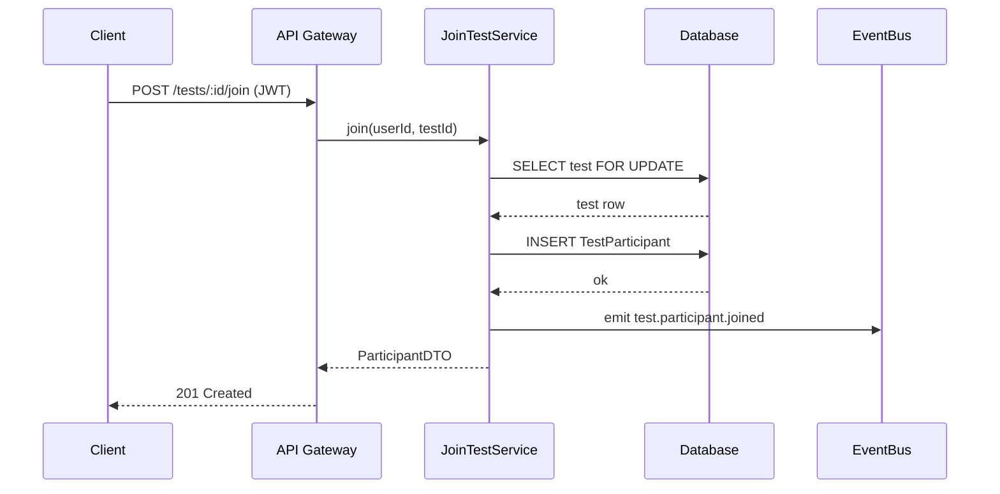

# Generate HLD — Coding-Agent-Ready, Project-Grounded Feature Design

Produces a comprehensive High-Level Design document for a **single backend
feature**, grounded in the project's existing documentation (ERD, architecture,
API conventions, prior HLDs). The output is detailed enough that an autonomous
coding agent can implement the feature end-to-end without further design work.

> **Scope:** One feature at a time. For a full system or multi-feature initiative,
> break it down into features first, then run this skill per feature.

---

## Workflow

```
Phase 0: Discovery   →  Phase 1: Interview  →  Phase 2: Generate
(silent, automated)     (targeted gaps only)    (comprehensive HLD)
```

### Phase 0 — Discovery (always run first)

Before asking the user anything, use the **`discover-project-context`** skill
to gather project context. It will guide you to:

1. Locate the project root (`mkdocs.yml` or `docs/`)
2. Enumerate and categorize every markdown file in the project
3. Extract outlines from foundational docs (architecture, ERD, data-access,
   API conventions, existing HLDs)
4. Grep for any existing mentions of the feature you're designing
5. Read the foundational docs in the right order
6. Map the feature's data needs against the existing ERD
7. Synthesize an internal context bundle: reused entities, new entities, API
   conventions, format reference

When invoking discovery, pass the feature name as the topic to grep for.

> **If discovery returns an error** (no project root found), ask the user for
> the project root path before continuing.

### Phase 1 — Interview (only what's missing)

After discovery, you may already have most of what you need. Ask **only the
questions discovery didn't answer**, one at a time. Skip any section's
questions if context already covers them.

Question order: §1 → §2 → §3 → §5 (NFRs) → §9 (state) → §13 (flows).
Everything else is usually derivable from discovery + the above.

### Phase 2 — Generate

Write the full HLD per the structure below to:

```
<project_root>/docs/hld-design/<kebab-case-feature-name>.md
```

This matches the existing `docs/hld-design/` convention. Create the directory
if missing; if the file already exists, read it first and overwrite with the
updated version. **Do not modify `hld-implementation-plan.md`** or any other
file outside `docs/hld-design/`.

---

## HLD Document Structure

The output document **must** contain all sections below. Each is essential for
a coding agent to implement the feature without further questions.

---

### 1. Executive Summary

One paragraph: what the feature is, who uses it, why it exists, and what
implementing it will require at a glance.

### 2. Feature Overview

- Feature name and one-line summary
- Business goal (why this feature exists)
- Primary user(s) / actor(s)
- Success criteria (how we'll know the feature works)

### 3. Functional Requirements

Numbered list of must-haves: **FR-1**, **FR-2**, … Use precise verbs ("the
system must allow a User to …"). End with an explicit **Non-Goals** subsection
listing what is out of scope.

### 4. System Fit

_(Derived from discovery — `docs/architecture.md`.)_

- Which layer / service this feature lives in
- Which existing services it depends on (auth, notifications, etc.)
- What new services or modules it introduces (if any)
- Where it sits in the request flow

### 5. Non-Functional Requirements

**Ask if missing:** Expected load? Latency target? Availability SLA?
Compliance constraints?

- Latency: p50 / p99 targets
- Throughput / concurrency ceiling
- Availability SLA
- Consistency model (strong / eventual / read-your-writes)
- Security / compliance constraints

### 6. Actors & Consumers

| Actor / System  | Role                  | Interaction |
| --------------- | --------------------- | ----------- |
| (e.g.) User     | Initiates the feature | REST API    |
| (e.g.) Notifier | Downstream consumer   | Async event |

### 7. Data Model

> Source of truth is `docs/erd.md`. **Do not redefine existing entities** —
> reference them by name with a link to their ERD section.

**Reused entities** (table):

| Entity | ERD reference | Fields this feature reads/writes | Operations |
| ------ | ------------- | -------------------------------- | ---------- |
| User   | `erd.md#user` | `id`, `email`                    | read       |
| Test   | `erd.md#test` | `id`, `max_participants`         | read       |

**New entities** (fully specified, flagged as ERD additions):

> **ERD Addition Required:** Add the following entity to `docs/erd.md`.

```
TestParticipant
─────────────────
id              UUID            PK
test_id         UUID            FK → Test.id, indexed
user_id         UUID            FK → User.id, indexed
joined_at       timestamptz     not null, default now()
status          enum            (ACTIVE, WITHDRAWN, KICKED)

Constraints:
  - UNIQUE (test_id, user_id)
Indexes:
  - INDEX (test_id, status)
```

**Modified entities** (if any):

> **ERD Modification Required:** Add field `X` to existing entity `Y`.

**Data access pattern:** State which pattern from `docs/data-access-pattern.md`
this feature follows (e.g., "Repository pattern per the project convention").

### 8. State Machine

_Only if the feature is stateful._ Show valid transitions and explicitly
forbidden ones.

```
NOT_STARTED ──join──▶ JOINED ──submit──▶ SUBMITTED ──grade──▶ GRADED
     │                   │
     └───── (invalid: cannot submit before joining) ─────┘
```

### 9. Business Rules & Invariants

Numbered list. These are conditions that must **always** hold true. The coding
agent will translate each into a guard, validation, or constraint.

- **INV-1:** A User cannot join the same Test twice (DB unique constraint).
- **INV-2:** A Test cannot have more participants than its `max_participants`.
- **INV-3:** A User cannot submit after `Test.end_time`.

### 10. API Contract

> Follow the project's API conventions discovered in `docs/api-design.md` and
> `docs/api-design/<version>.md` — versioning style, error envelope, auth header.

For **every** endpoint, provide:

#### `POST /api/v1/tests/:testId/join`

- **Purpose:** A logged-in user joins a test.
- **Auth:** `Authorization: Bearer <jwt>` (per project convention)
- **Path params:** `testId` (UUID)
- **Request body:**
  ```json
  {}
  ```
- **Success response — `201 Created`:**
  ```json
  {
    "participantId": "uuid",
    "testId": "uuid",
    "joinedAt": "2026-01-15T10:30:00Z",
    "status": "ACTIVE"
  }
  ```
- **Error responses:**
  | Status | Error code | When |
  | ------ | ----------------------- | ----------------------------------- |
  | 400 | `INVALID_TEST_ID` | `testId` is not a valid UUID |
  | 401 | `UNAUTHENTICATED` | No / invalid JWT |
  | 404 | `TEST_NOT_FOUND` | No test with that id |
  | 409 | `ALREADY_JOINED` | User already joined this test |
  | 409 | `TEST_FULL` | `max_participants` reached |
  | 410 | `TEST_ENDED` | Test end_time has passed |
  | 500 | `INTERNAL_ERROR` | Unhandled server error |

Repeat the block above for every endpoint the feature exposes.

### 11. Validation Rules

For every input field: type, format, allowed range, whether required.

| Field    | Type | Required | Validation      |
| -------- | ---- | -------- | --------------- |
| `testId` | UUID | yes      | RFC 4122 format |

### 12. Authorization Rules

For every endpoint:

- Who can call it (role, ownership)
- Ownership / policy checks performed in service layer
- Side-channel concerns (e.g., "cannot leak existence of private tests to
  non-members — return 404, not 403")

### 13. Feature Flows

#### Happy path

Numbered, step-by-step, client → repository:

1. Client `POST /api/v1/tests/:testId/join` with JWT
2. Gateway validates JWT; injects `userId` into request context
3. Controller validates `testId` format
4. Service: `JoinTestService.join(userId, testId)`
5. Repository: fetch Test by id with row-level lock (`SELECT … FOR UPDATE`)
6. Service: assert `Test.status == OPEN` and `participant_count < max_participants`
7. Repository: insert TestParticipant in same transaction
8. Service: emit `test.participant.joined` event
9. Controller: return `201` with participant payload

Include a Mermaid sequence diagram:



#### Edge cases

Bullet list — each maps to a business rule or invariant from §9.

#### Failure scenarios

What happens when each external call fails (DB timeout, event bus down,
duplicate request mid-transaction). Map each to behavior + error code.

### 14. Module / Code Structure

Tell the coding agent **exactly** where each piece of code goes. Match the
project's existing layout.

```
src/
└── modules/
    └── join-test/
        ├── join-test.controller.ts    # HTTP layer
        ├── join-test.service.ts       # business logic
        ├── join-test.repository.ts    # DB queries
        ├── dto/
        │   ├── join-test.request.ts
        │   └── join-test.response.ts
        ├── events/
        │   └── participant-joined.event.ts
        └── join-test.module.ts        # DI wiring
```

For each file: one-line responsibility + the key exported symbols.

### 15. Layered Breakdown

**Controller:** parses request, calls service, formats response. No business
logic.

**Service:** orchestrates the feature. Owns transactions. Calls repository
and emits events. List its public methods with signatures.

**Repository:** SQL/ORM queries only. No business logic. List the queries.

Example:

```
JoinTestService:
  join(userId: UUID, testId: UUID): Promise<ParticipantDTO>
  leave(userId: UUID, testId: UUID): Promise<void>

JoinTestRepository:
  findTestForUpdate(testId: UUID, tx): Promise<Test | null>
  insertParticipant(p: NewParticipant, tx): Promise<Participant>
  countParticipants(testId: UUID, tx): Promise<number>
```

### 16. Transactions & Concurrency

- **Atomic units:** "reserve participant slot + insert participant" must be in
  one DB transaction.
- **Locking strategy:** row-level lock on `Test` row (`SELECT … FOR UPDATE`) to
  prevent overshooting `max_participants` under concurrent joins.
- **Idempotency:** repeated POSTs from the same user return the same
  participant record (or 409 ALREADY_JOINED — pick one and document).
- **Race conditions to defend against:** explicit list with mitigation per race.

### 17. Error Catalog

Consolidated table of every error this feature can return.

| Code              | HTTP | Message (user-facing)             | Logged at level |
| ----------------- | ---- | --------------------------------- | --------------- |
| `INVALID_TEST_ID` | 400  | Test id is malformed              | warn            |
| `UNAUTHENTICATED` | 401  | Authentication required           | info            |
| `TEST_NOT_FOUND`  | 404  | Test not found                    | info            |
| `ALREADY_JOINED`  | 409  | You have already joined this test | info            |
| `TEST_FULL`       | 409  | This test is full                 | info            |
| `TEST_ENDED`      | 410  | This test has ended               | info            |
| `INTERNAL_ERROR`  | 500  | Internal server error             | error           |

Wrap them in the project's standard error envelope (from `docs/api-design.md`).

### 18. Side Effects

- **Events emitted:** name, payload schema, when fired
- **Notifications sent:** channel, recipient, trigger
- **Background jobs scheduled:** job name, schedule, idempotency key
- **Analytics events:** event name + properties
- **Audit log entries:** what's written and when

### 19. Dependencies

Other modules or services this feature **calls**:

| Dependency      | Why                          | Failure behavior            |
| --------------- | ---------------------------- | --------------------------- |
| AuthService     | JWT validation               | 401 propagated              |
| NotificationSvc | Send join confirmation email | Best-effort; logged on fail |
| EventBus        | Publish join event           | Retry 3x then dead-letter   |

### 20. Observability

- **Logs:** what to log at each layer (controller, service, repository), with
  structured fields (`requestId`, `userId`, `testId`)
- **Metrics:** counters and histograms specific to this feature
  (`join_test_attempts_total`, `join_test_duration_seconds`)
- **Traces:** span names and the propagation chain
- **Dashboards / alerts:** what should be visible; what should page

### 21. Testing Strategy

- **Unit tests:** service-level for each business rule; one test per invariant
- **Integration tests:** controller → service → real DB; happy path + each
  error response
- **Concurrency tests:** N parallel joins against a near-full test, assert
  `max_participants` is never exceeded
- **Contract tests:** request/response shapes match this spec

### 22. Open Questions & Assumptions

> **Assumption:** … _(one per line for each assumption made)_
>
> **Open Question:** … _(decisions needing product/engineering input)_

### 23. Implementation Checklist

Sequential, copy-pasteable for the coding agent. Each item maps to a real
deliverable.

- [ ] Add `TestParticipant` entity to `docs/erd.md`
- [ ] Create migration `<timestamp>_create_test_participants.sql`
- [ ] Implement `JoinTestRepository` with methods from §15
- [ ] Implement `JoinTestService.join()` with logic from §13 happy path
- [ ] Implement `POST /api/v1/tests/:testId/join` controller
- [ ] Add request DTO validation per §11
- [ ] Wire authentication middleware per §12
- [ ] Wire `test.participant.joined` event per §18
- [ ] Add structured logging per §20
- [ ] Add metrics per §20
- [ ] Write unit tests per §21
- [ ] Write integration tests per §21
- [ ] Write concurrency test per §21
- [ ] Update OpenAPI/Swagger spec per §10

### 24. Follow-up LLDs (optional)

If any sub-component is complex enough to deserve its own focused design doc,
list it here and recommend running the `lld-workflow` skill on it. Otherwise,
this HLD is the complete design artifact.

---

## Output Format Rules

- File path: `<project_root>/docs/hld-design/<kebab-case-feature-name>.md`
- Title: `# HLD: <Feature Name>`
- Executive summary immediately under the title
- Every section as a `##` header
- Tables for actors, data model, API errors, validation, dependencies, error
  catalog, and implementation checklist
- Mermaid diagram in §13 (sequence or flow — whichever fits the feature)
- Assumptions and open questions as blockquotes
- Tone: precise, technical, no padding — prefer tables and bullets over prose
- Match the structural conventions of any existing HLD found in
  `docs/hld-design/` during discovery

---

## Companion skill

This skill delegates project context gathering to the
**`discover-project-context`** skill — make sure it's available in your
environment. Discovery runs first; HLD generation runs second.
