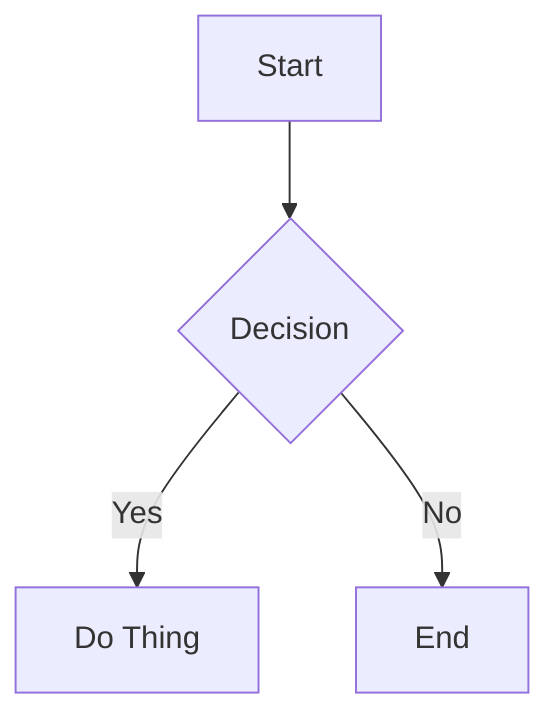

## Purpose

Convert a diagram image into a valid, renderable Mermaid diagram — and optionally
insert it into a file. This makes static diagrams editable, versionable, and
embeddable in docs.

---

## Invocation

```
image-to-mermaid <diagram_type> [options]
```

### Examples

```
image-to-mermaid flow
image-to-mermaid erd
image-to-mermaid class
image-to-mermaid flow file=README.md
image-to-mermaid class file=docs/architecture.md position=append
image-to-mermaid flow file=docs/overview.md position=section:Architecture
```

---

## Arguments

| Argument              | Required               | Values                                |
| --------------------- | ---------------------- | ------------------------------------- |
| `diagram_type`        | Yes                    | `flow`, `erd`, `class`                |
| `file=<path>`         | No                     | Path to target file for insertion     |
| `position=<strategy>` | No (default: `append`) | `append`, `replace`, `section:<name>` |

---

## Input

An image is required. If the user hasn't provided one, ask them to upload the
diagram before proceeding — don't try to generate from a description alone.

---

## Steps

### 1. Study the image before writing any code

Rushing into Mermaid syntax before fully understanding the diagram causes missed
connections and mislabelled nodes. Take a moment to:

- Identify every node/entity and copy its label exactly as shown (preserve casing and punctuation)
- Trace all edges/arrows, noting direction and any labels on the edges
- Note cardinality markers, multiplicity symbols, or annotations
- Identify any groupings, subgraphs, swimlanes, or containers
- Note visual emphasis (dashed borders, colours, bold lines) — represent these
  with Mermaid styling where it meaningfully reflects the original

For complex diagrams, mentally group the layout into sections before translating;
this prevents losing connections.

### 2. Choose the right Mermaid syntax

| `diagram_type` | Mermaid keyword | Use when                                                   |
| -------------- | --------------- | ---------------------------------------------------------- |
| `flow`         | `flowchart TD`  | Flowcharts, decision trees, pipelines, system architecture |
| `erd`          | `erDiagram`     | Database schemas, entity-relationship diagrams             |
| `class`        | `classDiagram`  | OOP class hierarchies, object models                       |

For flowcharts, pick direction based on the image's visual layout:

- Top-to-bottom image → `flowchart TD`
- Left-to-right image → `flowchart LR`

### 3. Translate faithfully

- Preserve original labels exactly — don't paraphrase or shorten
- Include all relationships shown; don't simplify
- Quote node labels containing spaces or special characters: `A["My Node"]`
- For ERDs, express cardinality correctly: `||--o{`, `}o--||`, `||--||`, etc.
- For class diagrams, include visibility markers (`+`, `-`, `#`) where visible

### 4. Validate before outputting

Do a quick mental check:

- Every node referenced in an edge is defined somewhere
- No duplicate node IDs
- Syntax is correct for the chosen diagram type
- The diagram would render without errors in a standard Mermaid renderer

---

## Output

### Mode 1 — No `file` argument (default)

Return **only** the Mermaid code block — no surrounding explanation, no prose
unless the user explicitly asks for it:



### Mode 2 — With `file=<path>` argument

Insert the generated Mermaid block into the specified file.

**Position strategies:**

| Strategy         | Behaviour                                                         |
| ---------------- | ----------------------------------------------------------------- |
| `append`         | Add the diagram at the end of the file (default if omitted)       |
| `replace`        | Replace the first existing ` ```mermaid ` block found in the file |
| `section:<name>` | Insert after the heading `## <name>` (or `# <name>`)              |

Steps:

1. Read the target file
2. Generate the Mermaid diagram
3. Apply the insertion strategy
4. Write the updated file
5. Confirm to the user — tell them exactly where the diagram was inserted and
   offer to adjust positioning or content

---

## Edge cases

**Blurry or unclear image** — Do your best, flag any labels you're uncertain
about, and ask the user to confirm those specific parts.

**Mixed diagram styles** (e.g. a flowchart with ER-style annotations) — Use the
requested `diagram_type`, adapt as closely as possible, and note any elements
that don't map cleanly to Mermaid's syntax.

**Large or complex diagrams** — Use `subgraph` blocks to group related nodes and
preserve readability. A diagram that's too flat is hard to follow.

**No image provided** — Ask the user to upload the diagram before proceeding.
