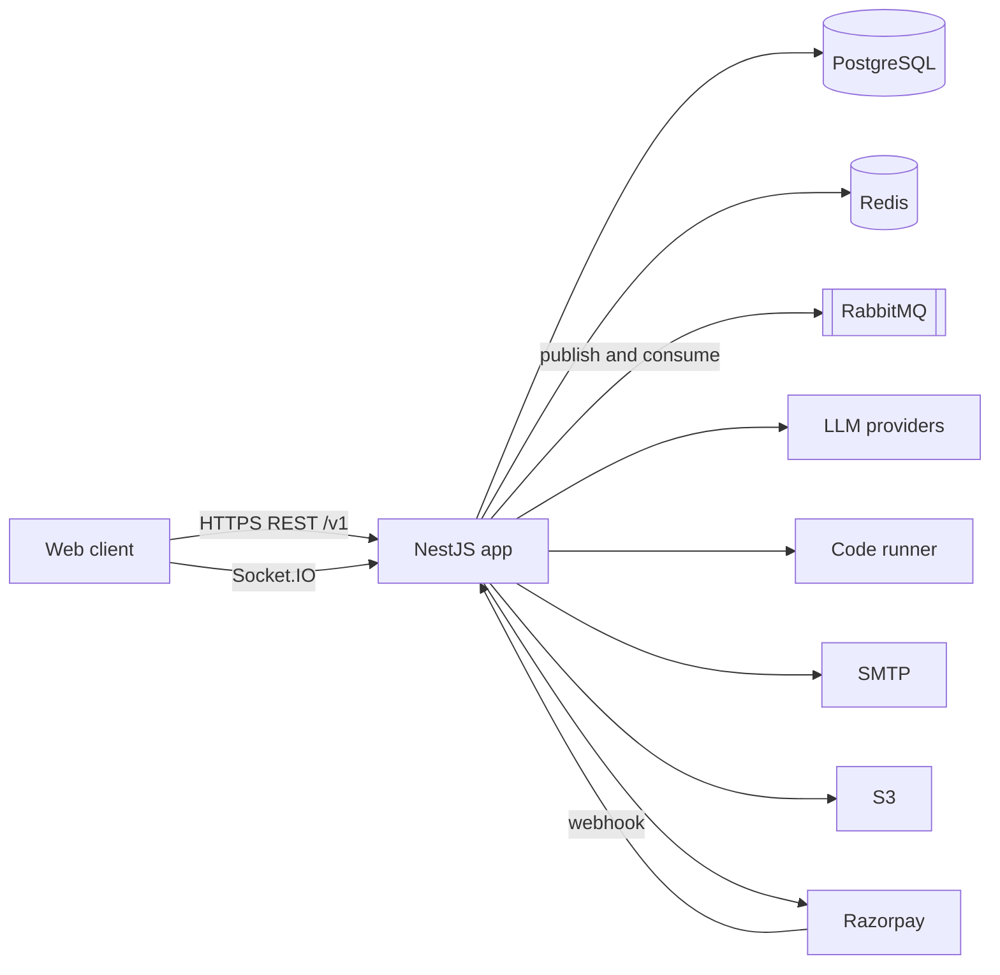
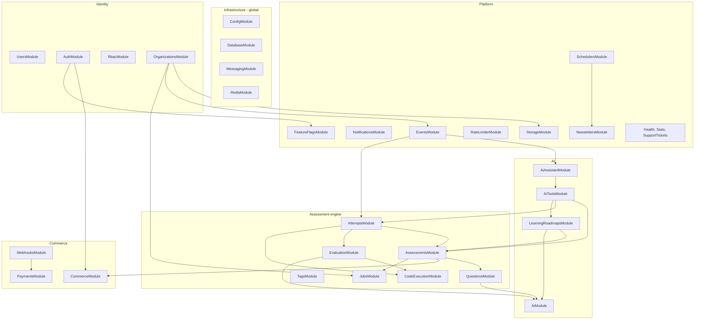
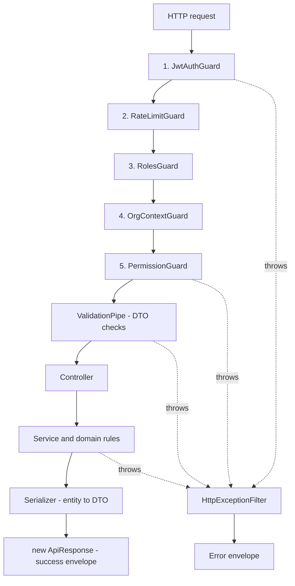
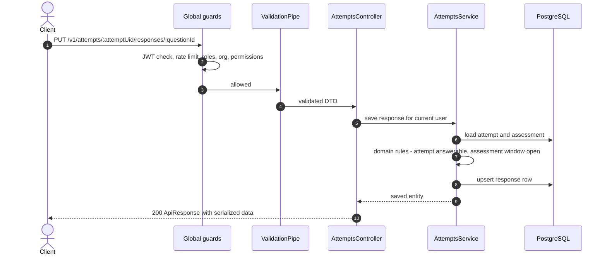
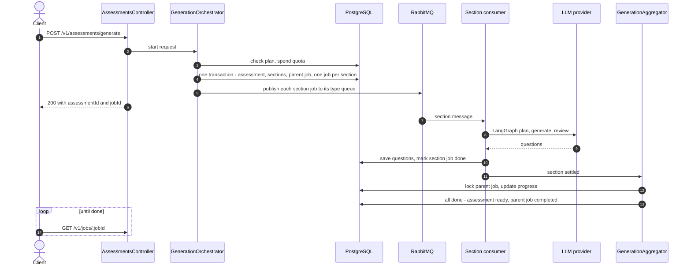
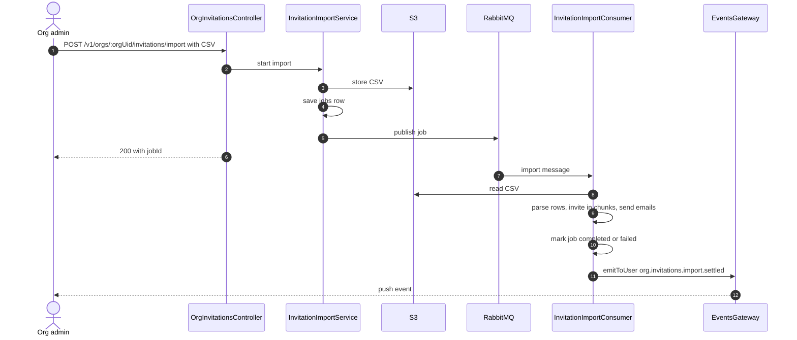

# Architecture

TestFlow's backend is a **modular monolith**: one NestJS app, one deployable, split into feature modules under `src/`. All modules share one PostgreSQL database. Slow work (LLM calls, grading, CSV imports) runs in the background through RabbitMQ, in the same codebase.

**Why a monolith?** The team is small, features touch each other a lot (assessments, attempts, AI, plans), and one deploy is simple. Module boundaries keep the code organized, and RabbitMQ lets slow work scale separately (see `CONSUMER` below) without splitting into microservices.



---

## 1. Module map

`src/app.module.ts` imports the modules below. Some modules are not imported there directly but come in through another module (shown in the "pulled in by" column).



| Module | Folder | Job | Pulled in by |
| --- | --- | --- | --- |
| `ConfigModule` | (Nest) | Loads `.env`, global. | `AppModule` |
| `DatabaseModule` | `src/config/database/` | TypeORM connection to Postgres; registers all entities; hosts the seeders. | `AppModule` |
| `MessagingModule` | `src/config/rabbitmq/` | Global RabbitMQ connection; declares exchanges and queues. | `AppModule` |
| `RedisModule` | `src/config/redis/` | Global Redis client for the read cache plus `RedisHelper`. | `AppModule` |
| `UsersModule` | `src/identity/users/` | User accounts, profile, admin user management. | `AppModule` |
| `AuthModule` | `src/identity/auth/` | Signup, login, Google sign-in, tokens, email verification, password reset, `GET /me`. | `AppModule` |
| `RbacModule` | `src/identity/rbac/` | Roles, permissions, `RolesGuard`, `PermissionGuard`, `AccessControlService`. | `AppModule` |
| `OrganizationsModule` | `src/organizations/` | Orgs, members, org invitations, CSV bulk import, `OrgContextGuard`. | `AppModule` |
| `AssessmentsModule` | `src/assessments/` | Assessments, sections, participants, invitations, templates, prompts, AI generation orchestration and consumers. | `AppModule` |
| `QuestionsModule` | `src/assessments/questions/` | Question bank and LLM question generation per type. | `AppModule` |
| `TagsModule` | `src/assessments/tags/` | Tags and admin tag management. | `AppModule` |
| `AttemptsModule` | `src/assessments/attempts/` | Attempts, responses, results, analytics, leaderboard, review, live code runs. | `AppModule` |
| `EvaluationModule` | `src/assessments/evaluation/` | Background scoring of attempts per question type. | `AttemptsModule` |
| `CodeExecutionModule` | `src/code-execution/` | Runs code on Piston or OnlineCompiler.io behind one `CodeRunner` interface. | `AttemptsModule`, `EvaluationModule` |
| `JobsModule` | `src/jobs/` | The `jobs` table: status, progress, retry, `GET /v1/jobs/:id`. | `AppModule` |
| `AiModule` | `src/ai/` | Chat model factory, model registry and selector, LangGraph graphs, prompts, LLM audit, conversations API. | Several modules |
| `AiToolsModule` | `src/ai/tools/` | Read-only tools the assistant can call (assessments, attempts, roadmaps, user). | `AppModule` |
| `AiAssistantModule` | `src/ai/assistant/` | The conversation assistant that answers chat messages using tools. | `EventsModule` |
| `LearningRoadmapsModule` | `src/learning-roadmaps/` | AI roadmaps, graph, progress, notes, node assessments, templates, roadmap consumers. | `AppModule` |
| `CommerceModule` | `src/commerce/` | Plans, plan versions, features, subscriptions, usage counters. | `AppModule` |
| `PaymentsModule` | `src/commerce/payments/` | Orders, payments, `RazorpayService`. | `AppModule` |
| `WebhooksModule` | `src/webhooks/` | Razorpay webhook endpoint with signature check and de-duplication. | `AppModule` |
| `EventsModule` | `src/events/` | Socket.IO gateway: auth on connect, user rooms, AI chat messages, code runs, server pushes. | `AppModule` |
| `NotificationsModule` | `src/notifications/` | `EmailService` (Nodemailer SMTP), templates, admin previews. | `AppModule` |
| `StorageModule` | `src/storage/` | S3 `putObject` / `getObject`. | `OrganizationsModule` |
| `RateLimiterModule` | `src/rate-limiter/` | Token-bucket rate limiting in Redis, `RateLimitGuard`. | `AppModule` |
| `FeatureFlagsModule` | `src/feature-flags/` | Flags turned on per role; admin API. | `AppModule` |
| `SchedulersModule` | `src/schedulers/` | All `@Cron` jobs live here (today: newsletter dispatch every minute). | `AppModule` |
| `NewslettersModule` | `src/newsletters/` | Newsletter admin and the dispatch service. | `AppModule` |
| `StatsModule` | `src/stats/` | Admin platform stats. | `AppModule` |
| `SupportTicketsModule` | `src/support-tickets/` | User support tickets and admin handling. | `AppModule` |
| `HealthModule` | `src/health/` | `GET /health`: checks database, Redis, RabbitMQ. | `AppModule` |

Routes are versioned in the controller path (`v1/...`). There is no global prefix. A few routes sit outside `v1`: `GET /ping`, `GET /health`, `POST /webhooks/razorpay`, and Swagger at `/api/docs`.

---

## 2. Request pipeline

Every HTTP request passes the same steps. Guards are registered with `APP_GUARD` in `src/app.module.ts`. The pipe and the filter are registered in `src/main.ts`.



!!! note "Order"
    In NestJS, guards run before pipes. So a request is authenticated and authorized first, and only then is its body validated.

### 2.1 Global guards, in order

| # | Guard | File | What it does | Controlled by |
| --- | --- | --- | --- | --- |
| 1 | `JwtAuthGuard` | `src/identity/auth/guards/jwt-auth.guard.ts` | Requires `Authorization: Bearer <access token>`. Verifies it with `JWT_ACCESS_SECRET`. Then loads the account and rejects it (401) if it was deleted, deactivated, or is unverified. Sets `request.user = { sub, email, username }`. | `@Public()` (`src/common/decorators/public.decorator.ts`) skips it. |
| 2 | `RateLimitGuard` | `src/rate-limiter/rate-limit.guard.ts` | Token bucket in Redis. Sets `X-RateLimit-Limit` and `X-RateLimit-Remaining`; on deny returns 429 with `Retry-After`. Skips non-HTTP contexts. Fails open if Redis is down. | `@RateLimit(policy, { scope?, cost? })`. Policies: `CLASS_A` 10 per 5 min by IP (auth), `CLASS_B` 30 per min by user (writes), `CLASS_C` 120 per min by user (reads). No decorator means no limit. |
| 3 | `RolesGuard` | `src/identity/rbac/guards/roles.guard.ts` | Checks the user has one of the listed **platform** roles. | `@Roles(...)`. No decorator means pass. |
| 4 | `OrgContextGuard` | `src/organizations/guards/org-context.guard.ts` | Finds the organization the request acts in and checks the user is an active member. Sets `request.org` (org id and the member's role). A non-member gets 404, so the org's existence is not leaked. | `@OrgScoped()` reads `:orgUid` from the path. `@OrgHeaderScoped()` reads the optional `x-organization-id` header; without it the request is "personal". |
| 5 | `PermissionGuard` | `src/identity/rbac/guards/permission.guard.ts` | Checks permissions. Inside an org, it checks the **member's org role**. Outside, it checks the user's platform roles. | `@Permissions(...)` (always) and `@OrgPermissions(...)` (only when `request.org` is set). |

Handy parameter decorators: `@CurrentUser()` (the JWT payload), `@CurrentOrg()` (org context, only on `@OrgScoped` routes), and `@OptionalOrg()` (org context or `null`).

!!! info "RabbitMQ consumers also pass through guards"
    `@golevelup/nestjs-rabbitmq` calls `@RabbitSubscribe` handlers through Nest's normal pipeline, so the global guards run for them too. That is why every consumer class is marked `@Public()`. Without it, `JwtAuthGuard` would look for an HTTP header that does not exist.

See [Auth](hld-design/auth.md), [RBAC](hld-design/rbac.md), [Organizations](hld-design/organizations.md), and [Platform Services](hld-design/platform-services.md) for details.

### 2.2 Validation

`src/main.ts` sets a global `ValidationPipe` with:

- `whitelist: true`: unknown fields are removed.
- `forbidNonWhitelisted: true`: unknown fields cause a 400 instead of being silently dropped.
- `transform: true`: query and path values are converted to the DTO types (for example, `"5"` to `5`).

DTOs use `class-validator` decorators. WebSocket messages use their own pipe (`src/events/pipes/ws-validation.pipe.ts`).

### 2.3 Responses: envelope and serializers

There is **no global interceptor**. Each controller builds its own response:

1. The service returns entities (or plain query rows).
2. The controller passes them through the module's serializer, for example `src/assessments/serializers/assessments.serializer.ts`. Each serializer extends `Serializer<TSource, TResponse>` from `src/common/serializers/serializer.ts` and copies **only** the fields the response DTO documents. This stops password hashes, joined relations, or soft-delete columns from leaking.
3. The controller returns `new ApiResponse(data, message, meta?)` from `src/common/api-response.ts`.

```json
{ "success": true, "message": "Assessment fetched", "data": { }, "meta": { } }
```

`meta` is optional (for example, paging info). `data` is never missing; `undefined` becomes `null`.

### 2.4 Errors

`HttpExceptionFilter` (`src/common/filters/http-exception.filter.ts`) is registered with `@Catch()`, so it catches **everything**:

- An `HttpException` keeps its status. Its message is used (arrays of validation messages are joined with `, `). Any extra fields on the exception body are spread into the response.
- A `DomainError` (see section 6) is mapped to HTTP first by `src/common/filters/domain-error.mapper.ts`: `invalid_transition` and `conflict` → 409, `rule_violation` → 400, `forbidden` → 403.
- Anything else becomes a 500 with `Internal server error`, and the stack is logged.

```json
{ "success": false, "message": "Missing permission: questions:create" }
```

There is no `error` key. Extra fields sit at the top level.

---

## 3. Infrastructure

### 3.1 PostgreSQL and TypeORM

| Item | Where | Notes |
| --- | --- | --- |
| App connection | `src/config/database/database.module.ts` | `TypeOrmModule.forRootAsync` with `ConfigService`. `synchronize: false`. Optional SSL via `DATABASE_SSL`. |
| CLI data source | `src/config/database/data-source.ts` | Used by migration scripts and standalone scripts. Reads `process.env` directly because it runs outside Nest. |
| Entities | `src/common/entities/` | All entities live here and are exported from `index.ts`. Each one must be listed in **both** files above. |
| Migrations | `src/migrations/` | The only way to change the schema. |
| Seeders | `src/seeders/` | Run by `npm run seed`. |

See [ERD](erd.md) and [Data Access Patterns](data-access-pattern.md).

### 3.2 Redis

Redis has two separate jobs, on two separate connections and logical DBs. Both **fail open**: if Redis is slow or down, the app keeps working.

| Use | Client | DB | What happens when Redis fails |
| --- | --- | --- | --- |
| Rate limiting | `REDIS_CLIENT` in `src/rate-limiter/redis.provider.ts` | `REDIS_DB` (0) | Requests are allowed. Timeout is 200 ms by default. |
| Read cache | `CACHE_REDIS_CLIENT` in `src/config/redis/redis.provider.ts`, used through `RedisHelper` (`src/common/helpers/redis.helper.ts`) | `REDIS_CACHE_DB` (1) | A read becomes a cache miss and goes to Postgres. Timeout is 500 ms by default. |

**What is cached** (keys are prefixed `cache:v1`, TTLs in `src/config/redis/cache-ttl.constants.ts`):

| Data | TTL | Why it is safe |
| --- | --- | --- |
| Results and analytics of an `evaluated` attempt | 1 hour | An evaluated attempt never changes again. |
| Question content during an attempt | 1 hour | Assessment questions are append-only. |
| AI assistant lists and details (assessments, attempts) | 60 seconds | Short TTL instead of explicit invalidation. |

The health check (`GET /health`) pings the rate-limit Redis client. Redis is **not** used for sessions, refresh tokens (those are in Postgres), or Socket.IO.

### 3.3 RabbitMQ

`MessagingModule` (`src/config/rabbitmq/rabbitmq.module.ts`) connects with `RABBITMQ_URL` and declares 4 **topic** exchanges and 12 queues. Names live in `src/config/rabbitmq/rabbitmq.constants.ts`. The `CONSUMER` env var decides whether this instance also runs the consumers (`registerHandlers`).

Every producer first saves a row in the `jobs` table, then publishes `{ jobId, ...payload }`. Because of this, `JobsService` can rebuild and republish any message on retry using the route table in `src/jobs/job-routes.ts`.

<a id="rabbitmq"></a>

| Exchange | Routing key | Queue | Producer | Consumer |
| --- | --- | --- | --- | --- |
| `question.generation` | `question.generate` | `question-generation-queue` | `AssessmentsService.generate` (legacy single-job generation, used by roadmap node assessments) | `QuestionGenerationConsumer` (`src/assessments/consumers/question-generation.consumer.ts`) |
| `question.generation` | `question.section.mcq` | `question-section-mcq-queue` | `GenerationOrchestratorService` (`src/assessments/generation/generation-orchestrator.service.ts`) | `McqSectionConsumer` (`src/assessments/generation/consumers/mcq-section.consumer.ts`) |
| `question.generation` | `question.section.coding` | `question-section-coding-queue` | `GenerationOrchestratorService` | `CodingSectionConsumer` |
| `question.generation` | `question.section.descriptive` | `question-section-descriptive-queue` | `GenerationOrchestratorService` | `DescriptiveSectionConsumer` |
| `attempt` | `attempt.evaluate` | `attempt-evaluation-queue` | `AttemptsService.submitAttempt` (`src/assessments/attempts/attempts.service.ts`) | `AttemptEvaluationConsumer` (`src/assessments/evaluation/consumers/`) |
| `attempt` | `attempt.evaluate.mcq` | `attempt-evaluation-mcq-queue` | `EvaluationOrchestratorService` (`src/assessments/evaluation/evaluation-orchestrator.service.ts`) | `McqEvaluationConsumer` |
| `attempt` | `attempt.evaluate.coding` | `attempt-evaluation-coding-queue` | `EvaluationOrchestratorService` | `CodingEvaluationConsumer` |
| `attempt` | `attempt.evaluate.descriptive` | `attempt-evaluation-descriptive-queue` | `EvaluationOrchestratorService` | `DescriptiveEvaluationConsumer` |
| `roadmap` | `roadmap.analyze` | `roadmap-analysis-queue` | `LearningRoadmapsService` (`src/learning-roadmaps/learning-roadmaps.service.ts`) | `RoadmapAnalysisConsumer` (`src/learning-roadmaps/consumers/`) |
| `roadmap` | `roadmap.generate` | `roadmap-generation-queue` | `LearningRoadmapsService` | `RoadmapGenerationConsumer` |
| `roadmap` | `roadmap.modify` | `roadmap-modification-queue` | `LearningRoadmapsService` | `RoadmapModificationConsumer` |
| `organization` | `organization.invitations.import` | `organization-invitation-import-queue` | `OrganizationInvitationImportService` (`src/organizations/services/organization-invitation-import.service.ts`) | `OrganizationInvitationImportConsumer` (`src/organizations/consumers/`) |

`JobsService.retry` (`src/jobs/jobs.service.ts`, behind `POST /v1/jobs/:id/retry`) can republish any of these.

**Why one queue per question type?** Coding work (writing test cases, running code) is much slower than MCQ work. Separate queues mean a slow coding section never blocks MCQs.

**Why save the job row first?** If publishing fails, the code marks the job `FAILED` right away and returns 503, so nothing is left "stuck" in a running state. The client can always read progress from `GET /v1/jobs/:id`.

### 3.4 Socket.IO gateway

`EventsGateway` (`src/events/events.gateway.ts`) listens on path `/socket.io`.

| Part | Behavior |
| --- | --- |
| Connect | The token comes from `handshake.auth.token`, the `token` query param, or an `Authorization: Bearer` header. It is verified with `JWT_ACCESS_SECRET`. A bad token gets an `exception` event and is disconnected. A good one joins the room for that user. |
| `ai.conversation.message` | Client → server chat message. The AI assistant answers and the reply returns on the same event. |
| `code.run` | Client → server "run my code" during an attempt. Results stream back to that socket only: `code.run.started`, `code.run.case` (per visible test case), then `code.run.completed` or `code.run.failed`. |
| Server push | `emitToUser(userId, event, data)` sends to every socket of the user. Today it is used for `org.invitations.import.settled` when a CSV import finishes. |
| Errors | `WsExceptionFilter` sends an `exception` frame and keeps the socket open. |

Connections are tracked in an in-memory map (`src/events/connection-manager.service.ts`). There is no Redis adapter, so a push only reaches sockets connected to the **same** instance. See [Realtime Events](hld-design/realtime-events.md).

### 3.5 External services

| Service | Used for | Code | Config |
| --- | --- | --- | --- |
| OpenAI, Anthropic, Google GenAI | Question generation, descriptive grading, roadmaps, AI assistant | `src/ai/llm/chat-model.factory.ts`, `src/ai/ai-model-registry.service.ts` | `ai_models` rows point at env vars such as `OPENAI_API_KEY` |
| Razorpay | Orders and payment webhooks | `src/commerce/payments/razorpay/razorpay.service.ts`, `src/webhooks/` | `RAZORPAY_*` |
| Piston (self-hosted) or OnlineCompiler.io | Running candidate code | `src/code-execution/runners/` chosen by `src/code-execution/code-execution.module.ts` | `CODE_RUNNER_PROVIDER`, `PISTON_*`, `ONLINE_COMPILER_*` |
| SMTP (Nodemailer) | Transactional email and newsletters | `src/notifications/email/email.service.ts` | `SMTP_*`, `EMAIL_FROM` |
| AWS S3 (or MinIO / LocalStack) | Uploaded invitation CSVs | `src/storage/storage.service.ts` | `AWS_*` |
| Google OAuth | Verifying Google ID tokens | `src/identity/auth/google/google-oauth.service.ts` | `GOOGLE_OAUTH2_CLIENT_ID` |

All LLM calls are recorded in the `llm_audit` table (`src/ai/llm-audit.service.ts`). See [AI Layer](hld-design/ai.md) and [Code Execution](hld-design/code-execution.md).

---

## 4. Sync vs async work

**Rule of thumb:** if a task calls an LLM, runs code, or loops over many rows, it goes to RabbitMQ. The HTTP request saves a `jobs` row, publishes a message, and returns fast. Everything else runs inside the request.

### 4.1 A typical sync request: save an answer



### 4.2 A typical async job: AI assessment generation



If any section fails, the aggregator fails the parent job and refunds the quota once. `POST /v1/assessments/:id/generation/retry` re-runs only the failed sections. Clients learn about progress by **polling** `GET /v1/jobs/:id`; there is no WebSocket push for generation today. See [AI Assessment Generation](hld-design/assessment-generation.md).

### 4.3 Async job with a WebSocket push: CSV invitation import



Whether the import succeeds or fails, the user gets the `org.invitations.import.settled` event with the job id and a summary (or the failure reason).

Other async flows follow the same shape: attempt evaluation (see [Evaluation](hld-design/evaluation.md)) and the three roadmap stages (see [Learning Roadmaps](hld-design/learning-roadmaps.md)).

### 4.4 Scheduled work

`SchedulersModule` (`src/schedulers/`) is the only place for `@Cron` handlers. Today there is one: `newsletter-dispatch`, every minute, turned off with `NEWSLETTER_SCHEDULER_ENABLED=false`. See [Jobs & Schedulers](hld-design/jobs-and-schedulers.md).

---

## 5. Folder structure

Each feature module follows the same shape. The `nestjs-folder-structure` skill has the full rules.

```text
src/<module>/
  <module>.module.ts
  <module>.controller.ts      # thin: validate, call service, serialize, wrap in ApiResponse
  <module>.service.ts         # business logic and DB access
  admin.controller.ts         # /v1/admin/... routes for platform admins (many modules)
  dto/                        # request and response DTOs (class-validator + Swagger)
  serializers/                # <module>.serializer.ts extends common Serializer
  domain/                     # pure rules and state transitions (where needed)
  consumers/                  # RabbitMQ consumers (where needed)
  interfaces/                 # TypeScript interfaces
```

| Folder | What lives there |
| --- | --- |
| `src/common/entities/` | **All** TypeORM entities, exported from `index.ts`. Entities do not extend a base class; each declares `id`, `createdAt`, `updatedAt`, and usually `deletedAt` inline. |
| `src/common/decorators/` | `@Public()`. |
| `src/common/filters/` | `HttpExceptionFilter` and the `DomainError` → HTTP mapper. |
| `src/common/domain/` | `DomainError` and transition-table helpers. |
| `src/common/dto/` | `PaginationDto` and `PaginatedResponseDto`. |
| `src/common/enums/` | Shared enums by area (assessments, commerce, identity, jobs, roadmaps, and more). |
| `src/common/helpers/` | `RedisHelper`, LIKE-escaping, question content helpers. |
| `src/common/serializers/` | The base `Serializer` class. |
| `src/common/` (root files) | `api-response.ts`, `db-errors.ts` (for example, unique-violation checks), `nano-id.ts` and `prefixed-id.ts` (public ids), `slugify.ts`. |
| `src/config/` | Database, RabbitMQ, and Redis setup. |
| `src/migrations/`, `src/seeders/`, `src/scripts/` | Schema changes, seed data, one-off CLI scripts. |

---

## 6. Cross-cutting conventions

These come from the code and the project skills in `.claude/skills/`. When a skill and general NestJS habits disagree, **the skill wins**.

| Topic | Convention | Skill |
| --- | --- | --- |
| Controllers | Thin. No `try/catch`. Call the service, serialize, return `ApiResponse`. | `nestjs-error-handling`, `api-response-format` |
| Business errors | Services throw Nest HTTP exceptions (`NotFoundException`, `ConflictException`, `ForbiddenException`, `UnprocessableEntityException`, `ServiceUnavailableException`, and so on). Pure `domain/` code throws `DomainError` and knows nothing about HTTP. | `nestjs-error-handling` |
| State machines | Status changes go through transition tables in `domain/` folders (for example, `src/assessments/domain/attempt-state.ts`). An illegal move throws `DomainError.invalidTransition`, which becomes 409. | - |
| Validation | `class-validator` on every DTO field, `@Type()` for query numbers, `PartialType` for updates. | `nestjs-validation` |
| Config | Always `ConfigService`, never `process.env`, except in `main.ts`, `data-source.ts`, RabbitMQ constants, and scripts. | `config-service-usage` |
| Entities | Explicit column `name` (snake_case) and `type`, `timestamptz` dates, named indexes, soft delete with `deletedAt`. Integer auto-increment ids; public ids use nanoid `uid` columns. | `typeorm-entity-patterns` |
| Migrations | Every schema change needs a migration. Never edit an applied one. | `typeorm-migrations` |
| Transactions | `dataSource.transaction(async (manager) => ...)` for multi-table writes. Use only `manager` inside the callback. Publish to RabbitMQ **after** the commit. | `nestjs-transactions` |
| Pagination | Cursor-based: `cursor` (last id) and `limit` (max 50, default 20). Response has `nextCursor` and `total`. | `nestjs-pagination` |
| Queries | Repository methods for simple reads, QueryBuilder for joins and filters. Avoid N+1 queries; select only needed columns. | `query-optimization` |
| Logging | One `new Logger(ClassName.name)` per class. No `console.*`. Log ids, not personal data. | `logging-conventions` |
| Swagger | Every route documents its envelope, errors, and auth. | `nestjs-swagger` |
| Tests | Jest. Unit tests in `tests/unit/<module>/` mirroring `src/`; e2e in `tests/`. | `jest-mock-patterns`, `test-naming-conventions`, `e2e-test-setup` |
| Types | No `any`. Use interfaces or DTOs. | - |

---

## 7. Security notes

| Topic | Current behavior | Where |
| --- | --- | --- |
| Authentication | Bearer JWT only, no cookies. Every non-public request re-checks that the account is still active and verified. Refresh tokens are stored as SHA-256 hashes in Postgres. | `jwt-auth.guard.ts`, `auth.service.ts` |
| CORS (HTTP) | `enableCors({ origin: true, credentials: true })`. This reflects **any** origin. Fine for development; tighten it for production. | `src/main.ts` |
| CORS (WebSocket) | `origin: '*'`. | `src/events/events.gateway.ts` |
| Raw body | The app is created with `rawBody: true`, so `req.rawBody` is available. The Razorpay webhook verifies `x-razorpay-signature` (HMAC) over the raw bytes, which is why the parsed JSON body is not enough. Webhook events are de-duplicated in `webhook_events`. | `src/main.ts`, `src/webhooks/` |
| Swagger | `/api/docs` is behind HTTP basic auth (`SWAGGER_USER` / `SWAGGER_PASS`). See the known issue below. | `src/main.ts` |
| Rate limiting | Auth routes use the strict IP-based `CLASS_A` policy. AI generation uses its own scope with a higher cost per call. | `src/rate-limiter/` |
| Validation | Unknown fields are rejected (`forbidNonWhitelisted`). | `src/main.ts` |
| Not used | No `helmet`. `passport` and `passport-jwt` are installed but not used; guards verify tokens with `JwtService` directly. | `package.json` |

!!! warning "Known issues to be aware of"
    - **Swagger basic auth may not block content.** When credentials are missing or wrong, the middleware in `src/main.ts` sets 401 and `WWW-Authenticate` but then calls `next()`, so Swagger still sends the page body. The JSON spec route (`/api/docs-json`) is also outside the protected `/api/docs` path prefix.
    - **WebSocket auth is lighter than HTTP auth.** The handshake only verifies the JWT signature (`src/events/events.service.ts`). It does not re-check that the account is still active, unlike `JwtAuthGuard`.
    - **Pushes are per instance.** With more than one instance, a `emitToUser` call from a consumer on instance A does not reach a socket held by instance B.

---

## 8. Related pages

- [Getting Started](getting-started.md): run it locally.
- [ERD](erd.md) and [Data Access Patterns](data-access-pattern.md): the data model.
- [API v1](api-design/v1.md): every endpoint.
- [Jobs & Schedulers](hld-design/jobs-and-schedulers.md): the `jobs` table and retries.
- [Realtime Events](hld-design/realtime-events.md): the socket protocol.
