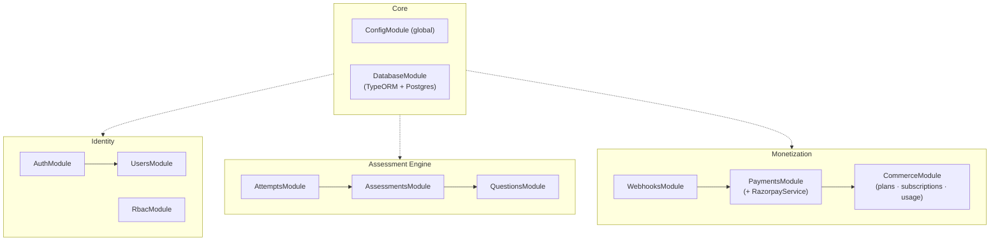
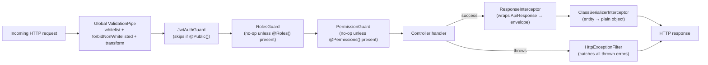
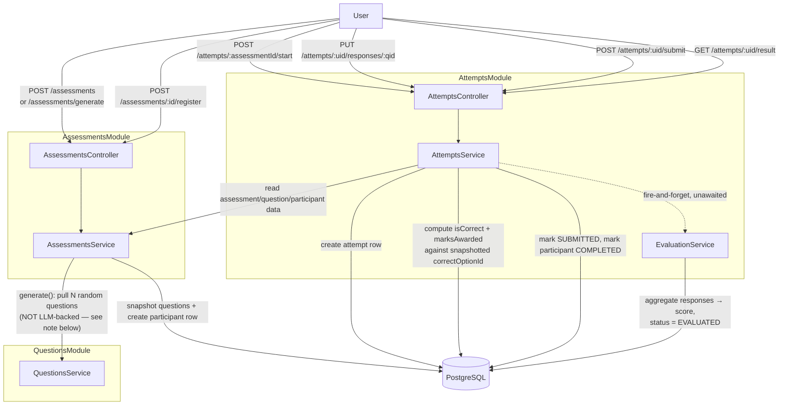
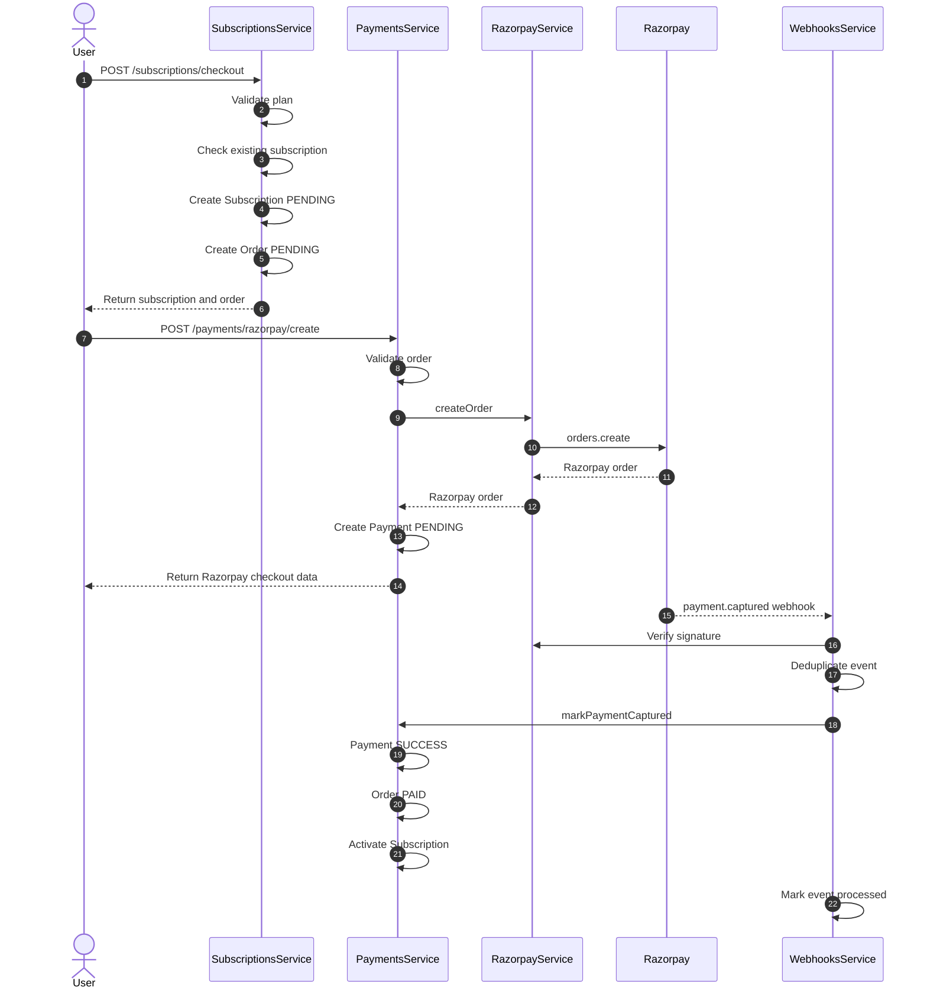

# Architecture

This page reflects the **actual implemented architecture** as of 2026-07-15 (verified directly against source, not aspirational design). Where the implementation diverges from what you might expect (e.g. no AI question generation yet, no Redis/OTP/OAuth), it is called out explicitly.

## 1. Module Map

`AppModule` wires together 10 feature modules plus `DatabaseModule` and a global `ConfigModule`:

**Import graph (who depends on whom):**

| Module              | Imports                                                                                                                                                         | Exports                                                                     |
| ------------------- | --------------------------------------------------------------------------------------------------------------------------------------------------------------- | --------------------------------------------------------------------------- |
| `AuthModule`        | `UsersModule`, `JwtModule.register({})`, `RefreshToken` repo                                                                                                    | `AuthService`, `JwtAuthGuard`, `JwtModule`                                  |
| `UsersModule`       | `User` repo, `RbacModule`                                                                                                                                       | `UsersService`                                                              |
| `RbacModule`        | `Role`/`Resource`/`RolePermission`/`UserRole` repos                                                                                                             | `AccessControlService`, `RolesGuard`, `PermissionGuard`, `UserRolesService` |
| `QuestionsModule`   | `Question` repo                                                                                                                                                 | `QuestionsService`                                                          |
| `AssessmentsModule` | `AuthModule`, `QuestionsModule`, assessment repos                                                                                                               | `AssessmentsService`                                                        |
| `AttemptsModule`    | `AuthModule`, `AssessmentsModule`, attempt repos                                                                                                                | `AttemptsService`                                                           |
| `CommerceModule`    | `Plan`/`PlanVersion`/`PlanVersionFeature`/`Subscription`/`UserFeatureUsage` repos (single flat module — plans/subscriptions/usage are folders, not sub-modules) | _(none)_                                                                    |
| `PaymentsModule`    | `Payment`/`Order` repos                                                                                                                                         | `PaymentsService`, `RazorpayService`                                        |
| `WebhooksModule`    | `WebhookEvent` repo, `PaymentsModule`                                                                                                                           | _(none)_                                                                    |

`CommerceModule` and `PaymentsModule` are not linked by a NestJS `imports`/`exports` relationship — `PaymentsService` reaches directly into the `Subscription` entity (cross-module entity import) to flip subscription status on payment capture. This is a known, explicitly TODO-flagged shortcut — see [Commerce & Payments HLD](hld-design/commerce.md#cross-module-coupling).

## 2. Request Pipeline

Every request passes through the same pipeline, wired partly in `app.module.ts` (guards) and partly imperatively in `main.ts` (filters/interceptors/validation) — the filter/interceptor wiring is **not** done via `APP_FILTER`/`APP_INTERCEPTOR` DI tokens, so it won't show up in the Nest module graph.

**Guard chain detail** — all three guards are registered globally via `APP_GUARD` in `app.module.ts`, in this order:

1. **`JwtAuthGuard`** — reads `IS_PUBLIC_KEY` metadata (`@Public()` decorator); if absent, requires a valid `Authorization: Bearer <token>` verified against `JWT_ACCESS_SECRET`, and attaches `request.user = { sub, email, username }`.
2. **`RolesGuard`** — reads `@Roles()` metadata; currently unused by any controller in the codebase (present but a no-op pass-through everywhere today).
3. **`PermissionGuard`** — reads `@Permissions()` metadata (e.g. `'questions:create'`); checks `AccessControlService.userHasPermission(userId, permission)`, which allows if the user's role has that exact resource key **or** the wildcard `*:*` resource.

Only the `questions`, `rbac`, and `users` (role-assignment) controllers actually apply `@Permissions()`. `assessments` and `attempts` controllers rely on `JwtAuthGuard` alone plus service-level ownership checks (e.g. `assessment.createdBy === userId`).

## 3. Response Envelope

The response envelope actually implemented differs from earlier drafts of this doc — see `src/common/interceptors/response.interceptor.ts` and `src/common/filters/http-exception.filter.ts` for ground truth. Full shape is documented in [API Design](api-design/v1.md#response-format).

Success: `{ success: true, message: string, data: T, meta?: object }` — no `error` key exists anywhere in the codebase.
Error: `{ success: false, message: string, ...extraFields }` — extra fields are spread flat, not nested under `error`.

## 4. Assessment Engine Flow

The core product flow: create/generate an assessment → a user registers as a participant → starts an attempt → answers questions → submits → gets an async-evaluated result.

**Important implementation notes:**

- **"Generate" is not AI-powered today.** `POST /assessments/generate` is documented/named as AI-powered question generation, but `AssessmentsService.generate()` actually calls `QuestionsService.findRandom(n)` — a plain `ORDER BY RANDOM() LIMIT n` pull from the existing question bank. An unused scaffold exists at `src/ai/interfaces/generated-question.interface.ts` (`GeneratedQuestion`/`GeneratedQuestionOption`) with zero consumers anywhere in the codebase — it appears to be prepared for a future LLM integration that hasn't been wired up yet.
- **Scoring happens at answer-time, not submit-time.** `AttemptsService.upsertResponse()` computes `isCorrect` and `marksAwarded` (including negative marking) the moment a response is saved, using the per-question `correctMarks`/`incorrectMarks` snapshotted onto `AssessmentQuestion` when questions were added to the assessment. `EvaluationService.evaluate()` only aggregates already-computed response rows into the attempt-level `score`/`attemptedQuestions`/`correctResponses`/`incorrectResponses` and flips status to `EVALUATED`.
- **Evaluation is asynchronous and unawaited.** `submitAttempt()` returns `true` to the client immediately after flipping status to `SUBMITTED`; `EvaluationService.evaluate()` runs afterward without being awaited. There is a narrow window where `GET /attempts/:uid/result` returns 400 (`"Attempt has not been evaluated yet"`) right after submit.
- **Legacy/dead code**: `src/assessments/dto/attempt-response.dto.ts`, `get-my-attempts-query.dto.ts`, `submit-response.dto.ts`, and `src/assessments/enums/attempt-status.enum.ts` are unused duplicates of the real files in `src/attempts/*` — left over from before the attempt/submission flow was extracted into its own module. `AttemptsModule` is the sole owner of the attempt/submission/evaluation flow today.

## 5. Commerce & Payments Flow

Checkout, payment, and webhook-driven fulfillment span three modules and are **not** wired through an event bus — fulfillment is a direct, synchronous cross-module call.

See [Commerce, Payments & Webhooks HLD](hld-design/commerce.md) for the full endpoint/entity/edge-case breakdown, including gaps (payment failure doesn't cascade to Order/Subscription status, `AI_CREDITS` order fulfillment has no handler yet, no renewal/cancellation/expiry logic exists for `PAST_DUE`/`CANCELLED`/`EXPIRED` subscription states).

## 6. What's Deliberately Not in the Stack

To avoid re-introducing assumptions from earlier design drafts, note what is **not** present despite being referenced in older docs or `.env.example`:

| Not present               | Where it might be assumed to exist                                                                                                                      |
| ------------------------- | ------------------------------------------------------------------------------------------------------------------------------------------------------- |
| Redis                     | Auth token storage/OTP/lockout (older `auth.md` draft) — refresh tokens are actually DB-backed (`refresh_tokens` table, SHA-256 hash)                   |
| OTP module                | Pre-registration email verification (older `auth.md` draft) — signup has no verification step today                                                     |
| OAuth flow                | `oauth_provider`/`oauth_id` columns exist on `users` but no OAuth controller/service/strategy exists anywhere                                           |
| MailService / SMTP        | No email sending capability in the codebase at all                                                                                                      |
| `helmet`, `cookie-parser` | Not dependencies; CORS is wide-open (`origin: true, credentials: true`); auth is pure Bearer token, no cookies                                          |
| Passport strategies       | `passport`/`passport-jwt` are installed but unused — `JwtAuthGuard` hand-verifies tokens via `JwtService.verify()` directly                             |
| Stripe integration        | `PaymentProvider.STRIPE` exists as an enum value on `payments`/`orders` but there is no Stripe SDK dependency or service — only Razorpay is implemented |
| Redis/queue env vars      | `REDIS_HOST`, `REDIS_PORT`, `NODE_ENV`, `LOG_LEVEL` are declared in `.env.example` but never read anywhere in `src/`                                    |

## 7. Related Pages

- [ERD](erd.md) — full schema
- [API Design v1](api-design/v1.md) — full endpoint reference
- [Data Access Patterns](data-access-pattern.md) — query patterns per module
- [HLD — Authentication](hld-design/auth.md)
- [HLD — RBAC](hld-design/rbac.md)
- [HLD — Assessments, Attempts & Questions](hld-design/assessments.md)
- [HLD — Commerce, Payments & Webhooks](hld-design/commerce.md)
