# Complete Entity Relationship Diagram (ERD)

This page merges every domain diagram in [erd.md](erd.md) — Identity & RBAC, Assessment Engine, Content Library, Async Jobs, Commerce, Payments & Orders, and Support Tickets — into a single Mermaid `erDiagram`. Field definitions and notes are unchanged from the per-domain pages; only application-level links (no DB FK — e.g. `jobs.payload.{assessmentId,userId}`, `orders.resource_id`) are omitted from the relationship set but called out below the diagram.

```mermaid
erDiagram

    %% ===== 1. Identity & RBAC =====
    users {
        int id PK
        varchar full_name "200"
        varchar first_name "100"
        varchar last_name "100"
        varchar username "UNIQUE, 100"
        varchar email "UNIQUE, 255"
        varchar password "nullable — reserved for OAuth-only accounts, no OAuth flow implemented yet"
        varchar phone_number "UNIQUE, nullable, 20"
        boolean is_active "default true"
        boolean is_verified "default false"
        varchar oauth_provider "ENUM: google, github — nullable; column exists, no OAuth flow implemented"
        varchar oauth_id "nullable"
        timestamp created_at
        timestamp updated_at
        timestamp deleted_at
    }

    refresh_tokens {
        int id PK
        varchar token_hash "SHA-256 hex of raw JWT refresh token"
        int user_id FK "FK -> users.id, CASCADE"
        timestamp expires_at
        timestamp created_at
        timestamp deleted_at "soft delete on rotation/logout"
    }

    roles {
        int id PK
        varchar key "UNIQUE, 100 — e.g. super_admin"
        timestamp created_at
        timestamp updated_at
        timestamp deleted_at
    }

    resources {
        int id PK
        varchar key "UNIQUE, 100 — e.g. users:read, questions:create, *:* wildcard"
        timestamp created_at
        timestamp updated_at
        timestamp deleted_at
    }

    role_permissions {
        int id PK
        int role_id FK "FK -> roles.id, CASCADE"
        int resource_id FK "FK -> resources.id, CASCADE"
        text description "nullable"
        timestamp created_at
        timestamp updated_at
        timestamp deleted_at
    }

    users_roles {
        int id PK
        int user_id FK "FK -> users.id, CASCADE"
        int role_id FK "FK -> roles.id, CASCADE"
        timestamp created_at
        timestamp updated_at
        timestamp deleted_at
    }

    %% ===== 2. Assessment Engine =====
    questions {
        int id PK
        text question_text
        jsonb options "array of {id, text}"
        int correct_option_id
        int created_by FK "FK -> users.id, CASCADE"
        timestamp created_at
        timestamp updated_at
        timestamp deleted_at
    }

    assessments {
        int id PK
        text description
        timestamp start_time
        timestamp end_time
        int duration "minutes, max 180"
        int max_participants
        int current_participants "default 0"
        int max_total_questions
        int curr_total_questions "default 0"
        decimal correct_marks "5,2"
        decimal incorrect_marks "5,2"
        varchar question_generation_status "ENUM: creating, submitted, in_progress, ready, failed — default creating"
        int created_by FK "FK -> users.id, CASCADE"
        timestamp created_at
        timestamp updated_at
        timestamp deleted_at
    }

    assessments_questions {
        int id PK
        int assessment_id FK "FK -> assessments.id, CASCADE"
        int question_id FK "FK -> questions.id, CASCADE"
        text question_text "snapshot at assignment time"
        jsonb options "snapshot"
        int correct_option_id "snapshot"
        decimal correct_marks "5,2 — per-question override"
        decimal incorrect_marks "5,2 — per-question override"
        int order_index
        timestamp created_at
    }

    assessments_participants {
        int id PK
        int user_id FK "FK -> users.id, CASCADE"
        int assessment_id FK "FK -> assessments.id, CASCADE"
        varchar status "ENUM: not_started, in_progress (unused), completed"
        timestamp completed_at "nullable"
        timestamp created_at
        timestamp updated_at
        timestamp deleted_at
    }

    assessment_attempts {
        int id PK
        uuid uid "generated, public attempt identifier used in all routes"
        int assessment_id FK "FK -> assessments.id, CASCADE"
        int user_id FK "FK -> users.id, CASCADE"
        timestamp started_at
        timestamp submitted_at "nullable"
        decimal score "8,2, nullable"
        int total_questions "snapshot of assessment.curr_total_questions at start"
        int attempted_questions "default 0"
        int correct_responses "default 0"
        int incorrect_responses "default 0"
        varchar status "ENUM: IN_PROGRESS, SUBMITTED, EVALUATED — default IN_PROGRESS"
        timestamp created_at
        timestamp updated_at
    }

    assessment_attempt_responses {
        int id PK
        int attempt_id FK "FK -> assessment_attempts.id, CASCADE"
        int assessment_question_id FK "FK -> assessments_questions.id, CASCADE"
        int selected_option_id
        boolean is_correct "computed at answer time"
        decimal marks_awarded "8,2 — computed at answer time, can be negative"
        timestamp answered_at "updated on every upsert"
    }

    %% ===== 3. Content Library — Tags & Assessment Prompts =====
    tags {
        int id PK
        varchar name "UNIQUE, 100"
        varchar slug "UNIQUE, 120"
        boolean is_active "default true"
        timestamp created_at
        timestamp deleted_at
    }

    assessment_prompts {
        int id PK
        varchar title "150"
        text description
        text prompt
        varchar visibility "ENUM: public, private — default private"
        varchar status "ENUM: draft, active, archived — default draft"
        int created_by FK "FK -> users.id, CASCADE"
        timestamp created_at
        timestamp updated_at
        timestamp deleted_at
    }

    assessment_prompt_tags {
        int id PK
        int assessment_prompt_id FK "FK -> assessment_prompts.id, CASCADE"
        int tag_id FK "FK -> tags.id, CASCADE"
        timestamp created_at
        timestamp deleted_at
    }

    %% ===== 4. Async Jobs =====
    jobs {
        bigint id PK "returned to clients as a string"
        varchar type "100 — ENUM-like, currently only CREATE_ASSESSMENT is issued"
        varchar queue "50 — plain string, e.g. 'assessment'"
        varchar status "ENUM: PENDING, PROCESSING, COMPLETED, FAILED, CANCELLED — default PENDING"
        jsonb payload "nullable — arbitrary job input, e.g. {assessmentId, userId, prompt, count}"
        jsonb result "nullable — set on completion"
        jsonb error "nullable — set on failure"
        int attempts "default 0"
        int max_attempts
        text status_description "nullable — human-readable progress message"
        timestamp created_at
        timestamp started_at "nullable"
        timestamp completed_at "nullable"
    }

    %% ===== 5. Commerce — Plans, Features, Subscriptions & Usage =====
    plans {
        int id PK
        varchar name "ENUM: FREE, PRO"
        varchar code "UNIQUE, 50 — generated 10-char code, e.g. 7K9XQPLM2R"
        text description
        boolean is_active "default true"
        timestamp created_at
        timestamp updated_at
        timestamp deleted_at
    }

    plan_versions {
        int id PK
        int plan_id FK "FK -> plans.id, CASCADE"
        int version
        decimal price "10,2"
        varchar currency "3"
        varchar billing_cycle "ENUM: MONTHLY, YEARLY"
        boolean is_current "default true"
        timestamp effective_from
        timestamp effective_until "nullable"
        timestamp created_at
        timestamp updated_at
        timestamp deleted_at
    }

    features {
        int id PK
        varchar key "UNIQUE, ENUM — currently only AI_ASSESSMENT"
        varchar display_name "150"
        text description "nullable"
        timestamp created_at
        timestamp updated_at
        timestamp deleted_at
    }

    plan_features {
        int id PK
        int plan_version_id FK "FK -> plan_versions.id, CASCADE"
        int feature_id FK "FK -> features.id, CASCADE"
        varchar display_name "150 — per-plan-version override of features.display_name"
        text description "nullable"
        varchar feature_value "255 — quota, parsed as a number; non-numeric = unlimited"
        int reset_period "nullable, days — null = never resets"
        timestamp created_at
        timestamp updated_at
        timestamp deleted_at
    }

    subscriptions {
        int id PK
        int user_id FK "FK -> users.id, CASCADE"
        int plan_version_id FK "FK -> plan_versions.id, CASCADE — no direct FK to plans"
        varchar status "ENUM: PENDING, ACTIVE, PAST_DUE, CANCELLED, EXPIRED, SUSPENDED"
        timestamp starts_at
        timestamp expires_at
        timestamp cancelled_at "nullable"
        boolean auto_renew "default true"
        timestamp created_at
        timestamp updated_at
        timestamp deleted_at
    }

    user_feature_usage {
        int id PK
        int user_id FK "FK -> users.id, CASCADE"
        int plan_feature_id FK "FK -> plan_features.id, CASCADE"
        int used "default 0"
        date period_start
        date period_end
        timestamp created_at
        timestamp updated_at
        timestamp deleted_at
    }

    %% ===== 6. Payments & Orders =====
    orders {
        int id PK
        int user_id FK "FK -> users.id, CASCADE"
        varchar resource_type "ENUM: SUBSCRIPTION, AI_CREDITS"
        int resource_id "polymorphic — no DB FK; points at subscriptions.id when resource_type=SUBSCRIPTION"
        decimal total_amount "10,2"
        varchar currency "3"
        varchar provider "ENUM: STRIPE, RAZORPAY — only RAZORPAY implemented"
        varchar provider_order_id "UNIQUE"
        varchar status "ENUM: PENDING, PAID, FAILED, FULFILLED"
        jsonb metadata "nullable"
        timestamp expires_at "payment window expiry"
        timestamp created_at
        timestamp updated_at
    }

    payments {
        int id PK
        int order_id FK "FK -> orders.id, CASCADE"
        decimal amount "10,2"
        varchar currency "3"
        varchar provider "ENUM: STRIPE, RAZORPAY"
        varchar provider_order_id "nullable, partial UNIQUE where not null"
        varchar provider_payment_id "nullable, partial UNIQUE where not null"
        varchar status "ENUM: PENDING, SUCCESS, FAILED, REFUNDED"
        text failure_reason "nullable"
        timestamp paid_at "nullable"
        timestamp created_at
        timestamp updated_at
    }

    webhook_events {
        int id PK
        varchar provider "50 — plain string, e.g. RAZORPAY, not an enum type"
        varchar event_id "UNIQUE, 255 — composite key: '{event}:{razorpayPaymentId}'"
        varchar event_type "100 — e.g. payment.captured, payment.failed"
        jsonb payload "full raw webhook body"
        boolean processed "default false"
        timestamp processed_at "nullable"
        timestamp created_at
    }

    %% ===== 7. Support Tickets =====
    support_tickets {
        int id PK
        int user_id FK "FK -> users.id, CASCADE"
        varchar topic "ENUM: BILLING, TECHNICAL, ACCOUNT, ASSESSMENT, OTHER"
        text query
        varchar status "ENUM: OPEN, IN_PROGRESS, RESOLVED, CLOSED — default OPEN"
        timestamp created_at
        timestamp updated_at
        timestamp deleted_at
    }

    %% ===== Relationships =====

    %% Identity & RBAC
    users ||--o{ refresh_tokens : issues
    users ||--o{ users_roles : has
    roles ||--o{ users_roles : assigned_to
    roles ||--o{ role_permissions : grants
    resources ||--o{ role_permissions : granted_via

    %% Assessment Engine
    users ||--o{ questions : creates
    users ||--o{ assessments : creates
    assessments ||--o{ assessments_questions : includes
    questions ||--o{ assessments_questions : mapped_in
    users ||--o{ assessments_participants : participates
    assessments ||--o{ assessments_participants : has
    users ||--o{ assessment_attempts : makes
    assessments ||--o{ assessment_attempts : attempted
    assessment_attempts ||--o{ assessment_attempt_responses : contains
    assessments_questions ||--o{ assessment_attempt_responses : answered_for

    %% Content Library
    users ||--o{ assessment_prompts : creates
    assessment_prompts ||--o{ assessment_prompt_tags : tagged_with
    tags ||--o{ assessment_prompt_tags : applied_to

    %% Commerce
    users ||--o{ subscriptions : purchases
    users ||--o{ user_feature_usage : consumes
    plans ||--o{ plan_versions : has_versions
    plan_versions ||--o{ plan_features : defines
    plan_versions ||--o{ subscriptions : "purchased as"
    features ||--o{ plan_features : cataloged_as
    plan_features ||--o{ user_feature_usage : tracked_by

    %% Payments & Orders
    users ||--o{ orders : places
    orders ||--o{ payments : "paid via"
    subscriptions ||--o| orders : "fulfilled by (application-level, no DB FK)"

    %% Support Tickets
    users ||--o{ support_tickets : files
```

**Entities with no DB-level FK relationships shown above:**

- `jobs` — standalone, append-only work-queue table. Links to `assessments`/`users` exist only inside `payload` jsonb (`{assessmentId, userId, ...}`), with no DB constraint.
- `webhook_events` — standalone idempotency/audit log for provider webhooks; no FK to `orders` or `payments`.
- `orders.resource_id` — polymorphic pointer at `subscriptions.id` (today) with no DB FK, backed only by a non-unique index on `(resource_type, resource_id)`; drawn above as `subscriptions ||--o| orders` per the source note.

See [erd.md](erd.md) for the per-domain diagrams, field-level notes, and the full [cross-domain relationship summary](erd.md#8-full-cross-domain-relationship-summary).
