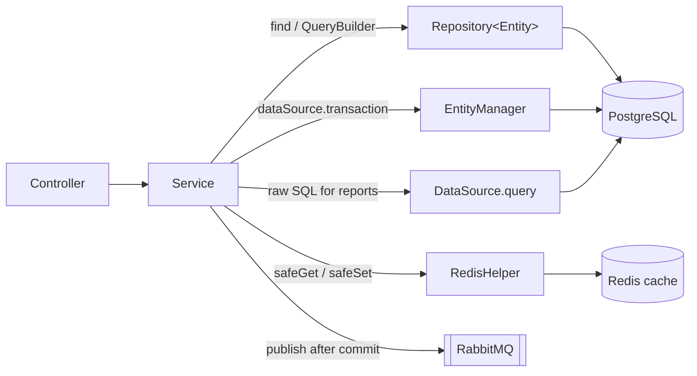
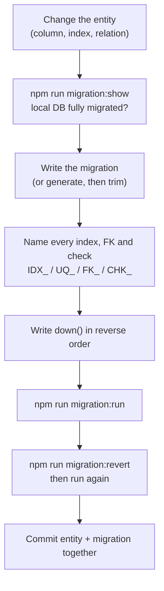

# Data Access Patterns

This page explains **how the code talks to the database**. The tables themselves are described in the [Data model (ERD)](erd.md).

The rules here come from two places: the project skills in `.claude/skills/` (`query-optimization`, `nestjs-transactions`, `nestjs-pagination`, `typeorm-entity-patterns`, `typeorm-migrations`) and what the code actually does today. Where the two differ, this page says so.

## The big picture



- **Services own the data.** Controllers never touch a repository. A service returns entities; the controller turns them into JSON with the module's serializer.
- **One module owns each table.** When another module needs that data, it calls the owning service. For example, `AttemptsService` calls `AssessmentsService.findOne()` instead of reading `assessments` itself.
- **Postgres is the source of truth.** Redis only holds short-lived copies of some reads.

## Entities and registration

All 44 entities live in `src/common/entities/` and are exported from `src/common/entities/index.ts`. A new entity must be added in **four** places:

1. `src/common/entities/index.ts` (export it).
2. The `entities` array in `src/config/database/database.module.ts` (used by the running app).
3. The `entities` array in `src/config/database/data-source.ts` (used by the TypeORM CLI for migrations).
4. `TypeOrmModule.forFeature([...])` in every module that injects its repository.

!!! warning "The skills show old paths"
    The `typeorm-entity-patterns` and `typeorm-migrations` skills mention `src/database/...`. The real files are `src/config/database/database.module.ts`, `src/config/database/data-source.ts` and `src/migrations/`.

`synchronize` is `false` in every environment. The schema only changes through migrations (see [Migrations](#migrations)).

## Repositories

TestFlow uses **TypeORM's built-in `Repository<T>`**. There are no custom repository classes. (The folder `src/assessments/repositories/` exists but is empty.)

| How | When | Example |
|---|---|---|
| `@InjectRepository(Entity) private readonly repo: Repository<Entity>` | Normal reads and single writes | `JobsService`, `TagsService`, `WebhooksService` |
| `this.dataSource.getRepository(Entity)` | A service that already holds `DataSource` and needs a quick read | `UsageService.consume()` reads `Feature` |
| `manager.find(Entity, ...)`, `manager.save(...)` | Inside a transaction | Every `dataSource.transaction(...)` callback |

Inject `DataSource` with no decorator. It is provided globally by `TypeOrmModule.forRootAsync()`.

## Reading data: find options, QueryBuilder or raw SQL

Pick the simplest tool that does the job:

| Need | Use | Real example |
|---|---|---|
| One row by id or a unique column | `repo.findOne({ where })`, then throw `NotFoundException` if null | `AttemptsService.resolveAttempt()` |
| A simple list with plain filters | `repo.find({ where, order, take })` | `JobsService.findSections()` |
| "Does it exist?" | `repo.exists()` or QueryBuilder `.getExists()` | `SubscriptionsService.checkout()` (already has an active plan?) |
| Joins with conditions, dynamic filters, sorting, paging, counts | `createQueryBuilder()` | `AssessmentsService.paginateList()`, `AccessControlService.userHasPermission()` |
| Window functions, CTEs, heavy reports | `dataSource.query(sql, params)` | Leaderboard ranking, attempt analytics, admin stats |

Raw SQL is used in only a few files: `src/assessments/attempts/leaderboard.service.ts`, `src/assessments/attempts/analytics.service.ts`, `src/stats/admin.service.ts`, `src/learning-roadmaps/learning-roadmap-assessment.service.ts`, `src/newsletters/newsletters-dispatch.service.ts` and the health check. Always pass values as `$1, $2` parameters, never by string building.

### Rules that keep queries fast

- **Never query inside a loop** (the "N+1" problem). Load related rows with `relations: { ... }` or `leftJoinAndSelect`, or fetch them all at once with `In([...ids])`.
- **Never use `eager: true`** on a relation. Load relations explicitly in the query that needs them.
- **Select only what a list needs.** Use `select: { ... }`. Large columns can be hidden by default: `learning_roadmaps.notepad` has `select: false`, so only the notepad endpoints load it.
- **Index what you filter or sort by**, and declare the index on the entity with a name such as `@Index('IDX_<table>_<column>')`.
- **Run independent reads in parallel** with `Promise.all`, as `AuthService.getMe()` and `LeaderboardService.getLeaderboard()` do.
- **Escape user text in `LIKE` searches** with `likeContains()` from `src/common/helpers/like.helper.ts`. It escapes `%`, `_` and `\`.
- **Turn `decimal` values into numbers.** The `pg` driver returns `decimal` columns as strings. Use `Number(row.score)` before doing maths.

## Writing data and transactions

A **transaction** groups several writes so they all succeed or all fail. TestFlow uses one pattern only: the callback form of `DataSource.transaction()`.

```ts
return this.dataSource.transaction(async (manager: EntityManager) => {
  const attempt = await manager.findOne(AssessmentAttempt, { where: { assessmentId, userId } });
  // ... more reads and writes, all through `manager`
});
```

If the callback throws, TypeORM rolls everything back. There is **no** `createQueryRunner()` / `startTransaction()` in application code; `QueryRunner` only appears inside migrations. A few services use `this.repo.manager.transaction(...)`, which is the same thing.

### Transaction rules (from the `nestjs-transactions` skill)

| Rule | Why |
|---|---|
| Use a transaction for two or more writes that must succeed together | A half-finished change leaves bad data |
| Inside the callback, use **only** `manager` | `this.someRepository` runs outside the transaction |
| Reads that decide a write also go through `manager` | So they see the same snapshot and hold the same locks |
| Let errors propagate. Do not catch inside the callback unless you rethrow. | The throw is what triggers the rollback. `NotFoundException` and friends work fine. |
| Do not nest transactions | One transaction per service call |
| Single writes and pure reads need no transaction | Extra cost for nothing |

### Sharing one transaction across services

When one service must write as part of another service's transaction, its method takes an **optional `manager`** argument. If a manager is passed, it joins that transaction; if not, it opens its own. Examples:

- `SubscriptionsService.createFreeSubscription(userId, manager)` is called inside `AuthService.verifyEmail()` and `UsageService.consume()`.
- `UsageService.release(..., manager?)` gives back a usage unit inside the caller's transaction, so the refund commits together with whatever caused it.
- `UsersService.markEmailVerified(userId, manager)`.

### Publish to RabbitMQ only after the commit

When a request creates a job, the job rows are written in a transaction first, and the message is published **after** the transaction commits. `GenerationOrchestratorService` does this: `createJobs()` runs in `dataSource.transaction`, then `publishSections()` runs. This way a worker never receives a message for a row that was rolled back. If the publish fails, the job row still exists and can be retried through `JobsService.retry()`, which republishes `{ jobId, ...payload }`.

Usage that is charged before such a transaction is given back with `UsageService.release()` if the transaction fails.

## Concurrency: locks and other guards

Several requests or workers can touch the same row at the same time. TestFlow uses these tools, from strongest to lightest:

### 1. Row locks (`pessimistic_write`)

`SELECT ... FOR UPDATE` locks a row until the transaction ends, so a second transaction waits. It is used where a read-then-write must not interleave:

| Where | Locked row | Why |
|---|---|---|
| `UsageService.consume()` and `release()` | The `user_feature_usage` row | Two generations must not both pass the quota check |
| `EvaluationOrchestratorService.claim()` | The `EVALUATE_ATTEMPT` job and the attempt | Only one worker may claim an evaluation |
| `EvaluationAggregatorService.onChildSettled()` | The parent job | Children finish in parallel; only one may close the parent |
| `GenerationAggregatorService` | The `GENERATE_ASSESSMENT` parent job | Same, for section generation |
| `GenerationOrchestratorService.reopen()` | The parent job | Two retry clicks must not both reopen it |

Pattern: `manager.createQueryBuilder(Job, 'job').setLock('pessimistic_write').where('job.id = :id', { id }).getOne()`, always inside `dataSource.transaction`.

### 2. `FOR UPDATE SKIP LOCKED` (work queue claim)

`NewslettersDispatchService.claimDueNewsletters()` moves due newsletters from `SCHEDULED` to `SENDING` in one `UPDATE ... WHERE id IN (SELECT ... FOR UPDATE SKIP LOCKED) RETURNING id`. Two app instances running the cron at the same time split the rows instead of sending the same newsletter twice.

### 3. Unique indexes as the final guard

Sometimes it is simpler to try the insert and let Postgres reject the duplicate:

| Case | Unique index | What the code does on a clash |
|---|---|---|
| Random short uid collides | `UQ_organizations_uid`, `UQ_assessment_templates_uid`, `UQ_learning_roadmap_templates_uid` | Retries with a new uid (`isUniqueViolation()` in `src/common/db-errors.ts`) |
| Two requests open the same AI conversation | `UQ_ai_conversations_context` | The loser re-reads and returns the winner's row (`AiConversationsService.getOrCreate()`) |
| Same generate request sent twice with an `Idempotency-Key` | `UQ_jobs_created_by_idempotency_key` | Returns the first request's result (`GenerationOrchestratorService`) |
| Same webhook delivered twice | `UQ_webhook_events_event_id` | Already processed, so ignored (`WebhooksService`) |
| One attempt per user per assessment | `UQ_assessment_attempts_user_assessment` | `startAttempt()` returns the existing attempt |

`isUniqueViolation(error, 'UQ_name')` checks Postgres error code `23505` and the constraint name, so you can react to one specific index.

### 4. Atomic counters

Counters are changed in SQL, not read-modify-write in JavaScript, so parallel updates do not lose each other:

- `manager.increment(Assessment, { id }, 'currentParticipants', delta)` for seats.
- `manager.increment(Assessment, { id }, 'currTotalQuestions', n)` when questions are written.
- `{ totalVerificationEmail: () => '"total_verification_email" + 1' }` in `UsersService`.
- `LearningRoadmapNode.positionIndex` is shifted with one `increment` during the two-phase reindex in `RoadmapGraphService`, so the unique `(learning_roadmap_id, position_index)` never clashes mid-update.

### 5. State checks in `domain/` files

Status changes go through small functions in each module's `domain/` folder (for example `claimEvaluation()`, `assertAnswerable()`, `reopenJob()` in `src/assessments/domain/` and `src/jobs/domain/`). They throw when a move is not allowed, such as answering a submitted attempt. Combined with a row lock, this stops two workers from moving the same row twice.

### Known gaps

- Saving an answer (`AttemptsService.upsertResponse()`) is find-then-insert with no unique index on `(attempt_id, assessment_question_id)`. Two parallel saves of the same question could create two rows.
- The usage lock only covers an existing `user_feature_usage` row. The very first consume for a feature inserts without a unique index to stop a twin row.

See [ERD → Known schema gaps](erd.md#known-schema-gaps).

## Pagination

Two styles exist side by side. **New list endpoints should use cursor pagination**, as the `nestjs-pagination` skill requires.

### Cursor (keyset) pagination: the standard

A **cursor** is the id of the last row the client saw. The next page asks for rows "after" that id. It stays fast on large tables because Postgres jumps straight to the cursor using the index, instead of counting past skipped rows.

- Query DTO: `PaginationDto` in `src/common/dto/pagination.dto.ts` (`cursor?: number`, `limit` 1 to 50, default 20). The skill says `cursor` is a UUID; the code uses an integer because every primary key is an `int`.
- Response: `PaginatedResponseDto<T>` in `src/common/dto/paginated-response.dto.ts`: `{ data, nextCursor, total }`. `nextCursor: null` means the last page.
- Recipe: order by the sort column plus `id` as a tie-breaker, fetch `limit + 1` rows, and if you got the extra row, drop it and return the last id as `nextCursor`. `total` is a separate count for display only.

Used by: user admin lists, organizations and members, assessment participants, learning roadmaps and roadmap templates, AI conversation messages, and the leaderboard. The leaderboard (`LeaderboardService.getLeaderboard()`) is a good model for a complex order: it keysets on `(score DESC, time_taken_ms ASC, id ASC)` in raw SQL.

### Offset pagination: older endpoints

`page` and `limit` with `qb.skip((page - 1) * limit).take(limit)` and `getManyAndCount()`. The response meta has `page`, `limit`, `total` and `totalPages`.

Still used by: assessment lists (`AssessmentsService.paginateList()`), my attempts, attempt review, tags, assessment prompts, assessment templates, question admin, plans, commerce admin, newsletters admin, AI admin and support tickets admin. These are fine for small, admin-sized tables. Do not copy this style into new user-facing lists.

Either way: an empty page is `data: []`, never a 404.

## Soft delete in practice

The tables that soft-delete are listed in the [ERD](erd.md#soft-delete).

| Task | How |
|---|---|
| Soft delete | `repo.softDelete({ id })` or `manager.softDelete(...)`. Do not set `deletedAt` by hand. |
| Normal reads | Nothing to do. `find*` and QueryBuilder add `deleted_at IS NULL` for you. |
| Read deleted rows too | `withDeleted: true`. Example: `AuthService.storeRefreshToken()` finds the user's soft-deleted token row and reuses it. |
| Raw SQL | Add `"deleted_at" IS NULL` yourself (the newsletter claim does). |
| Uniqueness | Use a partial unique index `WHERE deleted_at IS NULL`, so a deleted row does not block a new one. |

Many "removals" are status changes instead of deletes: a participant becomes `revoked`, an attempt becomes `rejected`, a member can be `suspended`. Tables without `deleted_at` (attempts, responses, jobs, audit rows, orders, payments) are either kept forever or hard-deleted.

## Caching in Redis

Redis caches a few expensive reads. Postgres stays the source of truth.

- **Helper:** `RedisHelper` in `src/common/helpers/redis.helper.ts`, with `safeGet<T>(key)` and `safeSet(key, value, ttlSeconds)`.
- **Fail-open:** if Redis is down, a read counts as a miss and a write is skipped. A Redis problem never fails a request.
- **Keys** are prefixed with `cache:v1:` (`src/config/redis/redis.constants.ts`). Each key also carries its own version, for example `attempts:result:v8:a<uid>:u<userId>`. When the cached shape changes, bump that version so old entries are never read.
- **TTLs** live in one place: `CACHE_TTL_SECONDS` in `src/config/redis/cache-ttl.constants.ts`. A TTL is required on every write.

### What is cached, and why it is safe

There is **no explicit invalidation**. Instead, each cached read is safe for one of two reasons:

| Read | Key (after `cache:v1:`) | TTL | Why it cannot go badly stale |
|---|---|---|---|
| Attempt result | `attempts:result:v8:a{uid}:u{user}` | 1 hour | Only cached once the attempt is evaluated or rejected, which are final |
| Attempt question list | `attempts:questions:v4:a{uid}:u{user}` | 1 hour | Only cached once the attempt is settled |
| One attempt question | `attempts:question:v3:a{uid}:q{id}:u{user}` | 1 hour | Question snapshots do not change after publish |
| Attempt analytics | `attempts:analytics:v2:a{uid}:u{user}:i{minutes}` | 1 hour | Settled attempts only |
| Assistant attempt detail | `attempts:assistant:detail:v2:a{uid}:u{user}` | 1 hour | Settled attempts only |
| Assistant attempt list | `attempts:assistant:list:v2:u{user}:l{limit}:s{status}` | 60 s | Short TTL: may include a live attempt |
| Assistant assessment list and detail | built in `AssessmentsService` | 60 s | Short TTL: counts may lag by up to a minute |

Rule of thumb: **cache only data that can no longer change, or accept a short, bounded staleness.** If you add a cache, put the TTL in `CACHE_TTL_SECONDS` with a comment that explains why it is safe.

Other Redis users have their own connections and are covered elsewhere: the rate limiter (`src/rate-limiter/`) and the health check. There is also one small in-memory cache: `AiModelRegistryService` keeps built chat-model clients in a `Map`.

## Migrations

A **migration** is a TypeScript file that changes the schema in a controlled, reversible way. Every schema change must have one. Never use `synchronize: true` and never run SQL by hand on a shared database.

### Where and how they are named

- Folder: `src/migrations/`.
- File name: `<YYYYMMDDHHmmss>-<kebab-description>.ts`, for example `20261026000000-add-registration-window-to-assessments.ts`. For several on the same day, bump the last digits (`...000001`, `...000002`).
- Class name: PascalCase description plus the same timestamp, for example `AddJobIdToAssessments20260902000001`.
- One logical change per file.

### Commands

| Command | What it does |
|---|---|
| `npm run migration:show` | Lists applied `[X]` and pending `[ ]` migrations. Run this first. |
| `npm run migration:run` | Applies pending migrations |
| `npm run migration:revert` | Rolls back the last applied migration |
| `npm run migration:generate -- src/migrations/<name>` | Writes a migration from the difference between the entities and your local database |
| `npm run migration:run:prod`, `migration:show:prod`, `migration:revert:prod` | Same, against the compiled `dist/` data source |

All of them use `src/config/database/data-source.ts`, which reads `DATABASE_*` from `.env`.

### Workflow for a schema change



### Rules

| Rule | Why |
|---|---|
| Every migration has a working `down()` that undoes `up()` in reverse order (drop FKs, then indexes, then the table) | So a bad deploy can be rolled back. If a change truly cannot be undone, `down()` throws with a clear message. |
| Name every constraint: `IDX_<table>_<col>`, `UQ_<table>_<cols>`, `FK_<table>_<col>`, `CHK_<table>_<rule>` | Readable errors, and the name must match the entity's `@Index('...')` |
| Never edit a migration that has already run on staging or production | Other databases already applied the old version. Write a new migration instead. |
| Data changes go in the migration: add the column as nullable, backfill with `UPDATE`, then make it `NOT NULL` | Existing rows must be valid. See the `20261014000006` to `20261014000011` series, which split MCQ data into `mcq_question_details` this way. |
| New "kinds" that will grow (question types, verdicts) can be `varchar` with a `CHECK`, not a Postgres enum | Adding a Postgres enum value needs an `ALTER TYPE` migration |
| New tables: `int` auto-increment `id`, `created_at` / `updated_at` with `now()` default, and `deleted_at` if the table soft-deletes | Matches every other table |
| Index every foreign key column | Joins and parent deletes stay fast |

!!! warning "Always review `migration:generate` output"
    Many existing foreign keys and unique constraints were created with readable names (`FK_assessments_created_by`) while the entities let TypeORM pick hashed names. So `migration:generate` produces dozens of `DROP CONSTRAINT` / `ADD CONSTRAINT` lines that change nothing. It also tries to drop things that exist only in migrations, such as `UQ_assessment_attempts_user_assessment` and two `CHECK` constraints. Keep only the lines for your change, or write the migration by hand with `queryRunner.addColumn`, `createIndex` and `createForeignKey`, as most existing migrations do. Full list: [ERD → Known schema gaps](erd.md#known-schema-gaps).

### Seeds

Reference data is filled by seeders in `src/seeders/` (roles, permissions, features, plans, feature flags, AI models), run with `npm run seed`. Templates have their own scripts: `npm run seed:assessment-templates` and `npm run seed:roadmap-templates`. The first super admin is created with `npm run bootstrap-admin`.

## Common questions → where the answer lives

| Question | Tables | Service method | How |
|---|---|---|---|
| Who is this user, and what plan and flags do they have? | `users`, `subscriptions`, `plan_versions`, `plans`, `feature_flags` | `AuthService.getMe()` | Four independent reads in `Promise.all` |
| Can this user do `questions:update`? | `users_roles`, `roles`, `role_permissions`, `permissions` | `AccessControlService.userHasPermission()` (called by `PermissionGuard`) | QueryBuilder join, `getCount() > 0`, exact key match |
| Can this org member do it? | `organization_members` → `role_permissions` | `AccessControlService.roleHasPermission()` | Same join, starting from the member's `role_id` |
| What is the user's org context for `/v1/orgs/:orgUid/...`? | `organizations`, `organization_members` | `OrganizationMembersService.resolveContext()` | One `findOne` on the user's `active` membership, joined to the organization by `uid`; a suspended org is refused |
| Which assessments can I see? | `assessments`, `assessments_participants` | `AssessmentsService.findAll()` → `paginateList()` | QueryBuilder, phase filters on the attempt window, offset paging |
| Is this assessment open to me? | `assessments`, `assessments_participants` | `AssessmentsService.findParticipantByAssessmentAndUser()` + `participantState()` | Rules in `src/assessments/domain/` |
| Start or resume my attempt | `assessment_attempts` | `AttemptsService.startAttempt()` | Transaction; returns the existing attempt (unique per user and assessment) |
| Save my answer | `assessment_attempt_responses` | `AttemptsService.upsertResponse()` | Transaction; find, then update or insert, reset to `pending` |
| Submit and grade | `assessment_attempts`, `jobs`, responses | `AttemptsService.submitAttempt()` → `EvaluationOrchestratorService` | Opens an `EVALUATE_ATTEMPT` job; workers lock and grade |
| My result | attempts, responses, `assessments_questions` | `AttemptsService.getAttemptResult()` | Cached in Redis once final |
| Leaderboard | `assessment_attempts`, `users` | `LeaderboardService.getLeaderboard()` | Raw SQL with ranking, keyset cursor, plus "my row" |
| Review or reject attempts (creator) | attempts, responses | `AttemptReviewService.listAttempts()`, `getResponses()`, `reject()` | Offset paging; reject in a transaction |
| Is generation done? | `jobs` | `JobsService.findOne()`, `findSections()` | Ownership checked against `payload.userId` |
| Do I have quota left? | `subscriptions`, `plan_features`, `user_feature_usage` | `UsageService.consume()`, `getSubscriptionUsage()` | Transaction with a row lock; resets the period when it has passed |
| What can my plan generate? | `plan_features` (`ALLOWED_QUESTION_TYPES`) | `SubscriptionsService.getAllowedQuestionTypes()` | Reads the enum feature value |
| Did the payment go through? | `payments`, `orders`, `subscriptions`, `webhook_events` | `WebhooksService` → `PaymentsService.markPaymentCaptured()` | Idempotent by `event_id`; one transaction |
| Show my roadmap graph | `learning_roadmaps`, nodes, edges | `LearningRoadmapsService.getGraph()` | Edges load by `roadmap_id` in one query |
| My roadmap list with progress | roadmaps, nodes | `LearningRoadmapsService.list()` | Cursor paging; one grouped count over all roadmaps on the page (never one count per roadmap), served by the `(learning_roadmap_id, status)` index |
| Chat history with the assistant | `ai_conversations`, `ai_conversation_messages` | `AiConversationsService.getMessagesPage()` | Cursor paging by message `id` (ids are unique and always increase, so a cursor never lands between two equal timestamps) |
| What did the LLM calls cost? | `llm_audit`, `ai_models` | `src/ai/admin.service.ts` | Admin reports over the append-only audit table |
| Is this feature flag on for me? | `feature_flags`, `feature_flag_roles`, `users_roles` | `FeatureFlagsService.enabledFor()` | Off, on for all, or on for listed roles |
| Platform numbers for admins | many | `src/stats/admin.service.ts` | Raw SQL aggregates |

## Checklist for new data code

- [ ] Reads use find options unless you need joins, paging or aggregates.
- [ ] No query inside a loop. No `eager` relations.
- [ ] Two or more writes are in one `dataSource.transaction`, using only `manager`.
- [ ] Read-then-write races are covered by a row lock or a unique index.
- [ ] New lists use cursor pagination with `PaginationDto` and `PaginatedResponseDto`.
- [ ] Raw SQL uses `$n` parameters and filters `deleted_at IS NULL`.
- [ ] Any cache has a TTL in `CACHE_TTL_SECONDS`, a versioned key, and a reason it is safe.
- [ ] Schema changes come with a named, reversible migration that was run and reverted locally.
