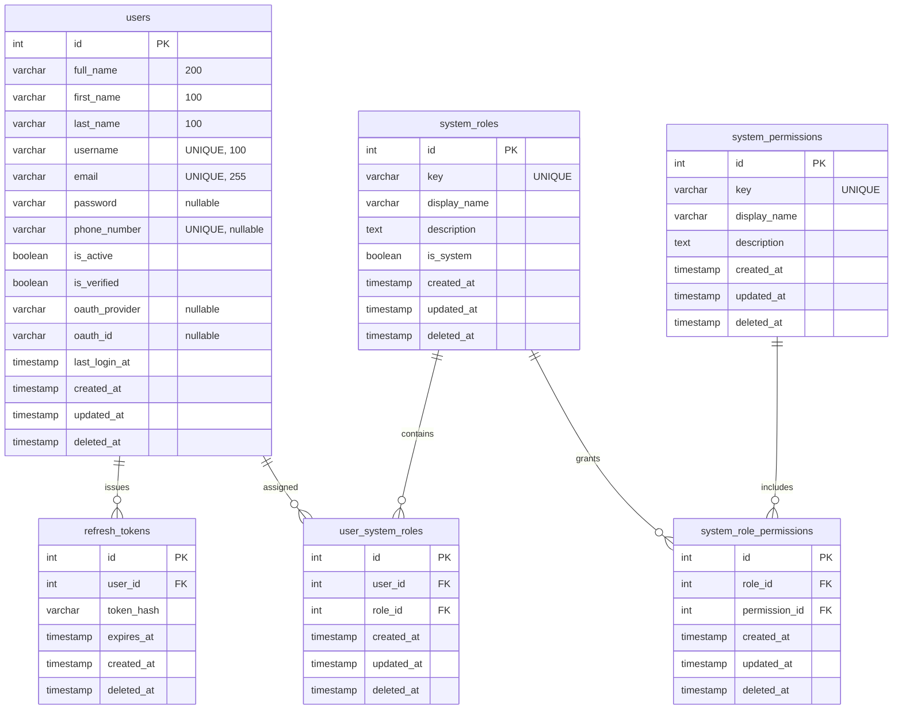
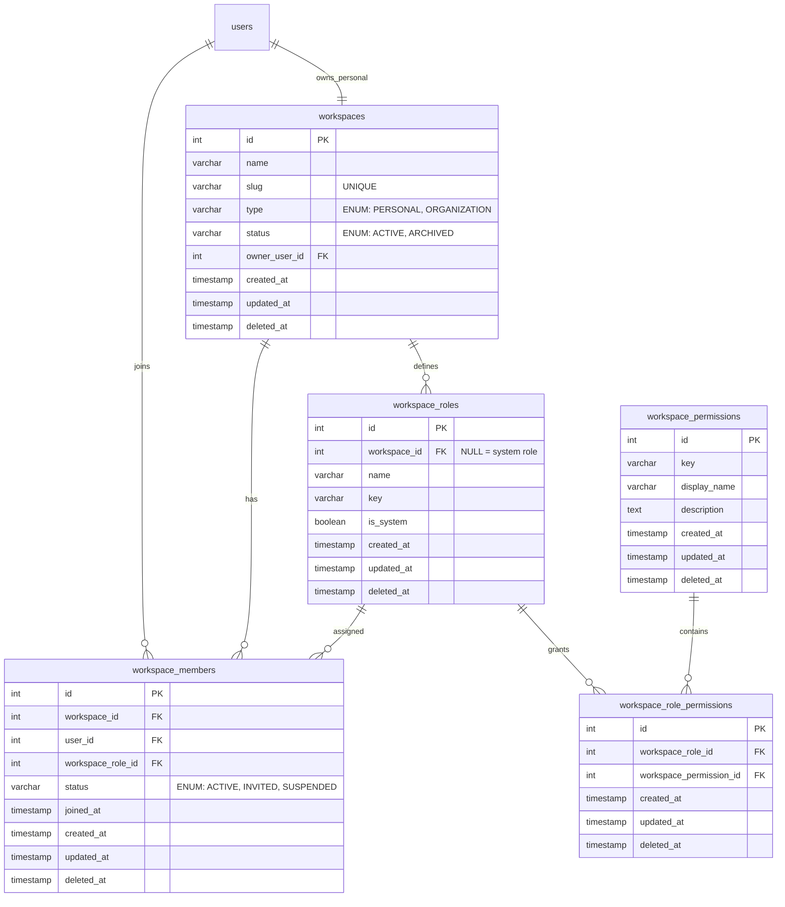
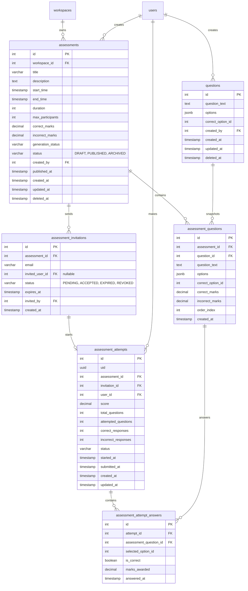
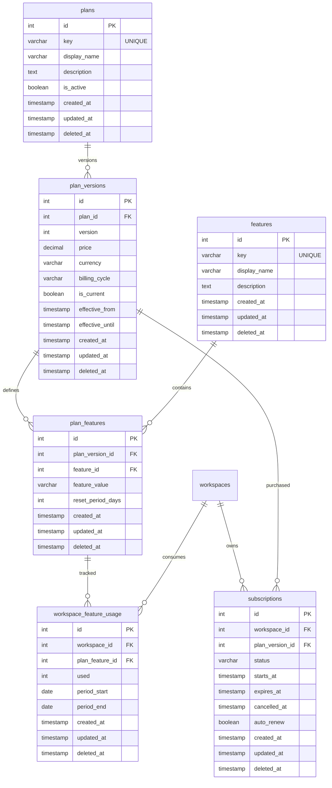
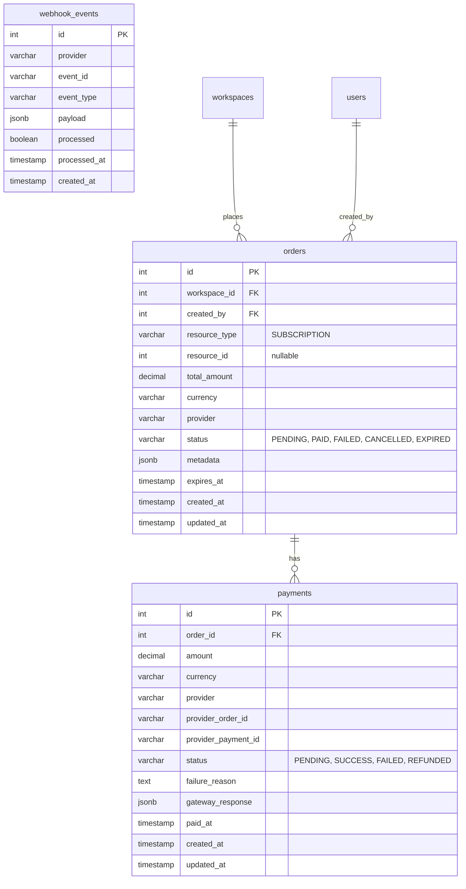
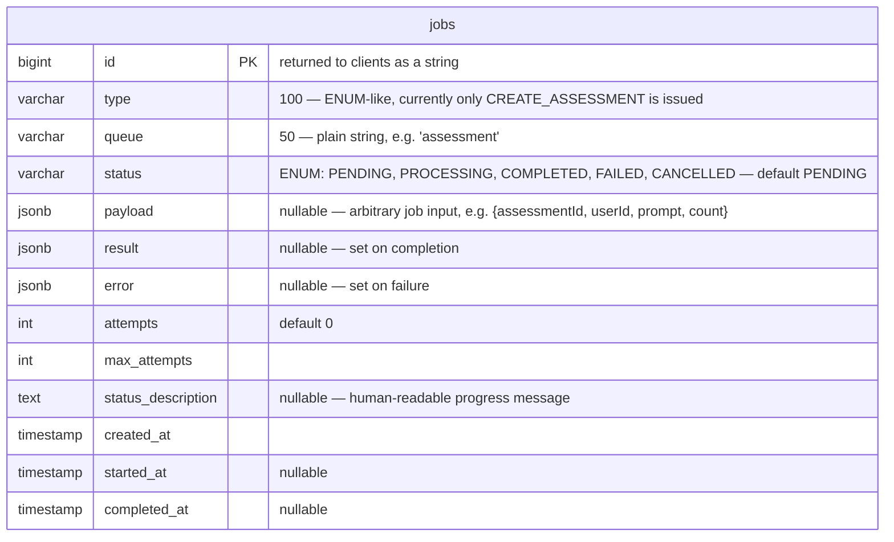

# Entity Relationship Diagram (ERD) — Workspace & Organisation Model

This is a **draft**, not the current implemented schema — see [erd.md](erd.md) for that. It sketches out a workspace/organization layer sitting between `users` and the rest of the schema: users would join one or more `workspaces`, hold a `workspace_role` scoped to that workspace, and workspaces — rather than individual users — would own assessments, subscriptions, and orders. System-level roles/permissions stay as a separate, workspace-independent tier for platform-wide access (e.g. super admins).

## 1. User Identity & System-Level Role Management

Core user accounts plus a global (non-workspace-scoped) role/permission system for platform-wide access control.

## 2. Workspace Management

Introduces the multi-tenant boundary itself: `workspaces` (personal or organization), membership, and a workspace-scoped role/permission system distinct from the system-level one above.

## 3. Assessment Engine

Same question/attempt lifecycle as the current schema, but reparented under `workspaces` — assessments belong to a workspace, and invitations replace direct participant assignment.

## 4. Commerce

Plans/features/subscriptions carried over from the current model, but subscription ownership and feature-usage tracking move from `users` to `workspaces`.

## 5. Payments & Orders

Orders move from user-owned to workspace-owned, with the acting user retained via `created_by` for audit purposes. Payments and webhook events are otherwise unchanged in shape from the current schema.

## 6. Async Jobs

Unchanged from the current schema — the async job queue has no ownership model to migrate, since it carries no FK relations today.

