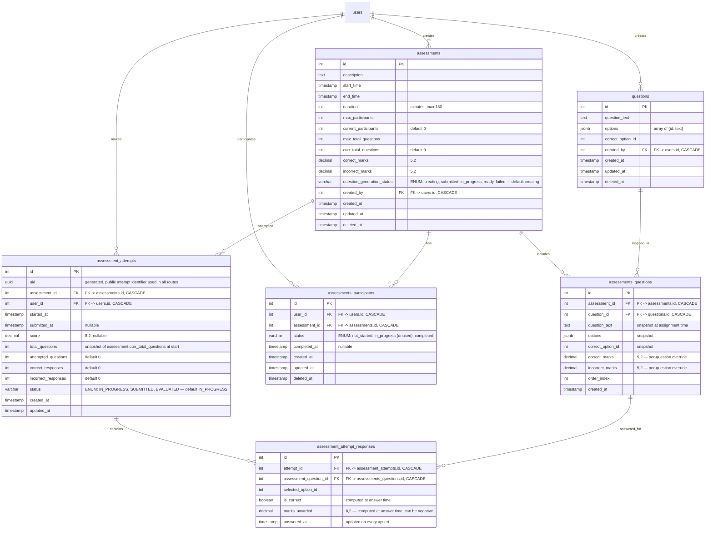
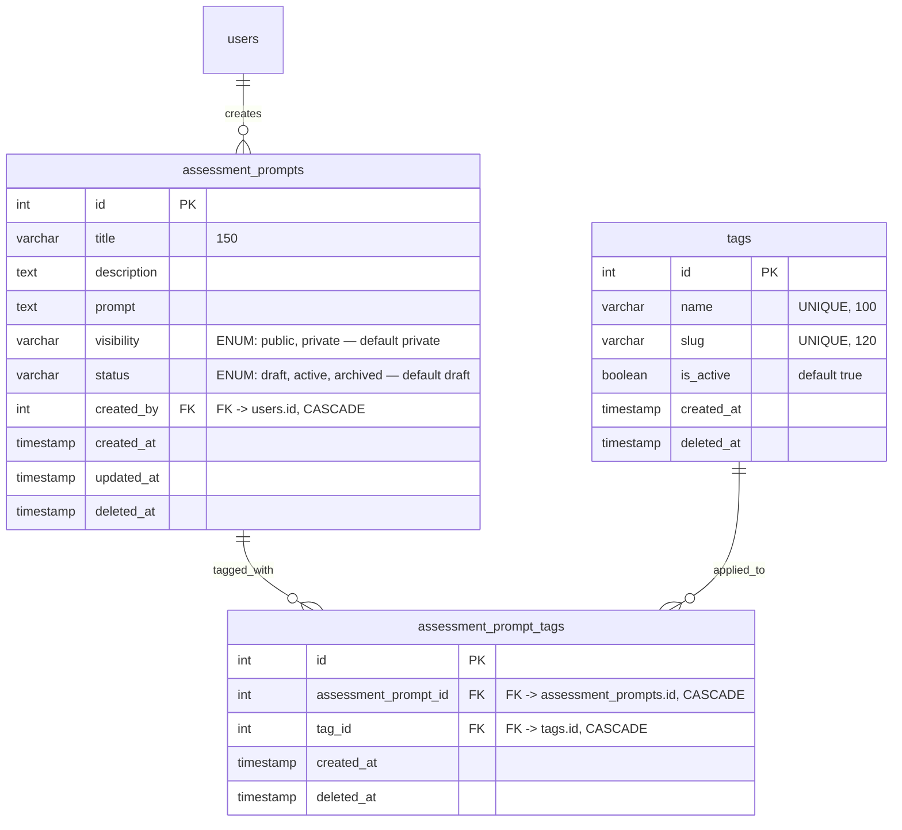
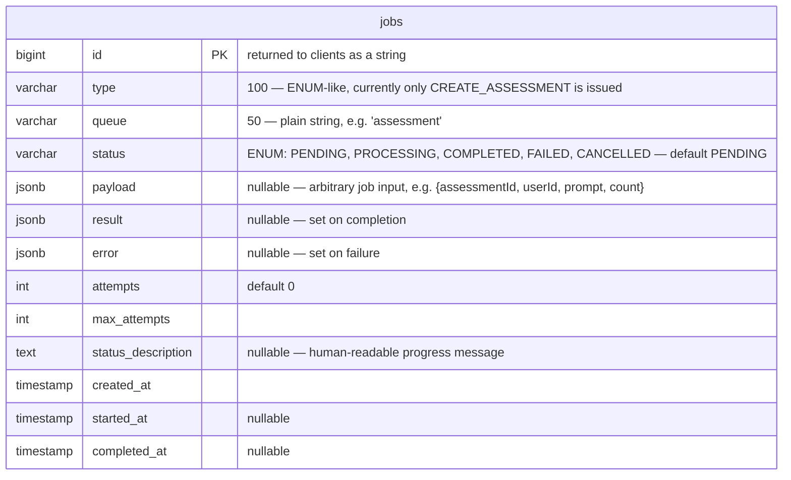
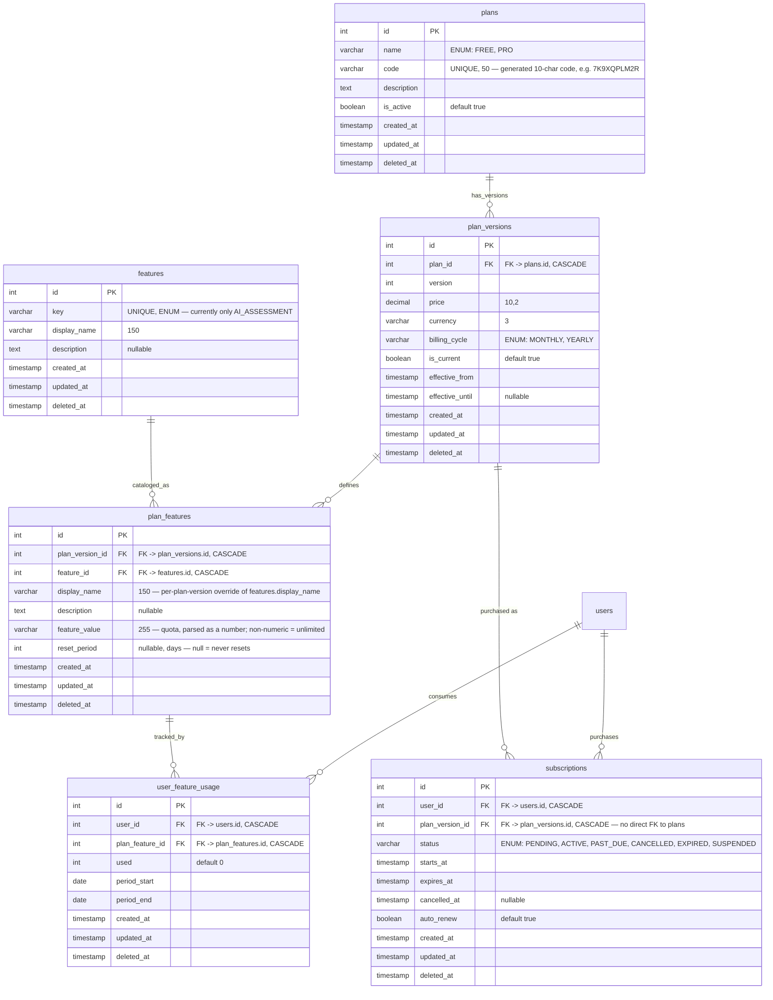
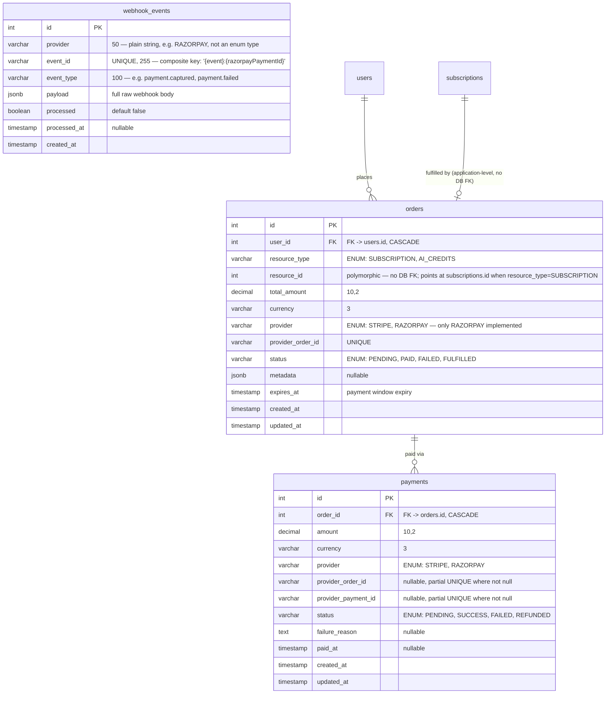
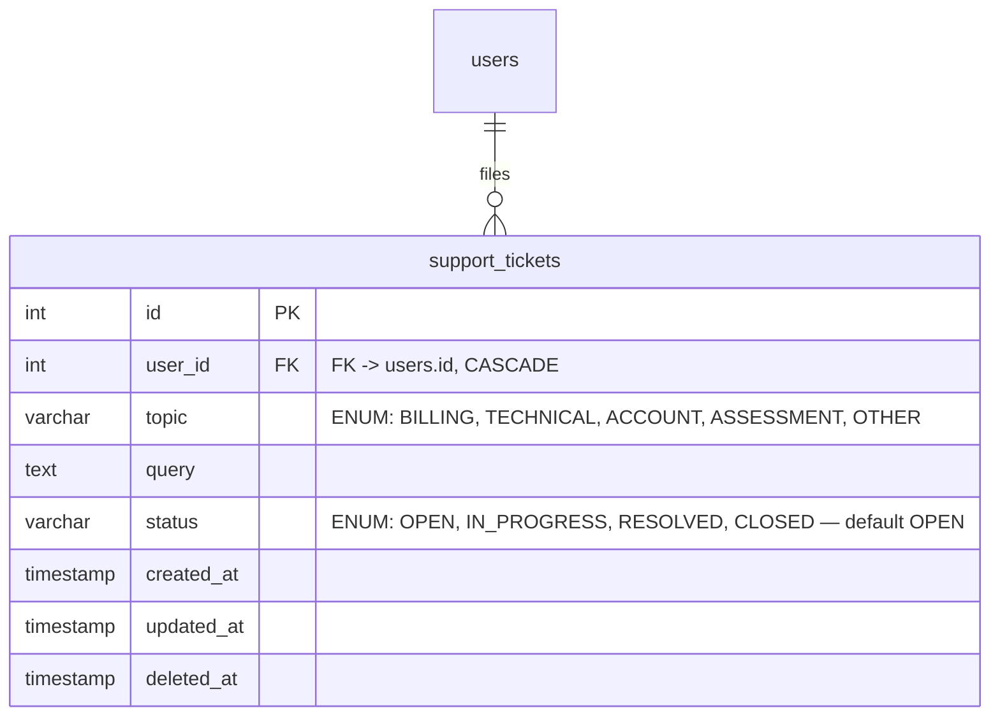

# Entity Relationship Diagram (ERD)

This page reflects the schema as implemented today — verified directly against TypeORM entity files (not migration files alone, since some migrations superseded earlier ones — see [Payments / Orders](#6-payments--orders) and [Commerce](#5-commerce--plans-features-subscriptions--usage) below). 26 entities across 7 domains: Identity & RBAC, Assessment Engine, Content Library, Async Jobs, Commerce, Payments, and Support.

All tables use `timestamptz` for timestamps and soft-delete (`deleted_at`) unless noted otherwise. Junction/snapshot/append-only tables (`assessments_questions`, `assessment_attempt_responses`, `webhook_events`, `jobs`) do not soft-delete.

## 1. Identity & RBAC

**Notes:**

- Composite partial unique index on `users(oauth_provider, oauth_id)` `WHERE oauth_id IS NOT NULL` — enforced at the DB level even though no OAuth flow currently populates these columns.
- `refresh_tokens` is a single-active-token-per-user model: `AuthService.storeRefreshToken()` upserts by `user_id` (resurrecting a soft-deleted row if present) rather than keeping one row per device/session.
- `resources.key` values are composite `resource:action` strings (`users:read`, `questions:create`, …) plus one wildcard `*:*` — seeded only for the `super_admin` role, which is the only role seeded out of the box.
- `role_permissions` and `users_roles` are plain join tables with their own soft-delete/audit columns, not TypeORM `@ManyToMany` relations.
- `users` also owns child rows in `assessment_prompts` (created_by), `jobs` (referenced only via `jobs.payload.userId`, no DB FK), `support_tickets`, and every table in the Assessment Engine and Commerce domains below — see the [cross-domain summary](#8-full-cross-domain-relationship-summary).

## 2. Assessment Engine

**Notes:**

- `assessments_questions` and `assessment_attempt_responses` are the only two tables in this domain without `deleted_at` — questions and responses are snapshot/append-only records, not independently soft-deletable.
- Unique index `(assessment_id, question_id)` on `assessments_questions` — a question can only be added to the same assessment once.
- Unique constraint `(user_id, assessment_id)` on `assessment_attempts` — enforces one attempt per user per assessment at the DB level.
- No unique constraint exists on `assessment_attempt_responses(attempt_id, assessment_question_id)` — the one-response-per-question invariant is enforced only in `AttemptsService.upsertResponse()` application logic (find-then-update-or-create), not the schema.
- `assessments_participants.status = in_progress` is defined in the enum but never actually set by any code path — participants transition directly `not_started → completed` via `markParticipantCompleted()`.
- `assessments.question_generation_status` is asynchronous: `AssessmentsService.generate()` creates the assessment row (status defaults to `creating`), opens a `jobs` row (see [Async Jobs](#4-async-jobs)), and publishes a RabbitMQ message so the LLM call happens out-of-band. `submitted` and `in_progress` are defined on the enum but no code path assigns them — the observed transitions are `creating → ready` (via `completeGeneration()`, once `QuestionGenerationConsumer` gets questions back from the LLM) or `creating → failed` (via `failGeneration()`, on any consumer error or publish failure).
- Question generation takes free-text prompt content directly on the generate-assessment request (`GenerateAssessmentDto.prompt`) — it does **not** reference the [`assessment_prompts`](#3-content-library--tags--assessment-prompts) library table. The two subsystems are unconnected at the schema level today.
- Generating an assessment consumes one unit of the `AI_ASSESSMENT` feature via `UsageService.consume()` (see [Commerce](#5-commerce--plans-features-subscriptions--usage)) before the assessment row is created — a user with no quota left gets a `422` and no assessment is created.

## 3. Content Library — Tags & Assessment Prompts

**Notes:**

- This is a standalone prompt-template library — a place for users to save, tag, and browse reusable prompt text (`AssessmentPromptsService`) — with **no** DB relation to `assessments` or `questions`. It exists independently of the question-generation flow described in [Assessment Engine](#2-assessment-engine).
- `assessment_prompt_tags` has a partial unique index `(assessment_prompt_id, tag_id) WHERE deleted_at IS NULL` — a tag can be removed from a prompt (soft delete) and reapplied later without a unique-constraint conflict.
- `tags` is generic (`name` + `slug` + `is_active`) but today is only ever joined through `assessment_prompt_tags`; nothing else in the schema references it.
- `assessment_prompts.visibility` (`public`/`private`) gates listing via `GetAssessmentPromptsQueryDto`; `status` (`draft`/`active`/`archived`) is a separate, independently-set lifecycle field — both are plain filters, not enforced by any DB constraint.

## 4. Async Jobs

**Notes:**

- `jobs` has no foreign keys and no `deleted_at` — it is a standalone, append-only work-queue table with no `@ManyToOne`/`@OneToMany` relations to any other entity.
- Links to `assessments` and `users` are application-level only, carried inside the `payload` jsonb column (`{ assessmentId, userId, prompt, count, positiveMark, negativeMark }` for `CREATE_ASSESSMENT`). `JobsService.findOne()` enforces per-user ownership by comparing the requesting user's id against `payload.userId` — there is no DB constraint backing this check.
- Lifecycle (driven by `JobsService`): `PENDING` → `PROCESSING` (`markProcessing()`, which also increments `attempts`) → `COMPLETED` (`markCompleted()`) or `FAILED` (`markFailed()`). `CANCELLED` is defined on the enum but no code path sets it.
- Today the only producer/consumer pair is question generation: `AssessmentsService.generate()` creates the job row and publishes to RabbitMQ; `QuestionGenerationConsumer` picks it up, calls the LLM via `QuestionsService.generateFromPrompt()`, and reports back through `JobsService` while also updating the originating `assessments.question_generation_status`.

## 5. Commerce — Plans, Features, Subscriptions & Usage

The feature model was normalized after the original launch: `plan_features` used to embed a free-text `feature_name` directly; a `features` catalog table was introduced later and `plan_features` was repointed at it via `feature_id` (migrations `20260716000000` and `20260716000001`), with `feature_name` dropped in favor of `features.key` plus a per-plan-version `display_name` override. The diagram below reflects the **current** (post-migration) state.

**Notes:**

- Table name is `plan_features` — the TypeORM entity class is named `PlanVersionFeature`, which can read as if the table were `plan_version_features`. It is not; the class name and table name intentionally diverge.
- `feature_id` FK'd to the new `features` catalog table is what identifies *which* feature a `plan_features` row grants (`FeatureKey.AI_ASSESSMENT` today, matched via `features.key`); `plan_features.display_name`/`description` remain per-plan-version overrides of the catalog's own `display_name`/`description`.
- Partial unique index `(plan_id) WHERE is_current = true` on `plan_versions` — DB-enforced guarantee that only one version per plan can be current. `PlansService.createVersion()` demotes the previous current version (setting its `effective_until`) inside the same transaction before inserting the new one.
- `subscriptions` links to `plan_versions`, **not** directly to `plans` — the plan is reached transitively (`subscription → plan_version → plan`).
- `UsageService.consume(userId, featureKey)` is fully implemented: it finds the user's `ACTIVE` subscription(s) (auto-provisioning a `FREE`-plan subscription via `SubscriptionsService.createFreeSubscription()` if none exists), resolves the matching `plan_features` row, takes a `pessimistic_write` lock on the user's `user_feature_usage` row, resets `used` to 0 if `period_end` has passed, and throws `422` if incrementing would exceed the parsed `feature_value` limit. A `reset_period` of `null` is treated as never-resetting via a `9999-12-31` sentinel `period_end`.
- `SubscriptionStatus.SUSPENDED` is live: `PaymentsService.markPaymentCaptured()` (see [Payments](#6-payments--orders)) suspends every *other* `ACTIVE` subscription the same user holds before activating the newly-paid one — the schema allows multiple concurrent subscriptions per user, but application logic keeps at most one `ACTIVE` at a time. `PAST_DUE`, `CANCELLED`, and `EXPIRED` remain defined on the enum but unused by any code path today.

## 6. Payments & Orders

The schema evolved mid-project: payments originally pointed directly at subscriptions; a generic `orders` abstraction was introduced later and payments were repointed to it. The diagram below reflects the **current** (post-migration) state.

**Notes:**

- `orders.resource_id` is a plain int with no database-level foreign key — the link to `subscriptions.id` (or a future `ai_credits` resource) is an application-level convention, backed only by a non-unique composite index on `(resource_type, resource_id)`.
- `payments` has neither `deleted_at` nor a `subscription_id` column — payments are immutable audit records tied to exactly one order.
- `webhook_events.event_id` is **not** the raw Razorpay webhook ID; it's synthesized as `"{event}:{razorpayPaymentId}"` (e.g. `payment.captured:pay_ABC123`) and used as the idempotency key so a redelivered webhook is a no-op.
- Only `PaymentProvider.RAZORPAY` has an actual SDK integration (`razorpay` npm package + `RazorpayService`). `STRIPE` exists as an enum value on both `orders` and `payments` but has no corresponding service or dependency.
- `OrderResourceType.AI_CREDITS` is defined but has no fulfillment handler — `PaymentsService.markPaymentCaptured()` only acts on `resource_type === SUBSCRIPTION`, with an explicit in-code TODO to generalize this once other resource types need fulfillment.
- On `payment.captured`, `markPaymentCaptured()` sets the order to `PAID`, then — for `SUBSCRIPTION` orders — suspends every other `ACTIVE` subscription the user holds and activates `orders.resource_id` (see the `SUSPENDED` note in [Commerce](#5-commerce--plans-features-subscriptions--usage)).
- On `payment.failed`, only `payments.status` is set to `FAILED` — `orders.status` and any linked `subscriptions.status` are left untouched (order stays `PENDING`, allowing retry until `expires_at`).

## 7. Support Tickets

**Notes:**

- Standalone table — no relation to `assessments`, `orders`, or any other domain beyond the owning `user_id`, even though `SupportTicketTopic.ASSESSMENT` and `BILLING` suggest the ticket concerns those domains; that association is only implied by the topic label, not modeled as a schema link.

## 8. Full Cross-Domain Relationship Summary

| From | To | Cardinality | Via |
|---|---|---|---|
| `users` | `refresh_tokens`, `users_roles`, `questions`, `assessments`, `assessments_participants`, `assessment_attempts`, `assessment_prompts`, `subscriptions`, `user_feature_usage`, `orders`, `support_tickets` | 1 → many | direct FK on each child table |
| `roles` | `users_roles`, `role_permissions` | 1 → many | direct FK |
| `resources` | `role_permissions` | 1 → many | direct FK |
| `assessments` | `assessments_questions`, `assessments_participants`, `assessment_attempts` | 1 → many | direct FK |
| `questions` | `assessments_questions` | 1 → many | direct FK |
| `assessment_attempts` | `assessment_attempt_responses` | 1 → many | direct FK |
| `assessments_questions` | `assessment_attempt_responses` | 1 → many | direct FK |
| `assessment_prompts` | `assessment_prompt_tags` | 1 → many | direct FK |
| `tags` | `assessment_prompt_tags` | 1 → many | direct FK |
| `assessments` / `users` | `jobs` | — | **application-level only** — `jobs.payload.{assessmentId,userId}`, no DB FK |
| `plans` | `plan_versions` | 1 → many | direct FK |
| `plan_versions` | `plan_features`, `subscriptions` | 1 → many | direct FK |
| `features` | `plan_features` | 1 → many | direct FK |
| `plan_features` | `user_feature_usage` | 1 → many | direct FK |
| `orders` | `payments` | 1 → many | direct FK |
| `subscriptions` | `orders` | 1 → 0..1 (per active checkout) | **application-level only** — `orders.resource_id` when `resource_type = SUBSCRIPTION`, no DB FK |
