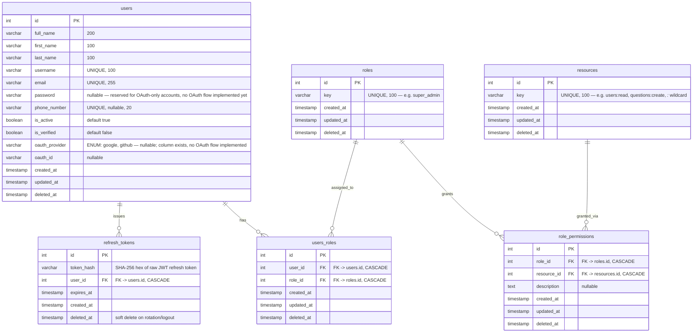
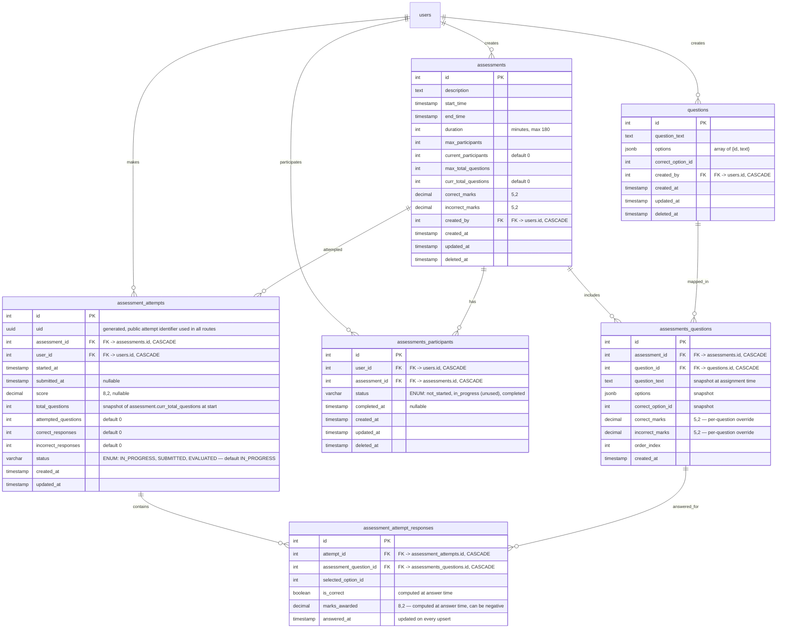
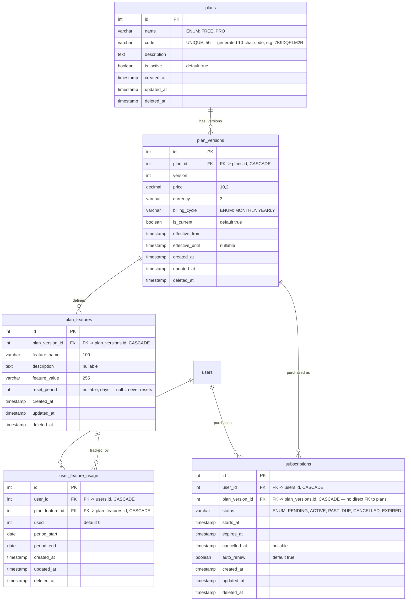
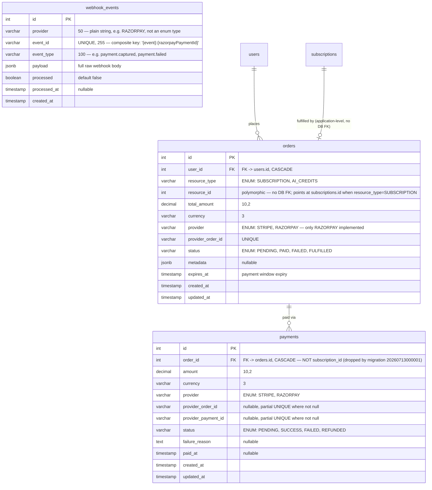

# Entity Relationship Diagram (ERD)

This page reflects the schema as implemented today — verified directly against TypeORM entity files (not migration files alone, since one migration already superseded another — see [Payments / Orders](#4-payments--orders) below). 20 entities across 4 domains: Identity & RBAC, Assessment Engine, Commerce, and Payments.

All tables use `timestamptz` for timestamps and soft-delete (`deleted_at`) unless noted otherwise. Junction/snapshot tables (`assessments_questions`, `assessment_attempt_responses`, `webhook_events`) do not soft-delete.

## 1. Identity & RBAC

**Notes:**

- Composite partial unique index on `users(oauth_provider, oauth_id)` `WHERE oauth_id IS NOT NULL` — enforced at the DB level even though no OAuth flow currently populates these columns.
- `refresh_tokens` is a single-active-token-per-user model: `AuthService.storeRefreshToken()` upserts by `user_id` (resurrecting a soft-deleted row if present) rather than keeping one row per device/session.
- `resources.key` values are composite `resource:action` strings (`users:read`, `questions:create`, …) plus one wildcard `*:*` — seeded only for the `super_admin` role, which is the only role seeded out of the box.
- `role_permissions` and `users_roles` are plain join tables with their own soft-delete/audit columns, not TypeORM `@ManyToMany` relations.

## 2. Assessment Engine

**Notes:**

- `assessments_questions` and `assessment_attempt_responses` are the only two tables without `deleted_at` — questions and responses are snapshot/append-only records, not independently soft-deletable.
- Unique index `(assessment_id, question_id)` on `assessments_questions` — a question can only be added to the same assessment once.
- Unique constraint `(user_id, assessment_id)` on `assessment_attempts` — enforces one attempt per user per assessment at the DB level (added in a later migration, `20260618000004`).
- No unique constraint exists on `assessment_attempt_responses(attempt_id, assessment_question_id)` — the one-response-per-question invariant is enforced only in `AttemptsService.upsertResponse()` application logic (find-then-update-or-create), not the schema.
- `assessments_participants.status = in_progress` is defined in the enum but never actually set by any code path — participants transition directly `not_started → completed` via `markParticipantCompleted()`.

## 3. Commerce — Plans, Subscriptions & Usage

**Notes:**

- Table name is `plan_features` — the TypeORM entity class is named `PlanVersionFeature`, which can read as if the table were `plan_version_features`. It is not; the class name and table name intentionally diverge.
- Partial unique index `(plan_id) WHERE is_current = true` on `plan_versions` — DB-enforced guarantee that only one version per plan can be current. `PlansService.createVersion()` demotes the previous current version (setting its `effective_until`) inside the same transaction before inserting the new one.
- `subscriptions` links to `plan_versions`, **not** directly to `plans` — the plan is reached transitively (`subscription → plan_version → plan`).
- `UsageService` currently has no methods implemented — the `user_feature_usage` table and `plan_features.reset_period` column exist and are schema-ready, but nothing in the codebase writes to or reads from this table yet.
- No code path currently transitions a subscription to `PAST_DUE`, `CANCELLED`, or `EXPIRED` — those enum values are defined but unused; only `PENDING → ACTIVE` (via webhook-driven payment capture) exists today.

## 4. Payments & Orders

The schema evolved mid-project: payments originally pointed directly at subscriptions; a generic `orders` abstraction was introduced later and payments were repointed to it (migration `20260713000001-change-payments-subscription-to-order.ts`). The diagram below reflects the **current** (post-migration) state.

**Notes:**

- `orders.resource_id` is a plain int with no database-level foreign key — the link to `subscriptions.id` (or a future `ai_credits` resource) is an application-level convention, backed only by a non-unique composite index on `(resource_type, resource_id)`.
- `payments` has neither `deleted_at` nor a `subscription_id` column — payments are immutable audit records tied to exactly one order.
- `webhook_events.event_id` is **not** the raw Razorpay webhook ID; it's synthesized as `"{event}:{razorpayPaymentId}"` (e.g. `payment.captured:pay_ABC123`) and used as the idempotency key so a redelivered webhook is a no-op.
- Only `PaymentProvider.RAZORPAY` has an actual SDK integration (`razorpay` npm package + `RazorpayService`). `STRIPE` exists as an enum value on both `orders` and `payments` but has no corresponding service or dependency.
- `OrderResourceType.AI_CREDITS` is defined but has no fulfillment handler — `PaymentsService.markPaymentCaptured()` only acts on `resource_type === SUBSCRIPTION`, with an explicit in-code TODO to generalize this once other resource types need fulfillment.
- On `payment.failed`, only `payments.status` is set to `FAILED` — `orders.status` and any linked `subscriptions.status` are left untouched (order stays `PENDING`, allowing retry until `expires_at`).

## 5. Full Cross-Domain Relationship Summary

| From | To | Cardinality | Via |
|---|---|---|---|
| `users` | `refresh_tokens`, `users_roles`, `questions`, `assessments`, `assessments_participants`, `assessment_attempts`, `subscriptions`, `user_feature_usage`, `orders` | 1 → many | direct FK on each child table |
| `roles` | `users_roles`, `role_permissions` | 1 → many | direct FK |
| `resources` | `role_permissions` | 1 → many | direct FK |
| `assessments` | `assessments_questions`, `assessments_participants`, `assessment_attempts` | 1 → many | direct FK |
| `questions` | `assessments_questions` | 1 → many | direct FK |
| `assessment_attempts` | `assessment_attempt_responses` | 1 → many | direct FK |
| `assessments_questions` | `assessment_attempt_responses` | 1 → many | direct FK |
| `plans` | `plan_versions` | 1 → many | direct FK |
| `plan_versions` | `plan_features`, `subscriptions` | 1 → many | direct FK |
| `plan_features` | `user_feature_usage` | 1 → many | direct FK |
| `orders` | `payments` | 1 → many | direct FK |
| `subscriptions` | `orders` | 1 → 0..1 (per active checkout) | **application-level only** — `orders.resource_id` when `resource_type = SUBSCRIPTION`, no DB FK |
