# Data Model (ERD)

This page describes the **current** PostgreSQL schema of the TestFlow backend. It was built from every `*.entity.ts` file and checked against the migrations in `src/migrations` (108 files, the newest is `20261029000000-backfill-order-statuses.ts`). A local database migrated to the latest version was also compared with the entities using `typeorm schema:log`. The few differences it found are listed in [Known schema gaps](#known-schema-gaps).

It replaces three older pages: `erd.md`, `erd-organisation.md` (a draft "workspaces" design that was never built; the real design is the `organizations` tables below) and `complete-erd.md`.

!!! tip "Where the code lives"
    - All 44 entity classes: `src/common/entities/` (re-exported from `src/common/entities/index.ts`).
    - All enums: `src/common/enums/`. Status enums live next to their rules in each module's `domain/` folder (for example `src/assessments/domain/attempt-state.ts`) and are re-exported from `src/common/enums`.
    - Migrations: `src/migrations/`. How to write one: [Data access patterns → Migrations](data-access-pattern.md#migrations).

## Conventions

### Naming

| What | Rule | Example |
|---|---|---|
| Table | snake_case, usually plural | `assessment_attempts`, `users_roles` |
| Column | snake_case, set with `name:` on every `@Column` | `created_by`, `is_active` |
| Entity property | camelCase | `createdBy`, `isActive` |
| Index | `IDX_<table>_<column>` | `IDX_jobs_status` |
| Unique index | `UQ_<table>_<column(s)>` | `UQ_users_email` |
| Foreign key (in migrations) | `FK_<table>_<column>` | `FK_assessments_created_by` |
| Check constraint | `CHK_<table>_<rule>` | `CHK_assessment_sections_difficulty` |

Two table names do not match their class names. The class `PlanVersionFeature` maps to the table `plan_features`, and `UserRole` maps to `users_roles`.

### There is no base entity class

`src/common/entities` holds the entity files, but there is **no** shared `BaseEntity`. Every entity declares its own columns. The usual set is:

| Column | Decorator | Type | Notes |
|---|---|---|---|
| `id` | `@PrimaryGeneratedColumn('increment')` | `int` | Auto-increment. `jobs.id` and `llm_audit.id` are `bigint` (TypeScript type `string`). |
| `created_at` | `@CreateDateColumn` | `timestamptz` | Set on insert. |
| `updated_at` | `@UpdateDateColumn` | `timestamptz` | Set on every save. Missing on append-only tables. |
| `deleted_at` | `@DeleteDateColumn` | `timestamptz`, nullable | Only on soft-deletable tables. |

All timestamps are `timestamptz` (time zone aware). The only `date` columns are `user_feature_usage.period_start` and `period_end`.

### Public ids

The numeric `id` is the internal key. Some tables also have a public id that clients use in URLs:

| Kind | Format | Built by | Tables |
|---|---|---|---|
| Short uid | 8 characters, letters and digits (nanoid) | `generateShortUid()` in `src/common/nano-id.ts` | `organizations`, `assessment_templates`, `learning_roadmap_templates` |
| Prefixed id | `conv_<32 hex>` or `msg_<32 hex>` | `generatePrefixedId()` in `src/common/prefixed-id.ts` | `ai_conversations`, `ai_conversation_messages` |
| UUID | Postgres `uuid`, generated on insert | `@Generated('uuid')` | `assessment_attempts.uid` |

Short uids can collide. They sit behind a unique index, and the service retries the insert when Postgres reports a unique violation.

### Soft delete

A **soft delete** sets `deleted_at` to the current time instead of removing the row. TypeORM's `find*` methods and QueryBuilder hide these rows automatically. Raw SQL does not, so raw queries must add `deleted_at IS NULL` themselves.

| Soft-deletable (`deleted_at` present) | Not soft-deletable |
|---|---|
| `users`, `refresh_tokens`, `roles`, `permissions`, `role_permissions`, `users_roles` | `assessment_sections`, `assessments_questions`, `mcq_question_details`, `coding_question_details`, `descriptive_question_details` |
| `organizations`, `organization_members` | `assessment_attempts`, `assessment_attempt_responses` |
| `assessments`, `assessments_participants`, `questions`, `tags`, `assessment_prompts`, `assessment_prompt_tags`, `assessment_templates` | `jobs`, `llm_audit`, `ai_conversations`, `ai_conversation_messages` |
| `plans`, `plan_versions`, `features`, `plan_features`, `subscriptions`, `user_feature_usage`, `credit_packs`, `user_feature_credits` | `orders`, `payments`, `webhook_events` |
| `ai_models`, `learning_roadmap_templates`, `newsletters`, `support_tickets` | `learning_roadmaps`, `learning_roadmap_nodes`, `learning_node_edges` |
| | `feature_flags`, `feature_flag_roles` |

Rules that follow from this:

- **Uniqueness only counts live rows.** Most unique indexes on soft-deletable tables are *partial*: `WHERE deleted_at IS NULL`. So a deleted user does not block a new sign-up with the same email, and a removed member can be invited again.
- **Many "deletes" are really status changes.** A participant who leaves becomes `revoked`. An attempt set aside by a reviewer becomes `rejected`. A membership can be `suspended`. These rows stay visible.
- **Hard deletes still happen** on tables without `deleted_at`, for example the `DELETE` of a response in `AttemptsService.deleteResponse()`.
- **Foreign keys cascade on hard delete only.** A soft delete of a parent does not touch its children.

### Enums: Postgres enum or varchar?

Most status columns are real Postgres enum types (named `<table>_<column>_enum`). Adding a value needs an `ALTER TYPE` migration. A few columns are stored as `varchar` on purpose, so new values need no migration:

- `questions.type`, `assessment_sections.question_type`, `assessments_questions.type` (`QuestionType`)
- `assessment_attempt_responses.evaluation_status` and `code_verdict` (guarded by `CHECK` constraints instead)
- `llm_audit.status`, `jobs.type`, `jobs.queue`, `features.key`, `coding_question_details.checker_type`

### Money and marks

Prices, marks and costs use `decimal(precision, scale)`. The `pg` driver returns `decimal` values as **strings**, even where the entity types them as `number`. Convert with `Number()` before doing maths. `llm_audit` types its decimals as `string` to make this explicit.

## Domain map

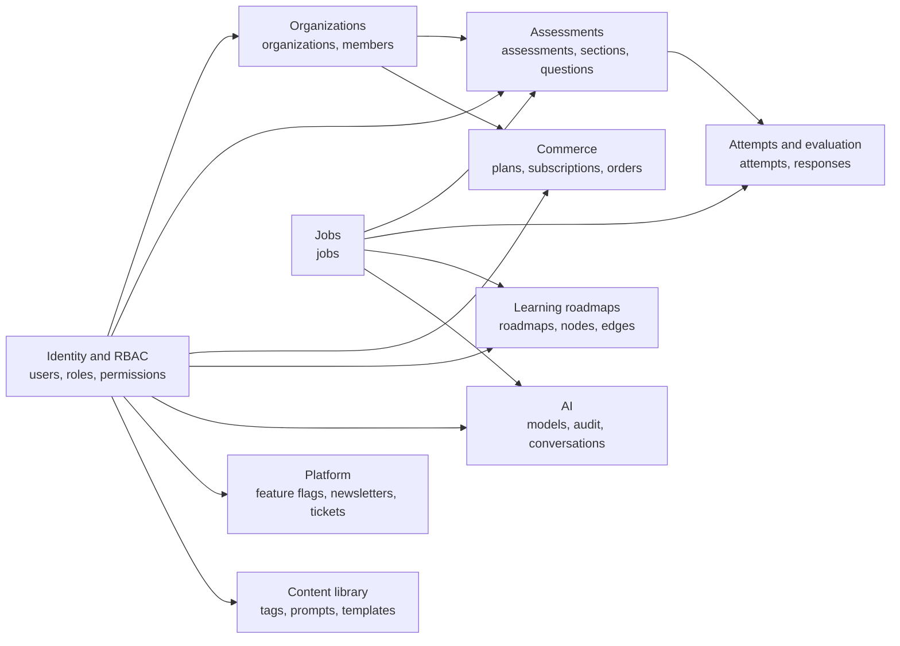

`users` is the hub: almost every domain has a `user_id` or `created_by` that points to it.

---

## 1. Identity and RBAC

**RBAC** (role-based access control) means a user gets permissions through roles. Platform roles (for example `super_admin`) are held through `users_roles`. Organization roles are held through `organization_members` (see [section 2](#2-organizations)). Both kinds of role draw from the same `permissions` catalog. Design details: [RBAC](hld-design/rbac.md) and [Auth](hld-design/auth.md).

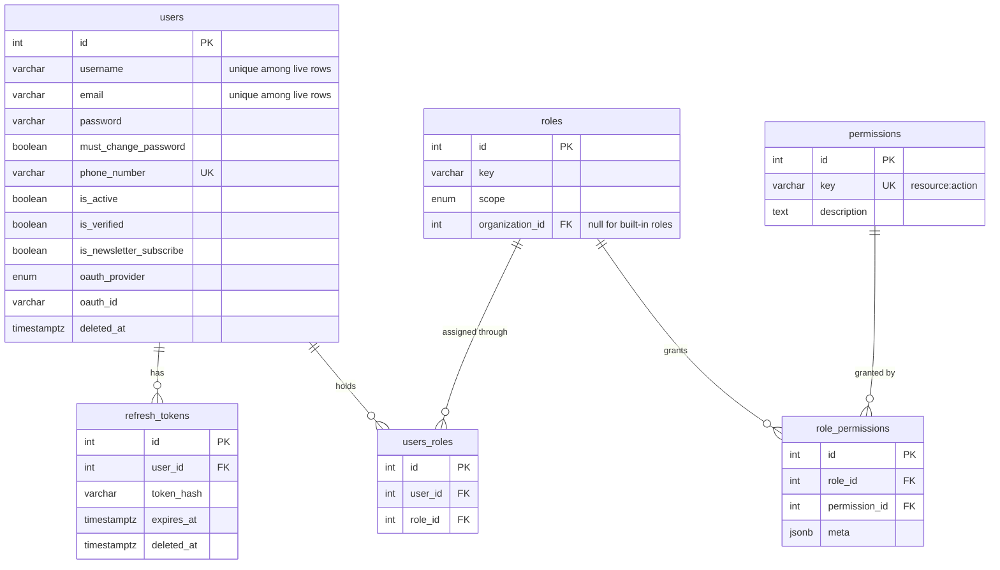

### `users`

A person who can sign in. Entity: `src/common/entities/user.entity.ts`.

| Column | Type | Null | Default | Notes |
|---|---|---|---|---|
| `id` | int | no | auto | PK |
| `full_name` | varchar(200) | no | | |
| `first_name` | varchar(100) | no | | |
| `last_name` | varchar(100) | no | | |
| `username` | varchar(100) | no | | Unique among live rows |
| `email` | varchar(255) | no | | Unique among live rows |
| `password` | varchar(255) | no | | bcrypt hash. Google sign-up stores a generated default password. |
| `must_change_password` | boolean | no | `false` | Forces a password change on an admin-created or Google-created account |
| `phone_number` | varchar(20) | yes | `null` | Unique (plain constraint, not limited to live rows) |
| `is_active` | boolean | no | `true` | |
| `is_verified` | boolean | no | `false` | Email verified |
| `is_newsletter_subscribe` | boolean | no | `true` | Newsletter opt-in |
| `total_verification_email` | int | no | `0` | How many verification emails were ever sent |
| `last_verification_email_sent_at` | timestamptz | yes | `null` | Used to throttle resends |
| `oauth_provider` | enum `OAuthProvider` | yes | `null` | `google`, `github` |
| `oauth_id` | varchar(255) | yes | `null` | Provider's user id |

Timestamps: `created_at`, `updated_at`, `deleted_at`.
Indexes: `UQ_users_username` and `UQ_users_email` (partial, `deleted_at IS NULL`); unique `(oauth_provider, oauth_id) WHERE oauth_id IS NOT NULL`; unique `phone_number`.

### `refresh_tokens`

Stores a hash of the user's refresh token. Entity: `refreshToken.entity.ts`.

| Column | Type | Null | Default | Notes |
|---|---|---|---|---|
| `id` | int | no | auto | PK |
| `token_hash` | varchar | no | | SHA-256 of the raw token. The raw token is never stored. |
| `user_id` | int | no | | FK `users.id`, ON DELETE CASCADE (in the database) |
| `expires_at` | timestamptz | no | | |

Timestamps: `created_at`, `deleted_at` (no `updated_at`). Index: `IDX_refresh_tokens_user_id` (created by migration).

There is **one row per user**, not one per device. `AuthService.storeRefreshToken()` finds the user's row (including a soft-deleted one) and overwrites it, or inserts the first one. Logout soft-deletes it.

### `roles`

A named set of permissions. Entity: `roles.entity.ts`.

| Column | Type | Null | Default | Notes |
|---|---|---|---|---|
| `id` | int | no | auto | PK |
| `key` | varchar(100) | no | | For example `super_admin`, `org_admin` |
| `scope` | enum `RbacScope` | no | `platform` | `platform` or `organization` |
| `organization_id` | int | yes | `null` | FK `organizations.id`, CASCADE. `null` for built-in roles; set for an organization's own custom role. |

Timestamps: all three. Indexes: `UQ_roles_key` on `key` where `organization_id IS NULL AND deleted_at IS NULL` (built-in keys are unique); `UQ_roles_organization_id_key` on `(organization_id, key)` for custom roles; `IDX_roles_organization_id`.

Built-in roles: `super_admin` and `beta_tester` (platform; `beta_tester` grants nothing and only unlocks feature flags), and `org_owner`, `org_admin`, `org_member` (organization, shared by every org).

### `permissions`

One grantable action, keyed `resource:action` (for example `questions:update`). Entity: `permissions.entity.ts`.

| Column | Type | Null | Default | Notes |
|---|---|---|---|---|
| `id` | int | no | auto | PK |
| `key` | varchar(100) | no | | `UQ_permissions_key` |
| `description` | text | yes | `null` | |

Timestamps: all three. The valid resources and actions are the `RbacResource` and `RbacAction` enums in `src/common/enums/identity.enums.ts`. Actions: `read`, `create`, `update`, `delete`, `upload`, `export`.

!!! note "Old `resources` table and the `*:*` wildcard"
    Older docs describe a `resources` table. Migration `20260929000003-move-permission-keys-and-drop-resources.ts` replaced it with `permissions`. The `*:*` wildcard is also gone: `src/seeders/super-admin-permissions.seeder.ts` replaces it with an explicit grant for every pair, and the permission check (`AccessControlService.userHasPermission`) matches exact keys only.

### `role_permissions`

Join table: which permissions a role grants. Entity: `role-permissions.entity.ts`.

| Column | Type | Null | Default | Notes |
|---|---|---|---|---|
| `id` | int | no | auto | PK |
| `role_id` | int | no | | FK `roles.id`, CASCADE. `IDX_role_permissions_role_id` |
| `permission_id` | int | no | | FK `permissions.id`, CASCADE. `IDX_role_permissions_permission_id` |
| `description` | text | yes | `null` | |
| `meta` | jsonb | yes | `null` | `RolePermissionMeta`: `{ implicitPermissions: PermissionKey[] }`, permissions implied by this one (for example `update` implies `read`). See `src/identity/rbac/interfaces/role-permission-meta.interface.ts`. |

Timestamps: all three. There is no unique index on `(role_id, permission_id)`; the services prevent duplicates.

### `users_roles`

Join table: which platform roles a user holds. Entity: `users-roles.entity.ts` (class `UserRole`).

| Column | Type | Null | Default | Notes |
|---|---|---|---|---|
| `id` | int | no | auto | PK |
| `user_id` | int | no | | FK `users.id`, CASCADE. Indexed. |
| `role_id` | int | no | | FK `roles.id`, CASCADE. Indexed. |

Timestamps: all three. Both join tables are real entities, not TypeORM `@ManyToMany`.

---

## 2. Organizations

An **organization** is a group of users who share assessments and a subscription. Each member has one organization-scoped role. Design: [Organizations](hld-design/organizations.md).

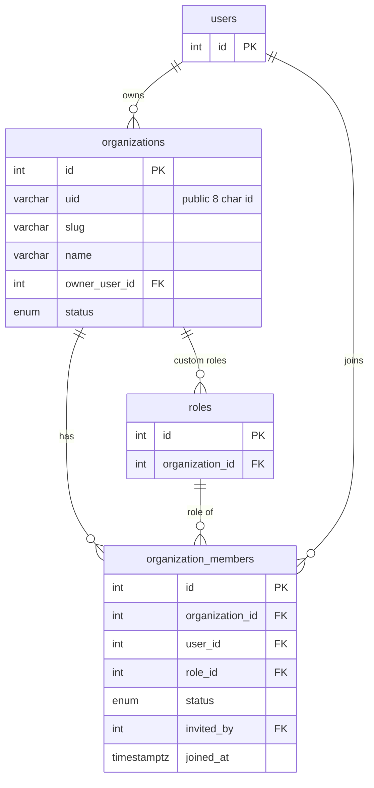

### `organizations`

Entity: `organization.entity.ts`.

| Column | Type | Null | Default | Notes |
|---|---|---|---|---|
| `id` | int | no | auto | PK |
| `uid` | varchar(8) | no | | Public id used in `/v1/orgs/:orgUid/...`. Unique among live rows. |
| `slug` | varchar(180) | no | | URL-safe name. Unique among live rows. |
| `name` | varchar(150) | no | | |
| `owner_user_id` | int | no | | FK `users.id`, CASCADE. `IDX_organizations_owner_user_id`. Kept for billing and ownership transfer. |
| `status` | enum `OrganizationStatus` | no | `active` | `active`, `suspended` |

Timestamps: all three. A user may own at most one organization (`OrganizationLimit.ORG_LIMIT = 1`, enforced in code). The owner also has an `org_owner` membership row, so every permission check goes through `organization_members`.

### `organization_members`

A user's membership in one organization. An invitation is a membership row in `invited` status. Entity: `organization-member.entity.ts`.

| Column | Type | Null | Default | Notes |
|---|---|---|---|---|
| `id` | int | no | auto | PK |
| `organization_id` | int | no | | FK, CASCADE. Indexed. |
| `user_id` | int | no | | FK, CASCADE. Indexed. |
| `role_id` | int | no | | FK `roles.id`, **RESTRICT** (deleting a role must not silently drop members). Indexed. |
| `status` | enum `OrganizationMemberStatus` | no | `invited` | See below |
| `invited_by` | int | yes | `null` | FK `users.id`, SET NULL. Null for the owner's own row. |
| `joined_at` | timestamptz | yes | `null` | Set when the invitation is accepted |

Timestamps: all three. Unique: `(organization_id, user_id)` among live rows.

| `OrganizationMemberStatus` | Meaning |
|---|---|
| `invited` | Invitation sent, not accepted yet |
| `active` | Full member |
| `suspended` | Membership paused, no access |

Organizations also own rows in `assessments`, `subscriptions` and `user_feature_usage` through a nullable `organization_id` (see the sections below).

---

## 3. Assessments, questions and the content library

An **assessment** is a test made of **sections**. Each section holds questions of one type. Questions live in a reusable bank (`questions`) and are **copied** (snapshotted) into the assessment as `assessments_questions` rows, so later edits to the bank never change a published test. Design: [Assessments](hld-design/assessments.md), [Questions and tags](hld-design/questions-and-tags.md), [Assessment generation](hld-design/assessment-generation.md).

### 3a. Assessments, sections and participants

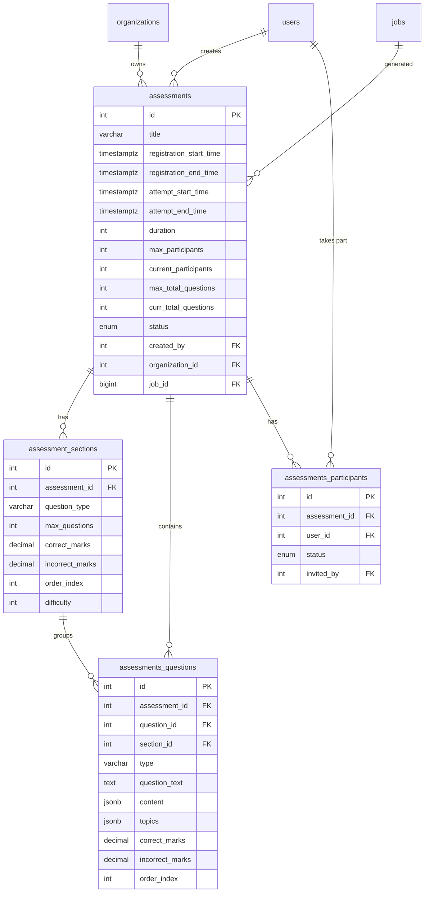

#### `assessments`

Entity: `assessment.entity.ts`.

| Column | Type | Null | Default | Notes |
|---|---|---|---|---|
| `id` | int | no | auto | PK |
| `title` | varchar(255) | yes | | Null until the generator suggests one or the creator sets it |
| `description` | text | no | | |
| `registration_start_time` | timestamptz | no | | People may register or be invited from here… |
| `registration_end_time` | timestamptz | no | | …until here |
| `attempt_start_time` | timestamptz | no | | Participants may sit the test from here… |
| `attempt_end_time` | timestamptz | no | | …until here |
| `duration` | int | no | | Minutes allowed per attempt |
| `max_participants` | int | no | | Seat limit |
| `current_participants` | int | no | `0` | Seats taken (invited + active, the creator excluded). Changed with `manager.increment()`. |
| `max_total_questions` | int | no | | Sum of the sections' sizes |
| `curr_total_questions` | int | no | `0` | Questions in place so far |
| `status` | enum `AssessmentStatus` | no | `draft` | See below |
| `created_by` | int | no | | FK `users.id`, CASCADE. `IDX_assessments_created_by` |
| `organization_id` | int | yes | `null` | FK `organizations.id`, CASCADE. `null` = personal assessment. Indexed. |
| `job_id` | bigint | yes | `null` | FK `jobs.id`, SET NULL (in the migration only, see [gaps](#known-schema-gaps)). The `GENERATE_ASSESSMENT` parent job. |

Timestamps: all three. The registration window columns were added by the newest migration, `20261026000000`. Marks moved from this table to `assessment_sections` in `20261014000013-drop-marks-from-assessments.ts`.

| `AssessmentStatus` | Meaning |
|---|---|
| `draft` | Being built: generating, generation failed, or not every question is in place |
| `ready` | Every section is full. The creator can review and still edit. |
| `published` | Open to participants. Questions are frozen. |

The **phase** (`upcoming`, `ongoing`, `completed`, enum `AssessmentPhase`) is *not stored*. It is worked out from `attempt_start_time` and `attempt_end_time`. Generation progress is the job's status, not the assessment's. Source: `src/assessments/domain/assessment-state.ts`.

#### `assessment_sections`

A group of same-type questions inside an assessment, with its own marking. Entity: `assessment-section.entity.ts`.

| Column | Type | Null | Default | Notes |
|---|---|---|---|---|
| `id` | int | no | auto | PK |
| `assessment_id` | int | no | | FK, CASCADE. Indexed. |
| `title` | varchar(255) | no | | |
| `description` | text | yes | | |
| `question_type` | varchar(20) | no | | `QuestionType`: `mcq`, `coding`, `descriptive` |
| `max_questions` | int | no | | |
| `correct_marks` | decimal(5,2) | no | | Marks for a right answer |
| `incorrect_marks` | decimal(5,2) | no | | Marks taken off for a wrong answer |
| `order_index` | int | no | | Order in the assessment |
| `difficulty` | int | no | `1` | 1 (easiest) to 5. `CHECK difficulty BETWEEN 1 AND 5` (in the migration only). |

Timestamps: `created_at`, `updated_at` (no soft delete).

#### `assessments_questions`

A **snapshot** of one bank question placed in an assessment. Entity: `assessment-question.entity.ts` (class `AssessmentQuestion`).

| Column | Type | Null | Default | Notes |
|---|---|---|---|---|
| `id` | int | no | auto | PK. Responses point here, not at `questions`. |
| `assessment_id` | int | no | | FK, CASCADE. Indexed. |
| `question_id` | int | no | | FK `questions.id`, CASCADE. Indexed. |
| `section_id` | int | no | | FK `assessment_sections.id`, CASCADE. Indexed. |
| `type` | varchar(20) | no | `mcq` | `QuestionType` |
| `question_text` | text | no | | Copied from the bank |
| `content` | jsonb | no | | Type-specific copy: `McqQuestionContent`, `CodingQuestionContent` or `DescriptiveQuestionContent` |
| `topics` | jsonb | yes | | Copy of `questions.meta.topics`: `QuestionTopic[]` |
| `correct_marks` | decimal(5,2) | no | | |
| `incorrect_marks` | decimal(5,2) | no | | |
| `order_index` | int | no | | |

Timestamps: `created_at` only. Unique: `UQ_assessments_questions_assessment_question` on `(assessment_id, question_id)`, so a bank question can appear only once per assessment.

**Why snapshot?** A participant must see exactly what was published, and grading must use the answer key that was live at the time. Copying the content into `content` makes the assessment independent of later bank edits or deletes.

#### `assessments_participants`

A user's place on an assessment. Entity: `assessment-participants.entity.ts`.

| Column | Type | Null | Default | Notes |
|---|---|---|---|---|
| `id` | int | no | auto | PK |
| `user_id` | int | no | | FK, CASCADE. Indexed. |
| `assessment_id` | int | no | | FK, CASCADE. Indexed. |
| `status` | enum `ParticipantStatus` | no | | See below |
| `invited_by` | int | yes | `null` | FK `users.id`, SET NULL. Null for self-registration. Indexed. |
| `invited_at` | timestamptz | yes | `null` | |
| `invite_accepted_at` | timestamptz | yes | `null` | |
| `revoked_at` | timestamptz | yes | `null` | Cleared if the user is invited again or re-registers |

Timestamps: all three. Unique: `(assessment_id, user_id)` among live rows.

| `ParticipantStatus` | Meaning |
|---|---|
| `invited` | Offered a seat by an organization member. Must accept first. |
| `active` | May sit the test (registered, accepted, or the creator) |
| `revoked` | Declined, left, or removed. May be invited again or re-register. |

The creator also has an `active` row but does not use a seat. Progress through the test is the attempt's status, not the participant's. Source: `src/assessments/domain/participant-state.ts`.

### 3b. Question bank

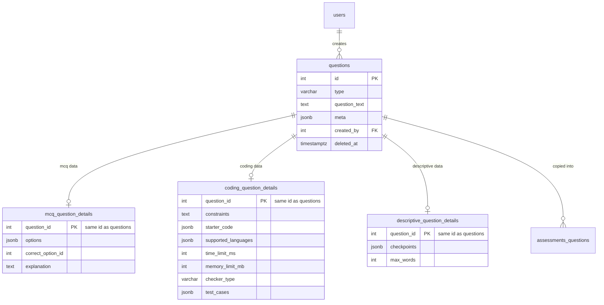

The bank uses **one shared table plus one detail table per type**. `questions.type` says which detail table holds the rest. Each detail table uses the question's id as its own primary key (a one-to-one link). This split happened in the `20261014*` migrations, which moved the MCQ columns out of `questions` and backfilled the new tables.

#### `questions`

Entity: `question.entity.ts`.

| Column | Type | Null | Default | Notes |
|---|---|---|---|---|
| `id` | int | no | auto | PK |
| `type` | varchar(20) | no | `mcq` | `QuestionType`. `IDX_questions_type` |
| `question_text` | text | no | | |
| `meta` | jsonb | yes | | `QuestionMeta`: `{ topics?: { name, weight }[] }`. Weights sum to 1. |
| `created_by` | int | no | | FK `users.id`, CASCADE. Indexed. |

Timestamps: all three.

#### `mcq_question_details`

| Column | Type | Null | Default | Notes |
|---|---|---|---|---|
| `question_id` | int | no | | PK and FK `questions.id`, CASCADE |
| `options` | jsonb | no | | `McqOption[]`: `{ id, text }` |
| `correct_option_id` | int | no | | Matches one `options[].id` |
| `explanation` | text | yes | | |

#### `coding_question_details`

| Column | Type | Null | Default | Notes |
|---|---|---|---|---|
| `question_id` | int | no | | PK and FK, CASCADE |
| `constraints`, `input_format`, `output_format` | text | yes | | Shown to the candidate |
| `starter_code` | jsonb | no | `{}` | `CodingStarterCode`: `{ [language]: code }` |
| `supported_languages` | jsonb | no | `[]` | `string[]` |
| `time_limit_ms` | int | no | | Per test case |
| `memory_limit_mb` | int | no | | |
| `checker_type` | varchar(30) | no | `exact` | How output is compared. varchar so new checkers need no migration. |
| `test_cases` | jsonb | no | `[]` | `CodingTestCase[]`: `{ input, expectedOutput, isHidden }`. Hidden cases are never shown. |

#### `descriptive_question_details`

| Column | Type | Null | Default | Notes |
|---|---|---|---|---|
| `question_id` | int | no | | PK and FK, CASCADE |
| `checkpoints` | jsonb | no | `[]` | `DescriptiveCheckpoint[]`: `{ id, description, weightage }`. Weightages are integers that sum to 100. This is the answer key. |
| `max_words` | int | yes | | Suggested length. Not enforced in grading. |

All jsonb shapes for questions are in `src/assessments/questions/interfaces/question-content.interface.ts` and `question-meta.interface.ts`.

### 3c. Content library: tags, prompts, templates

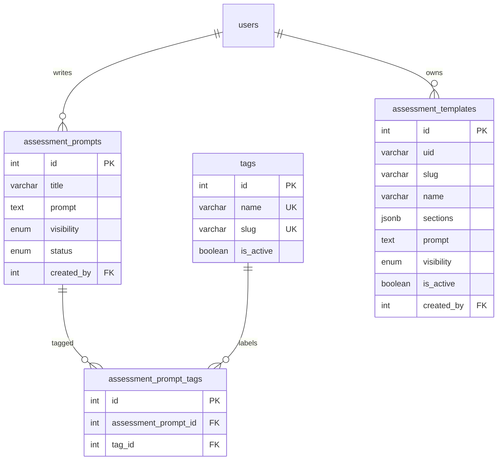

#### `tags`

A label for prompts. Entity: `tag.entity.ts`.

| Column | Type | Null | Default | Notes |
|---|---|---|---|---|
| `id` | int | no | auto | PK |
| `name` | varchar(100) | no | | `UQ_tags_name` (not partial) |
| `slug` | varchar(120) | no | | `UQ_tags_slug` (not partial) |
| `is_active` | boolean | no | `true` | |

Timestamps: `created_at`, `deleted_at`. Today tags are only joined through `assessment_prompt_tags`.

#### `assessment_prompts`

A saved, reusable prompt text that users can browse. Entity: `assessment-prompt.entity.ts`.

| Column | Type | Null | Default | Notes |
|---|---|---|---|---|
| `id` | int | no | auto | PK |
| `title` | varchar(150) | no | | |
| `description` | text | no | | |
| `prompt` | text | no | | |
| `visibility` | enum `AssessmentPromptVisibility` | no | `private` | `public`, `private` |
| `status` | enum `AssessmentPromptStatus` | no | `draft` | `draft`, `active`, `archived` |
| `created_by` | int | no | | FK, CASCADE. Indexed. |

Timestamps: all three. This library has **no** foreign key to `assessments`. Generation takes the prompt text directly in the request.

#### `assessment_prompt_tags`

Join table between prompts and tags. Entity: `assessment-prompt-tag.entity.ts`.

| Column | Type | Null | Default | Notes |
|---|---|---|---|---|
| `id` | int | no | auto | PK |
| `assessment_prompt_id` | int | no | | FK, CASCADE |
| `tag_id` | int | no | | FK, CASCADE |

Timestamps: `created_at`, `deleted_at`. Unique `(assessment_prompt_id, tag_id)` among live rows, so a tag can be removed and added again. Single-column indexes on both FKs exist in the database.

#### `assessment_templates`

A reusable preset of assessment settings. Starting from a template sends its sections as a manual-mode generation. Entity: `assessment-template.entity.ts`.

| Column | Type | Null | Default | Notes |
|---|---|---|---|---|
| `id` | int | no | auto | PK |
| `uid` | varchar(8) | no | | Public id. Unique among live rows. |
| `slug` | varchar(180) | no | | Unique among live rows |
| `name` | varchar(150) | no | | Template name in the picker |
| `title` | varchar(255) | yes | `null` | Title given to created assessments |
| `description` | text | no | | |
| `duration` | int | no | | Minutes |
| `max_participants` | int | no | | |
| `max_total_questions` | int | no | | Sum of section counts. Kept in step with `sections`. |
| `sections` | jsonb | no | `[]` | `AssessmentTemplateSection[]`: `{ title, prompt, questionType, questionCount, difficulty, positiveMark, negativeMark }`. Defined in the entity file. |
| `prompt` | text | yes | `null` | Default prompt for sections without their own |
| `visibility` | enum `AssessmentTemplateVisibility` | no | `private` | `public`, `private` |
| `is_active` | boolean | no | `true` | |
| `created_by` | int | no | | FK, CASCADE. Indexed. |

Timestamps: all three. Registration and attempt windows are not stored on the template; they come from the caller.

---

## 4. Attempts and evaluation

An **attempt** is one user sitting one assessment. A **response** is the answer to one question inside that attempt. Grading is done by background jobs (see [section 5](#5-jobs)). Design: [Attempts](hld-design/attempts.md), [Evaluation](hld-design/evaluation.md), [Code execution](hld-design/code-execution.md).

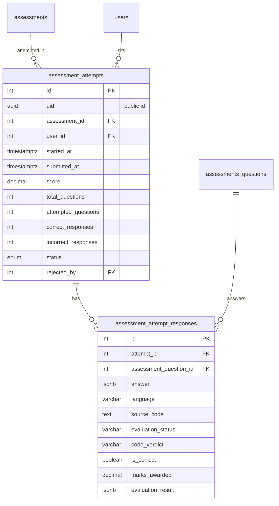

### `assessment_attempts`

Entity: `assessment-attempt.entity.ts`.

| Column | Type | Null | Default | Notes |
|---|---|---|---|---|
| `id` | int | no | auto | PK (internal) |
| `uid` | uuid | no | generated | Public id used in URLs |
| `assessment_id` | int | no | | FK, CASCADE. Indexed. |
| `user_id` | int | no | | FK, CASCADE. Indexed. |
| `started_at` | timestamptz | no | | |
| `submitted_at` | timestamptz | yes | `null` | |
| `score` | decimal(8,2) | yes | `null` | Set when evaluated |
| `total_questions` | int | no | | Copied from `assessments.curr_total_questions` at start |
| `attempted_questions` | int | no | `0` | |
| `correct_responses` | int | no | `0` | |
| `incorrect_responses` | int | no | `0` | |
| `status` | enum `AttemptStatus` | no | `in_progress` | See below |
| `rejected_at` | timestamptz | yes | `null` | |
| `rejected_by` | int | yes | `null` | FK `users.id`, SET NULL |
| `rejection_reason` | text | yes | `null` | |

Timestamps: `created_at`, `updated_at` (no soft delete).
Unique: `UQ_assessment_attempts_user_assessment` on `(user_id, assessment_id)`, so **one attempt per user per assessment**. It was created by migration `20260618000004` and is not declared on the entity. `AttemptsService.startAttempt()` returns the existing attempt if there is one.

| `AttemptStatus` | Meaning |
|---|---|
| `in_progress` | Being sat. Answers can change. |
| `submitted` | Handed in. Waiting for the evaluation job. |
| `evaluating` | The evaluator is grading the responses |
| `evaluated` | Graded and scored. Final. |
| `rejected` | Set aside by a reviewer, from any other state. Keeps its score for the record. |

Source: `src/assessments/domain/attempt-state.ts`.

### `assessment_attempt_responses`

Entity: `assessment-attempt-response.entity.ts`.

| Column | Type | Null | Default | Notes |
|---|---|---|---|---|
| `id` | int | no | auto | PK |
| `attempt_id` | int | no | | FK, CASCADE. Indexed. |
| `assessment_question_id` | int | no | | FK `assessments_questions.id`, CASCADE. Indexed (`IDX_assessment_attempt_responses_question_id`). |
| `answer` | jsonb | yes | | `McqAnswer` `{ selectedOptionId }` or `DescriptiveAnswer` `{ text }`. Null for coding. |
| `language` | varchar(30) | yes | | Coding only |
| `source_code` | text | yes | | Coding only |
| `evaluation_status` | varchar(20) | no | `pending` | `ResponseEvaluationStatus`, guarded by a `CHECK` |
| `code_verdict` | varchar(30) | yes | | `CodeVerdict`, guarded by a `CHECK`. Coding only. |
| `is_correct` | boolean | yes | | Null until graded |
| `marks_awarded` | decimal(8,2) | yes | | Null until graded |
| `evaluation_result` | jsonb | yes | | `CodingEvaluationResult` (per test case results, counts, time, memory, compiler output) or `DescriptiveEvaluationResult` (per checkpoint results, `scorePercent`) |
| `answered_at` | timestamptz | no | | |
| `evaluated_at` | timestamptz | yes | | |

Timestamps: `created_at`, `updated_at`. Composite index: `IDX_assessment_attempt_responses_evaluation_status` on `(attempt_id, evaluation_status)`. There is **no** unique index on `(attempt_id, assessment_question_id)`; "one response per question" is enforced in `AttemptsService.upsertResponse()` (find, then update or insert).

| `ResponseEvaluationStatus` | Meaning |
|---|---|
| `pending` | Saved, not graded yet. Every answer is saved as `pending`. |
| `processing` | A grader is working on it |
| `completed` | Graded |
| `failed` | Grading failed. The job can retry. |
| `cancelled` | Grading abandoned (for example the attempt was rejected) |

| `CodeVerdict` | Meaning |
|---|---|
| `accepted` | All test cases passed |
| `wrong_answer` | Output did not match |
| `time_limit_exceeded` | Too slow |
| `memory_limit_exceeded` | Too much memory |
| `compilation_error` | Did not compile |
| `runtime_error` | Crashed while running |

Source: `src/assessments/domain/response-state.ts`. jsonb shapes: `src/assessments/questions/interfaces/question-content.interface.ts`.

---

## 5. Jobs

A **job** is a row that tracks a piece of background work sent through RabbitMQ (generating an assessment, grading an attempt, building a roadmap, importing invitations). Jobs can have child jobs. Design: [Jobs and schedulers](hld-design/jobs-and-schedulers.md).

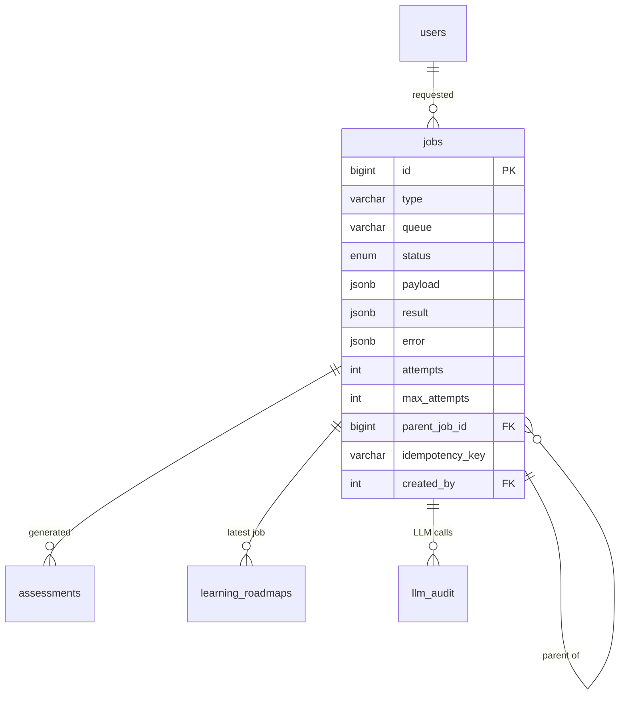

### `jobs`

Entity: `job.entity.ts`.

| Column | Type | Null | Default | Notes |
|---|---|---|---|---|
| `id` | bigint | no | auto | PK (TypeScript `string`) |
| `type` | varchar(100) | no | | `JobType`. `IDX_jobs_type` |
| `queue` | varchar(50) | no | | RabbitMQ queue. `IDX_jobs_queue` |
| `status` | enum `JobStatus` | no | `pending` | `IDX_jobs_status` |
| `payload` | jsonb | yes | `null` | Input. Shape depends on `type` (see below). |
| `result` | jsonb | yes | `null` | Output on success |
| `error` | jsonb | yes | `null` | Error details on failure |
| `attempts` | int | no | `0` | Tries so far |
| `max_attempts` | int | no | | Retry budget |
| `status_description` | text | yes | `null` | Human-readable progress, for example `2/3 sections generated` |
| `parent_job_id` | bigint | yes | `null` | FK `jobs.id`, CASCADE. `IDX_jobs_parent_job_id` |
| `idempotency_key` | varchar(100) | yes | `null` | Client's `Idempotency-Key` header |
| `created_by` | int | yes | `null` | FK `users.id`, **SET NULL** (a job is an audit record and outlives its user). Indexed. |
| `started_at`, `completed_at` | timestamptz | yes | `null` | |

Timestamps: `created_at` only. Unique: `UQ_jobs_created_by_idempotency_key` on `(created_by, idempotency_key) WHERE idempotency_key IS NOT NULL`, so the same request sent twice opens only one job.

| `JobStatus` | Meaning |
|---|---|
| `pending` | Queued, not picked up |
| `processing` | A worker is running it (a parent stays here while its children run) |
| `completed` | Finished with a result |
| `failed` | Finished with an error |
| `cancelled` | Abandoned before finishing |

`JobType` values and their payload interfaces:

| `JobType` | Payload interface (file) |
|---|---|
| `GENERATE_ASSESSMENT` (parent) | `ParentGenerationPayload` (`src/assessments/generation/interfaces/generation-job.interface.ts`) |
| `GENERATE_MCQ_SECTION`, `GENERATE_CODING_SECTION`, `GENERATE_DESCRIPTIVE_SECTION` | `SectionGenerationPayload` (same file) |
| `EVALUATE_ATTEMPT` (parent) | `AttemptEvaluationPayload` (`src/assessments/attempts/interfaces/attempt-evaluation-job.interface.ts`) |
| `EVALUATE_MCQ_RESPONSES`, `EVALUATE_CODING_RESPONSES`, `EVALUATE_DESCRIPTIVE_RESPONSES` | `ResponseEvaluationPayload` (`src/assessments/evaluation/interfaces/evaluation-job.interface.ts`) |
| `IMPORT_ORG_INVITATIONS` | `InvitationImportPayload` (`src/organizations/interfaces/invitation-import.interface.ts`) |
| `ANALYZE_ROADMAP_INTENT`, `GENERATE_ROADMAP`, `MODIFY_ROADMAP_GRAPH` | Roadmap payloads (`src/learning-roadmaps/`) |
| `CREATE_ASSESSMENT` | Older single-job generation, still routed by `src/assessments/consumers/question-generation.consumer.ts` |

Every payload carries a `userId`. `JobsService.findOne()` checks it against the caller, so users only see their own jobs.

---

## 6. AI

These tables hold the list of LLMs the platform can call, an audit row for every LLM call, and the chat history of the AI assistant. Design: [AI layer](hld-design/ai.md), [AI assistant](hld-design/ai-assistant.md).

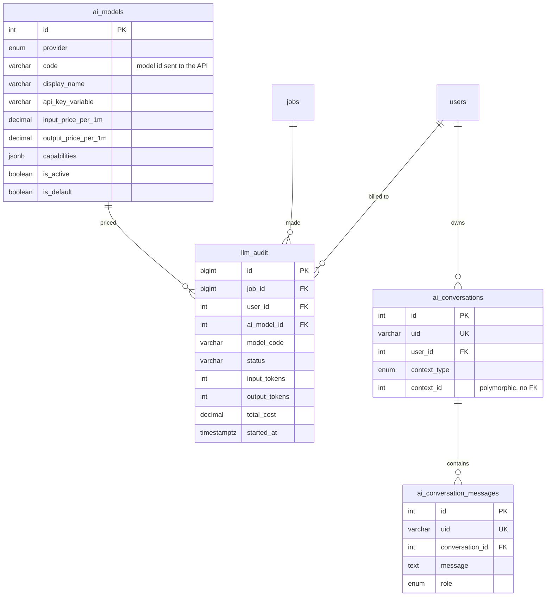

### `ai_models`

An LLM the platform can route requests to, with its prices. Entity: `ai-model.entity.ts`.

| Column | Type | Null | Default | Notes |
|---|---|---|---|---|
| `id` | int | no | auto | PK |
| `provider` | enum `AiModelProvider` | no | | `openai`, `anthropic`, `google` |
| `code` | varchar(150) | no | | Provider's model id. Unique among live rows. |
| `display_name` | varchar(150) | no | | |
| `api_key_variable` | varchar(100) | no | | **Name** of the env variable that holds the key. The key itself is never stored. |
| `base_url_variable` | varchar(100) | yes | `null` | Name of the env variable for the base URL |
| `input_price_per_1m` | decimal(12,6) | no | `0` | USD per million input tokens |
| `output_price_per_1m` | decimal(12,6) | no | `0` | USD per million output tokens |
| `capabilities` | jsonb | no | `{}` | `AiModelCapabilities`: `vision`, `toolCalling`, `structuredOutput`, `streaming`, `contextWindow`, `maxOutputTokens` (all optional). `src/ai/interfaces/ai-model-capabilities.interface.ts` |
| `is_active` | boolean | no | `true` | Indexed |
| `is_default` | boolean | no | `false` | `UQ_ai_models_is_default`: unique where `is_default = true AND deleted_at IS NULL`, so at most one default |

Timestamps: all three.

### `llm_audit`

One row per LLM API call. Append-only: rows are never updated or deleted. Entity: `llm-audit.entity.ts`.

| Column | Type | Null | Default | Notes |
|---|---|---|---|---|
| `id` | bigint | no | auto | PK |
| `job_id` | bigint | yes | `null` | FK `jobs.id`, SET NULL. Indexed. |
| `job_type` | varchar(100) | no | | Copied from the job |
| `user_id` | int | yes | `null` | FK, SET NULL. Indexed. |
| `ai_model_id` | int | yes | `null` | FK, SET NULL. Indexed. |
| `provider`, `model`, `model_code` | varchar | no | | Snapshot at call time |
| `status` | varchar(30) | no | | `LlmAuditStatus`: `SUCCESS`, `FAILED` |
| `attempt` | int | no | `1` | 2 for a repair retry, and so on |
| `error_message` | text | yes | `null` | |
| `started_at` | timestamptz | no | | Indexed |
| `completed_at` | timestamptz | yes | `null` | |
| `duration_ms` | int | yes | `null` | |
| `input_tokens`, `output_tokens`, `cached_input_tokens`, `total_tokens` | int | no | `0` | |
| `input_price_per_1m`, `output_price_per_1m` | decimal(20,10) | yes | `null` | Price snapshot |
| `input_cost`, `output_cost`, `total_cost` | decimal(20,10) | no | `0` | USD |

Timestamps: `created_at` only. All foreign keys are SET NULL because the audit trail must outlive the job, user and model. Provider, model and prices are copied so a row keeps its meaning after a model is repriced or deleted.

### `ai_conversations`

One chat thread of the AI assistant, attached to one resource. Entity: `ai-conversation.entity.ts`.

| Column | Type | Null | Default | Notes |
|---|---|---|---|---|
| `id` | int | no | auto | PK |
| `uid` | varchar(64) | no | | `conv_<32 hex>`. `UQ_ai_conversations_uid` |
| `user_id` | int | no | | FK, CASCADE. Indexed. Copied from the context. |
| `context_type` | enum `AiConversationContextType` | no | | `assessment_attempt` or `roadmap` |
| `context_id` | int | no | | Id in the table that `context_type` names. **Polymorphic: deliberately no FK.** |

Timestamps: `created_at`, `updated_at`. Unique: `UQ_ai_conversations_context` on `(context_type, context_id)`, so there is one conversation per attempt or roadmap, even if two requests open it at the same time.

### `ai_conversation_messages`

Entity: `ai-conversation-message.entity.ts`.

| Column | Type | Null | Default | Notes |
|---|---|---|---|---|
| `id` | int | no | auto | PK |
| `uid` | varchar(64) | no | | `msg_<32 hex>`. Unique. |
| `conversation_id` | int | no | | FK, CASCADE. Indexed. |
| `message` | text | no | | |
| `role` | enum `AiConversationMessageRole` | no | | `user` (the learner) or `bot` (the assistant) |

Timestamps: `created_at` only. Index `IDX_ai_conversation_messages_conversation_created` on `(conversation_id, created_at)` serves transcript reads.

---

## 7. Commerce: plans, subscriptions, usage, orders, payments, credits

A **plan** (for example Free or Pro) has **versions**. Each version has a price and a list of **features** with limits. A **subscription** links a user (or an organization) to one plan version. **Usage** rows count how much of a limited feature has been used in the current period. **Credit packs** are one-time purchases of extra usage, and **credit balances** hold what was bought. **Orders** and **payments** record checkout through Razorpay, for subscriptions and credit packs alike. Design: [Commerce](hld-design/commerce.md).

### 7a. Plans, features, subscriptions and usage

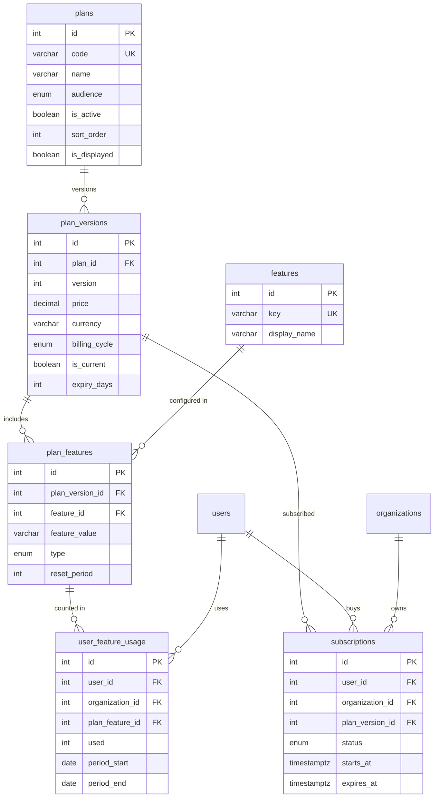

#### `plans`

Entity: `plan.entity.ts`.

| Column | Type | Null | Default | Notes |
|---|---|---|---|---|
| `id` | int | no | auto | PK |
| `name` | varchar(100) | no | | The free plan is found by name (`FREE_PLAN_NAME`) |
| `code` | varchar(50) | no | | Unique (plain constraint) |
| `description` | text | no | | |
| `audience` | enum `PlanAudience` | no | `individual` | `individual` (bought for yourself) or `organization` (bought for an org) |
| `is_active` | boolean | no | `true` | |
| `sort_order` | int | no | `0` | Order in the public list. Indexed. |
| `is_displayed` | boolean | no | `true` | Hidden plans still work for existing subscribers |

Timestamps: all three.

#### `plan_versions`

A priced version of a plan. Changing a price creates a new version so old subscribers keep their terms. Entity: `plan-version.entity.ts`.

| Column | Type | Null | Default | Notes |
|---|---|---|---|---|
| `id` | int | no | auto | PK |
| `plan_id` | int | no | | FK, CASCADE. Indexed. |
| `version` | int | no | | |
| `price` | decimal(10,2) | no | | |
| `currency` | varchar(3) | no | | ISO code, for example `INR` |
| `billing_cycle` | enum `BillingCycle` | no | | `MONTHLY`, `YEARLY`, `ONE_TIME` |
| `is_current` | boolean | no | `true` | |
| `effective_from` | timestamptz | no | | |
| `effective_until` | timestamptz | yes | `null` | After this, the version can no longer be bought |
| `expiry_days` | int | yes | `null` | How long a `ONE_TIME` purchase lasts. Null = never expires. Always null for recurring versions. |

Timestamps: all three. Unique: `(plan_id, version)`; and `UQ_plan_versions_plan_id_current` on `plan_id WHERE is_current = true`, so **only one current version per plan**.

#### `features`

The catalog of features a plan can include. Entity: `feature.entity.ts`.

| Column | Type | Null | Default | Notes |
|---|---|---|---|---|
| `id` | int | no | auto | PK |
| `key` | varchar(100) | no | | `FeatureKey`. `UQ_features_key` |
| `display_name` | varchar(150) | no | | |
| `description` | text | yes | `null` | |

Timestamps: all three.

| `FeatureKey` | Meaning |
|---|---|
| `AI_ASSESSMENT` | Number of AI assessment generations (a limit) |
| `AI_LEARNING_ROADMAP` | Number of AI roadmaps (a limit) |
| `AI_MODEL` | Which AI model the plan uses (an enum setting) |
| `ALLOWED_QUESTION_TYPES` | Comma-separated question types the plan may generate, for example `mcq,coding` |

#### `plan_features`

One feature inside one plan version, with its value. Entity: `plan-version-feature.entity.ts` (class `PlanVersionFeature`).

| Column | Type | Null | Default | Notes |
|---|---|---|---|---|
| `id` | int | no | auto | PK |
| `plan_version_id` | int | no | | FK, CASCADE. Indexed. |
| `feature_id` | int | no | | FK `features.id`, CASCADE. Indexed. |
| `display_name` | varchar(150) | no | | Per-version label |
| `description` | text | yes | `null` | |
| `feature_value` | varchar(255) | no | | A number, "unlimited", a model code or a list, depending on `type` |
| `type` | enum `PlanFeatureType` | no | `limit` | `limit`: a usage quota (a non-numeric value means unlimited). `enum`: a setting, never consumed. |
| `reset_period` | int | yes | `null` | Days between usage resets. Null = never resets. |

Timestamps: all three. Unique `(plan_version_id, feature_id)` among live rows.

#### `subscriptions`

Links a user, or an organization, to a plan version. Entity: `subscription.entity.ts`.

| Column | Type | Null | Default | Notes |
|---|---|---|---|---|
| `id` | int | no | auto | PK |
| `user_id` | int | no | | FK, CASCADE. Indexed. Always the purchaser. |
| `organization_id` | int | yes | `null` | FK, CASCADE. Indexed. Set for an organization's subscription. |
| `plan_version_id` | int | no | | FK, CASCADE. Indexed. The plan is reached through the version. |
| `status` | enum `SubscriptionStatus` | no | | See below |
| `starts_at` | timestamptz | no | | |
| `expires_at` | timestamptz | yes | `null` | Null for a `ONE_TIME` purchase with no `expiry_days` |
| `cancelled_at` | timestamptz | yes | `null` | |
| `auto_renew` | boolean | no | `true` | `false` for `ONE_TIME` |

Timestamps: all three.

| `SubscriptionStatus` | Meaning |
|---|---|
| `PENDING` | Checkout started, not paid |
| `ACTIVE` | In use |
| `SUSPENDED` | Replaced: when a new personal plan is paid, other active personal subscriptions are suspended (`PaymentsService.markPaymentCaptured()`) |
| `PAST_DUE`, `CANCELLED`, `EXPIRED` | Defined for renewals and cancellation |

A user with no active personal subscription gets a free one created on demand (`SubscriptionsService.createFreeSubscription()`, called from `UsageService.consume()` and from email verification).

#### `user_feature_usage`

How much of a limited feature has been used in the current period. Entity: `user-feature-usage.entity.ts`.

| Column | Type | Null | Default | Notes |
|---|---|---|---|---|
| `id` | int | no | auto | PK |
| `user_id` | int | no | | FK, CASCADE. Indexed. For pooled org usage, the org's purchaser. |
| `organization_id` | int | yes | `null` | FK, CASCADE. Indexed. Set for an organization's pooled usage. |
| `plan_feature_id` | int | no | | FK `plan_features.id`, CASCADE. Indexed. |
| `used` | int | no | `0` | |
| `period_start` | date | no | | |
| `period_end` | date | no | | A far-future date when `reset_period` is null |

Timestamps: all three. There is no unique index on `(user_id, organization_id, plan_feature_id)` (see [gaps](#known-schema-gaps)).

### 7b. Orders, payments and webhooks

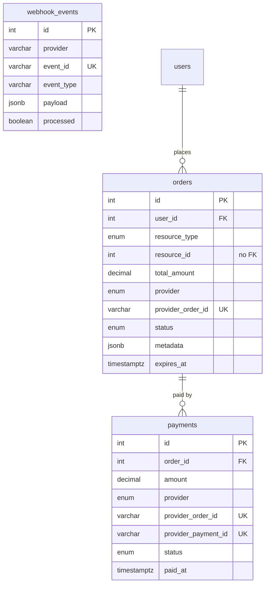

#### `orders`

What the user is buying. Entity: `order.entity.ts`.

| Column | Type | Null | Default | Notes |
|---|---|---|---|---|
| `id` | int | no | auto | PK |
| `user_id` | int | no | | FK, CASCADE. Indexed. |
| `resource_type` | enum `OrderResourceType` | no | | `SUBSCRIPTION` or `CREDIT` (renamed from `AI_CREDITS` by `20261027000002`) |
| `resource_id` | int | no | | Id of the thing bought: a `subscriptions.id`, or a `credit_packs.id` for `CREDIT`. **No FK**: it is polymorphic. |
| `total_amount` | decimal(10,2) | no | | |
| `currency` | varchar(3) | no | | |
| `provider` | enum `PaymentProvider` | no | | `RAZORPAY` (in use), `STRIPE` (enum only, no integration) |
| `provider_order_id` | varchar(255) | no | | Our checkout reference `chk_<uuid>`; the Razorpay order id is on the payment. `UQ_orders_provider_order_id` |
| `status` | enum `OrderStatus` | no | | `PENDING`, `PAID`, `FAILED`, `FULFILLED` (see below) |
| `metadata` | jsonb | yes | `null` | `null` for `SUBSCRIPTION`. For `CREDIT`, `CreditOrderMetadata`: `{ creditPackId, featureId, quantity, aiModelCode }`, what the pack held at purchase. |
| `expires_at` | timestamptz | no | | |

Timestamps: `created_at`, `updated_at`. Index `IDX_orders_resource_type_resource_id` on `(resource_type, resource_id)`.

| `status` | Set when |
|---|---|
| `PENDING` | Checkout created the order |
| `PAID` | Its payment was captured. Moves on to `FULFILLED` in the same transaction; stays `PAID` only for a `CREDIT` order with no credit metadata. |
| `FULFILLED` | What it bought was granted: the subscription activated, or the credits added |
| `FAILED` | Its payment failed while the order was still `PENDING`. A later capture of the same Razorpay order still moves it to `PAID`. |

`20261029000000-backfill-order-statuses.ts` brought older rows in line: captured subscription orders to `FULFILLED`, and pending orders whose latest payment failed to `FAILED`.

#### `payments`

One payment try against an order. Entity: `payment.entity.ts`.

| Column | Type | Null | Default | Notes |
|---|---|---|---|---|
| `id` | int | no | auto | PK |
| `order_id` | int | no | | FK, CASCADE. Indexed. |
| `amount` | decimal(10,2) | no | | |
| `currency` | varchar(3) | no | | |
| `provider` | enum `PaymentProvider` | no | | |
| `provider_order_id` | varchar(255) | yes | `null` | Unique where not null |
| `provider_payment_id` | varchar(255) | yes | `null` | Unique where not null |
| `status` | enum `PaymentStatus` | no | | `PENDING`, `SUCCESS`, `FAILED`, `REFUNDED` |
| `failure_reason` | text | yes | `null` | |
| `paid_at` | timestamptz | yes | `null` | |

Timestamps: `created_at`, `updated_at`.

On a captured payment, in one transaction: the payment becomes `SUCCESS` and the order `PAID`. Then, for a subscription, other active personal subscriptions become `SUSPENDED`, the ordered one `ACTIVE`, and the order `FULFILLED`; for credits, the balance grows and the order becomes `FULFILLED`. On a failed payment, in one transaction: the payment becomes `FAILED`, and the order `FAILED` if it was still `PENDING`.

#### `webhook_events`

A log of received payment webhooks, used to ignore repeats. Entity: `webhook-event.entity.ts`.

| Column | Type | Null | Default | Notes |
|---|---|---|---|---|
| `id` | int | no | auto | PK |
| `provider` | varchar(50) | no | | |
| `event_id` | varchar(255) | no | | Unique. Built as `<event>:<razorpayPaymentId>` (for example `payment.captured:pay_ABC`), not the raw webhook id. |
| `event_type` | varchar(100) | no | | |
| `payload` | jsonb | no | | Raw webhook body |
| `processed` | boolean | no | `false` | |
| `processed_at` | timestamptz | yes | `null` | |

Timestamps: `created_at` only. No FK to payments; the link is through the payload.

### 7c. Credit packs and purchased credits

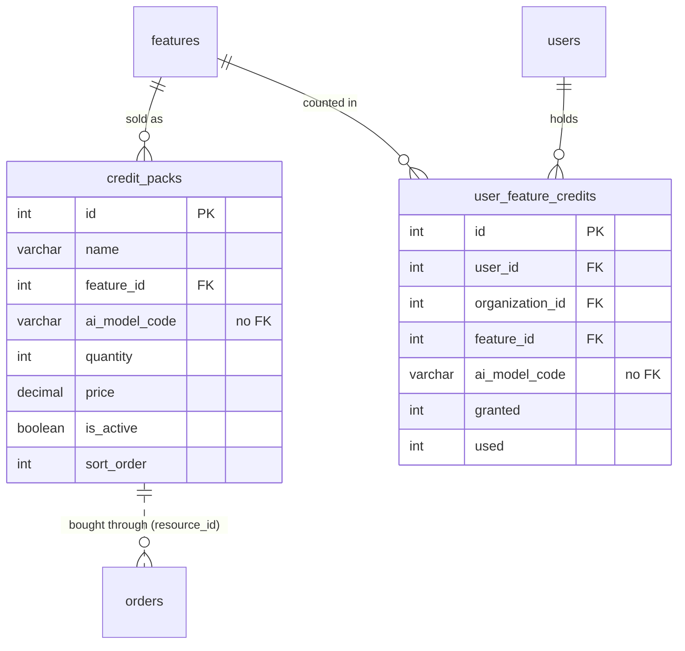

Credits are extra usage on top of any plan. They are keyed by **feature**, not plan feature, so a balance survives plan changes, and they never reset or expire. `UsageService.consume` spends them only once the plan's own quota runs out. Design: [Commerce, section 7](hld-design/commerce.md#7-credit-packs).

#### `credit_packs`

The catalog of credits on sale, managed by admins. Entity: `credit-pack.entity.ts`.

| Column | Type | Null | Default | Notes |
|---|---|---|---|---|
| `id` | int | no | auto | PK. Checkout takes this id. |
| `name` | varchar(100) | no | | |
| `description` | text | yes | `null` | |
| `feature_id` | int | no | | FK `features.id`, CASCADE. `IDX_credit_packs_feature_id`. Never `AI_MODEL` or `ALLOWED_QUESTION_TYPES` (the API refuses settings). |
| `ai_model_code` | varchar(150) | yes | `null` | The model the credits run on, by `ai_models.code`. `null` = the free plan's `AI_MODEL`. A code, not an FK: a removed model falls back to the default. |
| `quantity` | int | no | | Units of the feature per pack |
| `price` | decimal(10,2) | no | | |
| `currency` | varchar(3) | no | | |
| `is_active` | boolean | no | `true` | `false` takes the pack off sale. There is no delete endpoint. |
| `sort_order` | int | no | `0` | `IDX_credit_packs_sort_order` |

Timestamps: all three.

#### `user_feature_credits`

A purchased credit balance: one row per owner, feature and AI model. Entity: `user-feature-credit.entity.ts`.

| Column | Type | Null | Default | Notes |
|---|---|---|---|---|
| `id` | int | no | auto | PK |
| `user_id` | int | no | | FK, CASCADE. Indexed. |
| `organization_id` | int | yes | `null` | FK, CASCADE. Indexed. Always `null` today: only personal credits are sold. |
| `feature_id` | int | no | | FK, CASCADE. Indexed. |
| `ai_model_code` | varchar(150) | yes | `null` | Copied from the pack. `null` = the free plan's model. |
| `granted` | int | no | `0` | Bought in total |
| `used` | int | no | `0` | Spent. `granted - used` is what is left. |

Timestamps: all three. Four partial unique indexes keep one row per owner, feature and model, with separate indexes for a `null` and a named model (a plain unique index would let `null`-model rows repeat):

| Index | Columns | Where |
|---|---|---|
| `UQ_user_feature_credits_user_id_feature_id` | `(user_id, feature_id)` | `organization_id IS NULL AND ai_model_code IS NULL` |
| `UQ_user_feature_credits_user_id_feature_id_ai_model_code` | `(user_id, feature_id, ai_model_code)` | `organization_id IS NULL AND ai_model_code IS NOT NULL` |
| `UQ_user_feature_credits_organization_id_feature_id` | `(organization_id, feature_id)` | `organization_id IS NOT NULL AND ai_model_code IS NULL` |
| `UQ_user_feature_credits_org_id_feature_id_ai_model_code` | `(organization_id, feature_id, ai_model_code)` | `organization_id IS NOT NULL AND ai_model_code IS NOT NULL` |

Grants are an `INSERT ... ON CONFLICT` on the matching index, so two first grants for the same user cannot both insert a row.

---

## 8. Learning roadmaps

A **roadmap** is a personal study plan made by the AI. It is a graph: **nodes** are steps (learn a topic, or practise it) and **edges** connect them. Design: [Learning roadmaps](hld-design/learning-roadmaps.md). The module also has a detailed design note at `src/learning-roadmaps/tdd.md`.

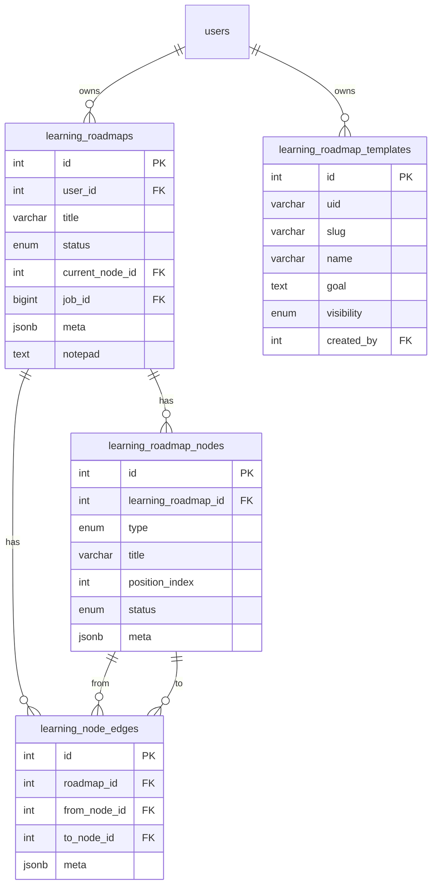

### `learning_roadmaps`

Entity: `learning-roadmap.entity.ts`.

| Column | Type | Null | Default | Notes |
|---|---|---|---|---|
| `id` | int | no | auto | PK |
| `user_id` | int | no | | FK, CASCADE. Indexed. |
| `title` | varchar(255) | yes | `null` | Written by the analysis job |
| `description` | text | yes | `null` | |
| `status` | enum `RoadmapStatus` | no | `analyzing` | See below |
| `current_node_id` | int | yes | `null` | FK `learning_roadmap_nodes.id`, SET NULL (in the migration only) |
| `job_id` | bigint | yes | `null` | FK `jobs.id`, SET NULL (in the migration only). The latest job. |
| `meta` | jsonb | yes | `null` | `RoadmapMeta`: `rawDescription`, `requirementQuestions[]`, the job ids per phase, LLM run info, modification history |
| `notepad` | text | no | `''` | The learner's notes. `select: false`, so it is only loaded when asked for. |

Timestamps: `created_at`, `updated_at` (no soft delete). Composite index `IDX_learning_roadmaps_user_status` on `(user_id, status)`.

| `RoadmapStatus` | Meaning |
|---|---|
| `analyzing` | Intent-analysis job queued or running |
| `draft` | Analyzed. Waiting for the learner's answers to the requirement questions. |
| `generating` | Graph-generation job queued or running |
| `active` | Graph exists. Learner is progressing. |
| `modifying` | Graph-modification job queued or running |
| `completed` | Finished |
| `archived` | Put away by the learner |
| `failed` | Analysis or generation failed. No usable graph. |

### `learning_roadmap_nodes`

Entity: `learning-roadmap-node.entity.ts`.

| Column | Type | Null | Default | Notes |
|---|---|---|---|---|
| `id` | int | no | auto | PK. Stays the same across modifications. |
| `learning_roadmap_id` | int | no | | FK, CASCADE. Indexed. |
| `type` | enum `NodeType` | no | | `knowledge` (learn) or `practice` (test yourself) |
| `title` | varchar(255) | no | | |
| `description` | text | yes | `null` | Learning material or practice brief |
| `position_index` | int | no | | 0-based order |
| `status` | enum `NodeStatus` | no | `not_started` | `not_started`, `in_progress`, `completed`, `skipped`. Owned by the learner; generation never changes it. |
| `completed_at` | timestamptz | yes | `null` | |
| `meta` | jsonb | yes | `null` | `KnowledgeNodeMeta & PracticeNodeMeta`: resources, estimated minutes, concepts; for practice nodes `assessmentId`, `questionCount`, `coversNodeIds` |

Timestamps: `created_at` only. Unique `UQ_learning_roadmap_nodes_position` on `(learning_roadmap_id, position_index)`. Index `(learning_roadmap_id, status)` for progress counts.

A practice node points to the assessment generated for it through `meta.assessmentId`. This is an app-level link with no FK.

### `learning_node_edges`

Links between nodes. They make the roadmap a graph (a DAG: a graph without loops) instead of a list. Entity: `learning-node-edge.entity.ts`.

| Column | Type | Null | Default | Notes |
|---|---|---|---|---|
| `id` | int | no | auto | PK |
| `roadmap_id` | int | no | | FK, CASCADE. Copied from the nodes so a whole graph loads with one indexed query. |
| `from_node_id` | int | no | | FK nodes, CASCADE. Indexed. |
| `to_node_id` | int | no | | FK nodes, CASCADE. Indexed. |
| `meta` | jsonb | yes | `null` | `EdgeMeta`: `label`, and an optional `condition` `{ type: 'score', operator: 'gte' or 'lt', value }` for branching after a practice node |

Timestamps: `created_at` only. Unique `(roadmap_id, from_node_id, to_node_id)`. `CHECK from_node_id <> to_node_id` (in the migration only).

jsonb shapes for all three tables: `src/learning-roadmaps/interfaces/roadmap-meta.interface.ts`.

### `learning_roadmap_templates`

A ready-made goal a learner can pick instead of typing one. Entity: `learning-roadmap-template.entity.ts`.

| Column | Type | Null | Default | Notes |
|---|---|---|---|---|
| `id` | int | no | auto | PK |
| `uid` | varchar(8) | no | | Unique among live rows |
| `slug` | varchar(180) | no | | Unique among live rows |
| `name` | varchar(150) | no | | |
| `description` | text | no | | For the picker. Not sent to the model. |
| `goal` | text | no | | Sent to the analysis job as if the learner typed it |
| `visibility` | enum `RoadmapTemplateVisibility` | no | `private` | `public`, `private` |
| `is_active` | boolean | no | `true` | |
| `created_by` | int | no | | FK, CASCADE. Indexed. |

Timestamps: all three.

---

## 9. Notifications and newsletters

Email templates are **not** stored in the database. They are TypeScript files in `src/notifications/email/templates/` (verification, welcome, password reset, invitations, newsletter). The only table here is `newsletters`. Design: [Notifications](hld-design/notifications.md).

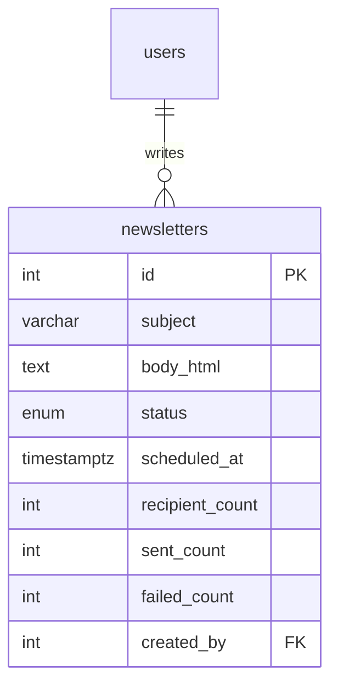

### `newsletters`

An email sent to every subscribed user, now or at a set time. Entity: `newsletter.entity.ts`.

| Column | Type | Null | Default | Notes |
|---|---|---|---|---|
| `id` | int | no | auto | PK |
| `subject` | varchar(200) | no | | |
| `body_html` | text | no | | |
| `body_text` | text | yes | `null` | Plain-text version |
| `status` | enum `NewsletterStatus` | no | `SCHEDULED` | Indexed |
| `scheduled_at` | timestamptz | no | | "Send now" stores the current time. Indexed. |
| `started_at` | timestamptz | yes | `null` | Set when a dispatcher claims the row |
| `sent_at` | timestamptz | yes | `null` | |
| `recipient_count` | int | yes | `null` | |
| `sent_count`, `failed_count` | int | no | `0` | |
| `error` | text | yes | `null` | For operators only |
| `created_by` | int | no | | FK, CASCADE. Indexed. |

Timestamps: all three.

| `NewsletterStatus` | Meaning |
|---|---|
| `SCHEDULED` | Waiting for `scheduled_at`. The only status the dispatcher claims from. |
| `SENDING` | Claimed and being delivered |
| `SENT` | Done. Check `failed_count`: a partial failure still lands here. |
| `FAILED` | Could not be attempted, or every recipient failed |

---

## 10. Platform: feature flags and support tickets

Design: [Platform services](hld-design/platform-services.md).

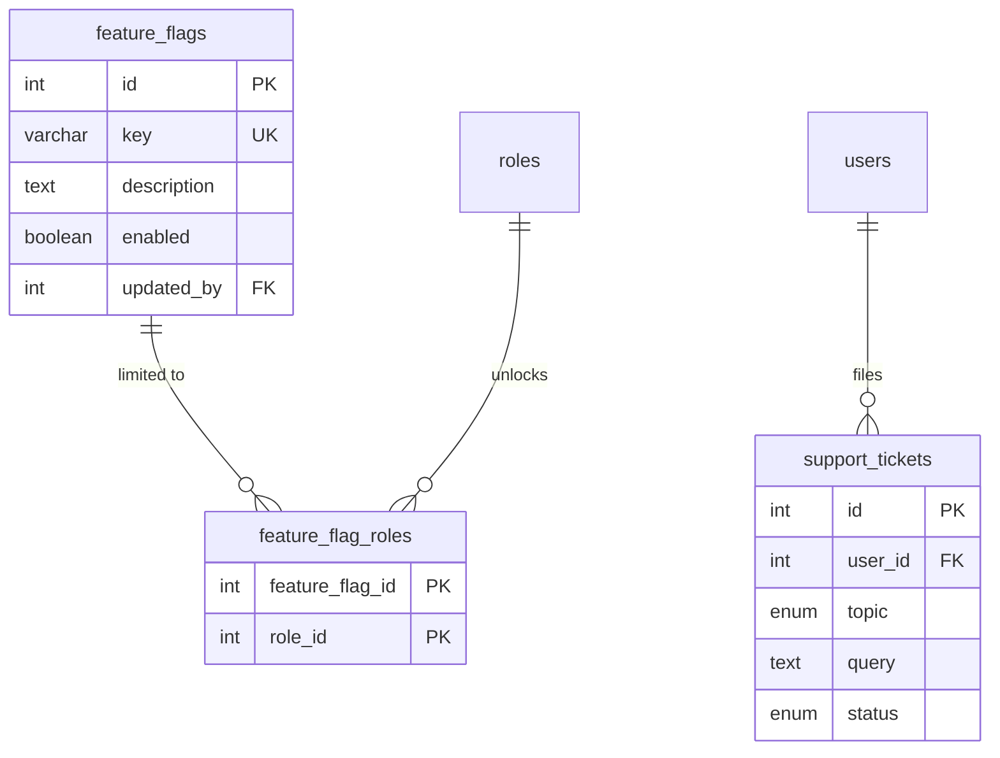

### `feature_flags`

The current state of one feature flag. Keys and defaults come from code (`FEATURE_FLAG_DEFINITIONS`); admins only change `enabled` and the role list. Entity: `feature-flag.entity.ts`.

| Column | Type | Null | Default | Notes |
|---|---|---|---|---|
| `id` | int | no | auto | PK |
| `key` | varchar(100) | no | | `UQ_feature_flags_key` |
| `description` | text | no | | |
| `enabled` | boolean | no | `true` | `false` turns it off for everyone |
| `updated_by` | int | yes | `null` | FK `users.id`, SET NULL. Null when only the seeder wrote it. |

Timestamps: `created_at`, `updated_at`.

How a flag is read: `enabled = false` → off for everyone. `enabled = true` with no roles → on for everyone. `enabled = true` with roles → on only for users holding one of those platform roles.

### `feature_flag_roles`

Which platform roles a flag is limited to. Entity: `feature-flag-role.entity.ts`.

| Column | Type | Null | Default | Notes |
|---|---|---|---|---|
| `feature_flag_id` | int | no | | Composite PK, FK, CASCADE |
| `role_id` | int | no | | Composite PK, FK `roles.id`, CASCADE. `IDX_feature_flag_roles_role_id` |

No timestamps. This is the only table with a composite primary key.

### `support_tickets`

A help request from a user. Entity: `support-ticket.entity.ts`.

| Column | Type | Null | Default | Notes |
|---|---|---|---|---|
| `id` | int | no | auto | PK |
| `user_id` | int | no | | FK, CASCADE. Indexed. |
| `topic` | enum `SupportTicketTopic` | no | | `BILLING`, `TECHNICAL`, `ACCOUNT`, `ASSESSMENT`, `FEEDBACK`, `OTHER` |
| `query` | text | no | | |
| `status` | enum `SupportTicketStatus` | no | `OPEN` | `OPEN`, `IN_PROGRESS`, `RESOLVED`, `CLOSED`. Indexed. |

Timestamps: all three. Tickets are not linked to orders or assessments; the topic is only a label.

### Modules with no tables

`health`, `stats`, `events` (WebSocket gateway), `rate-limiter` (counters live in Redis), `code-execution` and `schedulers` have no tables of their own. `stats` reads other tables with raw SQL.

---

## How tables connect across domains

### Real foreign keys between domains

| From | To | Via | On delete |
|---|---|---|---|
| Almost every table | `users` | `user_id`, `created_by`, `owner_user_id` | CASCADE |
| `jobs`, `llm_audit`, `feature_flags`, `*.invited_by`, `assessment_attempts.rejected_by` | `users` | various | SET NULL (the row outlives the user) |
| `assessments`, `subscriptions`, `user_feature_usage`, `roles` | `organizations` | `organization_id` (nullable) | CASCADE |
| `organization_members` | `roles` | `role_id` | RESTRICT |
| `feature_flag_roles` | `roles` | `role_id` | CASCADE |
| `assessments`, `learning_roadmaps` | `jobs` | `job_id` | SET NULL |
| `llm_audit` | `jobs`, `ai_models` | `job_id`, `ai_model_id` | SET NULL |
| `assessment_attempt_responses` | `assessments_questions` | `assessment_question_id` | CASCADE |

A `null` `organization_id` always means "personal". A set one means "belongs to that organization".

### App-level links (no foreign key)

These links exist only in code. The database does not check them.

| Link | Where it lives | Why no FK |
|---|---|---|
| Conversation → attempt or roadmap | `ai_conversations.context_type` + `context_id` | Polymorphic: points to different tables |
| Order → subscription or credit pack | `orders.resource_type` + `resource_id` | Polymorphic |
| Credit pack or balance → AI model | `credit_packs.ai_model_code`, `user_feature_credits.ai_model_code` | By code, so a removed model falls back to the default |
| Practice node → assessment | `learning_roadmap_nodes.meta.assessmentId` | Lives inside jsonb |
| Job → assessment, attempt, roadmap, org | `jobs.payload` (`assessmentId`, `attemptId`, `orgUid` and so on) | Payload shape depends on job type |
| Roadmap → its jobs per phase | `learning_roadmaps.meta.analysisJobId`, `generationJobId`, `modificationJobIds` | History kept in jsonb; `job_id` holds the latest |
| Webhook → payment | `webhook_events.payload` | Raw provider data |

### jsonb columns at a glance

| Column | Shape | Interface file |
|---|---|---|
| `questions.meta` | `QuestionMeta` | `src/assessments/questions/interfaces/question-meta.interface.ts` |
| `mcq_question_details.options` | `McqOption[]` | `src/assessments/questions/interfaces/question-content.interface.ts` |
| `coding_question_details.starter_code`, `test_cases`, `supported_languages` | `CodingStarterCode`, `CodingTestCase[]`, `string[]` | same |
| `descriptive_question_details.checkpoints` | `DescriptiveCheckpoint[]` | same |
| `assessments_questions.content` | `AssessmentQuestionContent` (union of three) | same |
| `assessments_questions.topics` | `QuestionTopic[]` | `question-meta.interface.ts` |
| `assessment_attempt_responses.answer` | `McqAnswer` or `DescriptiveAnswer` | `question-content.interface.ts` |
| `assessment_attempt_responses.evaluation_result` | `CodingEvaluationResult` or `DescriptiveEvaluationResult` | same |
| `assessment_templates.sections` | `AssessmentTemplateSection[]` | `src/common/entities/assessment-template.entity.ts` |
| `role_permissions.meta` | `RolePermissionMeta` | `src/identity/rbac/interfaces/role-permission-meta.interface.ts` |
| `ai_models.capabilities` | `AiModelCapabilities` | `src/ai/interfaces/ai-model-capabilities.interface.ts` |
| `learning_roadmaps.meta`, `learning_roadmap_nodes.meta`, `learning_node_edges.meta` | `RoadmapMeta`, `RoadmapNodeMeta`, `EdgeMeta` | `src/learning-roadmaps/interfaces/roadmap-meta.interface.ts` |
| `jobs.payload`, `jobs.result` | Depends on `jobs.type` | See [Jobs](#5-jobs) |
| `orders.metadata` | `CreditOrderMetadata` for `CREDIT` orders, otherwise `null` | `src/commerce/credits/interfaces/credit-order-metadata.interface.ts` |
| `jobs.error`, `webhook_events.payload` | `Record<string, unknown>` | none |

---

## Known schema gaps

These were found by comparing the entities with a database migrated to the latest version (`typeorm schema:log`, which only prints SQL) and by reading the migrations. None of them breaks the app today, but they matter when you change a table or run `migration:generate`.

**Defined in a migration but not on the entity.** The database has them; the entity does not say so. `migration:generate` will try to drop them, so remove those lines by hand.

| What | Table | Created in |
|---|---|---|
| Unique `(user_id, assessment_id)` | `assessment_attempts` | `20260618000004-add-uid-to-assessment-attempts.ts` |
| FK `job_id` → `jobs` (SET NULL) | `assessments` | `20260902000001-add-job-id-to-assessments.ts` |
| FK `job_id` → `jobs` and FK `current_node_id` → nodes (SET NULL) | `learning_roadmaps` | `20260902000002-add-job-id-to-learning-roadmaps.ts`, `20260827000000-create-learning-roadmaps-tables.ts` |
| `CHECK difficulty BETWEEN 1 AND 5` | `assessment_sections` | `20261014000014-add-difficulty-to-assessment-sections.ts` |
| `CHECK from_node_id <> to_node_id` | `learning_node_edges` | `20260827000000-create-learning-roadmaps-tables.ts` |
| Index on `user_id`, and ON DELETE CASCADE on its FK | `refresh_tokens` | `20260611000000-CreateRefreshTokensTable.ts` |
| Indexes on both FK columns | `assessment_prompt_tags` | `20260723000001-create-assessment-prompts-tables.ts` |

**Declared on the entity but missing in the database.**

- `IDX_learning_node_edges_roadmap` (`learning-node-edge.entity.ts`). Lookups by `roadmap_id` still use the unique index, which starts with that column.

**Foreign keys with no index.** Deleting the parent row, or joining on these columns, scans the table: `assessments.job_id`, `learning_roadmaps.job_id`, `learning_roadmaps.current_node_id`, `assessment_attempts.rejected_by`, `organization_members.invited_by`, `feature_flags.updated_by`.

**No unique index where the code expects one row.**

- `assessment_attempt_responses (attempt_id, assessment_question_id)`: two parallel saves of the same answer could create two rows.
- `user_feature_usage (user_id, organization_id, plan_feature_id)`: the row lock in `UsageService.consume()` does not cover the very first insert.

**Naming drift.** Many FKs were created with readable names (`FK_assessments_created_by`) while the entities let TypeORM pick hashed names. Some unique constraints differ the same way (`plans.code`, `webhook_events.event_id`, `users.phone_number`, the users OAuth index). Because of this, `migration:generate` outputs long lists of drop-and-recreate statements that change nothing.

**Stale comment.** `permissions.entity.ts` still calls `*:*` "the super-wildcard", but that key is no longer granted or checked.

Nullable settings and column types match between the entities and the database. No entity column is missing a migration.
