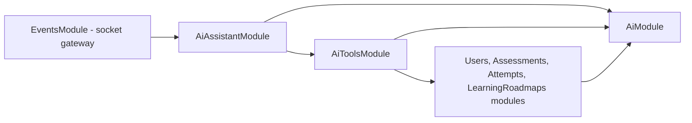
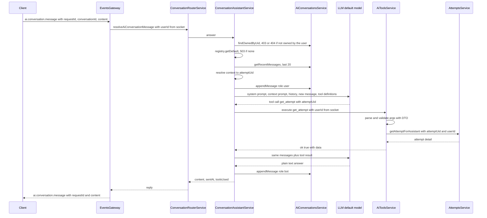
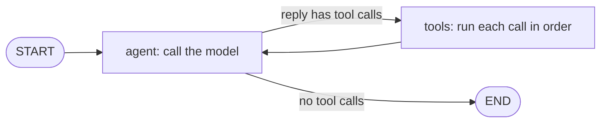

# AI Assistant and Tools

The AI assistant is a chat bot inside TestFlow. A learner opens a conversation about an **evaluated assessment attempt** and asks questions like "Why did I get question 4 wrong?" or "What should I study next?". The assistant answers in short prose. To look up the learner's data it calls **tools** — small read-only functions that wrap our domain services.

This page covers the assistant loop, the tools, how conversations are stored, and the safety rules. For the model layer underneath (registry, providers, auditing) see [AI layer](ai.md).

## 1. Key terms

| Term | Meaning |
|---|---|
| **Conversation** | One chat thread, attached to one *context* (an assessment attempt or a roadmap). Table `ai_conversations`. |
| **Message** | One turn in a conversation. Role `user` (the learner) or `bot` (the assistant). Table `ai_conversation_messages`. |
| **Tool** | A function the model may ask us to run, described to the model as a name, a description and a JSON Schema for its arguments. |
| **Tool call** | The model's reply says "run `get_attempt` with `{attemptUid: ...}`" instead of (or before) giving an answer. |
| **Tool loop** | Call the model → run any tools it asked for → send results back → call the model again, until it answers in plain text. |
| **requestId** | A correlation id the client sends with each message. It is echoed back on the reply and written on every log line. |

## 2. Where the code lives

| File | Role |
|---|---|
| `src/ai/assistant/ai-assistant.module.ts` | `AiAssistantModule`. Imports `AiModule` and `AiToolsModule`. Imported by `EventsModule`. |
| `src/ai/assistant/conversation-assistant.service.ts` | `ConversationAssistantService.answer()` — the tool loop (a LangGraph graph). |
| `src/ai/prompts/conversation-assistant.prompt.ts` | System prompt + per-turn context prompt. |
| `src/ai/tools/ai-tools.module.ts` | `AiToolsModule`. Imports the domain modules the tools read from. |
| `src/ai/tools/ai-tools.service.ts` | Tool registry, definitions for the provider, argument validation, dispatch. |
| `src/ai/tools/*.tools.ts` | Tool definitions, grouped by domain. |
| `src/ai/tools/dto/*` | `class-validator` DTOs for each tool's arguments. |
| `src/ai/tools/conversation-context.resolver.ts` | Turns a stored context into ids the tools accept. |
| `src/ai/ai-conversations.service.ts` | Conversation and message storage and reads. |
| `src/ai/ai-conversations.controller.ts` | HTTP: read a conversation's messages page by page. |
| `src/events/events.gateway.ts`, `src/events/conversation-router.service.ts` | Socket.IO entry point. See [Realtime events](realtime-events.md). |

**Why separate modules?** Attempts and roadmaps import `AiModule` to store conversations. The tools import attempts and roadmaps. If the tools lived in `AiModule` there would be a dependency cycle. So the arrows go one way: `ai/assistant → ai/tools → domain modules → ai`.

## 3. Conversations and messages

### 3.1 Storage

`ai_conversations` (`src/common/entities/ai-conversation.entity.ts`):

| Column | Notes |
|---|---|
| `id` | Internal key. |
| `uid` | Public id, `conv_` + 32 hex chars. This is what clients and tools use. |
| `user_id` | Owner. Cascade-deletes with the user. |
| `context_type` | `assessment_attempt` or `roadmap`. |
| `context_id` | Row id of the attempt (`assessment_attempts.id`) or roadmap. |
| `created_at`, `updated_at` | `updated_at` is touched on every new message, so it means "last activity". |

Unique on `(context_type, context_id)`: **one conversation per attempt (or roadmap)**.

`ai_conversation_messages`: `id`, `uid`, `conversation_id` (cascade delete), `message` (text), `role` (`user` / `bot`), `created_at`. Indexed on `(conversation_id, created_at)`.

Only the user's text and the assistant's final reply are stored. Tool calls and tool results are **not** stored.

### 3.2 Opening a conversation

| Step | Where |
|---|---|
| `POST /v1/attempts/:attemptUid/conversations` (rate limit `CLASS_B`) | `AttemptsController.createConversation` |
| Check the attempt belongs to the user, and its status has a result (evaluated). Otherwise a rule error. | `AttemptsService.getOrCreateConversation` |
| Find or create the conversation for this attempt. Two concurrent opens are safe: the loser of the unique-index race adopts the winner's row. | `AiConversationsService.getOrCreate` |
| Returns `{ conversationId: "conv_..." }` | |

**Why only after evaluation?** While an attempt is live, the API hides the correct answers. A bot with attempt context would be a way around that.

The `roadmap` context type exists in the enum, the resolver and the prompt, but today **no endpoint creates a roadmap conversation**.

### 3.3 Reading messages over HTTP

`GET /v1/conversations/:conversationId/messages` (`AiConversationsController`, rate limit `CLASS_B`, JWT required).

- Query: `limit` (default 20), `cursor`.
- Returns messages **newest first**. The first page is the bottom of the chat. Pass `meta.nextCursor` back as `cursor` to load older messages. `nextCursor: null` means you reached the start.
- The cursor is the internal message id.
- `403` if the conversation belongs to someone else, `404` if it does not exist.

There is no HTTP endpoint for *sending* a message. Sending happens over the socket.

## 4. One assistant turn

### 4.1 Transport: Socket.IO, request/reply, no streaming

The client sends a Socket.IO event `ai.conversation.message` with:

| Field | Rules |
|---|---|
| `requestId` | Required. Letters, digits, `-`, `_`. Max 64. |
| `conversationId` | Required. Max 64. |
| `content` | Required. Max **4000** characters. |

The socket must have connected with a valid JWT (checked in `handleConnection`). `WsJwtGuard` checks the socket has a user. `wsValidationPipe` validates the DTO.

The server answers on the **same socket** with event `ai.conversation.message` and `{ requestId, userId, conversationId, content, sentAt }`. Errors come back as an `exception` event (via `WsExceptionFilter`) that includes the `requestId`. The socket stays open.

The reply is sent **once, when complete**. Tokens are **not** streamed.

### 4.2 Sequence

### 4.3 Step by step

1. **Ownership.** `findOwnedByUid(conversationId, userId)`. Wrong owner → `403`, unknown → `404`.
2. **Model.** Always the **default** model (`AiModelRegistry.getDefault()`), not the user's plan model. No default → `503`, before anything is stored.
3. **History and context.** Load the last **20** stored messages. Resolve the context: for an attempt, the stored `context_id` (a row id) is turned into the attempt `uid` that `get_attempt` accepts.
4. **Save the user message first.** If the provider fails later, what the user said is not lost.
5. **Build messages:**
    - System message 1: `CONVERSATION_ASSISTANT_SYSTEM_PROMPT` (static, so providers can cache it).
    - System message 2: `buildConversationContextPrompt()` — current date/time, what the conversation is attached to, and a hint like `get_attempt({"attemptUid": "..."})`.
    - The 20 history messages (`user` → human, `bot` → AI).
    - The new user message.
6. **Run the tool loop** (next section).
7. **Save the reply** as a `bot` message and return it.

### 4.4 The tool loop graph

State: `messages` (LangGraph `MessagesAnnotation`, appended to), `round` (model calls so far), `toolsUsed` (tool names, for logs).

- **agent** binds the tool definitions to the model with `bindTools` and calls it. Each call is audited in `llm_audit` with `jobType = ASSISTANT_REPLY`, `jobId = null`, and the user id.
- **tools** runs every tool call from the last model message, one after another, and appends a `ToolMessage` for each.
- **Round limit.** Tools are offered for rounds 1–4 (`MAX_TOOL_ROUNDS = 4`). On the 5th call the model is called **without tools**, so it must answer. Worst case: 5 provider calls per user message.
- If the final message has no text → `503 The assistant is temporarily unavailable`.
- If the model does not support tool calling (`bindTools` missing) → `503`.
- Any provider error → `503`. The user message stays stored, the bot message is not written.

## 5. Tools

All tools **only read**. None of them write, so a hallucinated tool call cannot change data.

Defined in `src/ai/tools/*.tools.ts`. Names are in `AssistantToolName` (`src/common/enums/ai.enums.ts`). The names are part of the contract with the provider; renaming one breaks old transcripts.

| Tool | What it returns | Inputs | Service method | Access check |
|---|---|---|---|---|
| `get_user_profile` | The caller's name, username, email, verified flag, join date | none | `UsersService.getProfileForAssistant(userId)` | Always the caller. No way to pass another user. |
| `list_assessments` | Caller's assessments (title, schedule, duration, question count), newest first | `role`: `enrolled` (default) or `created`; `limit` 1–25 (default 10) | `AssessmentsService.listAssessmentsForAssistant` | Query is filtered by `createdBy = userId` or an active participant row for `userId`. |
| `get_assessment` | One assessment: title, schedule, status, generation status, sections (type, count, marks, difficulty), `createdByMe`, participant status. Never questions or answers. | `assessmentId` (int ≥ 1) | `AssessmentsService.getAssessmentForAssistant` | **No ownership check** — see the warning below. |
| `list_attempts` | Caller's attempts, newest first, with score and right/wrong counts | `status` (optional `AttemptStatus`); `limit` 1–25 | `AttemptsService.listAttemptsForAssistant` | Uses `findMyAttempts(userId)`. |
| `get_attempt` | One attempt. After evaluation: per-section results and every question with the user's answer, correct option and explanation (MCQ), or problem and saved code (coding). Before evaluation: `answersAvailable: false`, `questions: null`. | `attemptUid` (UUID v4) | `AttemptsService.getAttemptForAssistant` | `resolveAttempt(attemptUid, userId)` — must be the caller's attempt. |
| `list_roadmaps` | Caller's roadmaps with step counts and progress | `status` (optional `RoadmapStatus`); `limit` 1–25 | `LearningRoadmapsService.listRoadmapsForAssistant` | Listed for `userId` only. |
| `get_roadmap` | One roadmap with its ordered steps and the current step | `roadmapId` (int ≥ 1) | `LearningRoadmapsService.getRoadmapForAssistant` | `findOwnedOr404(roadmapId, userId)`. |
| `get_roadmap_node` | One step in full: description, resources, estimated time, previous and next steps | `roadmapId`, `nodeId` | `LearningRoadmapsService.getRoadmapNodeForAssistant` | Goes through the owned roadmap. |
| `get_conversation` | Another conversation: its context (with usable id), dates, message count, last 20 messages | `conversationId` (`conv_` + 32 hex) | `AiConversationsService.getConversationForAssistant` + context resolver | `findOwnedByUid(..., userId)`. |
| `get_conversation_messages` | A conversation's transcript, oldest first, up to 100 most recent, with `hasMore` | `conversationId`; `limit` 1–100 (default 100) | `AiConversationsService.getConversationMessagesForAssistant` | `findOwnedByUid(..., userId)`. |

### 5.1 How a tool call is executed

`AiToolsService.execute(name, rawArguments, context)` never throws. Every failure becomes `{ ok: false, tool, error }` so the model can read it and correct itself on the next round.

1. Unknown tool name → error listing the available tools.
2. Arguments are not a JSON object → error.
3. Arguments are converted with `plainToInstance` and checked with `class-validator` (`whitelist: true`). Extra keys are dropped, not rejected. `"limit": "5"` is converted to a number.
4. Validation errors → `Invalid arguments: ...`.
5. The handler runs with `context.userId`.
6. An `HttpException` from the service (404, 403, 400) is passed through with its message, e.g. "This conversation does not belong to you".
7. Any other error is logged with its stack and the model gets a generic "That lookup failed" message. No internal detail reaches the transcript.

The result goes back to the model as JSON in a `ToolMessage`.

### 5.2 Limits that keep prompts small

| Limit | Value | Where |
|---|---|---|
| History replayed each turn | 20 messages | `REPLAYED_HISTORY_MESSAGES` |
| Tool rounds per turn | 4 (+1 answer-only call) | `MAX_TOOL_ROUNDS` |
| List tool rows | default 10, max 25 | `src/ai/tools/ai-tools.constants.ts` |
| Transcript tool | max 100 messages, no paging | `MAX_CONVERSATION_TRANSCRIPT_MESSAGES` in `src/ai/ai.constants.ts` |
| Conversation preview | 20 messages | `CONVERSATION_PREVIEW_MESSAGES` |
| User message length | 4000 characters | `ConversationMessageDto` |

Because tool results are not stored, a follow-up question in a later turn makes the model call the tool again. The prompt tells it to do so rather than "recall" numbers.

## 6. Safety and authorization

**The user id never comes from the model.** `AssistantToolContext.userId` is taken from the authenticated socket. No tool has a `userId` argument. Each domain method receives that id and filters or checks ownership with it.

**Answers are protected in three layers:**

1. A conversation can only be opened for an evaluated attempt.
2. `get_attempt` returns `answersAvailable: false` and no questions for any attempt that is not yet evaluated (the user may ask about another, live attempt).
3. The system prompt forbids working out or hinting at answers for a test the user is still taking, and forbids calling ungraded answers right or wrong. It still allows teaching the topic.

**Grounding.** The prompt says every claim about the user's data must come from a tool result, never invent ids, and say plainly when a tool returns nothing or an error.

**Only reads.** No tool writes anything.

!!! warning "`get_assessment` has no access check"
    `AssessmentsService.getAssessmentForAssistant` (`src/assessments/assessments.service.ts`, around line 820) loads the assessment with `findOne(assessmentId)` and does not check that the caller created it or is registered for it. A user who guesses a numeric id can get the metadata of any assessment: title, schedule, status, section layout, marks and participant counts. It never returns questions or answers. Every other tool is scoped to the caller.

### 6.1 Rate limits and usage limits

- **No commerce usage limit applies to the assistant.** `answer()` does not call `UsageService`. Chat does not count against any plan quota, and it always runs on the default model.
- **No rate limit on the socket message.** The `ai.conversation.message` handler has no `@RateLimit`. Cost per message is limited only by the 4000-character cap and the 5-call round limit.
- The HTTP endpoints (`POST .../conversations`, `GET .../messages`) use rate-limit policy `CLASS_B`.
- Every assistant model call is recorded in `llm_audit` with `jobType = ASSISTANT_REPLY`, so admins can see chat cost per user through `GET /v1/admin/llm-audits?jobType=ASSISTANT_REPLY` (see [AI layer](ai.md#9-admin-endpoints)).

## 7. Adding a new tool

1. Add the name to `AssistantToolName` in `src/common/enums/ai.enums.ts` (snake_case).
2. Add an args DTO in `src/ai/tools/dto/` with `class-validator` rules. Use `@Type(() => Number)` for numbers, because models often send numbers as strings.
3. Add a read-only method on the domain service that takes `userId` and **checks ownership itself**. Keep the result small.
4. Add the tool object (name, description written for the model, JSON Schema parameters with `additionalProperties: false`, `argsType`, `handler`) to the matching `*.tools.ts` file, or a new file registered in the `AiToolsService` constructor.
5. If the tool needs a new domain module, import it in `AiToolsModule`, not in `AiModule`.
6. If the model should know when to use it, update `CONVERSATION_ASSISTANT_SYSTEM_PROMPT`.
7. Add unit tests under `tests/unit/ai/`.
