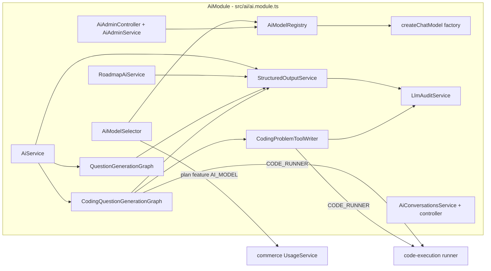
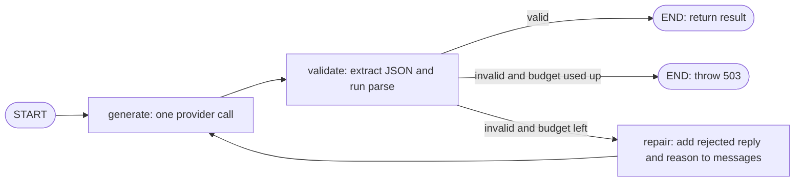
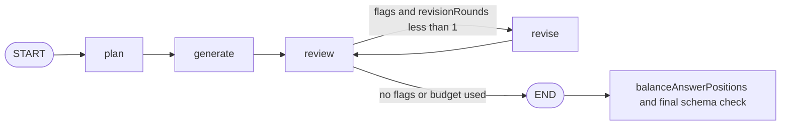
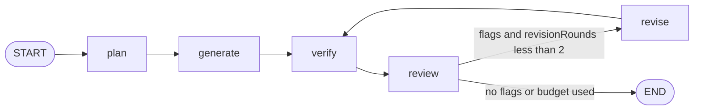
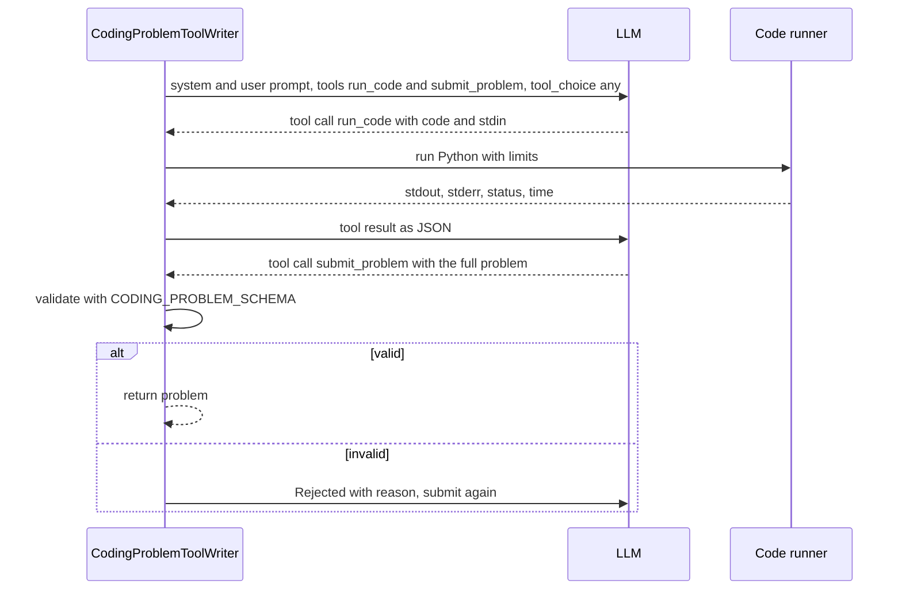

# AI Layer — LLM, Structured Output and LangGraph

!!! note "AI is implemented"
    Older pages said AI was "not implemented". That is wrong. All of `src/ai/` is live code: model selection, three LLM providers, two LangGraph question-generation pipelines, roadmap prompts, descriptive grading, a chat assistant and a per-call cost audit.

This page covers the **internals** of `src/ai`. Other pages cover the features that call into it:

| Feature | Page |
|---|---|
| Assessment generation (API → RabbitMQ → consumer → this layer) | [Assessment generation](assessment-generation.md) |
| Learning roadmaps (analysis, generation, modification jobs) | [Learning roadmaps](learning-roadmaps.md) |
| Descriptive answer grading | [Evaluation](evaluation.md) |
| The chat assistant and its tools | [AI assistant](ai-assistant.md) |
| Code runners used to check coding problems | [Code execution](code-execution.md) |

## 1. Words you will see

| Term | Meaning |
|---|---|
| **LLM** | Large Language Model. A hosted model (GPT, Claude, Gemini) that takes text and returns text. |
| **Provider** | The company that hosts the model: `openai`, `anthropic` or `google` (`AiModelProvider` in `src/common/enums/ai.enums.ts`). |
| **Model code** | The exact model name sent to the provider API, e.g. `gpt-4o`. Stored in `ai_models.code`. |
| **LangChain** | The library we use to talk to every provider through one interface (`BaseChatModel`). |
| **LangGraph** | A LangChain library for writing a pipeline as a **graph**: *nodes* are steps (functions), *edges* say which step runs next, and *conditional edges* pick the next step from the current state. All nodes read and update one shared **state** object. |
| **Structured output** | Asking the model to answer with JSON that matches a schema, instead of free prose. |
| **Zod schema** | A TypeScript schema (library `zod`) that both describes the JSON shape and validates it. |
| **Repair turn** | When the model's JSON is invalid, we send it its own answer back plus the exact error, and ask for a fixed version. |
| **Tool call** | The model asks us to run a named function with JSON arguments. We run it and send the result back. |
| **Tokens** | The unit providers bill by. Input tokens = prompt, output tokens = answer. |

## 2. Module map



| File | What it does |
|---|---|
| `src/ai/ai.module.ts` | Wires everything. Imports `CommerceModule` (for the user's plan) and `CodeExecutionModule` (for the code runner). |
| `src/ai/ai-model-registry.service.ts` | In-memory list of usable models, loaded from the `ai_models` table. |
| `src/ai/ai-model-selector.service.ts` | Picks the model for a given user from their plan. |
| `src/ai/llm/chat-model.factory.ts` | Builds the LangChain chat model for a provider. |
| `src/ai/llm/structured-output.service.ts` | The shared "call → validate → repair" loop for every JSON call. |
| `src/ai/llm/json-extraction.util.ts` | Pulls a JSON object out of messy model text. |
| `src/ai/llm/question-generation.graph.ts` | MCQ pipeline (LangGraph). |
| `src/ai/llm/coding-question-generation.graph.ts` | Coding problem pipeline (LangGraph). |
| `src/ai/llm/coding-problem-tool-writer.ts` | Writes one coding problem with a `run_code` tool. |
| `src/ai/llm/concurrency.util.ts` | `mapWithConcurrency` — run at most N calls at once. |
| `src/ai/ai.service.ts` | Public entry for question generation and descriptive grading. |
| `src/ai/roadmap-ai.service.ts` | Public entry for the three roadmap prompts. |
| `src/ai/llm-audit.service.ts` | Writes one `llm_audit` row per provider call (tokens and cost). |
| `src/ai/admin.controller.ts`, `admin.service.ts` | Admin API for models and audits. |
| `src/ai/schemas/*` | Zod schemas for every JSON output. |
| `src/ai/prompts/*` | System prompts. |
| `src/ai/assistant/*`, `src/ai/tools/*` | The chat assistant. See [AI assistant](ai-assistant.md). |

## 3. Choosing a model

### 3.1 Models live in the database, not in code

Models are rows in the `ai_models` table (entity `src/common/entities/ai-model.entity.ts`). Admins manage them through the admin API (section 9). Each row holds:

| Column | Purpose |
|---|---|
| `provider` | `openai`, `anthropic` or `google`. |
| `code` | Model name sent to the API. Unique among non-deleted rows. |
| `display_name` | Human name. |
| `api_key_variable` | **Name** of the env var that holds the API key, e.g. `OPENAI_API_KEY`. The key itself is never stored in the DB. |
| `base_url_variable` | Optional **name** of an env var holding a custom base URL (for proxies or OpenAI-compatible hosts). `null` = provider default host. |
| `input_price_per_1m`, `output_price_per_1m` | USD per 1 million tokens. Used for cost tracking. |
| `capabilities` (JSONB) | `vision`, `toolCalling`, `structuredOutput`, `streaming`, `contextWindow`, `maxOutputTokens`. Only `structuredOutput: false` changes runtime behavior today (section 4). |
| `is_active` | Inactive rows are ignored. |
| `is_default` | Exactly one default. A partial unique index (`UQ_ai_models_is_default`) enforces it. |

The seeder `src/seeders/ai-model.seeder.ts` creates the first default row: an OpenAI model named by `OPENAI_MODEL` (fallback `gpt-4`), with `apiKeyVariable = OPENAI_API_KEY` and `baseUrlVariable = OPENAI_BASE_URL`, prices 0.

### 3.2 The registry

`AiModelRegistry` loads all active rows at startup (`onModuleInit`) and after every admin write.

For each row it reads the named env vars:

- API key env var missing or empty → the model is **skipped** (logged as a warning).
- `base_url_variable` set but the env var is empty → the model is **skipped**. It does *not* fall back to the default host, because a key for a proxy probably will not work on the real host.

The result is a map of `RegisteredAiModel` objects. Each holds the row data plus a `chatModel(options)` function that returns a cached LangChain client (one client per distinct option set, e.g. one for `temperature: 0`, one for default).

!!! warning "The registry is per process"
    Each app instance keeps its own copy. An admin change reloads only the instance that served the request. Other instances see it after restart.

### 3.3 The selector: which model does a user get?

`AiModelSelector.forUser(userId)`:

1. Reads the user's plan feature `AI_MODEL` through `UsageService.getFeatureValue` (see [Commerce](commerce.md)). Its value is a model code.
2. Blank or missing → use the default model.
3. A code that is unknown, inactive or unavailable → log a warning and use the default model.
4. No default available → `503 Service Unavailable`.

So the plan decides the model. There are no feature flags involved in model choice.

| Caller | Model used |
|---|---|
| MCQ / coding / descriptive generation (`QuestionsService`) | The requesting user's plan model |
| Roadmap analysis, generation, modification consumers | The roadmap owner's plan model |
| Descriptive grading (`DescriptiveEvaluator`) | The **assessment creator's** plan model (not the candidate's) |
| Chat assistant | Always the **default** model, whatever the plan |

### 3.4 The chat model factory

`createChatModel(provider, code, credentials, options)` in `src/ai/llm/chat-model.factory.ts`:

| Provider | LangChain class | Base URL option |
|---|---|---|
| `openai` | `ChatOpenAI` (`@langchain/openai`) | `configuration.baseURL` |
| `anthropic` | `ChatAnthropic` (`@langchain/anthropic`) | `anthropicApiUrl` |
| `google` | `ChatGoogleGenerativeAI` (`@langchain/google-genai`) | `baseUrl` |

Settings:

- **Native integrations.** Each provider uses its own LangChain class, not an OpenAI-compatible shim. This means structured output and tool calling use the provider's real mechanism.
- **Transport retries:** `maxRetries: 2` for network/HTTP errors (handled inside the SDK).
- **Temperature:** only set when a caller pins it. Grading, reviews and roadmap prompts use `0` (same input → same answer). Writing steps use the provider default.
- **Max tokens / timeouts:** not set. The provider default applies. There is no explicit request timeout in our code.

## 4. Structured output — getting reliable JSON

Almost every LLM call in TestFlow must return one JSON object. All of them go through `StructuredOutputService.run()` (`src/ai/llm/structured-output.service.ts`). It is itself a tiny LangGraph loop.

### 4.1 The request

| Field | Meaning |
|---|---|
| `model`, `context` | Which model, and what the audit row is filed under (`jobId`, `jobType`, `userId`). |
| `systemPrompt`, `userMessage` | The prompts. |
| `parse(value)` | Turns the JSON into the result, or throws an `Error` whose **message is written for the model**. That message is sent back as the repair instruction. |
| `structured` | Optional `{ schema, name }`. If present, the provider's native structured output is used. |
| `maxAttempts` | Total calls allowed, including repairs. Every caller uses **2** (one try + one repair). |
| `temperature` | Optional. |

### 4.2 The loop



State fields: `messages` (the chat so far, appended to), `attempt`, `completion` (last reply), `lastReason`, `result`, `native` (use native structured output on the next call?), `bonusAttempts`.

Step by step:

1. **Build the prompt.** If a schema is given, `STRUCTURED_JSON_CONTRACT` is appended to the system prompt and `STRUCTURED_JSON_REMINDER` to the user message. If native output is off, the JSON Schema itself (from `zod.toJSONSchema`) is also put into the user message so the model knows the exact keys.
2. **generate.** If native output is on, call `chatModel.withStructuredOutput(schema, { includeRaw: true })`. Otherwise call the model as plain chat. Every call is wrapped in `LlmAuditService.track()` (one audit row per call).
3. **validate.** Use the provider-decoded object if there is one, else run `extractJsonObject(text)`. Then run `parse`. On error, store the message as `lastReason`.
4. **repair.** Append the rejected reply (max 8000 chars) and `buildJsonRepairPrompt(reason)` ("Your previous response was REJECTED for this reason: …"). Go back to generate.
5. **End.** Success returns the value. Out of budget throws `ServiceUnavailableException("<label> returned an invalid response")`.

**Why a repair turn instead of a plain retry?** A plain retry samples the same mistake again. Telling the model exactly what was wrong ("`outline` had 4 items — it must have exactly 5") fixes it much more often.

### 4.3 Native output fallbacks

Some OpenAI-compatible endpoints accept a schema and then send replies the SDK cannot decode (code fences, a stray `{"` prefix). The service handles this:

| What happened | Treated as | Effect |
|---|---|---|
| SDK could not decode the reply (`SyntaxError`, `OutputParserException`) | Model output problem | Switch to plain JSON for the rest of this call. This call does **not** use up an attempt (`bonusAttempts + 1`). |
| Same model fails to decode natively 3 times (`NATIVE_DECODE_FAILURE_LIMIT`) | Model does not honour schemas | Native output is disabled for that model **until restart**. Set `capabilities.structuredOutput = false` to make it permanent. |
| SDK decoded but its own Zod check failed | Content problem | Normal repair turn, costs an attempt, native stays on. |
| Reply cut off at token limit / content filter | Not counted against the model | Repair turn with a message like "be more concise". |
| Network or HTTP error | Real outage | `503 "<label> is temporarily unavailable"`. No repair. |
| Empty reply | Outage | `503`. |

### 4.4 JSON extraction

`extractJsonObject()` (`src/ai/llm/json-extraction.util.ts`) is used when we parse text ourselves:

- Strips one outer code fence (```` ```json ````).
- Tries every `{` (up to 8) as a possible start, and takes the first balanced object that parses. This handles gateways that prefix `{"` before the real object.
- Removes trailing commas before `}` or `]`.
- Does **not** guess at ambiguous damage (single quotes, unquoted keys). Those fail and go to the repair turn.

### 4.5 Schemas

All in `src/ai/schemas/`. `zodParser(schema)` (`zod-parser.ts`) turns a Zod schema into a `parse` function. Its errors are formatted as `"path": message; …` so they read well to the model.

| Schema | Used for | Key rules |
|---|---|---|
| `QUESTION_PLAN_SCHEMA` | MCQ and coding plan | `assessmentTitle`; `outline[]` of `{ focus, difficulty: easy/medium/hard, topics: 1–4 kebab-case slugs }` |
| `QUESTION_BATCH_SCHEMA` | One batch of MCQs | Each question: text, exactly 4 options with ids 1–4, `correctOptionId` that matches an option, 1–4 weighted topics |
| `QUESTION_REVIEW_SCHEMA` | MCQ review | Per question: `number`, `reasoning`, `answerOptionId`, `verdict: ok/ambiguous/incorrect`, `issue` |
| `QUESTION_GENERATION_SCHEMA` | Final MCQ result check | Title + at least one question |
| `CODING_PROBLEM_SCHEMA` | One coding problem | Title, statement, input/output format, constraints, starter code for `python`, `java`, `cpp`, 7–15 test cases (≥2 visible, ≥5 hidden, all inputs unique), Python `referenceSolution`, topics |
| `CODING_REVIEW_SCHEMA` | Coding review | `verdict`, `issue`, `outputs[]` (the reviewer's traced output per test input) |
| `DESCRIPTIVE_GENERATION_SCHEMA` | Descriptive questions | Text, 2–6 checkpoints with integer weightage 1–100, `maxWords` 30–1000, topics |
| `DESCRIPTIVE_GRADING_SCHEMA` | Descriptive grading | `completedCheckpointIds: number[]` |

Each caller adds extra checks in its `parse` function. Examples: "outline must have exactly N items", "reviews must cover questions 1..N once each", "checkpoint id 7 does not exist".

Non-blank strings use a Zod `.refine()` instead of `.trim()`, because a transform cannot be expressed in the JSON Schema sent to the provider.

**Roadmap prompts are different.** They use no Zod schema and no native structured output. The JSON contract lives inside the prompt text (`JSON_ONLY_CONTRACT`), and `RoadmapAiService` validates the result with hand-written checks (`parseAnalyzedIntent`, `parseGeneratedRoadmap`, `parseGeneratedDiff`) whose error messages feed the repair turn. The reason given in the code: some gateways implement JSON mode by pre-filling the reply, which corrupts it.

## 5. Prompts

All in `src/ai/prompts/`, re-exported from `index.ts`.

| Prompt | What it asks for |
|---|---|
| `QUESTION_PLAN_SYSTEM_PROMPT` | Act as an examiner. Produce exactly N distinct outline items (focus, difficulty, topic slugs) plus an assessment title. Spread coverage, stay in scope. |
| `QUESTION_GENERATION_SYSTEM_PROMPT` | Write one MCQ per outline item. Test understanding, not recall. Plausible distractors, Markdown-safe formatting. |
| `QUESTION_REVIEW_SYSTEM_PROMPT` | Act as an independent examiner. Solve each question **without the answer key**, pick an option, give a verdict and a one-line issue. |
| `CODING_PLAN_SYSTEM_PROMPT` | Plan exactly N coding problems (algorithmic idea, difficulty, topics) plus a title. |
| `CODING_GENERATION_SYSTEM_PROMPT` | Write one full coding problem: statement, formats, constraints, starter code, test cases, Python reference solution. |
| `CODING_TOOLS_SYSTEM_PROMPT` | Extra rules when writing with tools: run the reference solution with `run_code` and copy its output into `expectedOutput`, then call `submit_problem`. |
| `CODING_REVIEW_SYSTEM_PROMPT` | Judge the statement and trace the reference solution on each test input, without seeing the expected outputs. |
| `DESCRIPTIVE_GENERATION_SYSTEM_PROMPT` | Write N free-text questions, each with 2–6 concrete, non-overlapping checkpoints and weightages summing to 100. |
| `DESCRIPTIVE_GRADING_SYSTEM_PROMPT` | Read the answer and return only the ids of the checkpoints it completes. Marks are computed in code. |
| `ROADMAP_ANALYSIS_SYSTEM_PROMPT` | Name the learning goal and ask the fewest questions (3–6) that would change the roadmap. |
| `ROADMAP_GENERATION_SYSTEM_PROMPT` | Build a personalised DAG of `knowledge` and `practice` nodes, using `ref` numbers and `fromRef`/`toRef` edges. |
| `ROADMAP_MODIFICATION_SYSTEM_PROMPT` | Change an existing roadmap from a plain-language instruction. Return a **diff** (`added`, `updated`, `removed`, `edges`) so surviving nodes keep their ids and progress. |
| `CONVERSATION_ASSISTANT_SYSTEM_PROMPT` | The chat assistant's rules: ground every fact in a tool result, never reveal answers before evaluation, keep replies short. See [AI assistant](ai-assistant.md). |
| `buildConversationContextPrompt()` | Second system message for chat: current date and what the conversation is attached to. |
| `JSON_ONLY_CONTRACT` | Strict "one raw JSON object, nothing else" rules, embedded in the three roadmap prompts. |
| `STRUCTURED_JSON_CONTRACT` / `STRUCTURED_JSON_REMINDER` | Lighter JSON rules appended to every schema call. Allows Markdown inside string values. |
| `buildJsonRepairPrompt(reason)` | The repair turn text. |
| `difficultyGuidance(level)` | Turns a section difficulty 1–5 into an easy/medium/hard mix (e.g. 3 → 30/50/20). |

## 6. LangGraph pipelines

There are four LangGraph graphs in `src/ai`:

| Graph | File | Used by |
|---|---|---|
| Structured output loop | `llm/structured-output.service.ts` | Every JSON call (section 4) |
| MCQ generation | `llm/question-generation.graph.ts` | `AiService.generateQuestions` |
| Coding generation | `llm/coding-question-generation.graph.ts` | `AiService.generateCodingQuestions` |
| Assistant tool loop | `assistant/conversation-assistant.service.ts` | Chat. See [AI assistant](ai-assistant.md). |

Descriptive generation and grading, and all three roadmap prompts, are **single structured-output calls** (no multi-step graph).

Each graph is built and compiled inside `run()` on every call. State lives only in memory for that one run. Nothing is checkpointed, so a crashed process loses the run and the job must be retried by its consumer.

### 6.1 MCQ generation graph



**State**

| Field | Meaning |
|---|---|
| `assessmentTitle` | From the plan. |
| `outline` | N items: focus, difficulty, topics. |
| `questions` | Written questions, same order as the outline. |
| `toReview` | Indexes the next review pass checks. All at first, then only revised ones. |
| `flagged` | `{ index, feedback }` for questions the reviewer disputes. |
| `revisionRounds` | How many revise passes ran. |

**Nodes**

1. **plan** — One call. Produces exactly `count` outline items and the title. Difficulty mix comes from `difficultyGuidance(section difficulty)`.
2. **generate** — Splits the outline into batches of **5** and writes them with at most **3** calls in parallel.
3. **review** — Batches of 5, 3 in parallel, `temperature 0`. The reviewer gets questions and options **but not the answer key**. A question is flagged if the verdict is not `ok` or the reviewer picks a different option than the key. If a review call fails, that batch is skipped with a warning (questions ship unreviewed).
4. **revise** — Rewrites each flagged question with the reviewer's feedback (3 in parallel). A failed rewrite keeps the original.
5. **End** — Max **1** revision round. Questions still flagged are **kept** (logged as a warning), because a short assessment is worse for the creator.
6. **After the graph** — `balanceAnswerPositions` moves correct answers so each group of four questions uses positions 1–4 once (models favour the same slot). Then the whole result is checked against `QUESTION_GENERATION_SCHEMA`.

Why plan first? Writers in parallel batches cannot see each other. A shared outline stops duplicate questions and fixes the difficulty mix up front.

### 6.2 Coding generation graph



**State** — like MCQ (`assessmentTitle`, `outline`, `problems`, `toReview`, `flagged`, `revisionRounds`) plus:

| Field | Meaning |
|---|---|
| `executed` | Problems whose expected outputs came from actually running the reference solution. |
| `executionUnavailable` | `true` when there is no code runner, or it failed. Review then checks outputs by tracing instead. |

**Nodes**

1. **plan** — Same as MCQ, with the coding plan prompt.
2. **generate** — One call per problem, 3 in parallel. Each problem is written by `writeWithTools` (section 6.3). If tool writing is not possible or fails, it falls back to one structured-output call.
3. **verify** — For every problem awaiting review, run the Python reference solution on each test input with the code runner (`CODE_RUNNER`, see [Code execution](code-execution.md)). Default limits: 2000 ms, 256 MB. What it prints **becomes** the expected output. A crash, timeout or over-long output flags the problem with the stderr as feedback. The first runner error (not configured, busy, down) turns execution off for the rest of the run.
4. **review** — One call per problem, `temperature 0`. The reviewer sees the statement, solution and inputs, **but not the expected outputs**. If the verdict is not `ok`, the problem is flagged. If outputs were **not** executed, the reviewer's traced outputs are compared with the expected ones and any mismatch flags it. A failed review call flags the problem.
5. **revise** — Rewrites flagged problems. Rewritten problems lose their `executed` mark until verify runs them again.
6. **End** — Max **2** revision rounds. Unlike MCQ, **any problem still flagged fails the whole run** with a `503`. A wrong expected output would fail every correct submission, which is worse than a missing problem.

### 6.3 Writing a coding problem with tools

`CodingProblemToolWriter` (`src/ai/llm/coding-problem-tool-writer.ts`) is a plain loop, not a LangGraph graph. It is used when a code runner supports Python and the chat model has `bindTools`.



Limits: max **8** model turns (the last turn offers only `submit_problem`), max **40** `run_code` runs per problem, outputs echoed back are cut to 2000 chars (stderr 1000). Every turn is a tool call (`tool_choice: 'any'`). Any failure raises `ToolWriterError`, and the graph falls back to plain structured output.

### 6.4 Parallelism and batching summary

| Setting | MCQ | Coding |
|---|---|---|
| Items per call | 5 questions | 1 problem |
| Calls in flight per step (`MAX_PARALLEL_CALLS`) | 3 | 3 |
| Attempts per call (incl. repair) | 2 | 2 |
| Revision rounds | 1 | 2 |
| Still flagged at the end | Kept, warning logged | Run fails (503) |

`mapWithConcurrency` keeps output order equal to input order. The cap of 3 is how we stay under provider rate limits. There is no other client-side rate limiter for LLM calls.

## 7. Callers

| Caller | Method | Pipeline | Audit `jobType` |
|---|---|---|---|
| `QuestionsService.generateFromPrompt` (sync endpoint or job) | `AiService.generateQuestions` | MCQ graph | job type, or `INLINE_QUESTION_GENERATION` |
| `QuestionsService.generateMcqSection` (section job) | `AiService.generateQuestions` | MCQ graph | section job type |
| `QuestionsService.generateCodingSection` | `AiService.generateCodingQuestions` | Coding graph | section job type |
| `QuestionsService.generateDescriptiveSection` | `AiService.generateDescriptiveQuestions` | 1 structured call | section job type |
| `DescriptiveEvaluator.evaluate` | `AiService.findCompletedCheckpoints` | 1 structured call, temp 0 | `EVALUATE_DESCRIPTIVE_RESPONSES` |
| `RoadmapAnalysisConsumer` | `RoadmapAiService.analyzeRoadmapIntent` | 1 structured call, temp 0 | roadmap job type |
| `RoadmapGenerationConsumer` | `RoadmapAiService.generateRoadmap` | 1 structured call, temp 0 | roadmap job type |
| `RoadmapModificationConsumer` | `RoadmapAiService.modifyRoadmapGraph` | 1 structured call, temp 0 | roadmap job type |
| `ConversationAssistantService.answer` | (own loop) | Assistant graph | `ASSISTANT_REPLY` |

In the `testing` environment (`NODE_ENV=testing`) `QuestionsService` skips the LLM entirely and returns banked or fixed questions.

For the full request → queue → consumer flow see [Assessment generation](assessment-generation.md) and [Learning roadmaps](learning-roadmaps.md).

## 8. Token and cost tracking

`LlmAuditService.track(model, context, attempt, call)` wraps **every** provider call: structured output attempts, tool-writer turns and assistant turns. It writes one row to `llm_audit` (`src/common/entities/llm-audit.entity.ts`):

- `job_id`, `job_type`, `user_id` — from the `LlmCallContext`.
- `ai_model_id`, `provider`, `model`, `model_code`.
- `status` (`SUCCESS` / `FAILED`), `attempt`, `error_message` (max 2000 chars).
- `started_at`, `completed_at`, `duration_ms`.
- `input_tokens`, `output_tokens`, `cached_input_tokens`, `total_tokens` — read from LangChain's `usage_metadata`.
- Prices at call time and `input_cost`, `output_cost`, `total_cost` = tokens × price / 1,000,000.

Notes:

- Cached input tokens are billed at the full input price (no cached rate is stored).
- A failure to write the audit row is logged and **never** fails the LLM call.
- A repair turn is a separate, separately billed row.

## 9. Admin endpoints

Controller: `src/ai/admin.controller.ts`, base path `/v1/admin`. Protected by the global `JwtAuthGuard` and `PermissionGuard` (see [RBAC](rbac.md)). Rate-limit policy `CLASS_C`.

| Method & path | Permission | What it does |
|---|---|---|
| `POST /v1/admin/ai-models` | `ai_models:create` | Register a model. `isDefault: true` unsets the old default in the same transaction. |
| `GET /v1/admin/ai-models` | `ai_models:read` | Paged list. Filters `provider`, `isActive`. Default model first. |
| `GET /v1/admin/ai-models/:id` | `ai_models:read` | One model. |
| `PATCH /v1/admin/ai-models/:id` | `ai_models:update` | Partial update. `capabilities` replaces the whole object. |
| `DELETE /v1/admin/ai-models/:id` | `ai_models:delete` | Soft delete. The default model cannot be deleted (422). |
| `GET /v1/admin/llm-audits` | `llm_audits:read` | Audit rows **grouped by job**, newest first, with totals under `usage` and the calls under `calls`. Filters: `jobId`, `jobType`, `userId`, `modelCode`, `provider`, `status`, `startedFrom`, `startedTo`. Paging counts jobs. A call with no job is its own group. |

Rules enforced by `AiAdminService`:

- The default model must be active (422 otherwise).
- Duplicate `code` → 409. Two requests racing to set a default → 409 "please retry".
- After every committed write the registry is reloaded (on this instance only).

## 10. Error handling summary

| Situation | What happens |
|---|---|
| No default model available | `503 No default AI model is available` |
| Plan names an unavailable model | Warning, falls back to the default |
| Network / HTTP error from provider | SDK retries 2 times, then `503 "<label> is temporarily unavailable"` |
| Invalid JSON or schema mismatch | Repair turn, then `503 "<label> returned an invalid response"` |
| MCQ review call fails | Batch ships unreviewed, warning |
| Coding review call fails | Problem flagged; may fail the run |
| Code runner down | Verify turns off; review traces outputs instead |
| Coding problem still disputed | Run fails with `503` |

Inside jobs, these exceptions propagate to the RabbitMQ consumer, which marks the job failed or retries it. See [Jobs and schedulers](jobs-and-schedulers.md).

## 11. How to add a new provider

1. Add the value to `AiModelProvider` in `src/common/enums/ai.enums.ts`. The column is a Postgres enum, so **write a migration** that adds the value to the enum type.
2. Ask the team before adding the LangChain package (e.g. `@langchain/mistralai`) — new npm packages need approval.
3. Add a `case` to `createChatModel` in `src/ai/llm/chat-model.factory.ts`. Pass `model`, `apiKey`, `temperature`, `maxRetries: MAX_TRANSPORT_RETRIES` and the base URL option.
4. Make sure the DTO enum check in `CreateAiModelDto` accepts it (it uses `AiModelProvider`, so step 1 covers it).
5. Set the API key env var on every instance.
6. Register a model through `POST /v1/admin/ai-models` with its prices and `capabilities`. If the provider does not honour JSON schemas, set `structuredOutput: false`.
7. Point a plan's `AI_MODEL` feature at the new code, or make it the default.

## 12. How to add a new graph or LLM call

1. **Schema.** Add a Zod schema in `src/ai/schemas/`. Keep it expressible as JSON Schema (use `.refine()`, not transforms).
2. **Prompt.** Add a system prompt in `src/ai/prompts/` and export it from `index.ts`. Describe the fields. Do not repeat JSON formatting rules — `StructuredOutputService` adds them.
3. **Single call?** Call `StructuredOutputService.run()` with `structured: { schema, name }`, `parse: zodParser(schema)` plus any extra checks, and `maxAttempts: 2`. Throw plain `Error`s with messages written for the model.
4. **Multi-step?** Create an `@Injectable()` class in `src/ai/llm/` like `QuestionGenerationGraph`:
    - Define state with `Annotation.Root({...})`.
    - Add nodes that return partial state.
    - Use `addConditionalEdges` for loops, and always cap loops with a counter in state.
    - Use `mapWithConcurrency(items, 3, fn)` for fan-out.
    - Route every provider call through `StructuredOutputService` or `LlmAuditService.track` so it is audited.
5. **Expose it** through a method on `AiService` (or a new service) that takes a `RegisteredAiModel` and an `LlmCallContext`. Register the class in `AiModule.providers`.
6. **Call it** from the domain module: resolve the model with `AiModelSelector.forUser(userId)`, and pass the job id and type for auditing. Long-running work should run in a RabbitMQ consumer, not in an HTTP request.
7. **Test it** in `tests/unit/ai/` with a mocked chat model.
