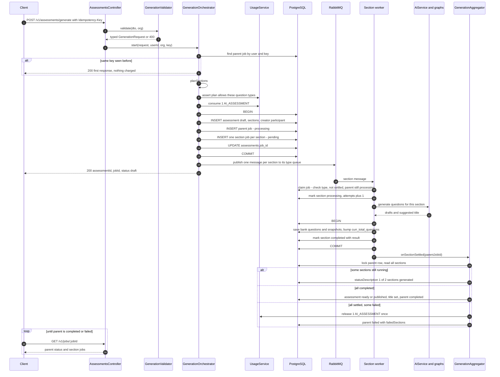
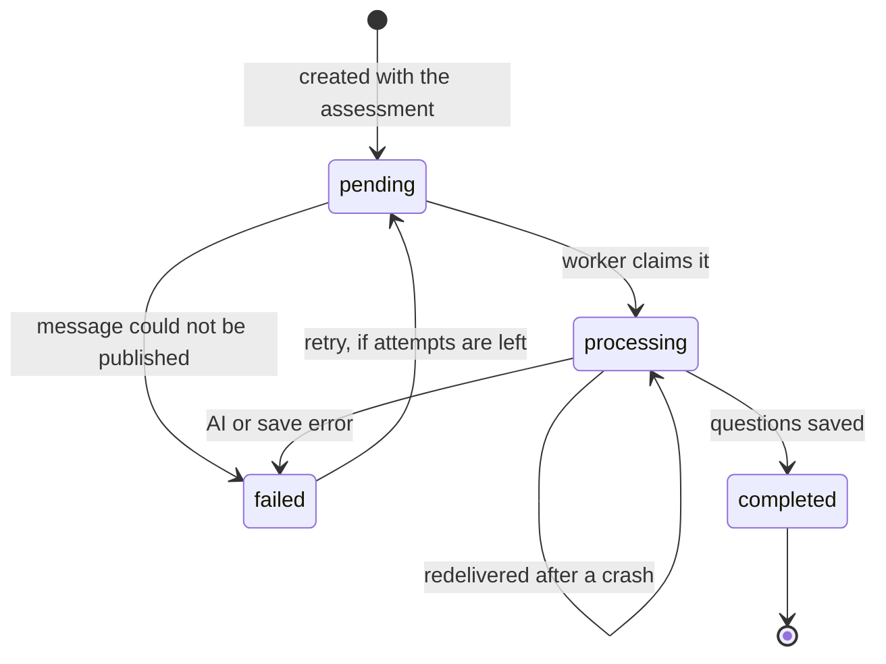
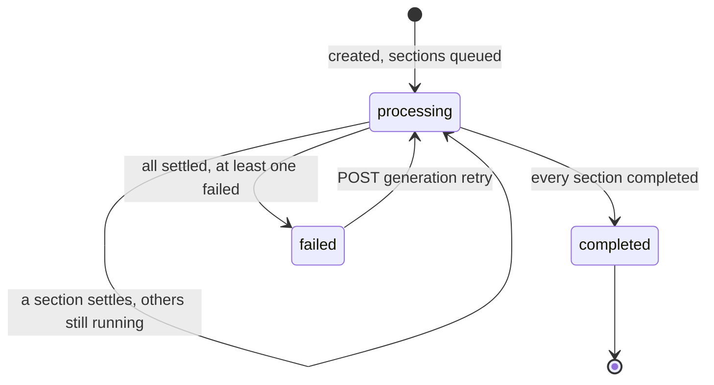

# AI Assessment Generation

## 1. Purpose

A user describes a test in plain words ("Intermediate Postgres: indexing, MVCC, query plans") and the backend builds the whole assessment with an LLM.

The work is slow (seconds to minutes) and can fail, so it runs **in the background**:

1. The API checks the request, charges the quota, creates the assessment and some **job** rows, and publishes messages to **RabbitMQ**. It returns at once.
2. One **worker per section** picks a message up, calls the AI layer, and saves the questions.
3. An **aggregator** watches the section jobs and finishes the assessment when all of them are done.
4. The client polls `GET /v1/jobs/:jobId` to show progress.

This page covers the assessment side. The LLM internals (models, LangGraph graphs, prompts, structured output) are on [AI Layer](ai.md).

## 2. Key concepts

| Term | Meaning |
| --- | --- |
| **Mode** | `auto`: the backend lays out the sections from a total count, the allowed types and a difficulty. `manual`: the client gives every section (type, count, difficulty, marks, its own prompt). |
| **Section** | One group of same-type questions. Each section is generated by its own job, so sections run in parallel and fail on their own. |
| **Parent job** | One `jobs` row of type `GENERATE_ASSESSMENT`. It is never published to a queue. It only tracks its sections. `assessments.job_id` points to it. |
| **Section job** | One `jobs` row per section, of type `GENERATE_MCQ_SECTION`, `GENERATE_CODING_SECTION` or `GENERATE_DESCRIPTIVE_SECTION`, with `parent_job_id` set. |
| **Aggregator** | `GenerationAggregatorService`. Runs every time a section job settles and decides what that means for the parent and the assessment. |
| **Idempotency key** | Optional `Idempotency-Key` header. Resending the same request with the same key returns the first result and charges nothing. |
| **Quota** | One unit of the `AI_ASSESSMENT` plan feature per generation (and per retry). Refunded once if the generation fails. |

## 3. Data it uses

See the [ERD](../erd.md):

- `jobs` (parent and section rows: `type`, `status`, `payload`, `result`, `error`, `attempts`, `max_attempts`, `parent_job_id`, `idempotency_key`, `status_description`). There is a partial unique index on (`created_by`, `idempotency_key`).
- `assessments`, `assessment_sections`, `assessments_participants` (creator row).
- `questions` + details tables, and `assessments_questions` (written per section).
- Commerce usage rows (via `UsageService`), and `llm_audit` (via the AI layer).

Parent job payload (`ParentGenerationPayload` in `src/assessments/generation/interfaces/generation-job.interface.ts`): `assessmentId`, `userId`, `orgId`, `mode`, `requestHash`, and `usage { charged, chargedAt, refunded }`.

Section job payload (`SectionGenerationPayload`): `parentJobId`, `assessmentId`, `sectionId`, `sectionTitle`, `questionType`, `count`, `difficulty`, `prompt`, `userId`.

## 4. The request

`POST /v1/assessments/generate`, body `GenerateAssessmentRequestDto` (`src/assessments/generation/dto/generate-assessment-request.dto.ts`).

| Field | Mode | Rule |
| --- | --- | --- |
| `prompt` | both | Required, 10–5000 chars. Becomes the assessment's `description`. |
| `title` | both | Optional, 3–255. If missing, the AI's suggested title is used, or the description. |
| `duration` | both | 1–180 minutes. |
| `maxParticipants` | both | Required for org assessments (1–10,000). Ignored for personal ones, which always get 10. |
| `registrationStartTime` … `attemptEndTime` | both | Org: attempt start and end required. Personal: ignored, fixed 30-day window. See [Assessments](assessments.md#42-schedule-rules). |
| `mode` | both | `auto` or `manual`. |
| `totalQuestions` | auto | 1–50. |
| `questionTypes` | auto | At least one, no repeats. `descriptive` is **not** allowed in auto mode. |
| `difficulty` | auto | 1–5. |
| `sections[]` | manual | 1–3 sections. Each: `title?` (≤100), `prompt` (10–5000, checked again after trimming), `questionType`, `questionCount ≥ 1`, `difficulty` 1–5, `positiveMark` 0.01–999.99, `negativeMark` 0–999.99. |

**Limits** (`GENERATION_LIMITS` in `generation/generation.constants.ts`):

| | MCQ | Coding | Descriptive |
| --- | --- | --- | --- |
| Max per section (manual) | 20 | 5 | 10 |
| Max per assessment (manual) | 60 | 5 | 10 |

### 4.1 Two-step validation

1. **The DTO** (class-validator) checks each field on its own.
2. **`AssessmentGenerationValidatorService`** checks rules that need more than one field, collects **all** errors and returns them in one 400:
    - the fields of the other mode must not be sent (`sections is not allowed in auto mode`),
    - the fields of this mode are required,
    - auto: total must cover every requested type, coding-only is capped at 5, no descriptive,
    - manual: section count, per-section and per-type limits (`sectionLimitErrors`, shared with templates),
    - org: `maxParticipants` and the schedule.

It then returns a typed `GenerationRequest` (auto or manual), trimmed and in a fixed key order so it can be hashed.

### 4.2 Planning the sections

`planSections()` in `generation/generation-planner.ts` is a pure function:

- **Manual**: one planned section per request section, in order. A missing title becomes "Multiple Choice", "Coding" or "Descriptive". Each section is generated from **its own** prompt.
- **Auto, one type**: one section with all the questions.
- **Auto, MCQ + coding**: coding gets 10% of the total (at least 1, at most 5), MCQ gets the rest. Order is MCQ then coding. Example: 20 questions → 18 MCQ + 2 coding. Auto sections use the **assessment** prompt and the default marks (MCQ +1/0, coding +10/0).

## 5. Main flow

### 5.1 Starting a generation

Notes on the diagram:

- **Steps before the transaction** (replay check, plan check, quota) can each refuse the request without creating anything.
- **If the transaction fails**, the quota unit is released right away. If it failed because a parallel request with the same key won the race (unique violation), the API answers with that request's result.
- **If publishing a section message fails**, that section job is marked `failed` on the spot, the aggregator runs, and the API returns **503** "Assessment created, but question generation could not be started". The assessment exists and can be retried.
- **No WebSocket events and no emails** are sent for generation. Progress is only visible by polling the job. See [Jobs & Schedulers](jobs-and-schedulers.md).

### 5.2 Calling the AI layer

Each queue has its own consumer in `src/assessments/generation/consumers/`. They all hand off to the shared `SectionGenerationWorker`, passing a type-specific generator from `QuestionsService`:

| Queue (routing key) | Consumer | Generator | AI call |
| --- | --- | --- | --- |
| `question-section-mcq-queue` (`question.section.mcq`) | `McqSectionConsumer` | `generateMcqSection` | `AiService.generateQuestions` → `QuestionGenerationGraph` (plan, generate, review, revise) |
| `question-section-coding-queue` (`question.section.coding`) | `CodingSectionConsumer` | `generateCodingSection` | `AiService.generateCodingQuestions` → `CodingQuestionGenerationGraph` (test cases checked by an independent review) |
| `question-section-descriptive-queue` (`question.section.descriptive`) | `DescriptiveSectionConsumer` | `generateDescriptiveSection` | `AiService.generateDescriptiveQuestions` → `StructuredOutputService` with a Zod schema |

All queues are bound to the `question.generation` topic exchange (`src/config/rabbitmq/`). One queue per type means slow coding generation never blocks MCQ sections.

Before each call the model is picked by `AiModelSelector.forUser(userId)`, so the user's plan decides the model. Each LLM call is audited against the section job (`llm_audit`). The graphs, prompts and output validation are described on [AI Layer](ai.md).

### 5.3 Checking and saving generated questions

The AI layer validates the structure of the output (schemas, exact counts, review steps). On the assessment side:

1. Only the first `count` questions are kept (`slice(0, count)`).
2. MCQ: options and correct option are taken as given; `explanation` is `null`.
3. Coding: the title is joined into the question text, the reference solution is dropped, fixed limits are applied (2000 ms, 256 MB, `exact` checker, `python`/`java`/`cpp`).
4. Descriptive: checkpoints are renumbered from 1 and their weights normalised to sum to 100. `assertCheckpointWeights` runs again before saving.
5. `SectionQuestionWriter.append` refuses drafts whose type does not match the section, then saves bank rows, details rows and snapshots in **one transaction** together with completing the section job. See [Questions & Tags](questions-and-tags.md#5-question-bank-vs-snapshots).

### 5.4 Finishing

When every section job is `completed`, the aggregator (inside the parent's row lock):

1. takes the first non-empty suggested title from the section results,
2. calls `AssessmentsService.markGenerated`: sets the title if the user gave none, and moves the status with `settleByCapacity` (full → `ready`; a **personal** assessment that is full goes straight to `published`),
3. marks the parent `completed` with `{ sections, questionsGenerated }`.

## 6. Job status lifecycle

The job rules live in `src/jobs/domain/`. The outcome of a parent from its children is `childOutcome()` (`running` / `completed` / `failed`), re-exported as `generationOutcome` in `src/assessments/domain/generation-outcome.ts`.

### 6.1 Section job

### 6.2 Parent job

The **assessment** status moves alongside: it stays `draft` while the parent is `processing` or `failed`, becomes `ready` (or `published` for personal) on `completed`, and goes back to `draft` if a `ready` assessment is retried. See [Assessments](assessments.md#51-assessment-status).

## 7. Failure handling and retries

### 7.1 What happens when a section fails

- The worker catches the error, marks only **that** section job `failed`, and still acks the RabbitMQ message. It does not rethrow, so a prompt the LLM can never satisfy does not loop forever.
- The other sections carry on.
- When all sections have settled and one or more failed, the aggregator:
    - refunds the quota **once** (`usage.refunded` flag on the parent payload; the refund is skipped if the usage period has reset since `chargedAt`),
    - marks the parent `failed` with `error.failedSections` (job id, section id, reason),
    - **keeps** the questions of the sections that completed.

### 7.2 Retrying

`POST /v1/assessments/:id/generation/retry` (`GenerationOrchestratorService.retry`). Rate limited like generate.

1. Caller must be able to manage the assessment.
2. The assessment must have a `GENERATE_ASSESSMENT` parent job in status `failed`. Otherwise 409.
3. The assessment must not be `published`.
4. Every failed section must still have attempts left (`attempts < max_attempts`, max 3). Otherwise 409.
5. The plan must still allow the failed sections' question types (403).
6. One `AI_ASSESSMENT` unit is charged again (the failure refunded the first).
7. In one transaction, under a row lock on the parent: parent `failed → processing` with a fresh unrefunded charge, failed sections `failed → pending`, assessment back to `draft`. A second concurrent retry gets 409 "already being retried".
8. Only the failed sections are republished. Completed sections are not re-run.

Generation jobs **cannot** be retried through the generic `POST /v1/jobs/:id/retry`; it returns 409 and points to the assessment route.

### 7.3 Redelivery and duplicates

- A message is acked when the handler returns. If a worker process dies mid-run, RabbitMQ redelivers it. `claimJob` lets a job that is already `processing` be picked up again, which is the recovery path.
- A redelivered message for a job that is already `completed` or `failed` is dropped (`isClaimable`).
- A message whose parent is no longer `processing` is dropped, so a section that waited in the queue after its generation failed does not run.
- Concurrent aggregator calls are serialised by a `SELECT ... FOR UPDATE` on the parent row, so exactly one call finishes the generation.

### 7.4 Dead-lettering

There is **no dead-letter exchange or queue** configured (`src/config/rabbitmq/rabbitmq.module.ts`). Failures are recorded on the job rows instead, and retry is an explicit API call.

## 8. Idempotency

1. The client may send `Idempotency-Key` (1–100 chars). Blank or too long is a 400.
2. The orchestrator hashes the validated request (SHA-256) and stores it as `requestHash` on the parent job, with the key in `jobs.idempotency_key`.
3. A later request from the **same user** with the same key:
    - same hash → returns the first `{ assessmentId, jobId, status }`; nothing is created or charged,
    - different hash → 422 "Idempotency-Key was already used for a different generation request",
    - assessment since hard-deleted → 409.
4. Two simultaneous requests with the same key: the unique index (`created_by`, `idempotency_key`) lets only one insert win. The loser releases its quota unit and answers with the winner's result.
5. Without a key, every request creates a new assessment.

## 9. Business rules and edge cases

1. **Plan checks come first.** A question type not in the plan's `ALLOWED_QUESTION_TYPES` is a 403 before any charge. In an org, the **org's** plan and pooled quota are used, never the member's personal plan.
2. **Quota exhausted** → 422, nothing created.
3. **Fewer questions than asked.** If a generator returns fewer drafts than `count`, the section still completes. The assessment then stays `draft` (not full) while the parent job is `completed`, and retry is refused because nothing failed. The creator must fill the gap by hand.
4. **Auto mode MCQ-only can make one section of up to 50 questions**, above the manual-mode per-section cap of 20.
5. **Personal assessments always get 10 seats** and a 30-day window, whatever the request says.
6. **Who can poll.** `GET /v1/jobs/:id` only allows the user in `payload.userId`. Other org admins cannot poll a colleague's generation.
7. **Retry budget.** Each section may run 3 times in total. The parent's `attempts` counts retries but is not itself capped.
8. **Testing environment.** With `NODE_ENV=testing`, no LLM is called; stand-in questions are used (see [Questions & Tags](questions-and-tags.md#8-business-rules-and-validation)).

## 10. Endpoints summary

| Method | Path | Purpose |
| --- | --- | --- |
| POST | `/v1/assessments/generate` | Start a generation (optional `Idempotency-Key`) |
| POST | `/v1/assessments/:id/generation/retry` | Retry failed sections |
| GET | `/v1/jobs/:jobId` | Poll the parent job; includes its section jobs |
| GET | `/v1/assessments/:id` | Assessment with sections and `generationStatus` |

Both POST routes need login, `org_assessments:create` when the org header is sent, and spend 5 units of the `AI_GENERATION` rate-limit scope. Full reference: [API v1](../api-design/v1.md).

## 11. Queues, events and emails

| Kind | Name | Notes |
| --- | --- | --- |
| Exchange | `question.generation` (topic) | Shared by all generation queues |
| Queue | `question-section-mcq-queue` | `GENERATE_MCQ_SECTION` jobs |
| Queue | `question-section-coding-queue` | `GENERATE_CODING_SECTION` jobs |
| Queue | `question-section-descriptive-queue` | `GENERATE_DESCRIPTIVE_SECTION` jobs |
| Queue | `question-generation-queue` (`question.generate`) | Older single-MCQ pipeline, see §13 |
| Message | `{ jobId, ...section payload }` | Every producer publishes exactly this, so `JOB_ROUTES` (`src/jobs/job-routes.ts`) plus the row can rebuild any message |
| WebSocket | none | Clients poll `GET /v1/jobs/:id` |
| Email | none | |

Consumers only register when the instance runs with `CONSUMER=true` (the default). Set `CONSUMER=false` for API-only instances. See [Jobs & Schedulers](jobs-and-schedulers.md).

## 12. Where the code lives

| Path | What |
| --- | --- |
| `src/assessments/assessments.controller.ts` | `generate` and `retryGeneration` routes, `Idempotency-Key` parsing |
| `src/assessments/generation/dto/` | Request DTOs |
| `src/assessments/generation/assessment-generation-validator.service.ts` | Cross-field validation |
| `src/assessments/generation/generation-planner.ts` | Section layout |
| `src/assessments/generation/generation-entitlement.service.ts` | Plan question-type check |
| `src/assessments/generation/generation-orchestrator.service.ts` | Start, retry, idempotency, publish |
| `src/assessments/generation/section-generation.worker.ts` | Claim, generate, save, hand to aggregator |
| `src/assessments/generation/consumers/` | One RabbitMQ consumer per type |
| `src/assessments/generation/generation-aggregator.service.ts` | Parent outcome, refund, finish |
| `src/assessments/generation/generation.constants.ts`, `section-limits.ts` | Limits, auto split, default marks, job types |
| `src/assessments/questions/questions.service.ts`, `section-question-writer.ts` | Generators and saving |
| `src/assessments/consumers/question-generation.consumer.ts` | Older pipeline consumer |
| `src/jobs/` | Job entity rules, routes, `GET /v1/jobs/:id` |
| `src/ai/` | LLM layer, see [AI Layer](ai.md) |

## 13. Known gaps and TODOs

1. **Older pipeline still in use.** `AssessmentsService.generate()` + `QuestionGenerationConsumer` (job type `CREATE_ASSESSMENT`, queue `question-generation-queue`) build a single MCQ section. Learning roadmaps use it (`learning-roadmap-assessment.service.ts`). Unlike the new pipeline it:
    - never refunds the `AI_ASSESSMENT` unit when publishing or generation fails,
    - saves bank questions and snapshots in separate transactions,
    - ignores the caller's `maxParticipants` for personal assessments (always 10), even though the roadmap sends its own value,
    - has a stale comment saying status "defaults to CREATING" (`assessments.service.ts:177`).
2. **No sweeper for stuck jobs.** If a worker commits the section but dies before calling the aggregator, the redelivered message is dropped as already settled and the parent stays `processing` forever. No scheduler checks for this.
3. **No dead-letter queue** and no automatic retry with back-off. All retries are manual.
4. **No push notification** (WebSocket or email) when a generation finishes or fails.
5. **Short generations look "completed" but stay draft** (see rule 3 in §9), with no retry path.
