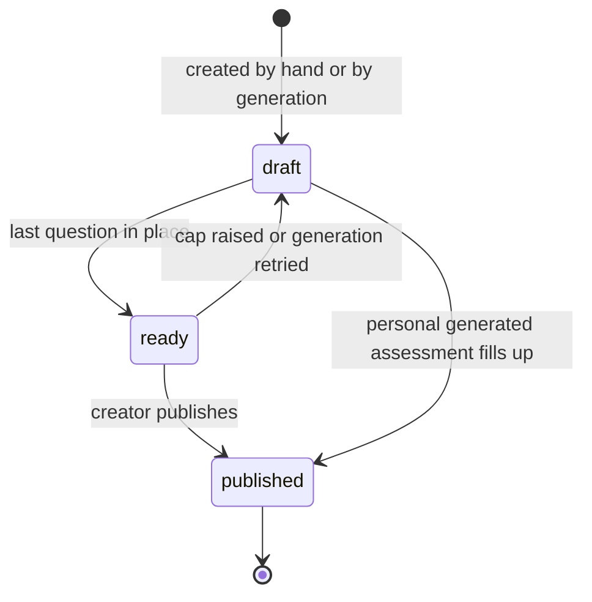
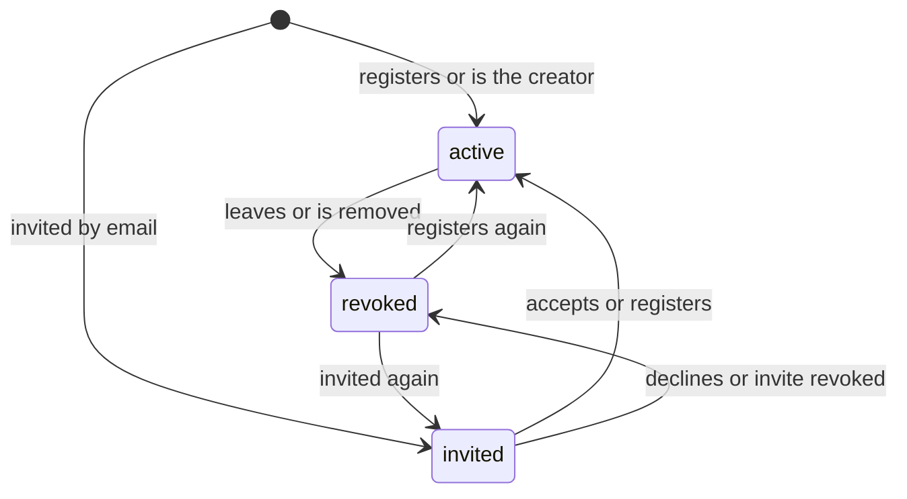
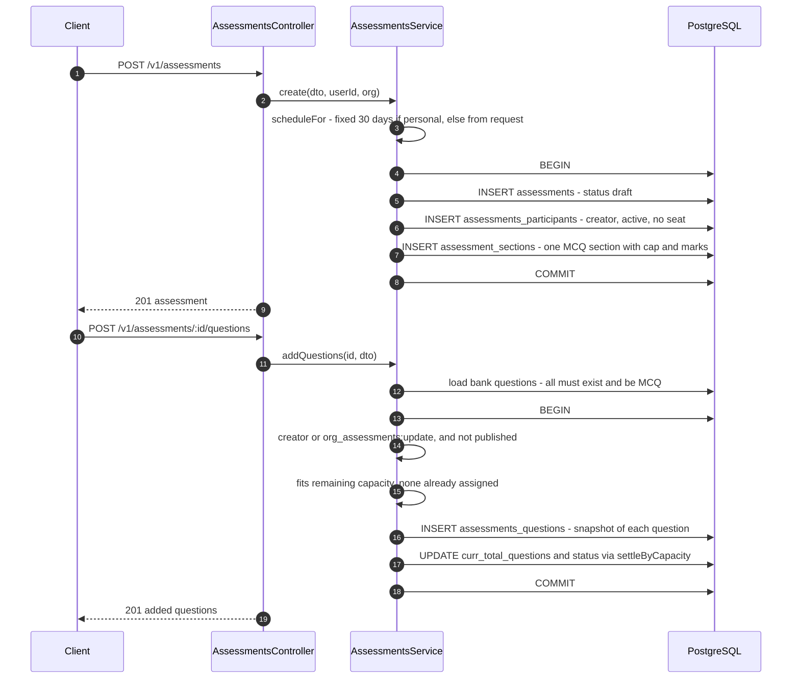
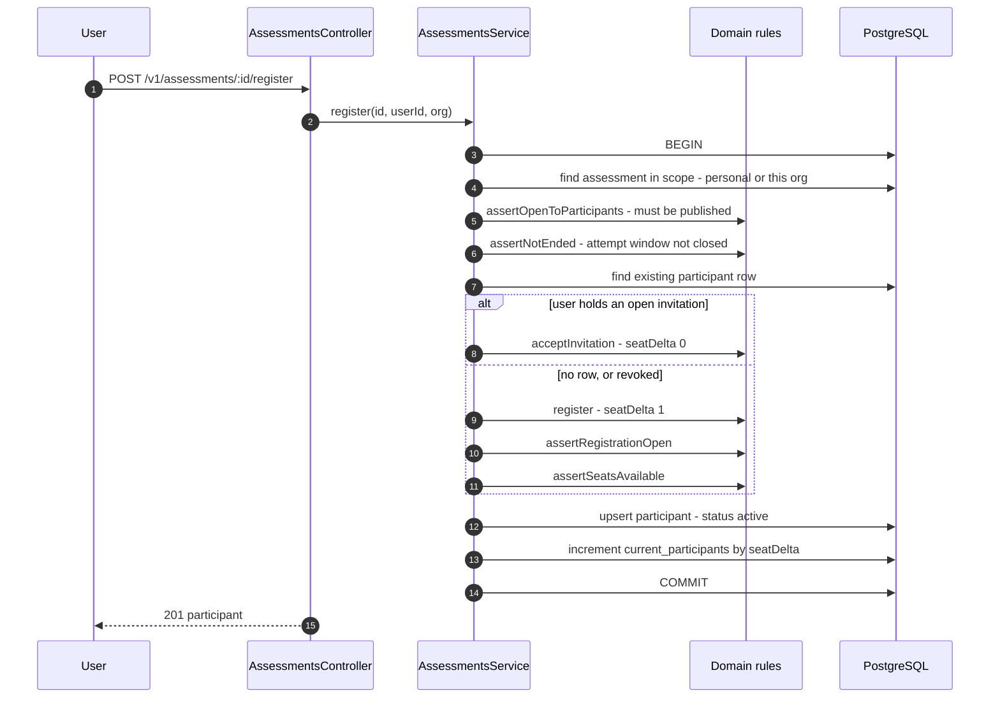
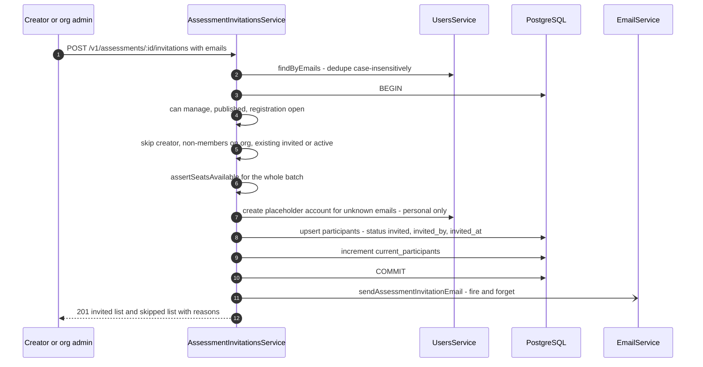

# Assessments

## 1. Purpose

An **assessment** is a test that people sit. It has a title, a schedule, a time limit, a seat limit and one or more **sections** of questions.

The assessments module (`src/assessments/`) owns:

- creating assessments (by hand, or by AI generation),
- their schedule and settings,
- the draft → ready → published lifecycle,
- who can take part (registration, invitations, removal),
- reusable presets: **assessment templates** and **assessment prompts**,
- admin read access to every assessment on the platform.

It does **not** own taking the test or scoring it. Those live in `src/assessments/attempts` and `src/assessments/evaluation` (see [Attempts](attempts.md) and [Evaluation](evaluation.md)). Questions and tags have their own page: [Questions & Tags](questions-and-tags.md). The AI generation pipeline has its own page too: [AI Assessment Generation](assessment-generation.md).

## 2. Key concepts

| Term | Meaning |
| --- | --- |
| **Personal assessment** | Created without the `x-organization-id` header. `organization_id` is `NULL`. Owned by one user. |
| **Organization assessment** | Created with the `x-organization-id` header. Belongs to that organization. Members manage it through org roles. |
| **Section** | A group of questions of **one type** (`mcq`, `coding` or `descriptive`). Each section has its own question cap, difficulty and marking scheme. An assessment has 1–3 sections. |
| **Status** | Stored lifecycle: `draft`, `ready` or `published`. See [§5](#5-lifecycle). |
| **Phase** | Derived from the clock, never stored: `upcoming`, `ongoing` or `completed`, based on the **attempt window**. |
| **Registration window** | `registration_start_time` → `registration_end_time`. People may register or be invited only inside it. |
| **Attempt window** | `attempt_start_time` → `attempt_end_time`. Participants may start and answer only inside it. |
| **Duration** | Minutes allowed for one attempt (1–180). Separate from the attempt window. |
| **Seat** | A place on the assessment. Held by every `invited` or `active` participant **except the creator**. `max_participants` caps seats. |
| **Participant** | A row in `assessments_participants`: `invited`, `active` or `revoked`. The creator is always an `active` participant but holds no seat. |
| **Generation status** | The status of the background job that is generating the questions (`assessments.job_id` → `jobs`). Not the same as the assessment status. |
| **Template** | A reusable preset of settings and sections (`assessment_templates`). |
| **Assessment prompt** | A saved, reusable prompt text with tags (`assessment_prompts`), for the "prompt library". |

## 3. Data it uses

All tables are described in the [ERD](../erd.md). This module reads and writes:

- `assessments`, `assessment_sections`, `assessments_questions` (question snapshots), `assessments_participants`
- `assessment_templates`
- `assessment_prompts`, `assessment_prompt_tags`, `tags`
- `jobs` (generation progress, via `assessments.job_id`)
- `questions` and its detail tables (when adding bank questions)

Things worth knowing about the shape:

- **Marking lives on the section**, not the assessment. The response field `correctMarks` / `incorrectMarks` on an assessment is read from its **first** section (lowest `order_index`). Each question snapshot also copies the marks, because scoring reads the per-question marks.
- `max_total_questions` is the sum of the section caps. `curr_total_questions` counts the questions actually in place.
- `current_participants` (column) counts **seats taken**. The API response replaces `currentParticipants` with a live count of invited + active people *including* the creator, and exposes the stored seat count as `seatsTaken` (`AssessmentsService.loadAssessments`).
- Assessments, participants, templates, prompts and tags are **soft-deleted** (`deleted_at`).

## 4. Settings

### 4.1 Personal vs organization

| Setting | Personal | Organization |
| --- | --- | --- |
| Schedule | **Fixed.** Registration and attempts both open at creation and close 30 days later (`PERSONAL_ASSESSMENT_WINDOW_DAYS` in `domain/assessment-schedule.ts`). Any schedule fields in the request are ignored, and cannot be edited later. | `attemptStartTime` and `attemptEndTime` are **required**. Registration defaults to "now → attempt end" when not given. |
| `maxParticipants` | Manual create: taken from the request. AI generation: always **10** (`GENERATED_ASSESSMENT_MAX_PARTICIPANTS`); the request value is ignored. | Required, 1–10,000. |
| Who can manage | Creator only. | Creator, or a member whose org role grants `org_assessments:update` / `org_assessments:delete`. |
| Who can be invited | Any email address. Unknown emails get a placeholder account. | Only **active members** of the organization. |
| Auto-publish after generation | Yes. A fully generated personal assessment goes straight to `published`. | No. It stops at `ready` so members can review it. |
| Quota pool for AI | The user's own plan. | The organization's pooled plan. |

### 4.2 Schedule rules

`scheduleErrors()` in `src/assessments/domain/assessment-schedule.ts` checks every schedule (on create and on update):

1. `registrationEndTime` must be after `registrationStartTime`.
2. `attemptEndTime` must be after `attemptStartTime`.
3. `registrationEndTime` must **not** be after `attemptEndTime`.

Registration may open before attempts, and may stay open after attempts start. The DTO also uses the `IsAfterField` validator (`src/assessments/validators/is-after-field.validator.ts`) so that each "end" field is after its "start" field when both are sent in the same request.

### 4.3 Other limits (manual create, `CreateAssessmentDto`)

| Field | Rule |
| --- | --- |
| `title` | Optional, 3–255 chars. If missing, a generated assessment takes the AI's suggested title, or the description. |
| `description` | Required, 10–500 chars. |
| `duration` | 1–180 minutes. |
| `maxTotalQuestions` | 1–200. |
| `correctMarks`, `incorrectMarks` | 0–999.99, 2 decimals. `incorrectMarks` is a positive amount that is deducted. |

## 5. Lifecycle

### 5.1 Assessment status

The rules live in `src/assessments/domain/assessment-state.ts` and `assessment-transitions.ts`.

- **draft**: being built. Generation may be running, may have failed, or questions are still missing.
- **ready**: every section is full. The creator reviews it and may still edit anything.
- **published**: open to participants. Questions are frozen. This is terminal; there is no unpublish.

The `draft → published` arrow is the auto-publish of a **personal** AI-generated assessment. In code it is `ready` then `published` in the same write (`AssessmentsService.generatedOutcome`).

`settleByCapacity()` is the single rule that moves between `draft` and `ready`: full means ready, not full means draft. It runs after adding questions, after a generation finishes, and when `maxTotalQuestions` is edited.

Generation progress and failure are **not** assessment statuses. They live on the parent job. A failed generation simply leaves the assessment in `draft`.

### 5.2 Phase (derived)

`phaseAt()` in `domain/assessment-invariants.ts`:

- before `attemptStartTime` → `upcoming`
- after `attemptEndTime` → `completed`
- otherwise → `ongoing`

The list endpoint's `status` query parameter filters by **phase**, not by stored status.

### 5.3 Participant status

The rules live in `domain/participant-state.ts`, `participant-transitions.ts` and `participant-invariants.ts`.

Each transition returns a `seatDelta` (+1, 0 or −1). The service adds it to `assessments.current_participants` inside the same transaction. Accepting an invitation has delta 0 because the seat was taken when the invite was sent.

## 6. Main flows

### 6.1 Ways to create an assessment

| Path | Endpoint | What happens |
| --- | --- | --- |
| **Manual** | `POST /v1/assessments` | Creates an empty `draft` with one MCQ section. Questions are added later from the question bank. |
| **AI generation (auto or manual mode)** | `POST /v1/assessments/generate` | Creates a `draft` with 1–3 sections and generates every section in the background. See [AI Assessment Generation](assessment-generation.md). |
| **From a template** | Client reads `GET /v1/assessment-templates`, then calls `POST /v1/assessments/generate` in **manual mode** with the template's sections | There is no "create from template" endpoint. The template is a preset the client turns into a generate request. Its `prompt` fills every section that has no prompt of its own. |
| **From a saved prompt** | Client reads `GET /v1/assessment-prompts/...`, then uses its text as the `prompt` of a generate request | Same idea: a prompt is only reusable text. |
| **From a learning roadmap** | `LearningRoadmapAssessmentService` calls `AssessmentsService.generate()` | Older single-section MCQ pipeline. See [Learning Roadmaps](learning-roadmaps.md) and [§13](#13-known-gaps-and-todos). |

### 6.2 Manual creation, then adding questions

When the last question is added the assessment becomes `ready`. The creator then calls `POST /v1/assessments/:id/publish`. A manually built personal assessment is **not** auto-published.

### 6.3 Editing and publishing

- `PATCH /v1/assessments/:id` (`AssessmentsService.update`):
    - In `draft` or `ready`, every field may change. Changing marks rewrites the marks on the first section **and on every question snapshot**, so the shown and scored marks never drift apart.
    - Once `published`, only `title`, `description` and `maxParticipants` may change (`PUBLISHED_EDITABLE_FIELDS`). Anything else is a 409.
    - A personal assessment's schedule can never be edited (400).
    - `maxParticipants` cannot go below seats already taken. `maxTotalQuestions` cannot go below questions already in place.
- `PUT /v1/assessments/:id/questions/:assessmentQuestionId` replaces the text, options, correct option and explanation of one **snapshot**. MCQ only, and only before publishing. The bank question is untouched.
- `POST /v1/assessments/:id/publish` moves `ready → published`. Publishing a `draft` fails with "Only an assessment with all its questions in place can be published".
- `DELETE /v1/assessments/:id` soft-deletes. Needs creator or `org_assessments:delete`. There is no status check, so a published assessment with participants can be deleted.

### 6.4 Registering for an assessment

Leaving (`POST /:id/unregister`) does the reverse: the row becomes `revoked`, `revoked_at` is set and the seat is given back. An `active` participant may leave **only while registration is open and before they have started an attempt** (`isParticipationLocked`). Declining an invitation is always allowed. The creator can never leave.

### 6.5 Inviting people

- Up to 50 emails per request (`MAX_INVITES_PER_REQUEST`).
- Each invite reserves a seat at once. The whole batch must fit, or nothing is saved.
- The invitee accepts with `POST /:id/invitations/accept`. This works **until the attempt window ends**, even after registration has closed and even if the assessment is now full.
- A placeholder account is unverified, with a random password and a placeholder username. Signing up with the same email takes over that row, so the invitation is already there.
- If someone signs up with one of the emails during the request, the unique email index fires and the API returns 409 "please retry".

### 6.6 Managing participants

- `GET /:id/participants` lists everyone (invited, active, revoked), newest first, cursor-paged, with `meta.counts` per status. The creator is listed with `isCreator: true`.
- `DELETE /:id/participants/:userId` revokes an open invitation at any time, or removes an `active` participant only while registration is open and before they started an attempt. The creator cannot be removed.
- `GET /v1/assessments/invited` lists the caller's own open invitations (org-scoped by the header).
- `POST /:id/check-enrollment` tells the caller whether they are enrolled. An open invitation returns `{ enrolled: false, invited: true }`.

## 7. Templates and prompts

### 7.1 Assessment templates

Code: `assessment-templates.controller.ts`, `assessment-templates.service.ts`.

A template stores: `name`, `slug`, a public 8-character `uid`, optional `title`, `description`, `duration`, `maxParticipants`, an ordered `sections` JSON array (type, count, difficulty, marks, optional title and prompt), an optional shared `prompt`, `visibility` (`public` / `private`) and `isActive`.

Rules:

1. A template must always be "generatable". Its sections must pass the same limits as a manual-mode generate request (`sectionLimitErrors` in `generation/section-limits.ts`: 1–3 sections, per-type caps). Every section needs a prompt, its own or the template's.
2. `slug` is derived from `name` unless given, and must be unique among live templates. `uid` is retried up to 5 times on collision.
3. Only the owner can update or delete. Seeded templates belong to the `system` user, so they are read-only to everyone else.
4. The schedule is never stored on a template. It comes from the caller, or the fixed personal schedule.
5. `GET /v1/assessment-templates` is **public** (no login) and lists only `public` + active templates.

**Seeding.** `npm run seed:assessment-templates` (`src/scripts/seed-assessment-templates.ts`) inserts the 10 public templates in `src/config/database/dummy-data/assessment-templates.ts` (DSA, DBMS, networks, OS, OOP, backend, frontend, system design, DevOps, aptitude).

- Owner: the `system` user (run `npm run bootstrap-admin` first), or `--owner-email <email>`.
- Idempotent by slug: existing rows are skipped.
- `--update` overwrites the seeded content of existing rows (never their uid, owner or active flag).
- `--dry-run` only reports.

### 7.2 Assessment prompts (prompt library)

Code: `assessment-prompts.controller.ts`, `assessment-prompts.service.ts`.

A prompt has `title`, `description`, `prompt` text, `visibility` (`public` / `private`), `status` (`draft` / `active` / `archived`) and tags (via `assessment_prompt_tags`, referenced by tag slug).

- `GET /v1/assessment-prompts` lists the caller's own prompts.
- `GET /v1/assessment-prompts/public` lists `public` + `active` prompts from everyone. It can filter by tag slugs (any match) and by owner username.
- `PUT /:id` replaces the whole prompt. Missing `visibility` / `status` reset to `private` / `draft`. Tags are re-synced: removed pairs are soft-deleted, new pairs are inserted.
- Unknown tag slugs give a 404.
- Only the owner can update or delete.

## 8. Business rules and edge cases

1. **Scope check.** Every user route resolves the assessment with `findOneInScope`: a personal request only sees personal assessments, an org request only sees that org's. Anything else is a 404, not a 403.
2. **Who can manage.** `assertCanManage` allows the creator, or in an org a member whose role grants `org_assessments:update` (or `:delete` for delete). Route guards only check `org_assessments:read` or `:create`; the update/delete check happens in the service, because a creator without those permissions may still manage their own assessment (`assessments.constants.ts`).
3. **Published is open, nothing else is.** Register, invite and accept all require `published` (`assertOpenToParticipants`).
4. **Questions freeze on publish.** Adding or editing questions on a published assessment is a 409 (`assertQuestionsEditable`).
5. **The creator holds no seat.** A personal assessment with 10 seats can have 10 people plus the creator.
6. **Seat counting is transactional.** Every change to a participant and its `current_participants` delta happen in one DB transaction.
7. **Manual add is MCQ only.** `POST /:id/questions` rejects coding and descriptive bank questions, and always adds into the first section.
8. **Per-question marks on manual add** come from the request item, not the section. A later marks edit overwrites them all with the section's marks.
9. **Search** on the user list matches `description` only (the admin list matches title or description).
10. **`GET /v1/assessments/:id` is public.** It needs no login and does not check scope. It returns settings and sections, never questions.
11. **Questions with answers** (`GET /:id/questions`) are only for people who can manage the assessment, because they include the correct options.
12. **Assistant reads are cached** in Redis per user (`listAssessmentsForAssistant`, `getAssessmentForAssistant`). The phase is recomputed on read so a cached entry never shows a stale phase. Edits are not invalidated; they show after the TTL.

## 9. Endpoints summary

Full details live in the [API reference](../api-design/v1.md). All user routes accept the optional `x-organization-id` header.

| Method | Path | Who | Purpose |
| --- | --- | --- | --- |
| POST | `/v1/assessments` | logged in, org: `org_assessments:create` | Manual create |
| POST | `/v1/assessments/generate` | logged in, org: `org_assessments:create` | AI generation ([details](assessment-generation.md)) |
| POST | `/v1/assessments/:id/generation/retry` | manager | Retry failed sections |
| GET | `/v1/assessments` | logged in | List mine (personal) or the org's |
| GET | `/v1/assessments/invited` | logged in | My open invitations |
| GET | `/v1/assessments/:id` | **public** | Details with sections |
| PATCH | `/v1/assessments/:id` | manager | Edit settings |
| DELETE | `/v1/assessments/:id` | manager (`:delete`) | Soft delete |
| POST | `/v1/assessments/:id/questions` | manager | Add bank MCQs |
| GET | `/v1/assessments/:id/questions` | manager | Questions with answers |
| PUT | `/v1/assessments/:id/questions/:assessmentQuestionId` | manager | Edit one MCQ snapshot |
| POST | `/v1/assessments/:id/publish` | manager | `ready → published` |
| POST | `/v1/assessments/:id/invitations` | manager | Invite by email |
| POST | `/v1/assessments/:id/invitations/accept` | invitee | Accept |
| GET | `/v1/assessments/:id/participants` | manager | List participants |
| DELETE | `/v1/assessments/:id/participants/:userId` | manager | Revoke or remove |
| POST | `/v1/assessments/:id/register` | logged in | Register |
| POST | `/v1/assessments/:id/unregister` | participant | Leave or decline |
| POST | `/v1/assessments/:id/check-enrollment` | logged in | Am I enrolled? |
| GET | `/v1/assessment-templates` | **public** | Public templates |
| POST / PATCH / DELETE | `/v1/assessment-templates[/:uid]` | logged in / owner | Manage templates |
| GET | `/v1/assessment-prompts`, `/public`, `/:id` | logged in | Prompt library |
| POST / PUT / DELETE | `/v1/assessment-prompts[/:id]` | logged in / owner | Manage prompts |
| GET | `/v1/admin/assessments`, `/v1/admin/assessments/:id` | platform `assessments:read` | See every assessment |

"Manager" means the creator, or an org member whose role grants `org_assessments:update`.

**Admin endpoints** (`src/assessments/admin.controller.ts`, `admin.service.ts`) are read-only. They list every assessment (personal and org) with filters `workspace` (personal / organization), `organization` (uid), `assessment_status`, `search`, plus the shared phase/sort/paging filters. They include the owner and organization, and report the stored seat count.

**Rate limits.** The controller uses policy `CLASS_B`. `generate` and `generation/retry` also spend 5 units of the `AI_GENERATION` scope. See [Platform Services](platform-services.md).

**Leaderboard.** The leaderboard lives in `src/assessments/attempts/leaderboard.*`. See [Attempts](attempts.md).

## 10. Async work, events and emails

| What | When | Where |
| --- | --- | --- |
| Assessment invitation email | After a successful invite, one per invited person. Fire and forget; a failure is only logged. | `EmailService.sendAssessmentInvitationEmail` ([Notifications](notifications.md)) |
| Question generation jobs (RabbitMQ) | `POST /generate` and retry | [AI Assessment Generation](assessment-generation.md) |
| WebSocket events | None from this module. Clients poll `GET /v1/jobs/:jobId` for generation progress. | [Realtime Events](realtime-events.md) |

## 11. Usage limits (commerce)

- Manual creation, invitations and registration are **not** metered.
- AI generation spends one unit of the `AI_ASSESSMENT` feature and checks `ALLOWED_QUESTION_TYPES` against the plan. In an org, the org's pooled plan is used. Details in [AI Assessment Generation](assessment-generation.md) and [Commerce](commerce.md).

## 12. Where the code lives

| Path | What |
| --- | --- |
| `src/assessments/assessments.controller.ts` | User routes |
| `src/assessments/assessments.service.ts` | Create, update, publish, add questions, register, list, assistant reads, the older `generate()` |
| `src/assessments/assessment-invitations.service.ts` | Invite and accept |
| `src/assessments/assessment-participants.service.ts` | List and remove participants |
| `src/assessments/admin.controller.ts`, `admin.service.ts` | Platform admin reads |
| `src/assessments/assessment-templates.*`, `assessment-prompts.*` | Templates and prompt library |
| `src/assessments/domain/` | Pure rules (see below) |
| `src/assessments/validators/is-after-field.validator.ts` | `IsAfterField` class-validator constraint |
| `src/assessments/assessments.constants.ts` | Org permission strings, personal seat limit, default section title |
| `src/assessments/serializers/assessments.serializer.ts` | Response shapes |
| `src/assessments/repositories/` | Empty. Services use TypeORM repositories and `DataSource` directly. |
| `src/scripts/seed-assessment-templates.ts` | Template seeding |

**The `domain/` folder** holds pure functions and enums with no Nest or DB code, so the rules can be unit tested on their own:

| File | Rules |
| --- | --- |
| `assessment-state.ts` | `AssessmentStatus`, `AssessmentPhase`, shape types |
| `assessment-transitions.ts` | Allowed status moves, `settleByCapacity`, `publishAssessment`, `reopenForGeneration` |
| `assessment-invariants.ts` | `phaseAt`, registration open, published only, seats available, seat limit covers taken seats, locked fields after publish |
| `assessment-schedule.ts` | Personal 30-day schedule, org schedule defaults, schedule ordering errors |
| `participant-*.ts` | Participant status, transitions with seat deltas, who may leave |
| `generation-outcome.ts` | Generation outcome from section jobs (see [AI Assessment Generation](assessment-generation.md)) |
| `descriptive-invariants.ts` | Checkpoint weight rules (see [Questions & Tags](questions-and-tags.md)) |
| `attempt-*.ts`, `response-*.ts` | Attempt and response rules (see [Attempts](attempts.md), [Evaluation](evaluation.md)) |

Rule violations throw `DomainError` (`rule` → 400, `conflict` → 409, `forbidden` → 403).

## 13. Known gaps and TODOs

1. **Two generation pipelines.** `POST /generate` uses the new section pipeline. The older `AssessmentsService.generate()` (single MCQ section, `CREATE_ASSESSMENT` job, `QuestionGenerationConsumer`) is still used by learning roadmaps. It never refunds the quota on failure.
2. **Multi-section edits only touch the first section.** `update()` writes `maxTotalQuestions` and marks onto the first section only, and applies those marks to **every** question in the assessment. For a generated assessment with MCQ and coding sections this can give coding questions MCQ marks and give the first section the whole assessment's cap.
3. **Manual add always targets the first section**, even when that section is coding or descriptive.
4. **No way for normal users to browse the question bank.** Manual add needs bank question IDs, but listing the bank is admin-only (`/v1/admin/questions`).
5. **No "my templates" or "get template by uid" endpoint.** A user cannot list their own private templates.
6. **`GET /v1/assessment-prompts/:id` does not check visibility or owner.** Any logged-in user can read anyone's private or draft prompt by ID.
7. **`GET /v1/assessments/:id` is public and unscoped.** Org assessment settings and the description (which, for generated ones, is the full prompt) are readable without login.
8. **Swagger text is out of date in a few places** (publish says "draft to ready"; update says only `maxParticipants` may change after publish; invite says "has not ended" but the code requires registration to be open).
9. **Delete has no status guard.** A published assessment with active participants can be soft-deleted.
10. **`GET /v1/assessments/invited`** reports `invitedAt` from the row's `created_at`, which is wrong for someone invited again after being revoked.
