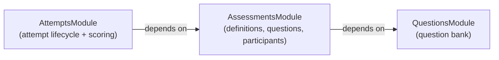
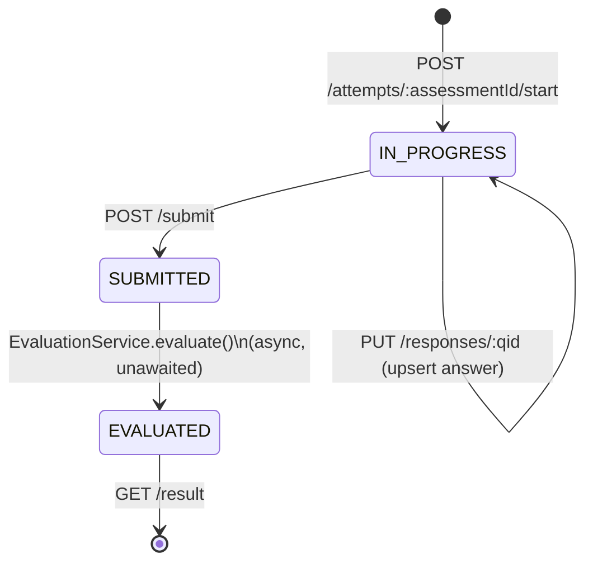
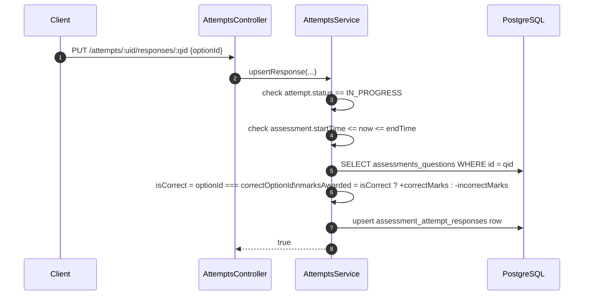

# HLD — Assessments, Attempts & Questions

## 1. Purpose

Three modules together implement the core product loop: **`QuestionsModule`** owns the reusable question bank; **`AssessmentsModule`** owns assessment definitions, question assignment, and participant enrollment; **`AttemptsModule`** owns the timed attempt lifecycle — starting, answering, submitting, and evaluating.

## 2. Module Relationship

`AttemptsModule` has no direct repository access to `Assessment`/`AssessmentQuestion`/`AssessmentParticipant` — it calls into `AssessmentsService` for all of that data (`findAssessmentQuestionById`, `findAssessmentQuestionsByAssessmentId`, `findParticipantByAssessmentAndUser`, `markParticipantCompleted`). This keeps assessment-shape invariants centralized in one service.

## 3. Questions Module

The question bank is the only module in this cluster that enforces RBAC (`@Permissions('questions:create'|'read'|'update'|'delete')`).

**Entity** (`questions`): `question_text`, `options` (jsonb array of `{id, text}`), `correct_option_id`, `created_by`, standard timestamps + soft delete.

**Seeding**: 45 hardcoded MCQ trivia questions (`src/database/dummy-data/questions.ts`) are inserted once, attributed to a `username: 'system'` user, if the table is empty at seed time.

See [API Design — Questions Module](../api-design/v1.md#questions-module-v1questions) for the endpoint table.

## 4. Assessments Module

### 4.1 Two creation paths

| Path | Endpoint | Behavior |
| --- | --- | --- |
| Manual | `POST /v1/assessments` | Creates an empty assessment shell. Questions must be added afterward via `POST /:id/questions`. No auto-enrolled participant. |
| "Generate" | `POST /v1/assessments/generate` | Creates the assessment **and** immediately snapshots `totalQuestions` random questions onto it, and auto-enrolls the creator as participant #1. |

!!! warning "Not actually AI-generated"
    Despite its name and Swagger summary, `generate()` calls `QuestionsService.findRandom(n)` — a plain `ORDER BY RANDOM() LIMIT n` query against the existing question bank. There is no LLM call anywhere in this path. An unused interface (`src/ai/interfaces/generated-question.interface.ts`, `GeneratedQuestion`/`GeneratedQuestionOption`) exists with zero consumers in the codebase — it looks like scaffolding for a future LLM-backed generator that hasn't been built. Document and communicate this gap explicitly if product copy or frontend UI implies real AI generation.

### 4.2 Question assignment (`AssessmentQuestion` snapshot)

Adding a question to an assessment **copies** `question_text`, `options`, and `correct_option_id` onto a new `assessments_questions` row at that moment — it does not reference the live `questions` row going forward. Editing the source question later has no effect on assessments it was already added to. Each assignment also carries its own `correct_marks`/`incorrect_marks`, which may differ per question within the same assessment (defaulting to the assessment's flat marking scheme only in the "generate" path).

Guardrails enforced in `AssessmentsService.addQuestions()`: no duplicate `questionId`s in one request, all question IDs must exist, none may already be assigned to this assessment, and the batch must not exceed `maxTotalQuestions - currTotalQuestions` remaining capacity.

### 4.3 Assessment status (derived, not stored)

`AssessmentStatus` (`upcoming`/`ongoing`/`completed`) is computed at query time from `start_time`/`end_time` — there is no `status` column on `assessments`.

### 4.4 Participants

`assessments_participants` tracks enrollment. `ParticipantStatus` is `not_started` → `completed` (the `in_progress` enum value is defined but never actually set by any code path — there's no explicit "participant started" transition separate from the attempt itself starting). `current_participants` on `assessments` is a denormalized counter, incremented/decremented on register/unregister in the same transaction as the participant row change.

Ownership model: update/delete/add-questions are restricted to `assessment.createdBy === callerId` (403 otherwise), enforced in the service — there is no `@Permissions()` decorator involved.

## 5. Attempts Module

### 5.1 Lifecycle

One attempt per (user, assessment) pair — enforced by a DB unique constraint on `assessment_attempts(user_id, assessment_id)`. `POST /start` returns the existing attempt's `uid` if one already exists (resume semantics) rather than erroring.

### 5.2 Where scoring actually happens

Scoring is **not** deferred to submit time — it happens the instant an answer is saved:

`EvaluationService.evaluate(attemptId)` — triggered fire-and-forget from `submitAttempt()`, not awaited by the HTTP response — does not re-grade anything. It purely aggregates the already-computed `is_correct`/`marks_awarded` values across all response rows into the attempt-level `score`, `attempted_questions`, `correct_responses`, `incorrect_responses`, and flips `status` to `EVALUATED`. Errors inside evaluation are caught and logged, never surfaced to the client.

**Consequence**: there is a real (if narrow) window immediately after `POST /submit` returns `true` where `GET /result` returns 400 (`"Attempt has not been evaluated yet"`), since evaluation hasn't necessarily completed yet. Clients should poll or retry briefly rather than treating a post-submit 400 as an error.

### 5.3 Guardrails

- Responses can only be upserted/deleted while `attempt.status === IN_PROGRESS` **and** the live assessment window is open (`start_time <= now <= end_time`) — checked against the current `Assessment` row, not a cached value at attempt-start time.
- `submitAttempt()` uses a conditional `UPDATE ... WHERE id=$1 AND status='IN_PROGRESS'`; if `affected = 0`, a 400 "already submitted" is thrown — this is the double-submit guard.
- Ownership is enforced by comparing `attempt.userId` to the caller on every attempt-scoped route (403 otherwise).

## 6. Legacy Code — Do Not Extend

`src/assessments/dto/attempt-response.dto.ts`, `get-my-attempts-query.dto.ts`, `submit-response.dto.ts`, and `src/assessments/enums/attempt-status.enum.ts` are **dead code** — duplicates left over from before the attempt/submission flow was extracted into `AttemptsModule`. They are not imported anywhere. Notably, the dead `submit-response.dto.ts` uses `option_id` (snake_case) while the live one in `src/attempts/dto` uses `optionId` (camelCase) — a clear signature of the stale copy predating a refactor. New work should never import from these files; they are candidates for deletion.

## 7. Open Gaps

1. **No real AI question generation** — the `/generate` endpoint's name overpromises; either build the LLM integration against the existing `GeneratedQuestion` interface or rename/redocument the endpoint.
2. **No auto-submit for expired attempts** — an attempt left `IN_PROGRESS` past the assessment's `end_time` is never automatically transitioned; there's no scheduled job.
3. **No question reordering/removal endpoint** — a `//TODO` in `AssessmentsController` flags this explicitly.
4. **Dead code cleanup** — the legacy files listed in §6 should be removed to prevent accidental reuse.

## 8. Related Pages

- [Architecture — Assessment Engine Flow](../architecture.md#4-assessment-engine-flow)
- [ERD — Assessment Engine](../erd.md#2-assessment-engine)
- [API Design v1 — Questions](../api-design/v1.md#questions-module-v1questions), [Assessments](../api-design/v1.md#assessments-module-v1assessments), [Attempts](../api-design/v1.md#attempts-module-v1attempts)
