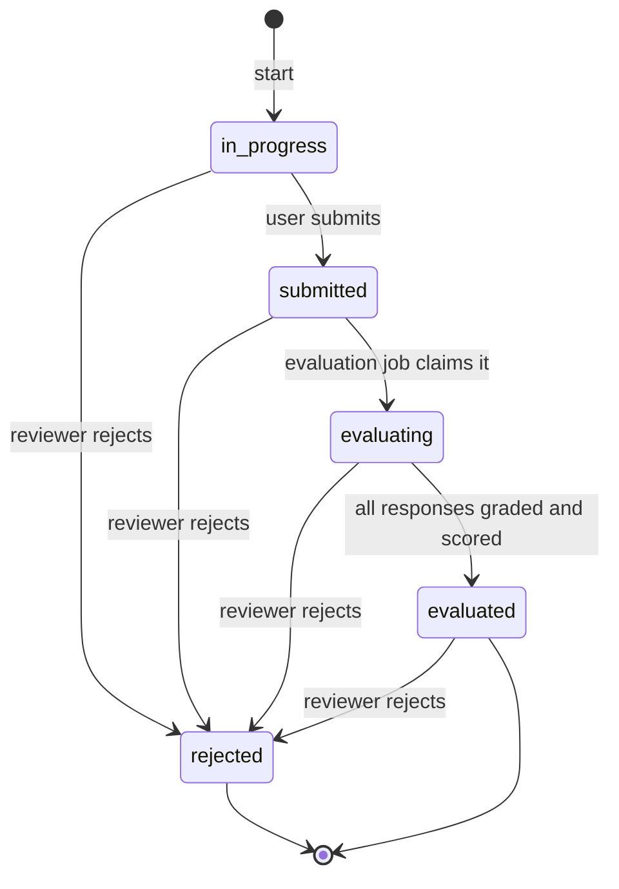
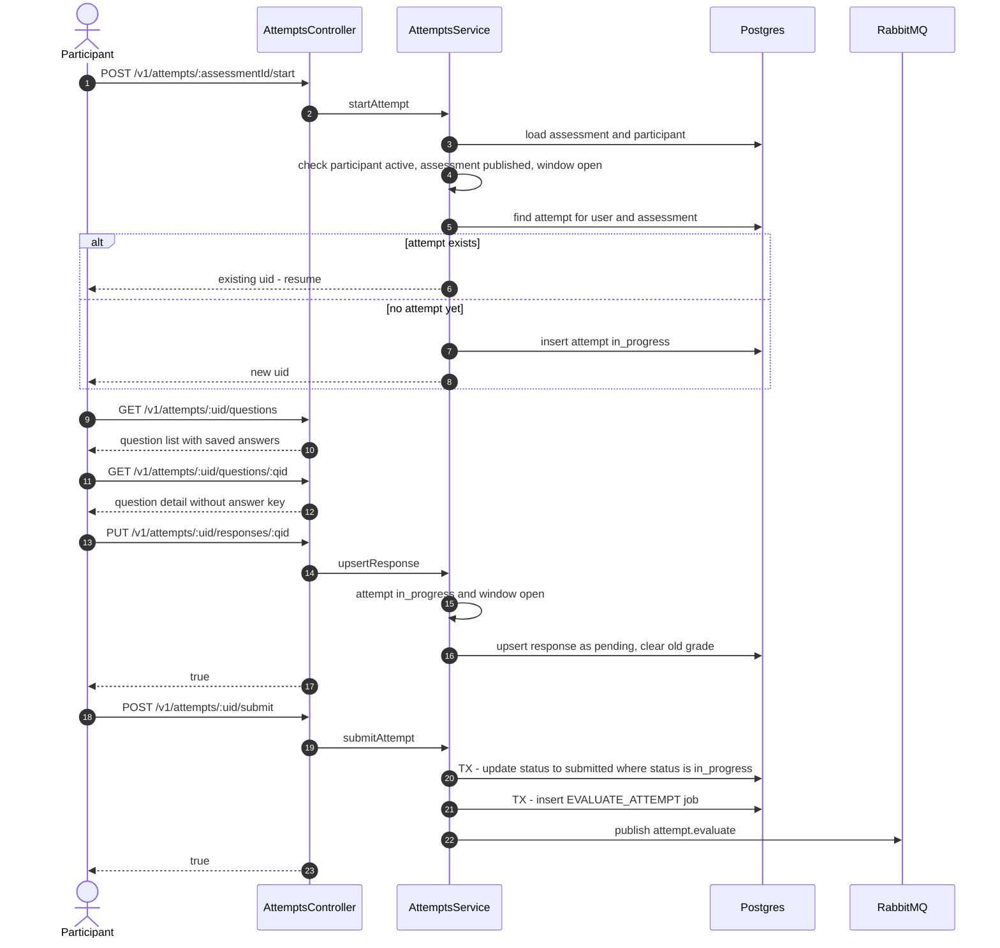
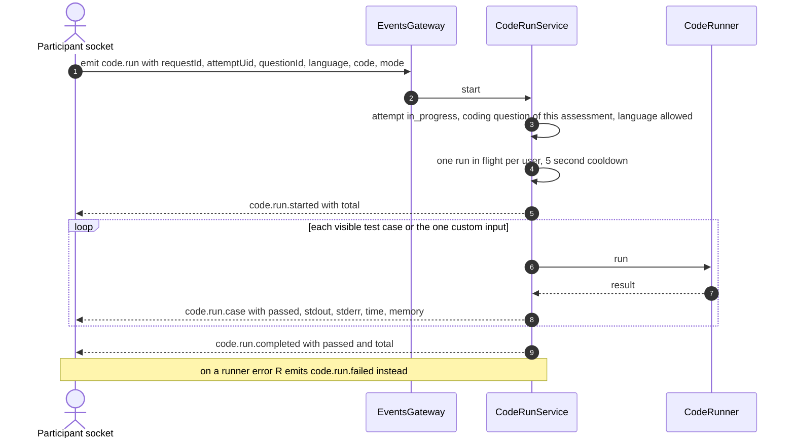
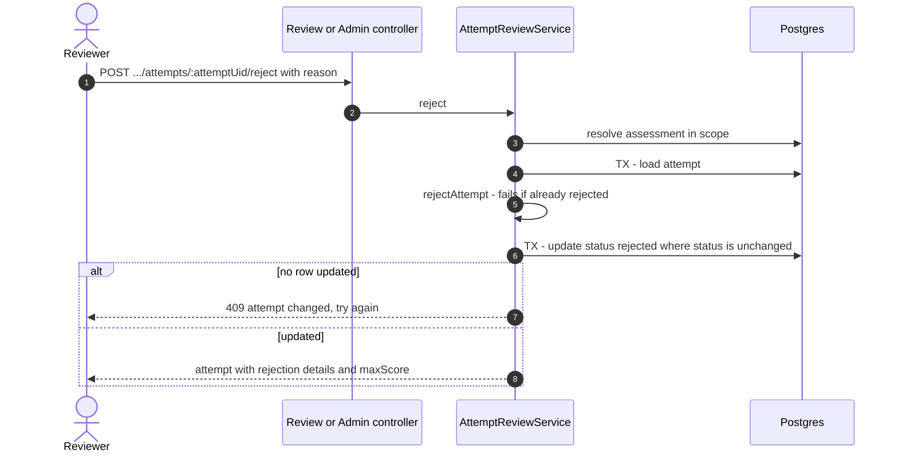

# Attempts

## 1. Purpose

An **attempt** is one participant sitting one assessment. The attempts feature covers everything from "Start test" to "see my result":

- start (or resume) an attempt, after checking the user may sit the assessment
- show the questions without leaking the answers
- save, change and clear answers while the test is open
- run code for coding questions (streamed over WebSocket)
- submit the attempt and hand it to [evaluation](evaluation.md)
- show the result, analytics, and an AI conversation once the attempt is graded
- let reviewers list attempts, read answers, and **reject** an attempt
- rank evaluated attempts on a **leaderboard**

The code lives in `src/assessments/attempts/`. The rules (what may happen in which state) live in small pure functions in `src/assessments/domain/`.

## 2. Key concepts

| Term | Meaning |
| --- | --- |
| Attempt | A row in `assessment_attempts`. Each user has **at most one attempt per assessment**. It has a public `uid` (UUID) used in all URLs. The numeric `id` is internal. |
| Response | A row in `assessment_attempt_responses`. It holds the user's answer to one question in one attempt. |
| Participant | A row in `assessment_participants`. A user must be an **active** participant to start. See [assessments](assessments.md). |
| Attempt window | `attemptStartTime` to `attemptEndTime` on the assessment. You can only start an attempt and write answers inside this window. |
| Registration window | `registrationStartTime` to `registrationEndTime`. Users can register (become active) only inside it. This is separate from the attempt window. |
| Settled attempt | An attempt in `evaluated` or `rejected`. Nothing changes it any more (except evaluated to rejected), so reads about it are cached. |
| Code run | Running the user's code against the visible test cases, or once on custom input, during the test. Nothing is saved. |
| Rejection | A reviewer sets an attempt aside with a reason. The score is kept for the record, but the user sees the reason instead of a result, and the attempt leaves the leaderboard. |

## 3. Data used

See [ERD: Assessment Engine](../erd.md) for full table definitions. This feature reads and writes:

- `assessment_attempts`: status, `started_at`, `submitted_at`, `score`, counters (`total_questions`, `attempted_questions`, `correct_responses`, `incorrect_responses`), and rejection fields (`rejected_at`, `rejected_by`, `rejection_reason`). A unique constraint `UQ_assessment_attempts_user_assessment` on `(user_id, assessment_id)` enforces one attempt per user.
- `assessment_attempt_responses`: `answer` (jsonb: the MCQ option or descriptive text), `language` and `source_code` (coding), `evaluation_status`, `code_verdict`, `is_correct`, `marks_awarded`, `evaluation_result` (jsonb), `answered_at`, `evaluated_at`.
- `jobs`: the submit step creates an `EVALUATE_ATTEMPT` job row. See [jobs and schedulers](jobs-and-schedulers.md).
- Reads `assessments`, `assessment_sections`, `assessment_questions` and `assessment_participants`.

## 4. Attempt lifecycle

| Status | What it means | What the user can do |
| --- | --- | --- |
| `in_progress` | Being sat. Answers can change. | Read questions, save/clear answers, run code, submit |
| `submitted` | Handed in. Waiting for the evaluation job. | Wait. Result returns 400 "not evaluated yet". |
| `evaluating` | The evaluator is grading responses. | Wait. |
| `evaluated` | Graded and scored. | See result, analytics, open AI conversation, appear on leaderboard |
| `rejected` | Set aside by a reviewer. | Result returns 409 with the reviewer's reason |

The transition table is `ATTEMPT_TRANSITIONS` in `src/assessments/domain/attempt-transitions.ts`.

Each response also has its own small lifecycle (`pending`, `processing`, `completed`, `failed`, `cancelled`). Every saved answer starts as `pending`. Grading happens only after submit. See [evaluation](evaluation.md).

## 5. Main flows

### 5.1 Start, answer, submit

**Starting** (`AttemptsService.startAttempt`) checks, in order:

1. The assessment exists (404 otherwise).
2. The user is an **active** participant (`assertActive` in `domain/participant-invariants.ts`). An `invited` user gets 403 "Accept the invitation before starting". No row, or a `revoked` row, gets 403 "You are not registered". The creator has an active participant row too, so they can sit their own assessment.
3. The assessment is `PUBLISHED` (`assertOpenToParticipants`). Drafts cannot be attempted by anyone, the creator included, because their questions can still change.
4. Now is inside the attempt window (`assertOngoing`). Before it: "has not started yet". After it: "has ended".
5. Inside a transaction: if an attempt for this user and assessment already exists, its `uid` is returned. Otherwise a new `in_progress` attempt is inserted with `startedAt = now` and `totalQuestions = assessment.currTotalQuestions`.

There is no separate organization-membership check at start. For organization assessments, access comes from the participant row created when the invitation is accepted. See [organizations](organizations.md).

**Saving an answer** (`upsertResponse`) requires the attempt to be `in_progress`, the window to be open, and the question to belong to the attempt's assessment. The body depends on the question type:

| Question type | Body | Extra checks |
| --- | --- | --- |
| MCQ | `{ optionId }` | `optionId` must be one of the question's options |
| Coding | `{ language, code }` | `language` must be in the question's `supportedLanguages` |
| Descriptive | `{ text }` | none. A blank text is kept and later grades to zero. |

Sending fields of another type (for example `code` on an MCQ) is a 400. Every save resets `evaluationStatus` to `pending` and clears `isCorrect`, `marksAwarded`, `codeVerdict` and `evaluationResult`. A client can autosave coding answers safely because each save replaces the last one.

**Clearing an answer** (`DELETE /v1/attempts/:uid/responses/:qid`) has the same checks and deletes the response row. A question with no response is simply not graded (zero marks, no penalty).

**Submitting** (`submitAttempt`) runs one transaction:

1. `UPDATE assessment_attempts SET status='submitted', submitted_at=now WHERE id=? AND status='in_progress'`. If no row changed, it throws 409 "already submitted".
2. Insert a `jobs` row: type `EVALUATE_ATTEMPT`, queue `attempt-evaluation`, `maxAttempts = 3`, payload `{ attemptId, attemptUid, assessmentId, userId }`.

After the commit, it publishes `{ jobId, ...payload }` to exchange `attempt` with routing key `attempt.evaluate`. If the publish fails, the job is marked `FAILED` (it can be retried later) but the **submission still stands** and the user gets `true`. Grading then continues asynchronously. See [evaluation](evaluation.md).

### 5.2 What the user sees during the test

- `GET /questions` returns, for each question: id, order, section, and the user's saved answer (`selectedOptionId`, `code`, or `text`).
- `GET /questions/:qid` returns the question text, type, options (without `correctOptionId`), the coding view (input/output format, constraints, starter code, languages, limits, and **visible test cases only**), and the descriptive view (`maxWords` only, because checkpoints are the answer key).
- The answer key and explanation are only returned by `GET /result`, which needs an `evaluated` attempt.

Caching (Redis, via `RedisHelper.safeGet/safeSet`):

| Read | Cached when | Key prefix | TTL |
| --- | --- | --- | --- |
| Question list with answers | attempt is settled | `attempts:questions:v4:` | 1 hour |
| Single question detail | always (it carries no answer) | `attempts:question:v3:` | 1 hour |
| Result | always (only reachable when evaluated) | `attempts:result:v8:` | 1 hour |
| Analytics | attempt is settled | `attempts:analytics:v2:` | 1 hour |

### 5.3 Running code during an attempt

Code runs go over the Socket.IO connection, not REST, so results can stream back case by case. The engine behind it is described in [code execution](code-execution.md).

Rules (`src/assessments/attempts/code-run/code-run.service.ts`):

1. `mode: "samples"` runs the question's **visible** test cases. Hidden test cases are never run here. They belong to grading.
2. `mode: "custom"` runs once on the given `stdin` and returns the output in `code.run.completed`.
3. The question must be a coding question of the attempt's assessment, and the language must be one the question offers **and** one the configured runner supports.
4. One run in flight per user, and at most one new run every 5 seconds (`CODE_RUN_COOLDOWN_MS`). A refused run comes back as a socket `exception` event (409 or 429 with `retryAfterMs`).
5. Code and stdin are each capped at 50,000 characters (`RunCodeDto`).
6. Nothing is saved. The user must still `PUT` the response to keep the code.
7. Events go only to the socket that started the run, not to the user's other tabs.

### 5.4 After submission: result, analytics, AI conversation

| Endpoint | Available when | Notes |
| --- | --- | --- |
| `GET /v1/attempts/:uid/result` | `evaluated` | Full per-question breakdown: chosen and correct option, explanation, submitted code, test-case results (hidden cases show only pass/fail and a generic message), descriptive checkpoint results, marks, and per-section breakdown. `rejected` gives 409 with the reason. Any other status gives 400. |
| `GET /v1/attempts/:uid/analytics` | any status | Score, accuracy, negative marks, a timeline in buckets of `intervalMinutes` (1 to 60, default 5), topic and section stats. A live attempt is recomputed on every call. |
| `POST /v1/attempts/:uid/conversations` | `evaluated` | Opens (or returns) an AI conversation about this attempt. Blocked earlier so the bot cannot leak answers mid-test. See [AI assistant](ai-assistant.md). |
| `GET /v1/attempts` | any | The caller's attempts, newest first, filterable by `status` and `assessmentId`, paginated. |

Hidden test cases stay hidden even after evaluation, because other participants may still be sitting the same assessment.

### 5.5 Reviewing and rejecting attempts

Two sets of routes share one service (`AttemptReviewService`):

- **Organization reviewers** use `/v1/assessments/:id/attempts...`. These need the `x-organization-id` header (400 without it). Permissions are checked against the member's org role, and only that organization's assessments resolve.
- **Platform admins** use `/v1/admin/assessments/:id/attempts...`. These are checked against platform roles and reach any assessment. See [RBAC](rbac.md).

Effects of a rejection:

- An `in_progress` attempt is closed. Because start returns the existing row, the user cannot restart.
- A `submitted` or `evaluating` attempt stops being graded. Child evaluation jobs see the new status and cancel themselves. See [evaluation](evaluation.md).
- An `evaluated` attempt keeps its score, but `GET /result` returns 409 with the reason, and it drops off the leaderboard.

`GET .../attempts` lists attempts newest first, with filters for `status` and `search` (username, email or full name, `ILIKE`). Each row includes `maxScore`, which is the sum of every question's `correctMarks`. `GET .../attempts/:attemptUid/responses` returns every question with the participant's answer and the **full** grading detail, including hidden test-case inputs and outputs.

### 5.6 Leaderboard

`GET /v1/assessments/:id/leaderboard` (`LeaderboardService`):

1. Only `evaluated` attempts are ranked. Users with deleted accounts are left out.
2. Order: higher `score` first, then shorter `time_taken_ms` (`submitted_at - started_at`, whole milliseconds).
3. Rank uses SQL `RANK()`, so ties share a rank and the next rank skips (1, 1, 3).
4. Paging is keyset-based. `cursor` is the attempt id of the last row on the previous page (`meta.nextCursor`). The page size is `limit` (default 20).
5. `meta.me` is the caller's own entry wherever it falls, or `null` if they have no evaluated attempt.
6. Access: for a personal assessment, the creator and **active** participants only (invited or revoked users get 403). Inside an organization, members whose role grants `org_assessments:read`, and the assessment must belong to that organization.

## 6. Business rules and edge cases

1. **One attempt per user per assessment.** This is enforced by the unique constraint and by `startAttempt` returning the existing attempt. There is no "max attempts" setting and no retake.
2. **Resuming** is the same call as starting. `POST /start` returns the existing `uid` whatever its status. The client then reads `/questions` to restore saved answers.
3. **No server-side timer.** The assessment has a `duration` field, but the backend does not enforce it per attempt. There is no auto-submit, no scheduler, and no delayed queue. The only time limit is the assessment's **attempt window**: after `attemptEndTime`, starting and saving or clearing answers fail with "This assessment has ended". The client is expected to show the countdown and call submit.
4. **Submitting after the deadline is allowed.** `submitAttempt` does not check the window, so an attempt can be handed in (and graded) after `attemptEndTime`. Only the answers saved before the end are graded, because writes were blocked after it.
5. **Never-submitted attempts stay `in_progress` forever.** They are never graded and never appear on the leaderboard.
6. **Double submit** is safe. The status update is conditional on `status = 'in_progress'`, so only one of two racing requests wins. The other gets 409 "already submitted". Only one evaluation job is created.
7. **Double start (race).** Two concurrent first starts can both see no attempt. The second insert then breaks the unique constraint. This is not caught, so it surfaces as a 500 (see section 10).
8. **Answers must match the question type.** Sending fields of another type gives a 400. An MCQ option must be one of the question's options. A coding language must be offered by the question.
9. **Questions are frozen once published.** Questions can only be edited while the assessment is a draft, so question detail is safe to cache during a live attempt.
10. **Rejection is final.** `rejected` has no outgoing transitions, and rejecting twice gives 409.
11. **The result is only for `evaluated`.** A `submitted` or `evaluating` attempt gives 400 "not evaluated yet". The client polls until it is ready (no push event, see section 8).

## 7. Endpoints summary

Full request and response shapes are in [API v1](../api-design/v1.md).

| Method | Path | Who | Purpose |
| --- | --- | --- | --- |
| GET | `/v1/attempts` | owner | List my attempts |
| POST | `/v1/attempts/:assessmentId/start` | active participant | Start or resume, returns `{ uid }` |
| GET | `/v1/attempts/:attemptUid/questions` | owner | Question list with saved answers |
| GET | `/v1/attempts/:attemptUid/questions/:assessmentQuestionId` | owner | One question, no answer key |
| PUT | `/v1/attempts/:attemptUid/responses/:assessmentQuestionId` | owner | Save or replace an answer |
| DELETE | `/v1/attempts/:attemptUid/responses/:assessmentQuestionId` | owner | Clear an answer (204) |
| POST | `/v1/attempts/:attemptUid/submit` | owner | Submit for evaluation |
| GET | `/v1/attempts/:attemptUid/result` | owner | Graded result |
| GET | `/v1/attempts/:attemptUid/analytics` | owner | Analytics |
| POST | `/v1/attempts/:attemptUid/conversations` | owner | Open the AI conversation |
| GET | `/v1/assessments/:id/leaderboard` | creator, participants, org members | Ranked board |
| GET | `/v1/assessments/:id/attempts` | org: `assessment_attempts:read` | List attempts (org) |
| GET | `/v1/assessments/:id/attempts/:attemptUid/responses` | org: `assessment_attempt_responses:read` | Read answers (org) |
| POST | `/v1/assessments/:id/attempts/:attemptUid/reject` | org: `assessment_attempts:update` | Reject (org) |
| GET | `/v1/admin/assessments/:id/attempts` | platform: `assessment_attempts:read` | List attempts (admin) |
| GET | `/v1/admin/assessments/:id/attempts/:attemptUid/responses` | platform: `assessment_attempt_responses:read` | Read answers (admin) |
| POST | `/v1/admin/assessments/:id/attempts/:attemptUid/reject` | platform: `assessment_attempts:update` | Reject (admin) |

Rate limits: most routes use policy `CLASS_C`. `start`, `submit` and `conversations` use the stricter `CLASS_B`. See [platform services](platform-services.md).

## 8. Async events, queues and WebSocket events

| Kind | Name | Direction | Notes |
| --- | --- | --- | --- |
| RabbitMQ | exchange `attempt`, key `attempt.evaluate`, queue `attempt-evaluation-queue` | published on submit | Message is `{ jobId, attemptId, attemptUid, assessmentId, userId }` |
| Job row | `EVALUATE_ATTEMPT` in `jobs` | created on submit | Can be polled with `GET /v1/jobs/:id` if the id is known |
| Socket in | `code.run` | client to server | Body is `RunCodeDto` |
| Socket out | `code.run.started`, `code.run.case`, `code.run.completed`, `code.run.failed` | server to the same socket | Every event carries the client's `requestId` |
| Socket out | `exception` | server to client | A refused run (validation, wrong attempt, rate limit) |

No WebSocket event or email is sent when an attempt is submitted, evaluated or rejected.

## 9. Where the code lives

| Path | What |
| --- | --- |
| `src/assessments/attempts/attempts.controller.ts` / `attempts.service.ts` | Participant routes: start, questions, responses, submit, result, conversation |
| `src/assessments/attempts/analytics.service.ts` | Attempt analytics SQL |
| `src/assessments/attempts/leaderboard.controller.ts` / `leaderboard.service.ts` | Leaderboard (raw SQL with `RANK()`) |
| `src/assessments/attempts/attempt-review.controller.ts` / `attempt-review.service.ts` | Org reviewer routes and shared review logic |
| `src/assessments/attempts/admin.controller.ts` / `admin.service.ts` | Platform-admin wrappers over the review service |
| `src/assessments/attempts/code-run/` | Live code runs (service, DTO, socket event shapes) |
| `src/assessments/attempts/section-breakdown.helper.ts` | Per-section stats for the result |
| `src/assessments/attempts/serializers/attempts.serializer.ts` | Response shaping |
| `src/assessments/domain/attempt-*.ts`, `response-*.ts`, `participant-invariants.ts`, `assessment-invariants.ts` | State machines and rules |
| `src/events/events.gateway.ts` | Socket.IO `code.run` handler |
| `src/common/helpers/question-content.helper.ts` | Candidate-safe views of questions and grades |

## 10. Known gaps and TODOs found in code

1. **No duration enforcement and no auto-submit.** `assessment.duration` is only displayed. Nothing closes an attempt when its time runs out or when the window ends (`attempts.service.ts` `startAttempt` and `submitAttempt`).
2. **Submit ignores the window** (`attempts.service.ts:339-341`), while saving answers does not (`resolveAnswerableQuestion`, line 229).
3. **Code runs ignore the window.** `CodeRunService.prepare` checks only `assertAnswerable` (`code-run.service.ts:72-73`), so code can still be run after `attemptEndTime` while the attempt is `in_progress`.
4. **The start race gives a 500.** The unique violation on `UQ_assessment_attempts_user_assessment` is not caught in `startAttempt` (`attempts.service.ts:86-99`).
5. **Out-of-date Swagger text.** The PUT response route says MCQ answers are "graded at once" (`attempts.controller.ts:335`), but every answer is saved `pending` and graded after submit. The start route lists "already completed it" as a 400 (`attempts.controller.ts:136`), but start just returns the existing attempt.
6. **Code-run limits are per process.** The in-flight set and the cooldown map live in memory (`code-run.service.ts:46-48`). With several instances, a user can run once per instance. The `lastRunAt` map is never pruned.
7. **No push when grading finishes.** The client has to poll `GET /result`. The submit response does not include the job id.
8. **The result header marks come from the first section.** `assessment.correctMarks/incorrectMarks` in `GET /result` come from `findSectionMarks`, while grading uses each question's own marks (`attempts.service.ts:400, 459-460`). These can differ when an assessment has several sections.
