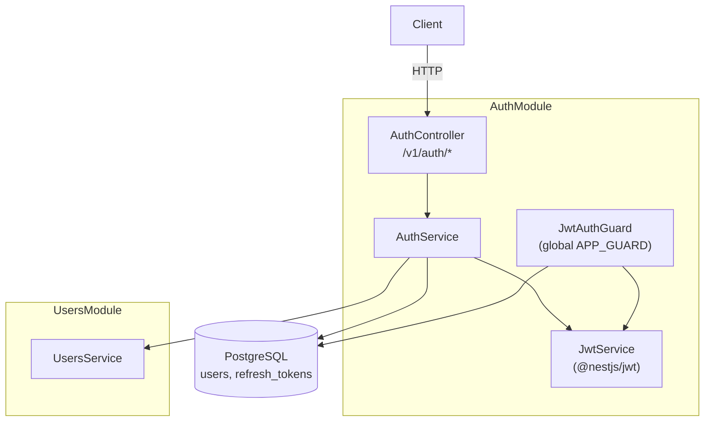
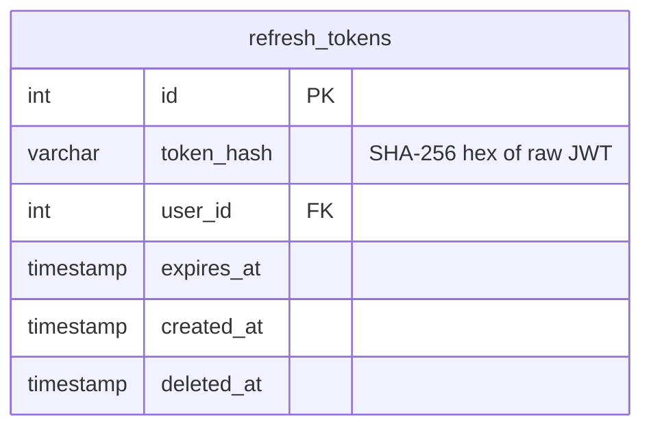
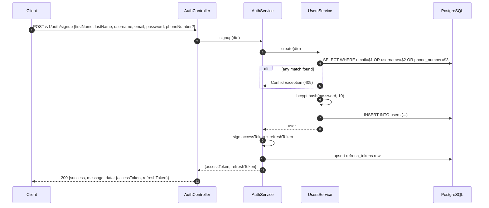
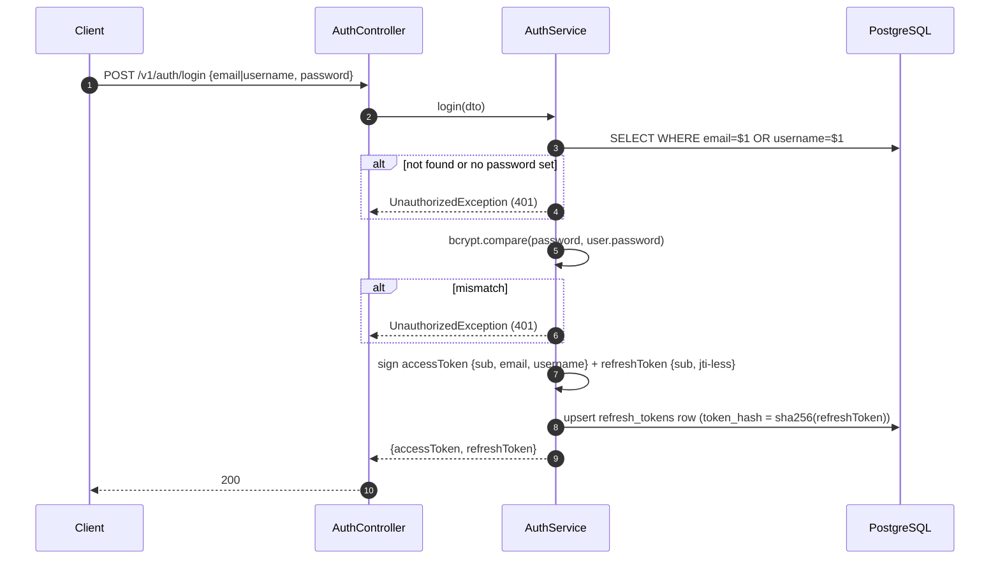
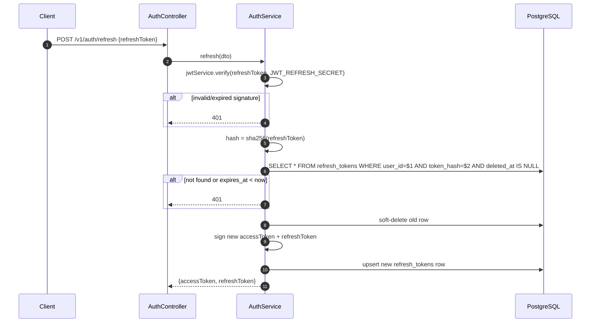

# HLD — Authentication Module

!!! note "Rewritten to match implementation"
    An earlier draft of this document described Redis-backed tokens, an OTP verification module, Google OAuth, password-reset email flows, and brute-force lockout. **None of that exists in the current codebase.** The implementation is a much simpler DB-backed JWT scheme. This page reflects what is actually built as of 2026-07-15.

## 1. Purpose

`AuthModule` owns identity verification: local signup/login, JWT access/refresh token issuance and rotation, and exposing the current user's profile. It is the sole source of the `JwtAuthGuard` applied globally to every route in the app.

## 2. Scope

### In Scope (implemented)

| Feature | Notes |
| --- | --- |
| Local signup / login | Email or username + password |
| JWT access + refresh token issuance | Two separate secrets/expiries |
| Refresh token rotation | Old token soft-deleted, new pair issued |
| Logout | Soft-deletes the refresh token row |
| `GET /me` | Returns caller's profile from the JWT `sub` claim |

### Not Implemented (despite schema/dependency hints)

| Feature | Evidence it's not built |
| --- | --- |
| OAuth login (Google/GitHub) | `users.oauth_provider`/`oauth_id` columns exist and `OAuthProvider` enum is defined, but no OAuth controller, service, or Passport strategy exists anywhere in `src/` |
| OTP / email verification | No OTP module, no mail service, no SMTP dependency |
| Password reset | No forgot/reset endpoints or tokens |
| Redis-backed sessions/lockout | No Redis client dependency; refresh tokens are DB rows, not Redis keys |
| Brute-force lockout | No failed-attempt counter or lockout logic anywhere in `AuthService` |
| Passport JWT strategy | `passport` and `passport-jwt` are installed as dependencies but unused — `JwtAuthGuard` hand-verifies tokens via `JwtService.verify()` directly, no `*.strategy.ts` file exists |

These are natural next steps, not current behavior — treat any reference to them elsewhere as aspirational unless this page is updated to say otherwise.

## 3. Module Architecture

| Component | Responsibility |
| --- | --- |
| `AuthController` | Exposes `/v1/auth/*`; validates DTOs |
| `AuthService` | Login, signup (delegates user creation to `UsersService`), refresh (rotation), logout, `getMe` |
| `JwtService` | Signs/verifies both access and refresh JWTs (two distinct secrets) |
| `JwtAuthGuard` | Global guard; skips `@Public()` routes; verifies Bearer token against `JWT_ACCESS_SECRET`; attaches `request.user = {sub, email, username}` |
| `CurrentUser` decorator | Returns `request.user` as populated by the guard |
| `RefreshToken` entity | DB-backed refresh token store (table `refresh_tokens`) |

## 4. Data Model

AuthModule owns the `refresh_tokens` table and reads/writes the `users` table (via `UsersService`).

There is exactly **one active refresh token row per user** — `AuthService.storeRefreshToken()` looks up any existing row for the user (including soft-deleted ones) and overwrites it (clearing `deleted_at`) rather than inserting a new row per session/device. Logging in from a second device invalidates the first device's refresh token.

## 5. Flows

### 5.1 Signup

### 5.2 Login

No brute-force lockout exists — repeated failed attempts are not rate-limited or counted anywhere.

### 5.3 Token Refresh (rotation)

### 5.4 Logout

`POST /v1/auth/logout` is `@Public()` — no access token required, only the refresh token in the body. Hashes the token and soft-deletes any matching `refresh_tokens` row. Always returns 200 regardless of whether a match was found.

## 6. JWT Design

**Access token** and **refresh token** share the same payload shape: `{ sub: userId, email, username, iat, exp }`. They differ only in secret and expiry:

| Token | Secret env var | Expiry env var |
| --- | --- | --- |
| Access | `JWT_ACCESS_SECRET` | `JWT_ACCESS_EXPIRY` |
| Refresh | `JWT_REFRESH_SECRET` | `JWT_REFRESH_EXPIRY` |

Both secrets are read via `ConfigService.getOrThrow(...)` — the app fails to boot if either is missing. There is no `jti` claim and no third "verification token" secret (no OTP flow exists to need one).

**Storage**: raw refresh tokens are never persisted — only their SHA-256 hash (`refresh_tokens.token_hash`). The raw refresh token is returned to the client in the response body; there is no `httpOnly` cookie mechanism (no `cookie-parser` dependency) — the client is expected to store and resend it explicitly.

## 7. Security Notes

| Concern | Implementation |
| --- | --- |
| Password hashing | `bcrypt`, cost factor 10 |
| Plaintext exposure | Never logged or returned; `password` column nullable (reserved for future OAuth-only accounts) |
| Token replay after rotation | Old refresh token row is soft-deleted on rotation, so it can't be reused — but there is no "family revocation" concept; a stolen-then-used-again old token simply gets a 401, without proactively invalidating the current valid token |
| Transport | No CORS allowlist — `app.enableCors({ origin: true, credentials: true })` reflects any origin; no HSTS/Helmet configured |
| Rate limiting | Not implemented anywhere in the app |

## 8. Open Gaps (for future work, not current behavior)

1. No password reset flow — a user who forgets their password has no self-service recovery path today.
2. No brute-force protection on `/login` — worth adding before production traffic.
3. `passport`/`passport-jwt` dependencies are installed but dead weight — either wire up a real Passport strategy (e.g. for OAuth) or remove them.
4. Single-refresh-token-per-user model means logging in on a new device silently logs out all others — confirm this is the intended UX before adding multi-device support.
5. OAuth columns (`oauth_provider`, `oauth_id`) exist on `users` with no consumer — either build the OAuth flow or remove the columns to avoid confusion.

## 9. Related Pages

- [Architecture](../architecture.md)
- [ERD](../erd.md#1-identity--rbac)
- [API Design v1 — Auth Module](../api-design/v1.md#auth-module-v1auth)
- [HLD — RBAC](rbac.md)
