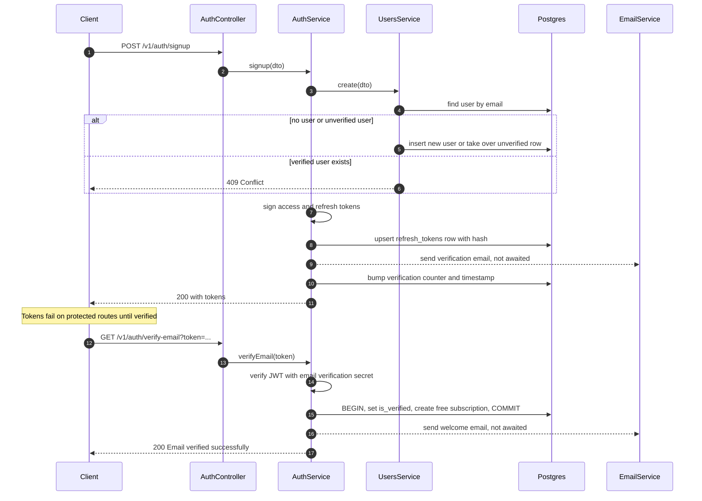
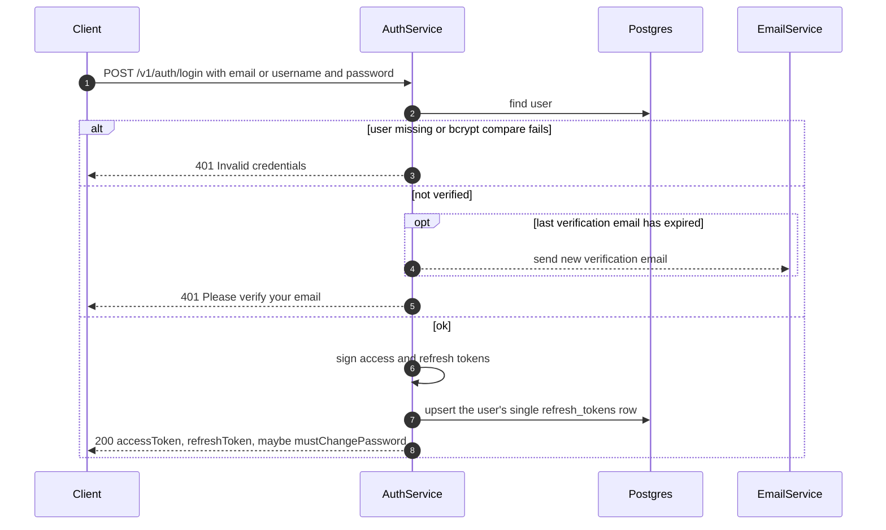
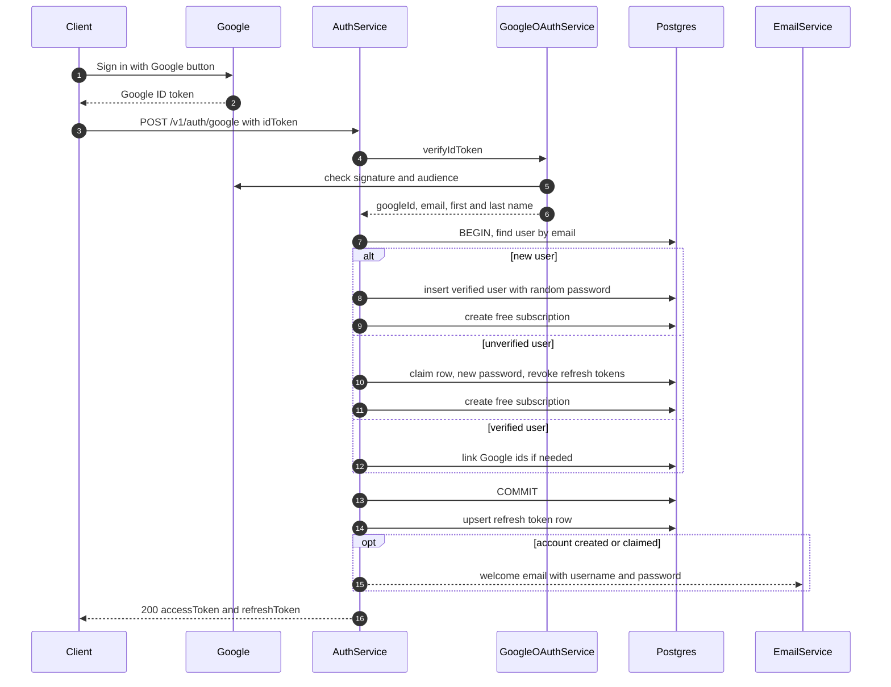
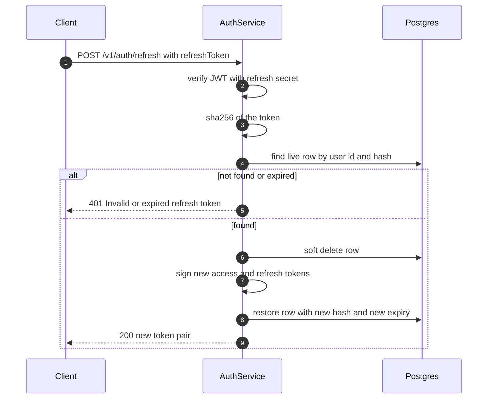
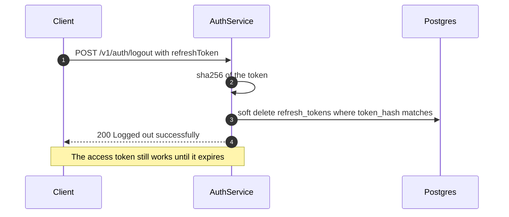
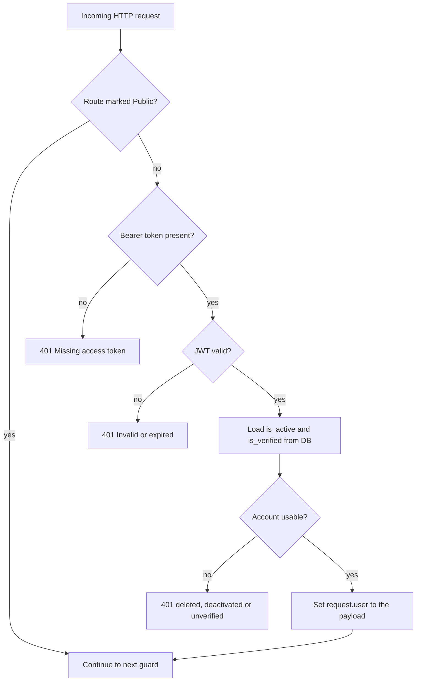

# Authentication and Users

## 1. Purpose

This module answers one question for every request: **"Who is calling, and can their account still be used?"**

It covers:

- **Sign-up and sign-in**: email or username plus password, and Google sign-in.
- **Email verification**: a link sent by email. An account must be verified before it can call any protected route.
- **Password reset**: a "forgot password" email with a one-time link.
- **Tokens**: a short-lived *access token* for API calls and a longer-lived *refresh token* to get new access tokens.
- **The global auth guard**: it runs on every HTTP request and puts the caller on `request.user`.
- **The current user's profile** (`GET /v1/auth/me`).
- **Admin user management**: listing users and adding or removing platform roles.

This module does not decide what a signed-in user is *allowed* to do. Roles and permissions do that. See [RBAC](rbac.md) and [Organizations](organizations.md).

!!! note "The old docs were wrong"
    Earlier versions of this page said there was no Google sign-in, no email verification and no password reset. All three exist now. Auth does **not** use Redis. Refresh tokens are stored in Postgres. Redis is used by the rate limiter (see [Platform services](platform-services.md)).

## 2. Key terms

| Term | Meaning |
|---|---|
| **JWT** | JSON Web Token. A signed string that carries a small JSON payload. The server can check the signature without calling the database. |
| **Access token** | A JWT sent as `Authorization: Bearer <token>` on every API call. Signed with `JWT_ACCESS_SECRET`. |
| **Refresh token** | A JWT used only on `POST /v1/auth/refresh` to get a new token pair. Signed with `JWT_REFRESH_SECRET`. Its SHA-256 hash is stored in `refresh_tokens`. |
| **Token payload** | `{ sub, email, username }`. `sub` is the user id. The type is `JwtPayload` in `src/identity/auth/guards/jwt-auth.guard.ts`. |
| **Verified account** | `users.is_verified = true`. The user clicked the email link, or signed in with Google. |
| **Active account** | `users.is_active = true`. A token for an inactive (deactivated) account is rejected. |
| **Placeholder account** | An unverified account the system creates for someone invited to an organization who has no account yet. Its username starts with `invited_`. See [Organizations](organizations.md#5-invitations). |
| **`mustChangePassword`** | A flag on the user. It is set when the system generated the password (Google sign-in). Login returns it so the client can ask the user to pick a new password. |
| **`@Public()`** | A decorator that tells the global auth guard to skip a route. In `src/common/decorators/public.decorator.ts`. |
| **`@CurrentUser()`** | A parameter decorator that returns `request.user` (the `JwtPayload`). In `src/identity/auth/decorators/current-user.decorator.ts`. |

## 3. Data it uses

See the [ERD](../erd.md) for the full table definitions. This module reads and writes:

| Table | Used for |
|---|---|
| `users` | Account details, bcrypt password hash (cost 10), `is_active`, `is_verified`, `must_change_password`, `oauth_provider` / `oauth_id`, and the verification email counters (`total_verification_email`, `last_verification_email_sent_at`). |
| `refresh_tokens` | `token_hash`, `user_id`, `expires_at`, `deleted_at`. **One row per user** (see rule 6). |
| `users_roles`, `roles` | Platform roles. The admin user endpoints read and write them. |
| `subscriptions` | A free subscription is created when an account becomes verified (see [Commerce](commerce.md)). |

Uniqueness rules on `users`:

- `email` and `username` are unique among rows that are not soft-deleted.
- `(oauth_provider, oauth_id)` is unique when `oauth_id` is set.
- `phone_number` is unique.

## 4. Configuration

| Env var | Meaning |
|---|---|
| `JWT_ACCESS_SECRET`, `JWT_ACCESS_EXPIRY` | Access token secret and lifetime **in seconds**. |
| `JWT_REFRESH_SECRET`, `JWT_REFRESH_EXPIRY` | Refresh token secret and lifetime **in seconds**. |
| `JWT_EMAIL_VERIFICATION_SECRET`, `JWT_EMAIL_VERIFICATION_EXPIRY` | Verification link token. Example: `86400` (1 day). |
| `JWT_PASSWORD_RESET_SECRET`, `JWT_PASSWORD_RESET_EXPIRY` | Reset link token. Example: `900` (15 minutes). |
| `GOOGLE_OAUTH2_CLIENT_ID` | Google client id. Google ID tokens must have this as their `audience`. |
| `FRONTEND_URL` | Base URL for email links (`/verify-email?token=...`, `/reset-password?token=...`). |

The code reads every expiry with `+value`. So each one **must be a plain number of seconds**. See Known gaps for the problem with `.env.example`.

## 5. Main flows

### 5.1 Sign-up and email verification

1. The client calls `POST /v1/auth/signup` with first name, last name, username, email, password and an optional phone number.
2. `UsersService.create` checks the email:
    - **No account** has that email: it checks that the username and phone are free, then creates a new user.
    - **An unverified account** has that email (an unfinished sign-up, or a placeholder made by an org invite): it **takes over that row**. It replaces the name, username, phone and password. The row keeps its id, so any org invitation waiting on it stays attached.
    - **A verified account** has that email: `409 Conflict`.
3. The server signs a token pair and stores the refresh token. It returns the tokens, but they **cannot be used yet**, because the guard rejects unverified accounts.
4. The server sends a verification email. It does not wait for the send to finish (fire-and-forget). The link holds a JWT with `{ email }`. The send time and a counter are saved on the user.
5. The user clicks the link. The frontend calls `GET /v1/auth/verify-email?token=...`.
6. In one transaction, the user is marked verified and a **free subscription** is created. Then a welcome email is sent.

### 5.2 Login with password

1. The client calls `POST /v1/auth/login` with **either** `email` **or** `username`, plus `password`.
2. The server looks up the user. A missing user and a wrong password return the same error: `401 Invalid credentials`.
3. If the account is **not verified**, the server may send a fresh verification email. Then it returns `401 Please verify your email before logging in`. It only sends a new email when the last one has expired (it is older than `JWT_EMAIL_VERIFICATION_EXPIRY`). This stops people from using login to spam someone's inbox.
4. Otherwise, the server signs a token pair and saves the refresh token hash.
5. If `mustChangePassword` is true, the response also contains `mustChangePassword: true`.

Login does not check `is_active`. A deactivated user can still get tokens, but the guard rejects them on the first protected call.

### 5.3 Google sign-in

The frontend uses Google's sign-in button to get a **Google ID token** and sends it to the backend. The backend has no redirect flow and no Passport strategy.

1. The client calls `POST /v1/auth/google` with `{ idToken }`.
2. `GoogleOAuthService.verifyIdToken` checks the token with `google-auth-library`. The audience must equal `GOOGLE_OAUTH2_CLIENT_ID`, and Google must say the email is verified. Otherwise the server returns `401`.
3. Inside one transaction, the server finds the user by email and takes one of three paths:

| Case | What happens |
|---|---|
| **No account** | Create a user. The name comes from Google. The username is made from the email prefix and is unique. The password is a random 8-character one, with `mustChangePassword = true` and `isVerified = true`. The Google ids are saved. A free subscription is created. |
| **Unverified account** (unfinished sign-up or org placeholder) | "Claim" it. Replace the name and any placeholder username. Set a **new random password**. Mark it verified and link Google. **Revoke all its refresh tokens.** Create a free subscription. This blocks *account pre-hijacking*: someone who signed up with your email but never verified it cannot keep a password on your account. |
| **Verified account** | Link Google to it (save `oauth_provider` and `oauth_id`) if it is not linked yet. The password stays the same. |

4. The server signs a token pair.
5. In the first two cases only, the server sends a welcome email **with the username and generated password**, so the user can also log in with a password later. The password is never logged and never returned in the API response.

### 5.4 Token refresh (rotation)

Each refresh token works **once**. Using it returns a new pair and kills the old token. This is called *rotation*.

1. The client calls `POST /v1/auth/refresh` with `{ refreshToken }`. The route is `@Public()`.
2. The server verifies the JWT with `JWT_REFRESH_SECRET`.
3. It hashes the token with SHA-256 and looks for a live row with that `user_id` and `token_hash`. If there is no row, or `expires_at` has passed, it returns `401`.
4. It soft-deletes the row, signs a new pair, and stores the new hash. Storing the hash brings the same row back with the new hash and expiry.

### 5.5 Logout

1. The client calls `POST /v1/auth/logout` with `{ refreshToken }`. The route is `@Public()`, so it works even when the access token has expired.
2. The server hashes the token and soft-deletes any row with that hash.
3. It always returns `200`, even if it did not know the token.

### 5.6 Forgot and reset password

1. The client calls `POST /v1/auth/forgot-password` with `{ email }`. The response is **always the same message**, so nobody can use this route to find out which emails have accounts.
2. If the account exists and is active, the server emails a reset link. The link holds a JWT with `{ sub: userId }`.
3. The JWT is signed with `JWT_PASSWORD_RESET_SECRET` **plus the user's current password hash**. When the password changes, the key changes, so every older reset link stops working. This makes the link single-use without storing it anywhere.
4. The client calls `POST /v1/auth/reset-password` with `{ token, password }`. The server reads `sub` from the token, loads that user, and then verifies the token with that user's key. Every failure returns the same error: `401 Invalid or expired password reset token`.
5. In one transaction, the server saves the new password, clears `mustChangePassword`, and **revokes all the user's refresh tokens**.

### 5.7 How a request is authenticated

`JwtAuthGuard` (`src/identity/auth/guards/jwt-auth.guard.ts`) is the **first** global guard in `src/app.module.ts`. The full order is:

`JwtAuthGuard` → `RateLimitGuard` → `RolesGuard` → `OrgContextGuard` → `PermissionGuard`

Steps inside `JwtAuthGuard`:

1. If the route or its controller has `@Public()`, let the request through.
2. Read the `Authorization: Bearer <token>` header. If it is missing: `401 Missing access token`.
3. Verify the JWT with `JWT_ACCESS_SECRET`. If it is bad or expired: `401`.
4. Load the account status from the database with `UsersService.findAccountStatusById`. It selects only `id`, `is_active` and `is_verified`. This runs **on every authenticated request**. Then:
    - user deleted: `401 Account no longer exists`
    - not active: `401 Account has been deactivated`
    - not verified: `401 Please verify your email before continuing`
5. Set `request.user = payload` (`{ sub, email, username }`).

Controllers read the caller with `@CurrentUser() user: JwtPayload`. They usually use `user.sub` as the user id.

RabbitMQ consumers are also marked `@Public()`. The global guard runs for them too, and they have no HTTP request to read a token from.

## 6. Business rules and edge cases

1. **Password policy** (`IsStrongPassword` in `src/identity/auth/decorators/is-strong-password.decorator.ts`): 8 to 255 characters, with at least one lowercase letter, one uppercase letter, one digit and one special character. Sign-up and reset use it. Login only checks that the password has at least 8 characters.
2. **Username**: 3 to 100 characters, using only letters, digits and `_`. First and last names may use only letters, spaces, `-` and `'`.
3. **Login identifier**: send `email` or `username`. If both are sent, email is used.
4. **Unverified accounts cannot call protected routes**, even with a valid token.
5. **Verification email throttle**: login sends a new link only after the previous link has expired.
6. **One refresh token per user.** `storeRefreshToken` keeps exactly one `refresh_tokens` row per user and overwrites it on every login, sign-up, Google sign-in and refresh. So logging in on a second device makes the first device's refresh token stop working. This comes from how the code is written. No setting changes it.
7. **Logout only revokes the refresh token.** There is no access token denylist. The access token keeps working until it expires. The exception is a deactivated or deleted account, because the guard checks those on every call.
8. **Resetting the password logs the user out everywhere** (all refresh tokens are revoked). Claiming an unverified account through Google does the same.
9. **Google requires `email_verified`.** If a verified TestFlow account has the same email, Google is linked to it automatically.
10. **Generated passwords** (`generateDefaultPassword` in `src/identity/helpers/default-password.helper.ts`) use `crypto.randomInt`. They have at least one character from each class and leave out characters that look alike.
11. **The free subscription** is created only when an account becomes verified (email link or Google), never at sign-up.
12. **Emails are fire-and-forget.** A failed send is logged and does not fail the request.
13. **Email matching is case-sensitive** in login, sign-up and Google sign-in (`findByEmail` compares with `=`). Only the org invite lookup lowercases emails.

## 7. Endpoints summary

The [API reference](../api-design/v1.md) has the full details.

### Auth (`/v1/auth`, `src/identity/auth/auth.controller.ts`)

| Method and path | Auth | Rate limit | Purpose |
|---|---|---|---|
| `POST /login` | Public | CLASS_A | Password login |
| `POST /signup` | Public | CLASS_A | Create an account and send the verification email |
| `GET /verify-email?token=` | Public | CLASS_A, own bucket | Verify the email and create the free plan |
| `POST /forgot-password` | Public | CLASS_A, own bucket | Send the reset email |
| `POST /reset-password` | Public | CLASS_A, own bucket | Set a new password with a reset token |
| `GET /check-username?username=` | Public | CLASS_A, own bucket | Returns `{ exists }` |
| `POST /google` | Public | CLASS_A | Google sign-in with an ID token |
| `POST /refresh` | Public | CLASS_A | Rotate the token pair |
| `POST /logout` | Public | CLASS_A | Revoke the refresh token |
| `GET /me` | Bearer | CLASS_C | Profile, current plan, allowed question types and enabled feature flags |

`GET /me` makes four reads at the same time: the profile (`UsersService.getMe`), the current plan and the allowed question types (`SubscriptionsService`), and the enabled feature flags (`FeatureFlagsService`). If the feature flag read fails, it uses the defaults from code instead of failing.

### Admin users (`/v1/admin`, `src/identity/users/admin.controller.ts`)

All of these use the CLASS_C rate limit and need a platform permission (see [RBAC](rbac.md)).

| Method and path | Permission | Purpose |
|---|---|---|
| `GET /users` | `users:read` | Cursor-paged list, newest first. Filters: `search` (name, username, email), `role`, `isActive`, `isVerified`. Each user includes their platform role keys. `meta` has `nextCursor` and `total`. |
| `GET /users/:username/roles` | `users:read` | A user's platform roles |
| `POST /users/:username/roles` | `users:create` | Add a platform role. Body: `{ roleKey }`. |
| `DELETE /users/:username/roles/:roleKey` | `users:delete` | Remove a platform role (soft delete) |

Admin rules (`src/identity/users/admin.service.ts`):

- You cannot change **your own** roles (`403`).
- You can only add roles with scope `platform` here. Org roles come from org membership (`400`).
- Adding a role the user already has returns `409`.

## 8. Async work, emails and events

This module uses no queues and no websocket events. It sends these emails through `EmailService` (see [Notifications](notifications.md)):

| Email | When |
|---|---|
| Verification | On sign-up, and on login when the last link has expired |
| Welcome | After email verification. After a Google sign-up or claim, it also includes the username and generated password. |
| Password reset | On `POST /forgot-password` for an active account |

## 9. Bootstrapping the first admin

`npm run bootstrap-admin -- --email <email> --password <password>` runs `src/scripts/bootstrap-admin.ts`:

1. The `super_admin` role must already exist, so run `npm run seed` first.
2. If any user already has `super_admin`, the script stops. It prints "already bootstrapped" if that user has the same email, and fails otherwise. **This script can only create one super admin.** You can add more later with `POST /v1/admin/users/:username/roles`.
3. In one transaction, it creates a verified, active user with username `system` and the given email and password, and gives that user `super_admin`.

The script does not check the password policy and does not create a subscription.

## 10. Where the code lives

| Path | What |
|---|---|
| `src/identity/auth/auth.controller.ts` | Auth routes |
| `src/identity/auth/auth.service.ts` | All auth flows, plus token signing and storage |
| `src/identity/auth/google/google-oauth.service.ts` | Google ID token check |
| `src/identity/auth/guards/jwt-auth.guard.ts` | Global auth guard and `JwtPayload` |
| `src/identity/auth/decorators/` | `@CurrentUser()`, `@IsStrongPassword()` |
| `src/common/decorators/public.decorator.ts` | `@Public()` |
| `src/identity/helpers/` | Generated passwords and the placeholder username prefix |
| `src/identity/users/users.service.ts` | User reads and writes used by auth and organizations |
| `src/identity/users/admin.controller.ts`, `admin.service.ts` | Admin user and role routes |
| `src/scripts/bootstrap-admin.ts` | Creates the first super admin |
| `tests/unit/identity/` | Unit tests (`auth/`, `users/`, `helpers/`) |

## 11. Known gaps and TODOs

1. **The expiry values in `.env.example` do not work.** It has `JWT_ACCESS_EXPIRY=15m` and `JWT_REFRESH_EXPIRY=7d`, but the code does `+value`, which turns `15m` into `NaN`. Use seconds instead, for example `900` and `604800`.
2. **There is no endpoint for users to update their profile or change their password.** `UsersService.update` and `remove` exist, but no controller calls them. A user with `mustChangePassword` can only change the password through the reset flow.
3. **The API cannot deactivate or delete a user.** `is_active` is checked everywhere, but nothing sets it to false.
4. **Only one refresh token per user** (rule 6), so a user cannot stay signed in on several devices.
5. **`POST /refresh` does not check `is_active` or `is_verified`.** The guard still rejects the new access token, so the risk is low.
6. **The guard reads the database on every request.** Nothing is cached.
7. **`request.user.email` and `request.user.username` come from the token.** They can be out of date until the token expires.
8. **Sign-up can take over an unverified row** with the same email and replace its password. The real owner still has to click the verification link. If they do click it, the password the other person chose stays on the account.
9. **`OAuthProvider.GITHUB`** is in the enum, but there is no GitHub sign-in.
10. **Emails are case-sensitive** (rule 13), so `A@x.com` and `a@x.com` can be two accounts. The unique index is on the raw value.
