# HLD — Authentication Module

## 1. Purpose

The AuthModule owns all identity-verification concerns for TestFlow. It is responsible for:

- Registering new users with local credentials
- Issuing and rotating JWT access and refresh tokens
- Authenticating users via OAuth 2.0 (Google, GitHub)
- Verifying user identity via OTP (email-based)
- Supporting password reset via time-limited email tokens
- Protecting all other modules from unauthenticated access via a globally applied guard
- Enforcing brute-force lockout on login attempts

No other module handles authentication logic. All protected routes depend on `JwtAuthGuard` provided by this module.

---

## 2. Scope

| In Scope                             | Out of Scope                               |
| ------------------------------------ | ------------------------------------------ |
| Local register / login               | Role assignment (handled by RBACModule)    |
| JWT access + refresh token lifecycle | Permission checking (handled by RBACGuard) |
| OAuth login (Google, GitHub)         | MFA (TOTP/FIDO2) — future                  |
| OTP-based email verification         | SMS OTP — future                           |
| Password forgot / reset              | Session-based auth                         |
| Brute force lockout                  | IP reputation scoring                      |
| Token blacklisting on logout         | Device management                          |

---

## 3. Module Architecture

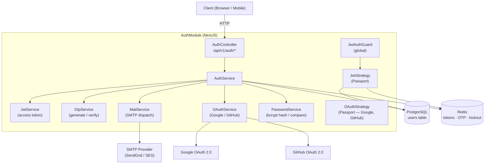

### 3.1 Component Responsibilities

| Component         | Responsibility                                                               |
| ----------------- | ---------------------------------------------------------------------------- |
| `AuthController`  | Exposes all `/auth/*` HTTP endpoints; validates DTOs; formats responses      |
| `AuthService`     | Orchestrates all auth flows; sole writer to auth-related Redis keys          |
| `JwtService`      | Signs and verifies JWTs; wraps `@nestjs/jwt`                                 |
| `OtpService`      | Generates a 6-digit numeric OTP; stores hashed OTP in Redis with TTL         |
| `PasswordService` | `bcrypt.hash` (cost 12) and `bcrypt.compare`; never stores plaintext         |
| `OAuthService`    | Exchanges authorization code for provider profile; upserts user record       |
| `MailService`     | Renders Handlebars template and enqueues email via BullMQ `mail` queue       |
| `JwtAuthGuard`    | Applied globally; skips routes decorated with `@Public()`                    |
| `JwtStrategy`     | Validates access token signature and expiry; checks token is not blacklisted |
| `OAuthStrategy`   | Implements Passport OAuth2 strategy per provider                             |

---

## 4. Data Model

The AuthModule reads and writes exclusively to the `users` table. No additional auth-specific tables are required — all transient state (tokens, OTPs, lockouts) lives in Redis.

### 4.1 Relevant `users` Table Columns

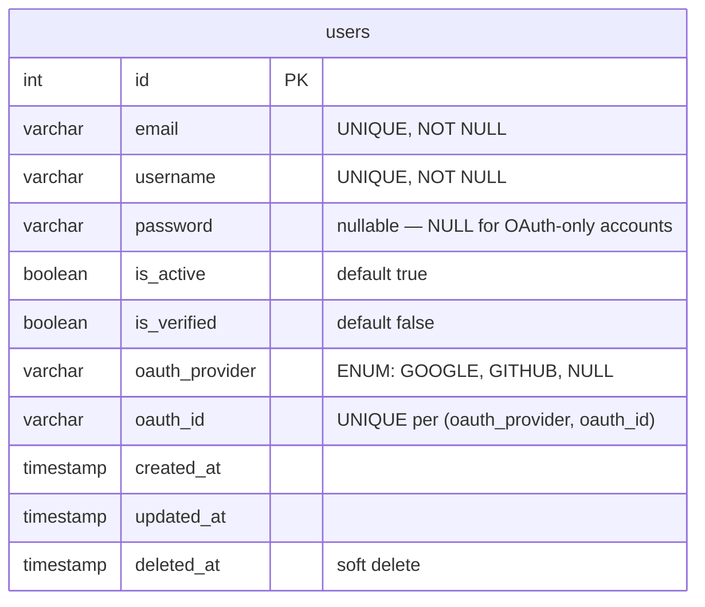

### 4.2 Redis Key Schema

All Redis keys used by AuthModule follow a consistent naming pattern. TTLs are set at write time — no separate expiry jobs needed.

| Key Pattern                        | Type                 | TTL                        | Purpose                                             |
| ---------------------------------- | -------------------- | -------------------------- | --------------------------------------------------- |
| `auth:refresh:{userId}:{tokenId}`  | String (jti)         | 7 days                     | Active refresh token store; deleted on logout       |
| `auth:refresh:family:{userId}`     | Set of tokenIds      | 7 days                     | Token family for reuse-attack detection             |
| `auth:otp:{email}`                 | String (bcrypt hash) | 10 minutes                 | Active OTP; deleted on successful verify            |
| `auth:otp:attempts:{email}`        | Integer              | 10 minutes                 | Failed OTP attempt counter (max 5)                  |
| `auth:lockout:{identifier}`        | String ("1")         | 15 minutes                 | Brute-force lockout flag (identifier = email or IP) |
| `auth:login:attempts:{identifier}` | Integer              | 15 minutes                 | Failed login counter                                |
| `auth:pwd_reset:{token}`           | String (userId)      | 1 hour                     | Password reset token → userId mapping               |
| `auth:blacklist:{jti}`             | String ("1")         | Remaining access token TTL | Explicitly revoked access tokens (edge case)        |

---

## 5. Authentication Flows

### 5.1 Local Registration

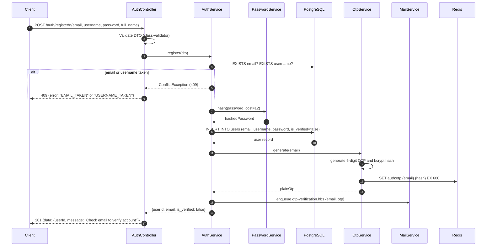

**Business rules**:

- `email` and `username` must be globally unique among non-deleted users
- Password minimum 8 characters, at least one number and one letter (validated in DTO)
- Account is created with `is_verified = false`; user can log in but may be restricted from certain actions until verified
- Verification OTP is sent immediately; user must verify within 10 minutes

### 5.2 OTP Verification

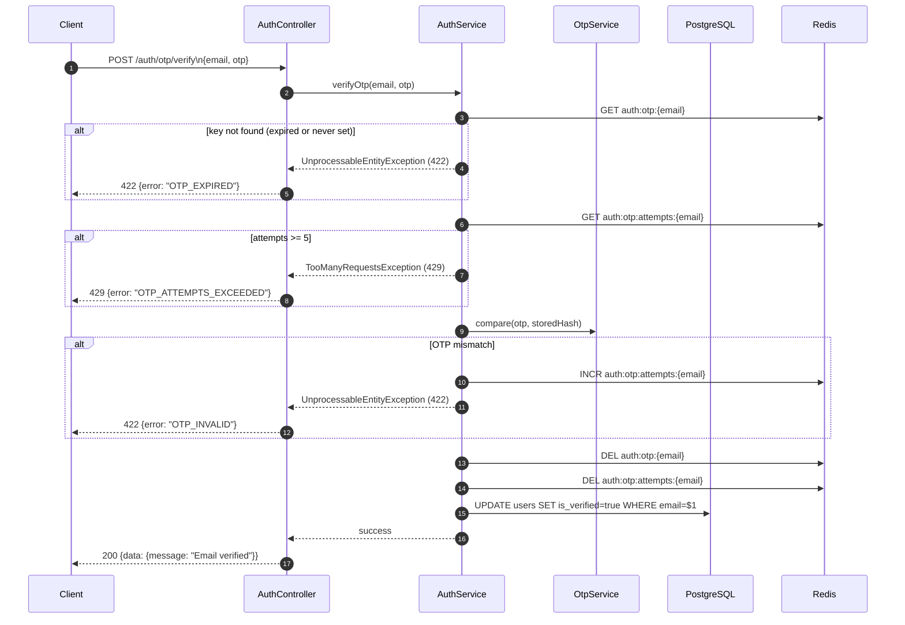

**OTP resend** (`POST /auth/otp`): Regenerates and resends the OTP. Rate-limited to 3 requests per 10 minutes per email.

### 5.3 Local Login

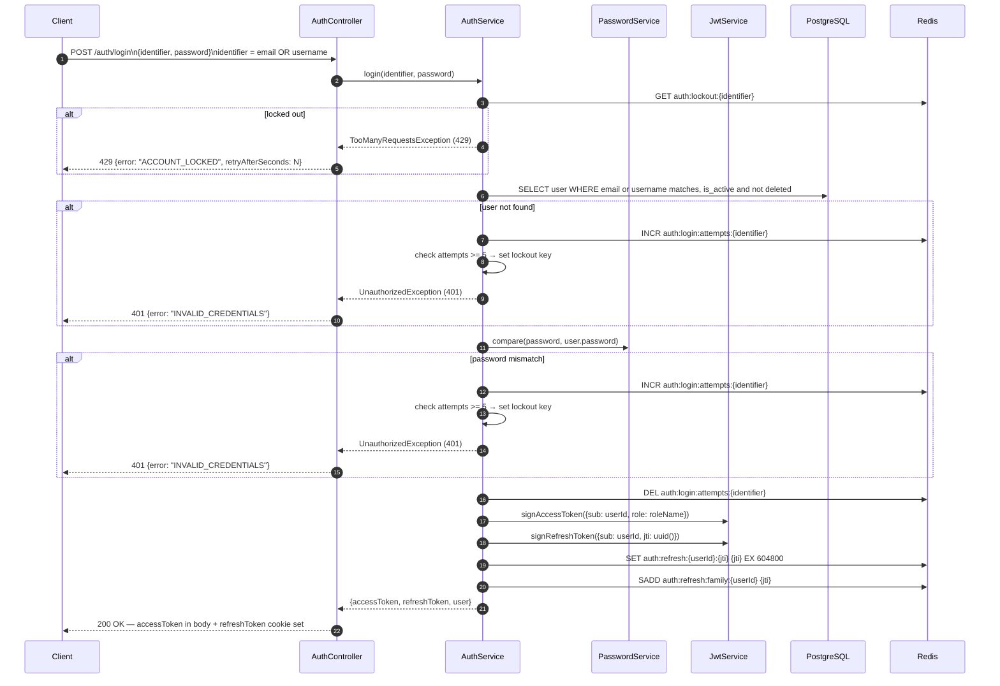

**Brute-force rules**:

- 5 failed attempts → 15-minute lockout on the `identifier` (email or username used in the request)
- Counter resets on successful login
- Both the failed identifier AND the client IP are tracked independently (dual-key lockout)

### 5.4 Token Refresh

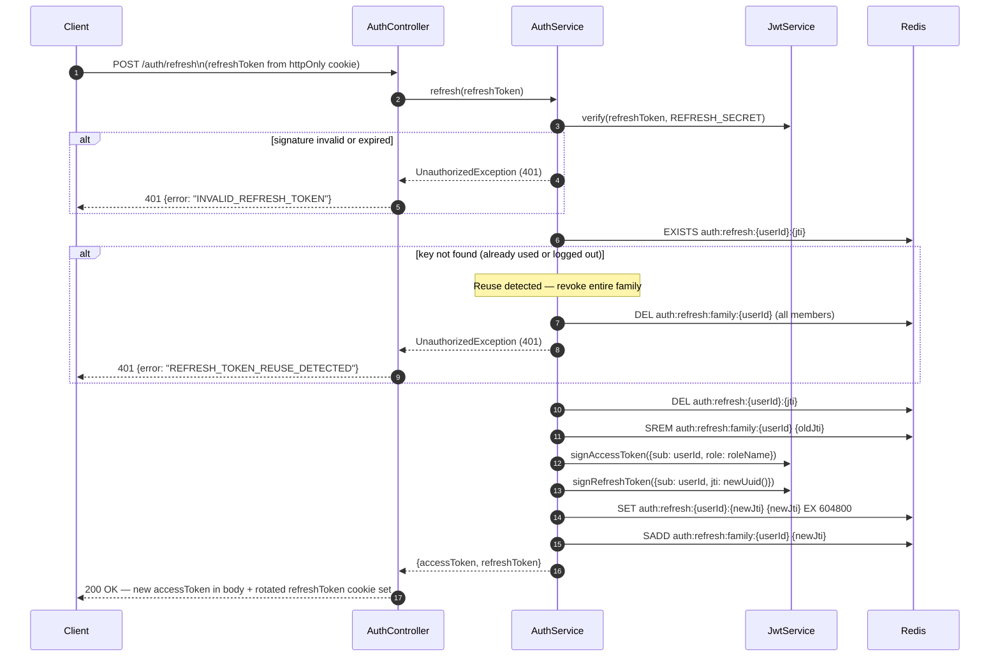

**Token rotation security**: Each refresh invalidates the presented token and issues a new one. If a stolen token is used after the legitimate user has already rotated, the `jti` will not exist in Redis — this triggers family revocation, forcing the legitimate user to re-login.

### 5.5 Logout

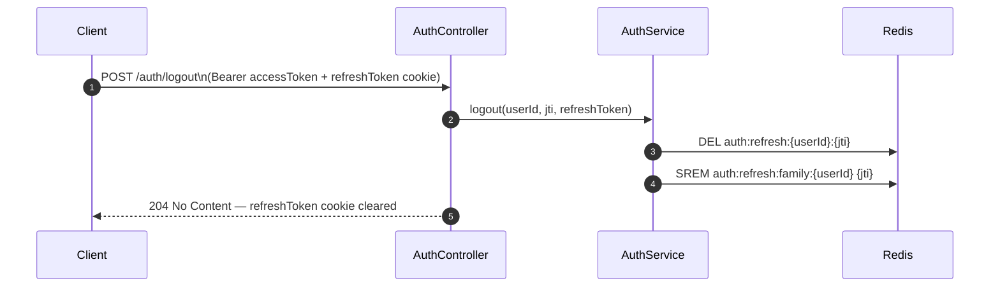

Access tokens are stateless JWTs and remain valid until their 15-minute TTL expires after logout. This is an acceptable trade-off. If immediate invalidation is required for a specific access token (e.g., security incident), the `auth:blacklist:{jti}` key is set with TTL equal to the token's remaining lifetime.

### 5.6 OAuth Login (Google / GitHub)

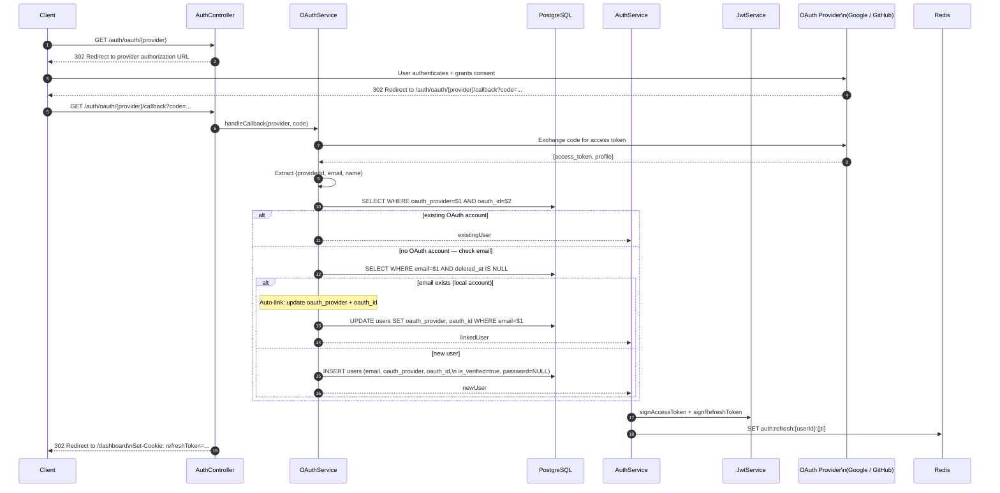

**OAuth account linking policy**: If the provider email matches an existing local account, the OAuth credentials are automatically linked to that account (`oauth_provider` and `oauth_id` are set). The user retains their local password and can use either login method. This is an assumption — see Open Questions.

### 5.7 Password Reset

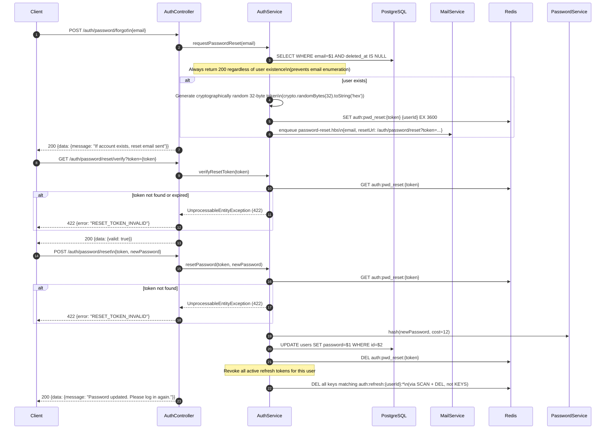

---

## 6. JWT Design

### 6.1 Token Structure

**Access Token** (short-lived, 15 minutes):

```json
{
  "sub": "42",
  "username": "john_doe",
  "role": "INSTRUCTOR",
  "iat": 1748476800,
  "exp": 1748477700,
  "iss": "testflow"
}
```

**Refresh Token** (long-lived, 7 days):

```json
{
  "sub": "42",
  "jti": "550e8400-e29b-41d4-a716-446655440000",
  "iat": 1748476800,
  "exp": 1749081600,
  "iss": "testflow"
}
```

**Design decisions**:

- `role` is embedded in the access token to avoid a DB/Redis lookup on every request — `JwtStrategy` does not call the DB for role resolution
- `role` embeds the role name only (not permissions) — `RBACGuard` resolves permissions from its own cache
- `jti` (JWT ID) in the refresh token is the Redis key suffix — enables O(1) revocation lookup
- Separate signing secrets for access and refresh tokens (`JWT_ACCESS_SECRET`, `JWT_REFRESH_SECRET`) — a compromised refresh secret does not expose access token verification

### 6.2 Token Storage

| Token         | Storage                                    | Rationale                                                                    |
| ------------- | ------------------------------------------ | ---------------------------------------------------------------------------- |
| Access token  | JS memory (Zustand store)                  | Never in `localStorage` (XSS risk); never in cookie (not needed — short TTL) |
| Refresh token | `httpOnly; Secure; SameSite=Strict` cookie | Inaccessible to JavaScript; `SameSite=Strict` prevents CSRF                  |

### 6.3 JwtStrategy (Passport)

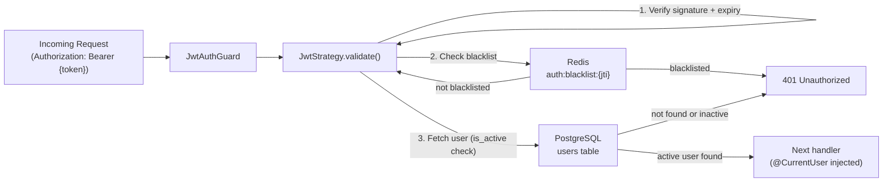

The DB call in step 3 can be eliminated if `is_active` and `is_verified` are embedded in the access token payload and refreshed on each token rotation. **Current decision**: include DB call for correctness (ensures deactivated accounts are immediately blocked even within the 15-minute window); optimize with token embedding if p99 latency becomes a concern.

---

## 7. API Specification

### 7.1 Endpoint Summary

| Method | Endpoint                          | Auth required    | Description                                       |
| ------ | --------------------------------- | ---------------- | ------------------------------------------------- |
| POST   | `/auth/register`                  | No               | Register with email + password                    |
| POST   | `/auth/login`                     | No               | Login; returns access token + sets refresh cookie |
| POST   | `/auth/refresh`                   | No (uses cookie) | Rotate refresh token; return new access token     |
| POST   | `/auth/logout`                    | Yes              | Revoke refresh token; clear cookie                |
| POST   | `/auth/otp`                       | No               | Send/resend OTP to email                          |
| POST   | `/auth/otp/verify`                | No               | Verify OTP; set `is_verified = true`              |
| GET    | `/auth/oauth/{provider}`          | No               | Redirect to OAuth provider (`google` \| `github`) |
| GET    | `/auth/oauth/{provider}/callback` | No               | Handle OAuth callback                             |
| POST   | `/auth/password/forgot`           | No               | Request password reset email                      |
| GET    | `/auth/password/reset/verify`     | No               | Validate reset token (for frontend to show form)  |
| POST   | `/auth/password/reset`            | No               | Set new password using reset token                |

### 7.2 Request / Response Contracts

#### POST `/auth/register`

**Request**:

```json
{
  "full_name": "John Doe",
  "username": "john_doe",
  "email": "john@example.com",
  "password": "Secret123!"
}
```

**Validation rules**:

- `full_name`: string, 2–100 chars
- `username`: string, 3–30 chars, alphanumeric + underscores only (`^[a-zA-Z0-9_]+$`)
- `email`: valid email format
- `password`: min 8 chars, at least 1 letter and 1 number

**Response 201**:

```json
{
  "success": true,
  "data": {
    "userId": 42,
    "email": "john@example.com",
    "message": "Account created. Check your email to verify."
  },
  "meta": null,
  "error": null
}
```

**Error responses**:

| Status | Error code         | Condition                                        |
| ------ | ------------------ | ------------------------------------------------ |
| 409    | `EMAIL_TAKEN`      | Email already registered and not soft-deleted    |
| 409    | `USERNAME_TAKEN`   | Username already registered and not soft-deleted |
| 400    | `VALIDATION_ERROR` | DTO validation failed                            |

---

#### POST `/auth/login`

**Request**:

```json
{
  "identifier": "john@example.com",
  "password": "Secret123!"
}
```

`identifier` accepts either email or username.

**Response 200**:

```json
{
  "success": true,
  "data": {
    "accessToken": "eyJhbGciOiJIUzI1NiIs...",
    "user": {
      "id": 42,
      "username": "john_doe",
      "email": "john@example.com",
      "full_name": "John Doe",
      "role": "INSTRUCTOR",
      "is_verified": true
    }
  },
  "meta": null,
  "error": null
}
```

`Set-Cookie: refreshToken={token}; HttpOnly; Secure; SameSite=Strict; Path=/auth/refresh; Max-Age=604800`

**Error responses**:

| Status | Error code            | Condition                                              |
| ------ | --------------------- | ------------------------------------------------------ |
| 401    | `INVALID_CREDENTIALS` | User not found, inactive, or wrong password            |
| 429    | `ACCOUNT_LOCKED`      | 5+ failed attempts; includes `retryAfterSeconds` field |
| 400    | `VALIDATION_ERROR`    | Missing fields                                         |

---

#### POST `/auth/refresh`

**Request**: No body. Refresh token read from `httpOnly` cookie.

**Response 200**:

```json
{
  "success": true,
  "data": {
    "accessToken": "eyJhbGciOiJIUzI1NiIs..."
  },
  "meta": null,
  "error": null
}
```

New `Set-Cookie` header with rotated refresh token.

**Error responses**:

| Status | Error code                     | Condition                                            |
| ------ | ------------------------------ | ---------------------------------------------------- |
| 401    | `INVALID_REFRESH_TOKEN`        | Token invalid, malformed, or expired                 |
| 401    | `REFRESH_TOKEN_REUSE_DETECTED` | Presented token was already rotated (possible theft) |

---

#### POST `/auth/logout`

**Request**: No body. Access token in `Authorization: Bearer` header. Refresh token from cookie.

**Response 204**: No content. Clears refresh token cookie.

---

#### POST `/auth/otp`

**Request**:

```json
{ "email": "john@example.com" }
```

**Response 200**:

```json
{
  "success": true,
  "data": { "message": "OTP sent. Valid for 10 minutes." },
  "meta": null,
  "error": null
}
```

Rate limited: 3 requests per 10 minutes per email.

---

#### POST `/auth/otp/verify`

**Request**:

```json
{
  "email": "john@example.com",
  "otp": "482910"
}
```

**Response 200**:

```json
{
  "success": true,
  "data": { "message": "Email verified successfully." },
  "meta": null,
  "error": null
}
```

**Error responses**:

| Status | Error code              | Condition                      |
| ------ | ----------------------- | ------------------------------ |
| 422    | `OTP_EXPIRED`           | Redis key expired or never set |
| 422    | `OTP_INVALID`           | Wrong OTP code                 |
| 429    | `OTP_ATTEMPTS_EXCEEDED` | 5+ failed attempts on this OTP |

---

#### GET `/auth/oauth/{provider}`

`provider` must be `google` or `github`.

**Response 302**: Redirects to provider authorization URL. No body.

---

#### GET `/auth/oauth/{provider}/callback`

Handled internally by Passport strategy. On success:

**Response 302**: Redirect to `/dashboard` with refresh token cookie set.

**On failure**: Redirect to `/login?error=oauth_failed`.

---

#### POST `/auth/password/forgot`

**Request**:

```json
{ "email": "john@example.com" }
```

**Response 200** (always, regardless of whether email exists):

```json
{
  "success": true,
  "data": {
    "message": "If an account exists for this email, a reset link has been sent."
  },
  "meta": null,
  "error": null
}
```

Rate limited: 3 requests per hour per email.

---

#### GET `/auth/password/reset/verify?token={token}`

**Response 200**:

```json
{
  "success": true,
  "data": { "valid": true },
  "meta": null,
  "error": null
}
```

**Error 422** if token not found or expired.

---

#### POST `/auth/password/reset`

**Request**:

```json
{
  "token": "a3f9b2c1...",
  "newPassword": "NewSecret456!"
}
```

**Response 200**:

```json
{
  "success": true,
  "data": { "message": "Password updated. Please log in." },
  "meta": null,
  "error": null
}
```

**Error responses**:

| Status | Error code            | Condition                                    |
| ------ | --------------------- | -------------------------------------------- |
| 422    | `RESET_TOKEN_INVALID` | Token not in Redis (expired or already used) |
| 400    | `VALIDATION_ERROR`    | Password does not meet strength requirements |

---

## 8. Token State Machine

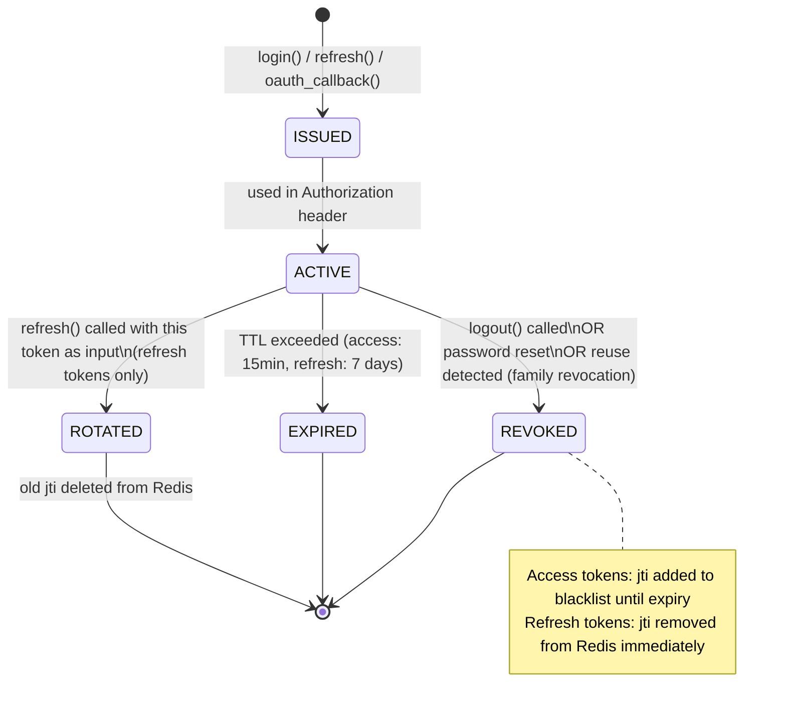

**Valid state transitions**:

| From   | To      | Trigger                                                 |
| ------ | ------- | ------------------------------------------------------- |
| ISSUED | ACTIVE  | Token presented to any endpoint                         |
| ACTIVE | EXPIRED | Time passes beyond `exp` claim                          |
| ACTIVE | REVOKED | `POST /auth/logout`, password reset, or reuse detection |
| ACTIVE | ROTATED | `POST /auth/refresh` consumes the refresh token         |

**Invalid transitions**: EXPIRED → ACTIVE, REVOKED → ACTIVE (these produce 401).

---

## 9. Security Design

### 9.1 Password Security

| Concern            | Implementation                                                                           |
| ------------------ | ---------------------------------------------------------------------------------------- |
| Hashing algorithm  | bcrypt, cost factor 12 (~250ms on modern hardware)                                       |
| Plaintext exposure | Never stored, never logged, never returned in responses                                  |
| Comparison timing  | `bcrypt.compare()` — constant-time comparison by design                                  |
| Minimum strength   | 8+ chars, 1 letter, 1 number (DTO `@Matches` validator)                                  |
| OAuth users        | `password` column is `NULL`; login via password rejected with `OAUTH_ONLY_ACCOUNT` error |

### 9.2 Brute Force Protection

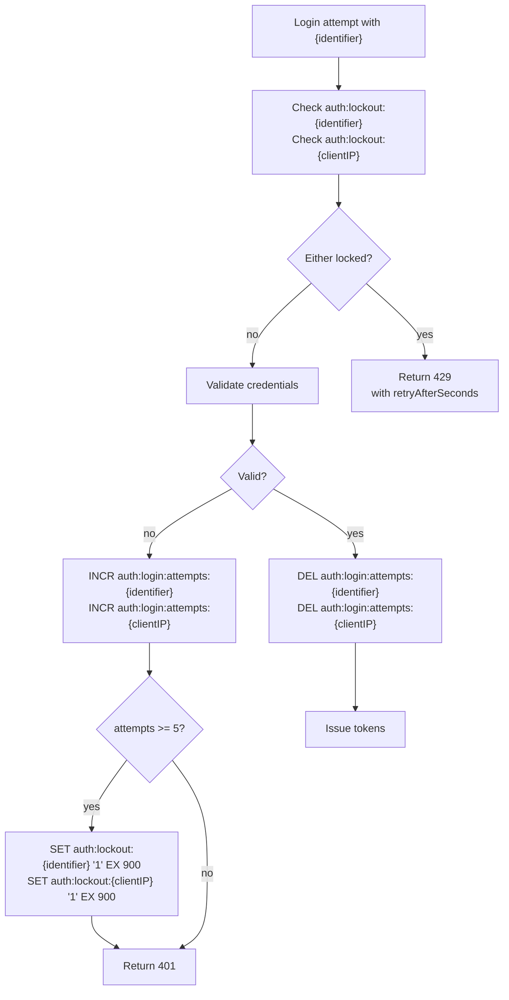

**Key design**: Both the identifier (email/username) and the client IP are locked independently. An attacker distributing across many accounts from one IP is caught by IP lockout; a targeted attack on one account from many IPs is caught by identifier lockout.

### 9.3 Transport Security

| Mechanism               | Configuration                                                    |
| ----------------------- | ---------------------------------------------------------------- |
| HTTPS                   | Required in production; Nginx terminates TLS                     |
| HSTS                    | `Strict-Transport-Security: max-age=31536000; includeSubDomains` |
| Cookie flags            | `HttpOnly; Secure; SameSite=Strict`                              |
| CORS                    | Allowlist of known frontend origins only                         |
| X-Frame-Options         | `DENY` (via Helmet)                                              |
| Content-Security-Policy | Defined in Nginx; NestJS sets `default-src 'self'` baseline      |

### 9.4 Prompt Injection / Data Exposure

Auth endpoints do not call the LLM. No injection risk in this module. Ensure:

- Error messages never expose whether an account exists (forgot password always returns 200)
- Stack traces never returned to client (GlobalExceptionFilter strips them in production)
- Response bodies never include `password` field (use `@Exclude()` on the entity)

---

## 10. Integration Points

### 10.1 PostgreSQL

Queries issued by AuthModule:

| Operation                                | Query pattern                                                                          | Frequency                         |
| ---------------------------------------- | -------------------------------------------------------------------------------------- | --------------------------------- |
| Email existence check                    | `SELECT EXISTS (...WHERE email=$1 AND deleted_at IS NULL)`                             | On register                       |
| Username existence check                 | `SELECT EXISTS (...WHERE username=$1 AND deleted_at IS NULL)`                          | On register                       |
| Login lookup                             | `SELECT ... WHERE (email=$1 OR username=$1) AND is_active=true AND deleted_at IS NULL` | On every login                    |
| OAuth upsert (find by provider)          | `SELECT ... WHERE oauth_provider=$1 AND oauth_id=$2`                                   | On OAuth callback                 |
| OAuth upsert (find by email for linking) | `SELECT ... WHERE email=$1 AND deleted_at IS NULL`                                     | On OAuth callback (new user path) |
| Set `is_verified = true`                 | `UPDATE users SET is_verified=true WHERE email=$1`                                     | On OTP verify                     |
| Update password                          | `UPDATE users SET password=$1 WHERE id=$2`                                             | On password reset                 |
| Insert new user                          | `INSERT INTO users (...)`                                                              | On register / new OAuth user      |
| Fetch user for JWT strategy              | `SELECT id, is_active, role FROM users WHERE id=$1`                                    | On every authenticated request    |

**Index dependency**: Login lookup requires the partial index on `email` and `username` where `deleted_at IS NULL` (defined in DB Migration Plan). Without it, login performance degrades at scale.

### 10.2 Redis

All Redis interactions use `ioredis` via a shared `RedisModule` (singleton connection). AuthModule calls Redis for:

- Token storage / deletion (refresh tokens)
- OTP storage / deletion
- Lockout flags
- Password reset token storage

**Connection failure handling**: If Redis is unavailable:

- Token refresh fails (401 returned) — acceptable, user must re-login
- OTP send succeeds (OTP stored in Redis); if Redis is down, OTP storage fails and user is notified
- Brute-force protection degrades gracefully (skip lockout check, log warning) — never block legitimate users due to Redis outage

### 10.3 MailService

AuthModule calls MailService for:

- OTP verification email (on register and OTP resend)
- Password reset email

MailService enqueues the job to BullMQ `mail` queue with retry. AuthModule does not wait for delivery confirmation — fire-and-forget. If the mail queue is unavailable, the operation is logged as a warning; the user may need to request a resend.

**Templates used**:

- `otp-verification.hbs`: variables `{otp, expiryMinutes, recipientName}`
- `password-reset.hbs`: variables `{resetUrl, expiryMinutes, recipientName}`

### 10.4 RBACModule

AuthModule does not directly call RBACModule. However, on user creation, AuthModule calls `RBACModule.assignDefaultRole(userId, 'PARTICIPANT')` to assign the default role. This is the only cross-module call from AuthModule.

### 10.5 OAuth Providers

| Provider | Auth endpoint                                  | Token endpoint                                | Profile fields used                         |
| -------- | ---------------------------------------------- | --------------------------------------------- | ------------------------------------------- |
| Google   | `https://accounts.google.com/o/oauth2/v2/auth` | `https://oauth2.googleapis.com/token`         | `id`, `email`, `name`                       |
| GitHub   | `https://github.com/login/oauth/authorize`     | `https://github.com/login/oauth/access_token` | `id`, `email` (from `/user/emails`), `name` |

GitHub requires a separate API call to `/user/emails` to get the verified primary email (the profile endpoint may not return email if it is set to private). `OAuthService` must handle this case.

---

## 11. Error Handling

### 11.1 Error Code Registry

| Error Code                     | HTTP Status | Description                                                      |
| ------------------------------ | ----------- | ---------------------------------------------------------------- |
| `VALIDATION_ERROR`             | 400         | DTO validation failed; `details` array with field-level messages |
| `INVALID_CREDENTIALS`          | 401         | Login failed (user not found, inactive, or wrong password)       |
| `INVALID_REFRESH_TOKEN`        | 401         | Refresh token invalid, malformed, or expired                     |
| `REFRESH_TOKEN_REUSE_DETECTED` | 401         | Presented refresh token was already rotated                      |
| `UNAUTHORIZED`                 | 401         | No valid access token on a protected route                       |
| `EMAIL_TAKEN`                  | 409         | Registration: email already in use                               |
| `USERNAME_TAKEN`               | 409         | Registration: username already in use                            |
| `OTP_EXPIRED`                  | 422         | OTP not found in Redis (expired or not sent)                     |
| `OTP_INVALID`                  | 422         | Presented OTP does not match stored hash                         |
| `RESET_TOKEN_INVALID`          | 422         | Password reset token not found or expired                        |
| `OAUTH_ONLY_ACCOUNT`           | 422         | Account has no password; must use OAuth login                    |
| `ACCOUNT_LOCKED`               | 429         | Brute-force threshold exceeded                                   |
| `OTP_ATTEMPTS_EXCEEDED`        | 429         | Too many failed OTP attempts                                     |
| `OTP_RATE_LIMIT`               | 429         | OTP resend rate limit exceeded                                   |

### 11.2 Error Response Format

All errors conform to the platform envelope:

```json
{
  "success": false,
  "data": null,
  "meta": null,
  "error": {
    "code": "INVALID_CREDENTIALS",
    "message": "The provided credentials are incorrect.",
    "details": null
  }
}
```

For validation errors, `details` contains per-field errors:

```json
{
  "error": {
    "code": "VALIDATION_ERROR",
    "message": "Request validation failed.",
    "details": [
      { "field": "email", "message": "email must be a valid email address" },
      {
        "field": "password",
        "message": "password must be at least 8 characters"
      }
    ]
  }
}
```

---

## 12. Observability

### 12.1 Logging

Every auth event is logged as a structured JSON entry with the following context. Sensitive fields (`password`, `otp`, `token` values) are never logged.

| Event                        | Log level | Key fields logged                                   |
| ---------------------------- | --------- | --------------------------------------------------- |
| Successful login             | `info`    | `userId`, `method` (local/oauth), `ip`, `userAgent` |
| Failed login                 | `warn`    | `identifier`, `ip`, `attemptCount`, `reason`        |
| Account locked               | `warn`    | `identifier`, `ip`, `lockoutDurationSeconds`        |
| Refresh token rotated        | `debug`   | `userId`, `oldJti`, `newJti`                        |
| Refresh token reuse detected | `error`   | `userId`, `jti`, `ip` — triggers security alert     |
| Logout                       | `info`    | `userId`                                            |
| OTP sent                     | `info`    | `email` (no OTP value)                              |
| OTP verified                 | `info`    | `email`                                             |
| OTP failed                   | `warn`    | `email`, `attemptCount`                             |
| Password reset requested     | `info`    | `email`                                             |
| Password reset completed     | `info`    | `userId`                                            |
| OAuth callback success       | `info`    | `userId`, `provider`, `isNewUser`                   |
| OAuth callback failure       | `error`   | `provider`, `reason`                                |

### 12.2 Metrics

| Metric                          | Type      | Labels                                                     |
| ------------------------------- | --------- | ---------------------------------------------------------- |
| `auth_login_total`              | Counter   | `method` (local/google/github), `status` (success/failure) |
| `auth_register_total`           | Counter   | `status` (success/conflict)                                |
| `auth_token_refresh_total`      | Counter   | `status` (success/reuse_detected/invalid)                  |
| `auth_otp_total`                | Counter   | `action` (sent/verified/failed)                            |
| `auth_lockout_total`            | Counter   | `trigger` (login/otp)                                      |
| `auth_password_reset_total`     | Counter   | `step` (requested/completed)                               |
| `auth_request_duration_seconds` | Histogram | `endpoint`                                                 |

### 12.3 Alerts

| Alert                     | Condition                                                        | Severity |
| ------------------------- | ---------------------------------------------------------------- | -------- |
| High login failure rate   | `auth_login_total{status="failure"}` rate > 10/s for 2 min       | P2       |
| Refresh token reuse spike | `auth_token_refresh_total{status="reuse_detected"}` > 5 in 5 min | P1       |
| Account lockout surge     | `auth_lockout_total` rate > 20/min                               | P2       |
| OTP send failure          | MailService queue depth > 100                                    | P2       |

---

## 13. Performance Considerations

### 13.1 DB Query Optimization

The most frequent query is the login lookup. Without the partial index on `(email, username)` where `deleted_at IS NULL`, this becomes a full table scan at scale.

```sql
-- Required partial indexes (from DB Migration Plan)
CREATE UNIQUE INDEX idx_users_email ON users(email) WHERE deleted_at IS NULL;
CREATE UNIQUE INDEX idx_users_username ON users(username) WHERE deleted_at IS NULL;
```

Login lookup uses `OR` across two columns. PostgreSQL will use a bitmap index scan combining both indexes. If profiling shows this is slow, split into two queries (email lookup first, username fallback) or add a generated column.

### 13.2 bcrypt Cost Factor

Cost factor 12 produces ~250ms hash time. This is intentional (makes brute force expensive) but means:

- Registration: ~250ms blocking for password hash
- Login: ~250ms blocking for password comparison

Both are acceptable for a user-facing auth flow. Do **not** run bcrypt in the main event loop if concurrency > 10 simultaneous logins — consider `bcrypt.hash()` with Node's worker thread pool (default behavior of `bcryptjs` async API).

### 13.3 JWT Validation Latency

`JwtStrategy.validate()` calls Redis (blacklist check) + PostgreSQL (user fetch) on every authenticated request. Target latency: < 10ms for both calls combined (Redis ~1ms, indexed PK lookup ~2ms).

If this becomes a bottleneck: cache the user record in Redis (key: `user:{userId}`, TTL: 60s, invalidate on `PATCH /users` or deactivation).

### 13.4 Rate Limiting

Implemented via `@nestjs/throttler` with Redis store (so limits are shared across multiple NestJS instances):

| Endpoint                     | Limit       | Window               |
| ---------------------------- | ----------- | -------------------- |
| `POST /auth/login`           | 10 requests | 1 minute per IP      |
| `POST /auth/register`        | 5 requests  | 1 minute per IP      |
| `POST /auth/otp`             | 3 requests  | 10 minutes per email |
| `POST /auth/password/forgot` | 3 requests  | 1 hour per email     |
| `POST /auth/password/reset`  | 10 requests | 1 hour per IP        |
| `POST /auth/refresh`         | 30 requests | 1 minute per userId  |

---

## 14. Scalability Considerations

The AuthModule is stateless at the NestJS layer — all state (tokens, OTPs, lockouts) is in Redis. This means:

- Multiple NestJS instances can handle auth requests without coordination
- Redis must be available for token refresh (hard dependency); login tolerance without Redis requires an architectural change
- bcrypt is CPU-intensive — at very high registration rates (> 100 concurrent registrations), consider a dedicated worker pool

**Redis availability**: Use Redis Sentinel (or ElastiCache in cluster mode) in production. If the primary fails, Sentinel promotes a replica within ~10 seconds. During this window, token refreshes fail (users see 401). This is acceptable — the window is narrow and users can retry.

---

## 15. Testing Strategy

### 15.1 Unit Tests

File: `src/modules/auth/auth.service.spec.ts`

| Test case                           | What is asserted                                            |
| ----------------------------------- | ----------------------------------------------------------- |
| `register()` — happy path           | User inserted, OTP sent, 201 response shape                 |
| `register()` — duplicate email      | `ConflictException` with `EMAIL_TAKEN` code                 |
| `register()` — duplicate username   | `ConflictException` with `USERNAME_TAKEN` code              |
| `login()` — valid credentials       | Access token issued, refresh token stored in Redis          |
| `login()` — wrong password          | `UnauthorizedException`; attempt counter incremented        |
| `login()` — 5th failed attempt      | Lockout key set in Redis; `TooManyRequestsException` on 6th |
| `login()` — locked account          | `TooManyRequestsException` even with correct credentials    |
| `login()` — inactive user           | `UnauthorizedException`                                     |
| `refresh()` — valid token           | New token issued; old jti deleted from Redis                |
| `refresh()` — already-rotated token | Entire family revoked; `UnauthorizedException`              |
| `refresh()` — expired token         | `UnauthorizedException`                                     |
| `logout()` — valid                  | jti removed from Redis                                      |
| `verifyOtp()` — correct OTP         | `is_verified` updated to true; OTP key deleted              |
| `verifyOtp()` — wrong OTP           | Attempt counter incremented; OTP key preserved              |
| `verifyOtp()` — expired OTP         | `UnprocessableEntityException` with `OTP_EXPIRED`           |
| `resetPassword()` — valid token     | Password updated; all refresh tokens revoked                |
| `resetPassword()` — expired token   | `UnprocessableEntityException`                              |

### 15.2 Integration Tests

File: `test/auth.e2e-spec.ts` (using `@nestjs/testing` + `testcontainers` for real PostgreSQL and Redis)

| Scenario                     | Steps                                                                                            |
| ---------------------------- | ------------------------------------------------------------------------------------------------ |
| Full local auth flow         | Register → verify OTP → login → access protected route → refresh → logout → verify refresh fails |
| Brute force lockout          | 5 failed logins → verify 429 → wait 15 min (mock TTL) → verify login succeeds                    |
| Refresh token rotation       | Login → refresh (get new tokens) → use old refresh → verify family revoked                       |
| OAuth flow (mocked provider) | Mock Google callback → verify user created → tokens issued                                       |
| Password reset               | Forgot → verify Redis key → reset → verify old refresh tokens revoked → login with new password  |
| Concurrent registration      | 10 parallel register requests with same email → exactly 1 succeeds, 9 return 409                 |

### 15.3 Security Tests

| Test                                  | Tool                             | Assertion                                                    |
| ------------------------------------- | -------------------------------- | ------------------------------------------------------------ |
| SQL injection in login identifier     | Manual / automated               | Parameterized query; no error leakage                        |
| Brute force not blocked if Redis down | Integration test with Redis down | Login still works; lockout silently skipped with warning log |
| Password not in response              | Unit test                        | `@Exclude()` applied; no `password` field in any response    |
| Reset token not reusable              | Integration test                 | Second use of same token returns 422                         |
| OTP not logged                        | Log output inspection            | OTP value absent from all log entries                        |

---

## 16. Implementation Order

Based on dependency sequencing and risk prioritization:

| Step | Tasks                                                                          | Sprint   |
| ---- | ------------------------------------------------------------------------------ | -------- |
| 1    | Register + login (local) + `JwtAuthGuard` global setup + `@Public()` decorator | Sprint 1 |
| 2    | Token refresh + logout + Redis integration + brute-force lockout               | Sprint 1 |
| 3    | OTP send + verify + `is_verified` flag + MailService integration               | Sprint 1 |
| 4    | OAuth (Google first, GitHub second) + account linking                          | Sprint 5 |
| 5    | Password forgot + reset flow                                                   | Sprint 5 |

Steps 1–3 are foundational (Phase 0 in the execution plan). Steps 4–5 are Phase 5 (after core test management and evaluation are working).

---

## 17. Open Questions

1. **OAuth account linking**: If a user registered locally with `john@example.com` and later attempts Google OAuth with the same email, the current design auto-links the accounts. Should the user be prompted to confirm this link instead of it happening silently?

2. **Unverified user access**: Which endpoints are accessible to users with `is_verified = false`? Current assumption: all endpoints are accessible (verification is advisory), but test creation or participation may eventually require verified status. Define the enforcement boundary before Sprint 3.

3. **Refresh token cookie path**: The cookie is currently set on `Path=/auth/refresh`. This means only the refresh endpoint receives the cookie — the frontend cannot accidentally send it elsewhere. Confirm this is the intended behavior.

4. **Access token payload — is_active / is_verified**: Embedding these flags in the JWT avoids a DB call per request but means changes (e.g., deactivation) take up to 15 minutes to take effect. The current design does the DB call for immediate enforcement. Confirm this is the correct trade-off for the use case.

5. **GitHub email privacy**: GitHub users may have their email set to private, requiring an additional `/user/emails` API call. Confirm whether users with private GitHub emails should be rejected or prompted to make their email public during OAuth flow.

6. **OTP for login vs. registration only**: Currently OTP is only used for email verification post-registration. Should OTP also be offered as a login method (passwordless)? This would require a separate `POST /auth/otp/login` flow.

7. **Logout — all devices**: Current logout only revokes the presented refresh token. Should there be a "logout from all devices" option that revokes the entire refresh token family? This is easy to implement (`DEL` all keys in `auth:refresh:{userId}:*`) but needs a dedicated endpoint.

8. **Token claims — `is_active` in JWT**: If an admin deactivates a user, their active access tokens remain valid until expiry (max 15 min). Is this acceptable, or should deactivation trigger immediate access token blacklisting?
