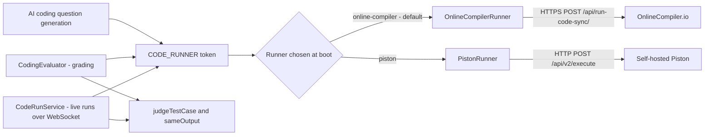

# Code Execution

## 1. Purpose

TestFlow never runs user code on the backend host. The `code-execution` module sends code to an **external sandbox** and turns the reply into one common result shape.

It sits behind one small interface, `CodeRunner`, so the rest of the app does not care which sandbox is used. Switching sandbox is a config change (`CODE_RUNNER_PROVIDER`), not a code change.

The code lives in `src/code-execution/`.

## 2. Key concepts

| Term | Meaning |
| --- | --- |
| `CodeRunner` | The interface every provider implements: `provider`, `supports(language)`, `run(request)`. |
| `CodeRunnerFactory` | An abstract factory. There is one per provider. It builds a runner from config. |
| `CODE_RUNNER` | The Nest injection token bound to the chosen runner. Callers inject this. |
| Provider | The sandbox behind a runner: `online-compiler` (OnlineCompiler.io, hosted) or `piston` (self-hosted [Piston](https://github.com/engineer-man/piston)). |
| Run result | How a program ended: `success`, `error`, `time_limit_exceeded` or `memory_limit_exceeded`. A program that crashes is a **result**, not an exception. |
| `CodeRunnerError` | Thrown when the run **could not happen**. The reason is one of `not_configured`, `unsupported_language`, `busy`, `unavailable`. |
| Judge | `judgeTestCase` compares one run with one test case's expected output. |

## 3. Architecture

**How the runner is chosen** (`code-execution.module.ts`):

1. Both factories (`OnlineCompilerRunnerFactory`, `PistonRunnerFactory`) are registered under `CODE_RUNNER_FACTORIES`.
2. At boot, `CODE_RUNNER` is built by `selectCodeRunnerFactory(factories, CODE_RUNNER_PROVIDER)`. An empty value falls back to `online-compiler`.
3. An unknown provider name **fails the boot** with a clear error, so the problem is not found on the first run.
4. A missing API key does **not** stop the boot. That runner then refuses every run with `not_configured`.
5. The chosen provider is logged: `Code runner: <provider>`.

To add a provider, write a new `CodeRunner` and a `CodeRunnerFactory`, and add the factory to the module's list.

## 4. Request and response shapes

`CodeRunRequest` (`interfaces/code-runner.interface.ts`):

| Field | Type | Notes |
| --- | --- | --- |
| `language` | `python`, `java` or `cpp` | `CODING_LANGUAGES` in `src/ai/interfaces/generated-coding-question.interface.ts` |
| `code` | string | The full source file |
| `stdin` | string | The input fed to the program |
| `timeLimitMs` | number | The question's CPU-time limit |
| `memoryLimitMb` | number | The question's memory limit |

`CodeRunResult`:

| Field | Notes |
| --- | --- |
| `status` | `success` (exit 0 within limits), `error` (compile or runtime error, non-zero exit), `time_limit_exceeded`, `memory_limit_exceeded` |
| `stdout`, `stderr` | Program output. When the program left no stderr, `stderr` is filled with a reason from the provider. |
| `exitCode` | Null if not reported |
| `timeMs` | CPU time of the program, without compilation. Null if not reported. |
| `memoryKb` | Null if not reported |
| `outputTruncated` | True when the provider cut `stdout`. Truncated output can never pass a test case. |

## 5. Supported languages

| Our language | OnlineCompiler.io compiler | Piston runtime |
| --- | --- | --- |
| `python` | `python-3.14` | `python 3.12.0` |
| `java` | `openjdk-25` | `java 15.0.2` |
| `cpp` | `g++-15` | `c++ 10.2.0` |

The Piston versions must match the packages installed on the Piston server (`piston.constants.ts`). JavaScript is not supported. A coding question may only offer languages from `CODING_LANGUAGES`. A live run is also refused if the active runner does not `supports()` the language.

## 6. The two runners

### 6.1 OnlineCompiler.io (`runners/online-compiler/`)

- Calls `POST {ONLINE_COMPILER_BASE_URL}/api/run-code-sync/` with header `Authorization: <api key>` and body `{ compiler, code, input }`.
- **Concurrency:** an in-process `Semaphore` allows `ONLINE_COMPILER_MAX_CONCURRENCY` calls at once (default 4, which is the API's per-key limit). Extra calls wait in order.
- **429** is retried once after 1 second. A second 429 gives `busy`.
- **401 or 403** gives `not_configured` (bad key). Any other non-2xx, a network error or a timeout gives `unavailable`.
- **Request timeout:** `ONLINE_COMPILER_TIMEOUT_MS` (default 40 s). The sandbox itself stops a program at 30 s.
- **Payload cap:** code and stdin are each at most 100 KB (`unavailable` if larger).
- **Status mapping:** a non-zero exit code maps through `ONLINE_COMPILER_EXIT_CODES`: 124 is a timeout, 137 is out of memory (the sandbox allows 512 MB), and others are `error`. The sandbox limits are much higher than a question's, so after a clean exit the runner compares the **reported** time and memory against the question's limits. Over a limit means TLE or MLE even though the program finished.
- **Output limit:** the API cuts `output` at 999 characters, so `outputTruncated` is set when `stdout.length >= 999`.

### 6.2 Piston (`runners/piston/`)

- Calls `POST {PISTON_BASE_URL}/api/v2/execute` with header `x-api-key: sha256hex(PISTON_API_KEY)`. Only the digest is sent, never the raw key.
- The body has the runtime, `files: [{ content: code }]`, `stdin` and per-run limits:
    - `run_cpu_time = timeLimitMs`
    - `run_timeout = 2 x timeLimitMs` (wall clock, to allow for I/O and start-up)
    - `run_memory_limit = memoryLimitMb` in bytes
    - each limit is **clamped** to `PISTON_MAX_RUN_TIMEOUT_MS`, `PISTON_MAX_RUN_CPU_TIME_MS` and `PISTON_MAX_RUN_MEMORY_MB` when set, because Piston answers 400 to anything above its own maximums
- **Concurrency:** a `Semaphore` of `PISTON_MAX_CONCURRENCY` (default 4). Keep it at or below Piston's `PISTON_MAX_CONCURRENT_JOBS` divided by the number of backend instances. The request timeout (`PISTON_TIMEOUT_MS`, default 60 s) starts only once a slot is taken.
- **Compile failure** (no `run` stage) gives `error` with the compiler's stderr.
- **Status mapping:** Piston `TO` is TLE. `OL` (output too long) is `success` with `outputTruncated`, which the judge treats as a wrong answer. A `SIGKILL` with memory at 95% or more of the enforced limit is MLE. A non-zero code or another signal is `error`. Otherwise the reported CPU time and memory are checked against the question's limits.
- Piston status `XX` (internal error) or any non-2xx gives `unavailable`. 401 gives `not_configured`.

## 7. Test-case execution and judging

Test cases always run **one after another**, never in parallel for one submission. The shared semaphore still lets runs from different users overlap.

`judgeTestCase(result, expectedOutput)` in `judge-test-case.ts`:

| Run status | Outcome |
| --- | --- |
| `time_limit_exceeded` | `time_limit_exceeded` |
| `memory_limit_exceeded` | `memory_limit_exceeded` |
| `error` | `runtime_error` (compile errors land here too) |
| `success`, output truncated | `wrong_answer` |
| `success`, output matches | `passed` |
| `success`, output differs | `wrong_answer` |

"Matches" means `sameOutput` (`output-compare.ts`): both sides are normalised to LF line endings, trailing spaces on each line are removed, and trailing blank lines are removed. Then they must be exactly equal. This is the `exact` checker.

How each feature uses it:

| Feature | Which cases | What happens with results |
| --- | --- | --- |
| Live code run during an attempt | visible cases (`samples`) or one custom stdin (`custom`) | Streamed to the socket. Nothing saved. See [attempts](attempts.md#53-running-code-during-an-attempt). |
| Coding evaluation | **all** cases, hidden included | Partial marks and verdict saved on the response. See [evaluation](evaluation.md#62-coding). |
| AI coding question generation | reference solution on generated inputs | Its output becomes the expected output, and generated cases are checked. See [assessment generation](assessment-generation.md). The runner is injected `@Optional()` there. |

## 8. Timeouts, limits and error handling

| Limit | Value | Where |
| --- | --- | --- |
| Code or stdin size, live run | 50,000 characters | `RunCodeDto` (`CODE_RUN_MAX_LENGTH`) |
| Code or stdin size, OnlineCompiler | 100 KB each | `ONLINE_COMPILER_MAX_PAYLOAD_BYTES` |
| Live runs per user | 1 in flight, 1 start every 5 s | `CodeRunService` (in memory, per instance) |
| Concurrent provider calls | 4 per instance by default | `*_MAX_CONCURRENCY` |
| HTTP timeout | 40 s (OnlineCompiler), 60 s (Piston) | `*_TIMEOUT_MS` |
| Program CPU time and memory | the question's `timeLimitMs` and `memoryLimitMb` | from the coding question |

How errors flow:

- **A program failure** (wrong output, crash, TLE, MLE) is a normal result. The user gets a verdict.
- **A `CodeRunnerError`** means the run did not happen:
    - live run: the socket gets `code.run.failed` with `reason` and `message`. Results already sent still stand.
    - evaluation: the response and its child job are marked failed, and a retry grades them later. It is never scored as wrong.
- Any other exception in a live run gives `code.run.failed` with `reason: "internal_error"`.

## 9. Security notes

1. **No local execution.** User code is only sent over HTTP to a sandbox. The backend never runs it.
2. **Hidden test cases stay private.** Live runs only use visible cases. Graded results shown to the candidate never include a hidden case's input, expected output, stdout or stderr. Reviewers see them.
3. **Secrets:** the Piston key is sent as a SHA-256 digest. The OnlineCompiler key is sent as is in `Authorization` over HTTPS. Both come from env (`.env.example`).
4. **Third-party exposure:** with `online-compiler`, candidate code and test inputs (hidden ones included, during grading) are sent to OnlineCompiler.io. Use `piston` to keep them in-house.
5. **Abuse limits:** these are the DTO size caps, the per-user cooldown and in-flight limit, and the semaphores. The cooldown is per process, so with N instances a user could run up to N times as often.
6. **Sandbox limits** (processes, output size, memory) are enforced by the provider, not by TestFlow.

## 10. Configuration

| Env var | Default | Used by |
| --- | --- | --- |
| `CODE_RUNNER_PROVIDER` | `online-compiler` | module (`online-compiler` or `piston`) |
| `ONLINE_COMPILER_API_KEY` | none (runs refused) | OnlineCompiler |
| `ONLINE_COMPILER_BASE_URL` | `https://api.onlinecompiler.io` | OnlineCompiler |
| `ONLINE_COMPILER_MAX_CONCURRENCY` | 4 | OnlineCompiler |
| `ONLINE_COMPILER_TIMEOUT_MS` | 40000 | OnlineCompiler |
| `PISTON_API_KEY` | none (runs refused) | Piston, the same raw secret as the Piston server's |
| `PISTON_BASE_URL` | `http://127.0.0.1:2000` | Piston |
| `PISTON_MAX_CONCURRENCY` | 4 | Piston |
| `PISTON_TIMEOUT_MS` | 60000 | Piston |
| `PISTON_MAX_RUN_TIMEOUT_MS`, `PISTON_MAX_RUN_CPU_TIME_MS`, `PISTON_MAX_RUN_MEMORY_MB` | unset (no clamp). `.env.example` uses 2000 / 2000 / 256 | Piston |

Values that are not positive integers fall back to the default. See [getting started](../getting-started.md).

## 11. Where the code lives

| Path | What |
| --- | --- |
| `src/code-execution/code-execution.module.ts` | Provider selection, exports `CODE_RUNNER` |
| `src/code-execution/code-execution.constants.ts` | Tokens, provider enum, default |
| `src/code-execution/code-runner.factory.ts` | Abstract factory |
| `src/code-execution/interfaces/code-runner.interface.ts` | `CodeRunner`, request and result types |
| `src/code-execution/code-runner.errors.ts` | `CodeRunnerError` and reasons |
| `src/code-execution/judge-test-case.ts`, `output-compare.ts` | Judging and output normalising |
| `src/code-execution/semaphore.ts` | FIFO concurrency limiter |
| `src/code-execution/runners/online-compiler/` | OnlineCompiler.io runner, factory, constants |
| `src/code-execution/runners/piston/` | Piston runner, factory, constants |
| Consumers: `src/assessments/attempts/code-run/code-run.service.ts`, `src/assessments/evaluation/evaluators/coding.evaluator.ts`, `src/ai/llm/coding-question-generation.graph.ts`, `src/ai/llm/coding-problem-tool-writer.ts` | Features that run code |

## 12. Known gaps and TODOs found in code

1. **Off-by-one truncation on OnlineCompiler.** `outputTruncated` is `stdout.length >= 999` (`online-compiler.runner.ts:128`). A correct answer that is exactly 999 characters long is treated as truncated and judged `wrong_answer`.
2. **`checkerType` is unused.** Questions store it, but judging is always `exact` (`judge-test-case.ts:19`). There is no float tolerance or custom checker.
3. **Limits are per process.** The semaphores and the live-run cooldown do not coordinate across instances. The provider's real concurrency limit is shared, which is why OnlineCompiler retries a 429 once.
4. **Compile errors are reported as `runtime_error`**, because both providers' results are folded into `error` before judging. There is a `compilation_error` code verdict, but it is never produced.
5. **Language versions differ between providers** (for example Java 25 against 15), so the same code may behave differently after switching provider.
