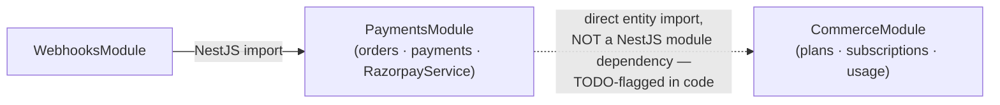

# HLD — Commerce, Payments & Webhooks

## 1. Purpose

Three modules implement monetization: **`CommerceModule`** (plans, plan versioning, subscriptions, and a not-yet-implemented usage-tracking stub), **`PaymentsModule`** (generic order/payment records + the Razorpay integration), and **`WebhooksModule`** (receives Razorpay's asynchronous payment-status callbacks and drives fulfillment). This is the newest and fastest-changing part of the system — three of the last four commits on this branch touched it (`b570f77`, `3f5933d`, `d3c601e`).

## 2. Module Relationship



`CommerceModule` and `PaymentsModule` have no `imports`/`exports` relationship in the Nest DI graph. `PaymentsService.markPaymentCaptured()` reaches directly into the `Subscription` entity (imported straight from `src/commerce/subscriptions/`) to flip its status — a deliberate, explicitly TODO-commented shortcut rather than an oversight. See [§6 Cross-Module Coupling](#6-cross-module-coupling).

## 3. Plans & Versioning

### 3.1 Plan code vs. plan id

Every plan gets both a numeric `id` (internal PK) and a `code` — a 10-character human-shareable string generated from an ambiguity-free alphabet (excludes `I`, `O`, `0`, `1`). The `code` is what checkout references (`CheckoutSubscriptionDto.planCode`), not the numeric `id`.

### 3.2 One current version per plan

`plan_versions.is_current` is guarded by a **partial unique index** — `WHERE is_current = true`, unique per `plan_id`. Creating a new version (`POST /:planId/versions`) runs in a transaction: demote the existing current version first (setting its `effective_until` if not already set), then insert the new one as current. `updateVersion()` (`PUT /:planId/versions/:versionNo`) only edits pricing fields in place — it can never change which version is current.

`GET /v1/plans` always joins only the current version — historical versions are invisible to that listing endpoint (they're still queryable directly by `(planId, version)`, which is exactly what checkout does).

### 3.3 Checkout pins an exact version

`CheckoutSubscriptionDto` requires **both** `planCode` and `version` — not just "buy the current plan." This lets a grandfathered user re-purchase an older version's pricing as long as it hasn't passed its `effective_until`. Validation order in `SubscriptionsService.checkout()`:

1. Plan exists by `code` (404) and `is_active` (422 otherwise).
2. That specific `version` exists for the plan (404).
3. `effective_until` (if set) hasn't passed (422 otherwise).
4. Caller has no existing `ACTIVE` subscription for this plan (409) — note a `PENDING` subscription for the same plan does **not** block a second checkout attempt; this is a known gap, not a deliberate allowance.

## 4. Checkout → Payment → Webhook Flow

This is the most important flow in the system and spans three HTTP calls plus one async webhook delivery:

```mermaid
sequenceDiagram
    autonumber
    participant U as User
    participant Sub as POST /subscriptions/checkout
    participant Pay as POST /payments/razorpay/create
    participant Rzp as Razorpay
    participant Hook as POST /webhooks/razorpay

    U->>Sub: {planCode, version}
    Sub->>Sub: validate plan/version, no existing ACTIVE sub
    Sub->>Sub: create Subscription(PENDING) + Order(PENDING, placeholder providerOrderId="chk_<uuid>")
    Sub-->>U: {subscription, order}

    U->>Pay: {orderId}
    Pay->>Pay: validate ownership, status=PENDING, not expired
    Pay->>Rzp: orders.create({amount*100, currency, receipt})
    Rzp-->>Pay: {id: razorpayOrderId}
    Pay->>Pay: create Payment(PENDING, providerOrderId=razorpayOrderId)
    Pay-->>U: {razorpayOrderId, razorpayKeyId}

    Note over U,Rzp: Frontend opens Razorpay Checkout widget client-side using these two values

    Rzp-->>Hook: payment.captured webhook
    Hook->>Hook: verify HMAC signature (RAZORPAY_WEBHOOK_SECRET)
    Hook->>Hook: dedupe: webhook_events.event_id = "payment.captured:{razorpayPaymentId}"
    Hook->>Pay: markPaymentCaptured(razorpayOrderId, razorpayPaymentId, paidAt)
    Pay->>Pay: Payment.status=SUCCESS; Order.status=PAID
    Pay->>Pay: if resourceType==SUBSCRIPTION: Subscription.status=ACTIVE (direct update)
    Hook->>Hook: mark webhook_events.processed=true
```

**Step-by-step notes:**

- **Checkout does not talk to Razorpay.** It only stages a `PENDING` order with a placeholder `provider_order_id` (`chk_<uuid>`). The real Razorpay order is created by the *separate* `POST /payments/razorpay/create` call — a deliberate two-step design that lets the order exist (and be validated/expired) before any payment provider is involved.
- **`POST /payments/razorpay/create` is idempotent.** If a `PENDING` payment with a `providerOrderId` already exists for the order, it's reused rather than creating a duplicate Razorpay order — safe to retry on network failure.
- **The order has an expiry** (`orders.expires_at`, default 30 minutes via `CHECKOUT_ORDER_TTL_MINUTES`). Payment creation against an expired order returns 422.
- **Webhook signature verification happens in the service, not a guard.** `POST /webhooks/razorpay` is `@Public()` (Razorpay, not a logged-in user, calls it) and hidden from Swagger. `WebhooksService.handleRazorpayWebhook()` itself throws 401 on a missing or invalid `x-razorpay-signature` header before touching any business logic.
- **Idempotency key is synthesized, not Razorpay-native**: `event_id = "{event}:{razorpayPaymentId}"` (e.g. `payment.captured:pay_ABC123`), looked up in `webhook_events` before processing. A redelivered webhook with the same key and `processed = true` is a silent no-op.
- **Only two event types are handled**: `payment.captured` and `payment.failed`. Everything else is logged and dropped.

## 5. Failure Path — Known Gap

On `payment.failed`, `PaymentsService.markPaymentFailed()` sets `payments.status = FAILED` **and nothing else** — `orders.status` stays `PENDING` and any linked `subscriptions.status` stays `PENDING`. This means a failed payment doesn't currently move the order to `OrderStatus.FAILED` (which exists as an enum value but is never set by any code path) — the user can simply retry `POST /payments/razorpay/create` again against the still-`PENDING` order until it expires. This is workable but undocumented behavior worth confirming is intentional before relying on `OrderStatus.FAILED` anywhere else.

## 6. Cross-Module Coupling

`PaymentsService.markPaymentCaptured()` contains an explicit `// TODO` comment acknowledging that directly importing and mutating the `Subscription` entity from the Payments module is a temporary shortcut. It:

- Only handles `OrderResourceType.SUBSCRIPTION` — `AI_CREDITS` (the other defined resource type) has **no fulfillment handler at all**; a captured payment for an `AI_CREDITS` order would mark the order `PAID` but never grant the credits.
- Bypasses `SubscriptionsService` entirely, using `manager.update(Subscription, order.resourceId, {status: ACTIVE})` directly inside the payments transaction.

**Recommended direction** (not yet implemented): replace this with an event-driven handler — e.g. `PaymentsService` emits an `OrderFulfillmentRequested { resourceType, resourceId }` event, and a resource-type-specific listener (one per `OrderResourceType`) owns its own fulfillment logic. This would let `AI_CREDITS` (or any future resource type) be added without further edits to `PaymentsService`.

## 7. Usage Tracking — Not Yet Implemented

`user_feature_usage` and `plan_features.reset_period` exist as schema, and `UsageService` is registered as a provider, but **it currently has zero methods**. There is no quota-checking, no usage-incrementing, and no period-reset logic anywhere in the codebase. Any feature gating (e.g. "free plan allows 3 assessments/month") described elsewhere is aspirational until this service is built.

## 8. Subscription Status — Only One Transition Implemented

`SubscriptionStatus` defines `PENDING`, `ACTIVE`, `PAST_DUE`, `CANCELLED`, `EXPIRED`, but the only transition any code path currently performs is `PENDING → ACTIVE` (via the webhook flow above). There is no renewal job, no cancellation endpoint, and no expiry sweep — `PAST_DUE`, `CANCELLED`, and `EXPIRED` are defined for future use only.

## 9. Endpoints

See [API Design v1](../api-design/v1.md#commerce--plans-v1plans) for the full endpoint tables: [Plans](../api-design/v1.md#commerce--plans-v1plans), [Subscriptions](../api-design/v1.md#commerce--subscriptions-v1subscriptions), [Payments](../api-design/v1.md#payments-module-v1payments), [Webhooks](../api-design/v1.md#webhooks-module).

## 10. Open Gaps Summary

1. Payment failure doesn't cascade to `Order`/`Subscription` status — confirm this is intentional (allows retry) rather than an oversight.
2. `AI_CREDITS` order resource type has no fulfillment handler.
3. Cross-module `Subscription` mutation from `PaymentsService` is a known TODO — plan the event-driven refactor before adding a third resource type.
4. `UsageService` is an empty stub — feature-gating by plan is not enforced anywhere yet.
5. No subscription list/cancel/renew endpoints exist — only checkout.
6. No expiry sweep for stale `PENDING` orders or subscriptions.
7. `PlanVersionFeature` entity maps to table `plan_features`, not `plan_version_features` — a naming trap worth flagging to anyone writing raw SQL against this table.

## 11. Related Pages

- [Architecture — Commerce & Payments Flow](../architecture.md#5-commerce--payments-flow)
- [ERD — Commerce](../erd.md#3-commerce--plans-subscriptions--usage) / [Payments & Orders](../erd.md#4-payments--orders)
- [API Design v1](../api-design/v1.md)
- [Data Access Patterns — Commerce](../data-access-pattern.md#commerce-plans-versions)
