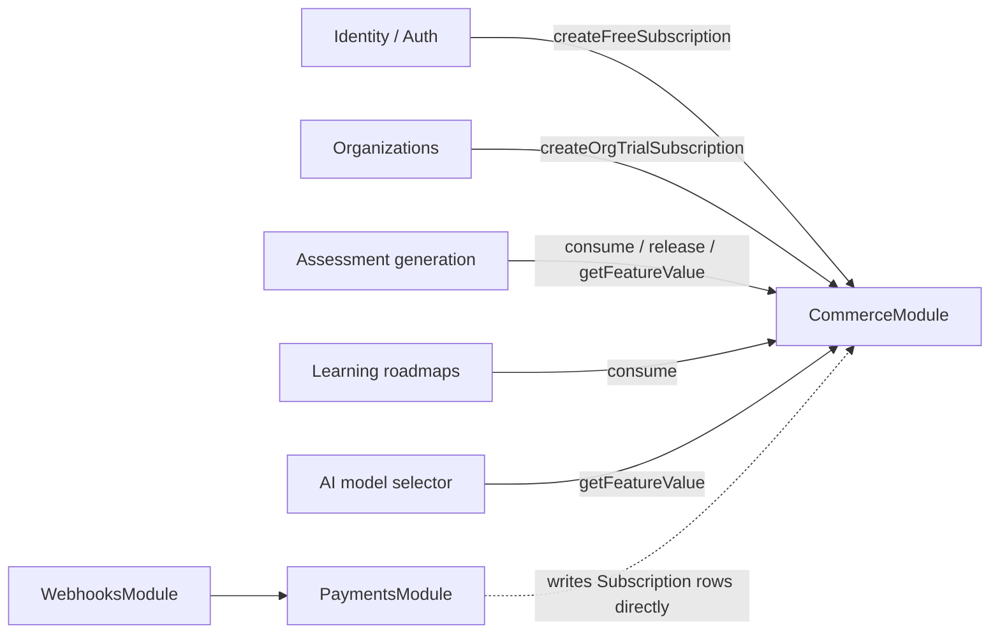
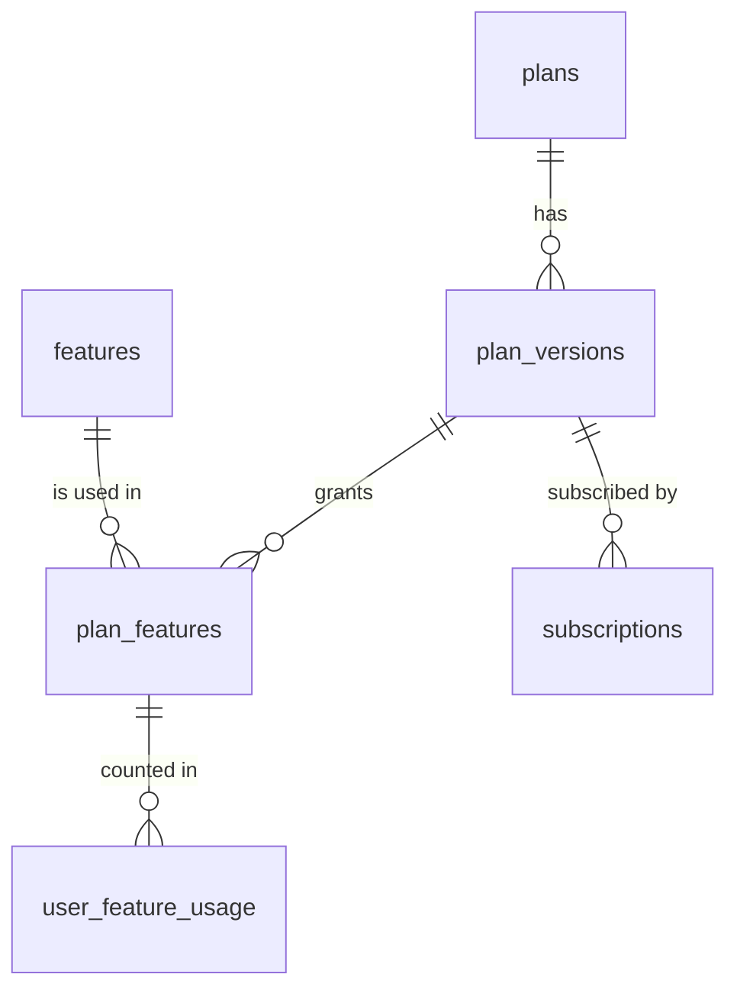
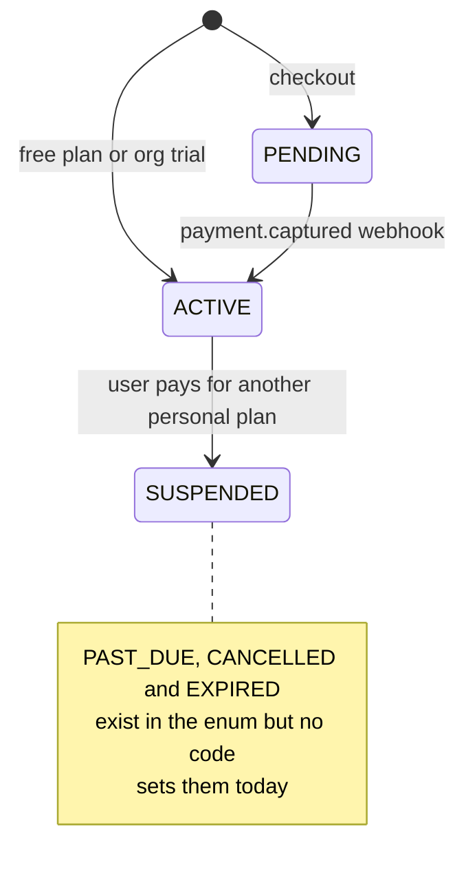
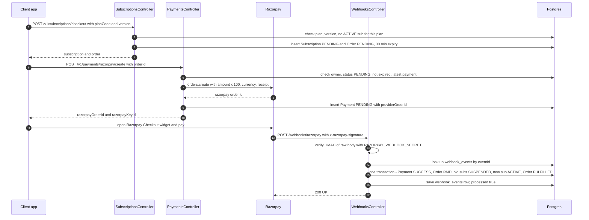
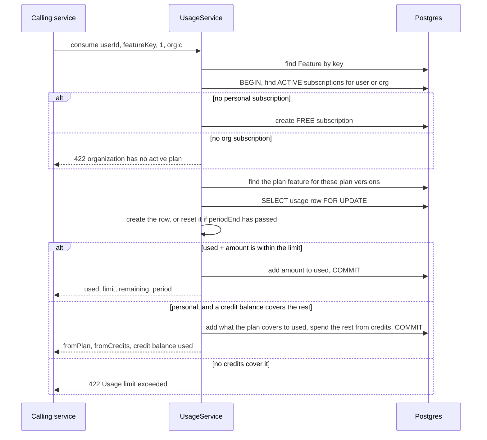
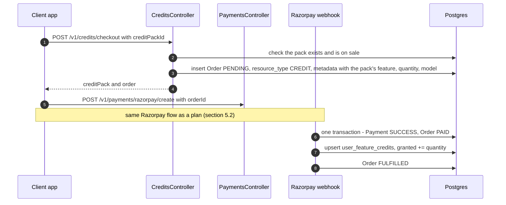

# Commerce, Payments and Webhooks

## 1. What this page covers

"Commerce" is everything to do with money and limits:

- **Plans**: what we sell (price, billing cycle, and what you get).
- **Subscriptions**: which plan a user or an organization is on right now.
- **Payments**: taking money through **Razorpay** (an Indian payment gateway) and confirming it with a **webhook** (a server-to-server HTTP call Razorpay makes to us).
- **Usage**: counting how much of a limited feature (for example, AI assessment generations) someone has used, and refusing when they run out.
- **Credits**: one-time packs of extra usage, spent once a plan's own quota runs out (section 7).
- **Orders**: a user's own purchase history (section 8).
- **Admin**: endpoints that platform admins use to manage the plan catalog and credit packs, and to look at orders, payments, subscriptions, and usage.

The code is split into three NestJS modules:

| Module | Folder | Owns |
|---|---|---|
| `CommerceModule` | `src/commerce/` | Plans, subscriptions, usage, credit packs (`src/commerce/credits/`), admin endpoints. Exports `UsageService`, `SubscriptionsService` and `CreditsService` to other modules. |
| `PaymentsModule` | `src/commerce/payments/` | Orders (including `GET /v1/orders`), payments, the Razorpay client. Imports `CommerceModule`, because a captured credit payment is granted by `CreditsService`. Exports `PaymentsService` and `RazorpayService`. |
| `WebhooksModule` | `src/webhooks/` | The public `POST /webhooks/razorpay` endpoint. Imports `PaymentsModule`. |

The dotted arrow is a shortcut: `PaymentsService` imports the `Subscription` entity and updates it itself, instead of calling `SubscriptionsService`. There is a `TODO` about this in `src/commerce/payments/payments.service.ts`.

## 2. Key terms

| Term | Meaning |
|---|---|
| **Feature** | A thing a plan can grant, identified by a fixed `FeatureKey` (table `features`). |
| **Plan** | A product we sell, e.g. `FREE` or `PRO` (table `plans`). Has a public `code`. |
| **Plan version** | One price point of a plan: price, currency, billing cycle (table `plan_versions`). |
| **Plan feature** | One feature attached to one plan version, with its value and reset period. Entity `PlanVersionFeature`, but the **table is `plan_features`**. |
| **Subscription** | A user's or an organization's link to one plan version, with a status and dates. |
| **Order** | "We expect this much money for this thing." Created at checkout, for a subscription or a credit pack. |
| **Payment** | One attempt to pay an order through a provider (Razorpay). An order can have several payments. |
| **Usage row** | A counter in `user_feature_usage`: how much of one plan feature was used in the current period. |
| **Credit pack** | A one-time purchase of extra usage of one feature, e.g. "10 AI assessments" (table `credit_packs`). |
| **Credit balance** | What a user bought and has spent of one feature's credits, per AI model (table `user_feature_credits`). Never resets or expires. |
| **Audience** | Who can buy a plan: `individual` (for yourself) or `organization`. |

## 3. Plans, versions and features

### 3.1 How pricing and limits are modelled

- **`plans`** (`src/common/entities/plan.entity.ts`): `name`, unique `code`, `description`, `audience`, `is_active`, `is_displayed`, `sort_order`.
    - `is_active = false` means it cannot be bought.
    - `is_displayed = false` hides it from the public list, but existing subscribers keep it.
    - `sort_order` sets the order of the public list (lowest first, then `id`).
- **`plan_versions`** (`plan-version.entity.ts`): `version` number, `price` (decimal 10,2), `currency` (3 letters), `billing_cycle` (`MONTHLY`, `YEARLY`, `ONE_TIME`), `is_current`, `effective_from`, `effective_until`, `expiry_days`.
    - `expiry_days` only applies to `ONE_TIME` versions. `null` means "never expires". The admin API refuses a value on a recurring version (`400`).
- **`plan_features`** (`plan-version-feature.entity.ts`): `feature_id`, `display_name`, `feature_value` (a string), `type`, `reset_period` (days, or `null`). A partial unique index allows one non-deleted row per (version, feature).
- **`features`** (`feature.entity.ts`): one row per `FeatureKey`. Seeded, not created through the API.

### 3.2 Feature types

A plan feature has a `type` (`PlanFeatureType` in `src/common/enums/commerce.enums.ts`) that says how to read `feature_value`:

| Type | `feature_value` means | Counted? |
|---|---|---|
| `limit` | A quota. A number like `"2"` is the limit. A non-number like `"unlimited"` means no limit. | Yes, by `UsageService.consume` |
| `enum` | A setting, e.g. a model code or a list of question types. | No. `consume` refuses an enum feature. |

### 3.3 The feature keys today

| `FeatureKey` | Type in practice | Used by | Effect |
|---|---|---|---|
| `AI_ASSESSMENT` | `limit` | Assessment generation | How many AI assessment generations per period. |
| `AI_LEARNING_ROADMAP` | `limit` | Learning roadmaps | How many AI roadmaps per period. |
| `AI_MODEL` | `enum` | `src/ai/ai-model-selector.service.ts` | Which LLM model the user's AI calls use. Missing means the default model. |
| `ALLOWED_QUESTION_TYPES` | `enum` | `src/assessments/generation/generation-entitlement.service.ts` | Comma-separated question types, e.g. `mcq,coding`. Missing or empty means `mcq` only (`src/commerce/plans/allowed-question-types.ts`). |
| `AI_ASSESSMENT_SUGGESTION` | `enum` | `src/assessments/attempts/attempt-suggestion.service.ts` | On/off. Any non-blank value (e.g. `enabled`) lets the plan's users ask for a next-assessment suggestion after an evaluated attempt. Missing or blank means `403`. Personal plan only. Added by migration `20261030000000`, attached to no plan by default. |

"Number of participants" and "number of assessments" are **not** metered features. Participant caps live on the assessment itself (see [Assessments](assessments.md)).

### 3.4 Why versions exist

Prices change, but people who already paid should keep what they bought. So instead of changing a plan's price in place, an admin adds a **new version**:

1. The old current version gets `is_current = false`, and `effective_until` is set (if it was empty) to the new version's `effective_from`.
2. The new version is inserted with `version = old + 1` and `is_current = true`.

Both steps run in one transaction (`CommerceAdminService.createPlanVersion` in `src/commerce/admin.service.ts`). A **partial unique index** (`UQ_plan_versions_plan_id_current`, `WHERE is_current = true`) makes sure a plan has at most one current version.

Existing subscriptions point at a `plan_version_id`, so they keep their old version's price and features.

Checkout asks for **both** `planCode` and `version`. So a client can buy an older version, as long as its `effective_until` has not passed.

### 3.5 Built-in plans and seeding

Two plans are special. Code finds them **by name**, so they must exist and be active (`src/commerce/plans/plan.constants.ts`):

| Name | Code (seeded) | Audience | Cycle | Price | Seeded feature | Who gets it |
|---|---|---|---|---|---|---|
| `FREE` | `FREEPLAN` | individual | `MONTHLY` | 0 USD | `AI_ASSESSMENT` = 2, reset every 1 day | Every user, when their account is verified |
| `ORG_TRIAL` | `ORGTRIAL` | organization | `ONE_TIME`, 7 days | 0 USD | `AI_ASSESSMENT` = 2, reset every 1 day | Every new organization |

- `npm run seed` runs `src/seeders/feature.seeder.ts` (creates the five features) and then `src/seeders/plan.seeder.ts` (creates each plan only if no plan with that name exists yet).
- Because code looks these plans up by name, admins **cannot rename or deactivate** `FREE` or `ORG_TRIAL` (`CommerceAdminService.updatePlan` returns `409`). Hiding, re-describing or re-ordering them is fine.
- Paid plans (for example `PRO`) are not seeded. Admins create them through the admin API (section 9).
- Admin-created plans get a random 10-character `code` from an alphabet without look-alike characters (no `I`, `O`, `0`, `1`).

## 4. Subscriptions

### 4.1 Personal vs organization subscriptions

Both exist, in the same `subscriptions` table:

| | Personal | Organization |
|---|---|---|
| `organization_id` | `NULL` | the org's id |
| `user_id` | the owner | the purchaser (the org creator for the trial) |
| How it starts | `FREE` at verification, or a paid plan through checkout | `ORG_TRIAL` when the org is created |
| Can be bought? | Yes, `individual` plans via `POST /v1/subscriptions/checkout` | **No**. There is no org checkout endpoint yet, and checkout refuses `organization` plans with `422`. |
| Usage | Counted per user | **Pooled**: one counter per organization and feature, shared by all members |

Which subscription applies depends on the `x-organization-id` request header (see [Organizations](organizations.md)). With the header, the org's plan is used, and the member's personal plan is never used as a fallback. Without it, the user's personal plan is used.

### 4.2 How a subscription is created

| Trigger | Code | Result |
|---|---|---|
| Email verification, new Google sign-in, or claiming an unverified account | `src/identity/auth/auth.service.ts` calls `SubscriptionsService.createFreeSubscription` | `FREE` current version, `ACTIVE`, `expires_at` = start + 1 month |
| A personal user with no active subscription spends usage | `UsageService.consume` calls `createFreeSubscription` | Same as above, created lazily inside the usage transaction |
| Organization created | `src/organizations/services/organizations.service.ts` calls `createOrgTrialSubscription` | `ORG_TRIAL`, `ACTIVE`, 7 days (or the version's `expiry_days`), `auto_renew = false` |
| User buys a plan | `SubscriptionsService.checkout` | `PENDING` subscription plus a `PENDING` order. Becomes `ACTIVE` after payment. |

`expires_at` comes from `computeExpiry` in `src/commerce/subscriptions/subscriptions.service.ts`: +1 month for `MONTHLY`, +1 year for `YEARLY`, `+expiry_days` for `ONE_TIME` (or `null` when it has no `expiry_days`).

### 4.3 Lifecycle

What the code really does today:

- **Upgrade or switch plan**: the user checks out a different personal plan. When that payment is captured, every other `ACTIVE` personal subscription of that user (including `FREE`) is set to **`SUSPENDED`**, and the new one becomes `ACTIVE`. There is no proration and no refund of the old plan.
- **Downgrade**: works the same way. Buying a cheaper plan suspends the more expensive one.
- **Cancel**: no endpoint. `cancelled_at` is never written.
- **Expiry**: there is **no scheduler or job** that expires subscriptions (`src/schedulers/` only has the newsletter scheduler). Every "which plan is this user on" query checks `status = ACTIVE` only and ignores `expires_at`. So an `ACTIVE` subscription keeps working after `expires_at`, including the 7-day org trial.
- **Renewal**: `auto_renew` is stored (`true` for recurring, `false` for `ONE_TIME` and the trial), but nothing reads it. There is no recurring billing.
- A `PENDING` subscription whose order expired or failed stays `PENDING` forever. Nothing cleans it up. To try again, the user checks out again, which makes a new subscription and order.

## 5. Checkout and payment with Razorpay

### 5.1 Why two steps

Checkout (`POST /v1/subscriptions/checkout`, or `POST /v1/credits/checkout` for a credit pack) **does not call Razorpay**. It only saves our own records: a `PENDING` order, plus a `PENDING` subscription for a plan. The Razorpay order is created by a second call, `POST /v1/payments/razorpay/create`, which works the same for both kinds of order.

This keeps "what is being bought" separate from "which payment provider is used". The order can be checked (owner, status, expiry) before any money is involved, and the provider step can be retried safely.

The order gets a placeholder `provider_order_id` of `chk_<uuid>` to fill its unique column. The real Razorpay order id is stored on the **payment** row, not on the order.

### 5.2 The full flow

Step by step:

1. **Checkout** (`SubscriptionsService.checkout`, one transaction). It checks, in order:
    - plan exists by `code`, else `404`
    - plan `is_active`, else `422`
    - plan `audience` is `individual`, else `422` ("can only be bought for an organization")
    - the requested `version` exists, else `404`
    - `effective_until` has not passed, else `422`
    - the user has no `ACTIVE` personal subscription **to this same plan**, else `409`

    Then it saves the subscription (`PENDING`) and the order (`PENDING`, amount = version price, expires after `CHECKOUT_ORDER_TTL_MINUTES`, default 30).
2. **Create the Razorpay payment** (`PaymentsService.createRazorpayPayment`). It checks the order exists (`404`), belongs to the caller (`403`), is `PENDING` (`422`), and has not expired (`422`). Then it looks at the **latest** payment for the order:
    - `SUCCESS`: `409` "already been paid".
    - `PENDING` with a Razorpay order id: the same payment is **returned again**. This makes the call safe to retry and avoids duplicate Razorpay orders.
    - none, or `FAILED`: a new Razorpay order and a new `PENDING` payment are created. In practice a failed payment has usually failed its order too (5.3), so the order check above has already returned `422`, and the client starts a new checkout instead.

    The amount sent to Razorpay is `Math.round(amount * 100)` (rupees to paise). If the Razorpay call fails, the API returns `503`.
3. **Client checkout.** The client opens the Razorpay widget with `razorpayOrderId` and `razorpayKeyId` (the public key id, never the secret). The backend has **no** "verify payment signature" endpoint for the client. The webhook is the only source of truth.
4. **Webhook** (`WebhooksService.handleRazorpayWebhook` in `src/webhooks/webhooks.service.ts`), see 5.3.

### 5.3 Webhook handling

`POST /webhooks/razorpay` is marked `@Public()` (Razorpay has no user token) and hidden from Swagger.

**Signature check.** Razorpay signs the exact bytes it sends. If we parsed the JSON and serialized it again, the bytes could change and the check would fail. So:

- `src/main.ts` creates the app with `{ rawBody: true }`, which keeps the original body on `req.rawBody`.
- The controller passes `req.rawBody` (as a UTF-8 string) and the `x-razorpay-signature` header to the service.
- `RazorpayService.verifyWebhookSignature` calls `Razorpay.validateWebhookSignature` with `RAZORPAY_WEBHOOK_SECRET`.
- Missing or wrong signature: `401`. This happens before any parsing or database work.

**Event filtering.** Only `payment.captured` and `payment.failed` are handled. Other events are logged and get `200`. A body with no payment entity is also logged and ignored.

**Dedup with `webhook_events`.** Razorpay can send the same event more than once. We build our own key: `eventId = "<event>:<razorpay payment id>"`, for example `payment.captured:pay_ABC123`. The column has a unique index (`UQ_webhook_events_event_id`).

- If a row with that key exists and `processed = true`, the webhook does nothing.
- Otherwise the payment is processed, and then a row is saved with `provider = RAZORPAY`, the event type, the full JSON payload, `processed = true`, and `processed_at`.
- The row is written **after** processing, and only on success. If processing throws, nothing is stored, we return an error, and Razorpay retries later.

**`payment.captured`** (`PaymentsService.markPaymentCaptured`, one transaction):

1. Find the payment by Razorpay order id. Not found: log and stop.
2. Already `SUCCESS`: stop. This is a second layer of idempotency.
3. Set the payment to `SUCCESS`, and store the Razorpay payment id and `paid_at`.
4. Set the order to `PAID`. It does not check the order's status first, so a capture also wins over an order that was marked `FAILED` (a retry inside the same Razorpay window).
5. Fulfil the order, by `resource_type`:
    - `SUBSCRIPTION`: suspend the user's other `ACTIVE` personal subscriptions, set this one to `ACTIVE`, and set the order to `FULFILLED`.
    - `CREDIT`: `CreditsService.grant` adds the pack's credits to the user's balance and sets the order to `FULFILLED` (section 7.3).

**`payment.failed`** (`PaymentsService.markPaymentFailed`, one transaction): set the payment to `FAILED` with Razorpay's `error_description`, and set the order to `FAILED` if it is still `PENDING`. A subscription stays `PENDING` (see 4.3). Each checkout opens a new order, so a failed order is never paid again through `POST /v1/payments/razorpay/create`. A later `payment.failed` never changes a payment that is already `FAILED` or `SUCCESS`, so a late failure cannot undo a capture.

### 5.4 Status values

| Entity | Values | Set by code today |
|---|---|---|
| Order | `PENDING`, `PAID`, `FAILED`, `FULFILLED` | All four. `PAID` moves on to `FULFILLED` in the same transaction, except for a credit order with no credit metadata. |
| Payment | `PENDING`, `SUCCESS`, `FAILED`, `REFUNDED` | `PENDING`, `SUCCESS`, `FAILED` |
| Subscription | `PENDING`, `ACTIVE`, `PAST_DUE`, `CANCELLED`, `EXPIRED`, `SUSPENDED` | `PENDING`, `ACTIVE`, `SUSPENDED` |
| Order resource type | `SUBSCRIPTION`, `CREDIT` | Both. `CREDIT` was called `AI_CREDITS` until migration `20261027000002`. |
| Payment provider | `RAZORPAY`, `STRIPE` | Only `RAZORPAY` |

### 5.5 Refunds

There is **no refund handling**: no endpoint, no `refund.*` webhook handling, and `REFUNDED` is never set. Refunds must be done by hand in the Razorpay dashboard, and the database will not show them.

## 6. Usage tracking and limits

### 6.1 The three methods

All in `src/commerce/usage/usage.service.ts`:

| Method | What it does |
|---|---|
| `consume(userId, featureKey, amount = 1, orgId = null)` | Checks the limit and adds to the counter, in one transaction with a row lock. When the plan's quota runs out, spends purchased credits for the rest (section 7.4). Throws if neither covers it. Returns how the charge was split (`fromPlan`, `fromCredits`) and which credit balance it used. |
| `release(userId, featureKey, amount, orgId, chargedAt, manager?, credits?)` | Gives usage back when the work it paid for failed. `credits` says how much of it came from credits and from which balance; that part goes back to the balance, the rest to the plan counter. Never goes below 0. The plan part does nothing if the period has reset since `chargedAt`. Pass `manager` to run inside the caller's transaction. |
| `getFeatureValue(userId, featureKey, orgId = null)` | Reads a feature's value from the active plan without counting anything. Used for `enum` features. Never creates a free subscription. |

### 6.2 How `consume` works

Details:

- **Reset period.** `reset_period` is a number of days. When a new period starts, `period_start` = today and `period_end` = today + `reset_period` (UTC dates). If `reset_period` is `null`, `period_end` is `9999-12-31`, so it never resets.
- **Resets are lazy.** The next `consume` that sees `period_end <= now` sets `used = 0` and starts a new period. There is no reset job.
- **The counter belongs to the plan feature row.** When a user moves to a new plan or version, they start a new counter for the new plan feature.
- **Org pooling.** For an org, the usage row has `organization_id` set and `user_id` = the org subscription's purchaser. All members share it.

### 6.3 Who calls it

| Caller | File | Feature | Charge and refund |
|---|---|---|---|
| Generate assessment | `src/assessments/generation/generation-orchestrator.service.ts` `start` | `AI_ASSESSMENT` (personal or org) | Consumes 1 before creating jobs. Releases it if the transaction fails. |
| Retry a failed generation | same file, `retry` | `AI_ASSESSMENT` | Consumes 1 again. Releases it if requeueing fails. |
| Generation ends with failed sections | `src/assessments/generation/generation-aggregator.service.ts` `fail` | `AI_ASSESSMENT` | Releases the charge once (tracked by the `usage.refunded` flag in the job payload). |
| Question type check | `src/assessments/generation/generation-entitlement.service.ts` | `ALLOWED_QUESTION_TYPES` (read) | Not counted. Returns `403` naming the types the plan does not allow. |
| Older single-shot generate, used for roadmap node assessments | `src/assessments/assessments.service.ts` `generate`, called from `src/learning-roadmaps/learning-roadmap-assessment.service.ts` | `AI_ASSESSMENT` | Consumes 1. No release on failure. |
| Create a learning roadmap | `src/learning-roadmaps/learning-roadmaps.service.ts` `create` | `AI_LEARNING_ROADMAP` (personal only) | Consumes 1. No release. |
| Pick the LLM | `src/ai/ai-model-selector.service.ts` | `AI_MODEL` (read, personal only) | Not counted. |
| Next-assessment suggestion | `src/assessments/attempts/attempt-suggestion.service.ts` `suggestNext` | `AI_ASSESSMENT_SUGGESTION` and `ALLOWED_QUESTION_TYPES` (read, personal only) | Not counted. `403` without the feature. Starting the suggested assessment is a normal generation and spends `AI_ASSESSMENT`. |
| Profile (`GET /v1/auth/me`) | `src/identity/auth/auth.service.ts` | Current plan and allowed question types | Read only (`getCurrentPlan`, `getAllowedQuestionTypes`). |

See [Assessment generation](assessment-generation.md) and [Learning roadmaps](learning-roadmaps.md) for the rest of those flows.

### 6.4 What happens when a limit is hit

| Situation | HTTP status | Message |
|---|---|---|
| Limit reached, and no credit balance has enough left | `422` | `Usage limit exceeded for feature AI_ASSESSMENT: 2/2 used` |
| Org request, org has no `ACTIVE` subscription | `422` | `This organization has no active plan` |
| Feature is `enum`, not `limit` | `422` | `Feature X is not a usage-limited feature` |
| Active plan does not include the feature, and (personally) no credits cover it | `404` | `Feature X is not included in the user's active plan` |
| Feature key missing from the `features` table | `404` | `Feature X not found` |
| Plan does not allow a question type | `403` | `Your plan does not include ... questions; it allows: ...` |

## 7. Credit packs

### 7.1 What credits are

A **credit pack** is a one-time purchase of extra usage of one feature, for example "10 AI assessments for ₹199". Buying it adds to the user's **credit balance** for that feature. Credits:

- work on top of **any** plan, including `FREE` and a plan that does not include the feature at all;
- are spent only **after** the plan's own quota for the period runs out;
- never reset and never expire;
- are **personal only** for now. `user_feature_credits.organization_id` exists so organizations can be added later without a schema change, but nothing sells or spends org credits.

Credits are not modelled as a `ONE_TIME` plan, for two reasons. A paid subscription suspends the user's other personal subscriptions, and plan quotas reset every period. So the catalog and the balances live in their own tables, and only the **order → payment → webhook** pipeline is shared with subscriptions. Tables: [`credit_packs` and `user_feature_credits`](../erd.md#7c-credit-packs-and-purchased-credits).

### 7.2 The catalog

Admins manage packs through `/v1/admin/credit-packs` (section 9), gated by the `plans:*` permissions. A pack has a name, a feature, a `quantity`, a `price` and `currency`, an `is_active` flag and a `sort_order`.

- Packs are taken off sale with `isActive: false`. There is no delete.
- A pack for a **setting** feature (`AI_MODEL`, `ALLOWED_QUESTION_TYPES`) is refused with `400`: there is nothing to count.
- A pack may name an **AI model** (`ai_model_code`, by `ai_models.code`). It must be an active model when the pack is saved (`404` otherwise). No model means the free plan's `AI_MODEL`. Work paid for with those credits runs on that model (`AiModelSelector.forGeneration` in `src/ai/ai-model-selector.service.ts`), and a model removed later falls back to the default.
- `GET /v1/credits/packs` is public and lists active packs in `sort_order`.

### 7.3 Buying a pack

- **Checkout** (`CreditsService.checkout`): `404` for an unknown pack, `422` for one not on sale. The order's `metadata` records `{ creditPackId, featureId, quantity, aiModelCode }` **as the pack is now**, so an admin editing the pack before the payment settles does not change what this buyer gets.
- **Grant** (`CreditsService.grant`, on the capture transaction): an `INSERT ... ON CONFLICT` on the balance's partial unique index adds `quantity` to `granted`, so two first grants for the same user cannot both insert a row. An order that is already `FULFILLED` is skipped. An order with no credit metadata is logged and left `PAID` rather than throwing, because throwing would roll back the payment and make Razorpay retry the webhook forever.

### 7.4 Spending and refunding

`UsageService.consume` takes from the plan first, then from credits:

1. Resolve the plan feature as usual. If the plan lacks the feature, the whole charge is taken from credits (personal only), otherwise `404`.
2. `fromPlan = min(amount, plan quota left)` (all of it for an unlimited plan) and `fromCredits = amount - fromPlan`.
3. If `fromCredits > 0`, lock the user's balances for the feature and take it all from **one** balance: the oldest with enough left. One balance means the charged work runs on a single AI model. None has enough: `422`, and nothing is spent.
4. An `enum` feature is refused before any of this. Credits only apply to `limit` features.

Assessment generation keeps the split with the charge (`GenerationUsageCharge` in the job payload), and `release` sends a refund back to where it came from: the credit part to the same balance (never period-gated), the rest to the plan counter.

## 8. Reading your subscription, usage, credits and orders

- `GET /v1/subscriptions`: the current `ACTIVE` subscription, with plan, version and features. With `x-organization-id`, the org's subscription (needs the org permission `org_billing:read`). `404` if there is none.
- `GET /v1/usage/subscriptions/:subscriptionId`: every feature of that subscription's plan version, with `used`, `remaining`, and the period. A counter whose period has ended shows `used = 0`. Same org rules as above.
- `GET /v1/plans`: public (no login). Active and displayed plans, each with only its **current** version and features. Paginated, and filterable by `name` and `audience`.
- `GET /v1/credits/balance`: the user's personal credit balances, one per feature and AI model, with `granted`, `used` and `remaining`.
- `GET /v1/orders`: the user's purchase history (`OrdersController`, served by `PaymentsService.listUserOrders`). Details below.

### 8.1 Order history (`GET /v1/orders`)

The signed-in user's orders, newest first. Cursor paged on the order id with the shared `PaginationDto`: query `cursor?`, `limit?` (1–50, default 20); `meta` holds `nextCursor` and `total`.

- **Which orders.** Only those the user placed, including ones bought for an organization (the purchaser is always the user). Only `PAID`, `FULFILLED` and `FAILED` orders are listed. `PENDING` orders are checkouts that were never paid, so they are left out. The `status` filter accepts only those three values (`400` otherwise); `resourceType` filters by `SUBSCRIPTION` or `CREDIT`.
- **What each order carries.** Amount, currency, status, `createdAt` and `expiresAt`. `plan` (name, code, version, billing cycle) for a subscription order, or `creditPack` (name, feature, and the **quantity bought**, taken from the order's metadata) for a credit order. Every payment attempt, newest first, with its status, amount, `paidAt`, `failureReason`, and `reference`, Razorpay's payment id, which users quote to support.
- **What it leaves out.** The order's raw `metadata` and our `chk_` checkout reference.
- **How it is loaded.** One query for the page of orders and one for their payments, rather than a join that would break the page size. Then one lookup per kind for what was bought (`loadOrderPurchases` in `src/commerce/order-purchases.helper.ts`, shared with the admin views). Soft-deleted subscriptions and packs still count: the purchase happened either way.

The frontend shows this on the account page (`/account`) as the Orders card. Each order opens in a details dialog.

## 9. Admin endpoints

All under `/v1/admin`, in `src/commerce/admin.controller.ts`, served by `CommerceAdminService`. Each needs a platform permission (see [RBAC](rbac.md)).

| Method and path | Permission | What it does |
|---|---|---|
| `GET /plans` | `plans:read` | All plans, including hidden and inactive ones. Filters: `isActive`, `isDisplayed`, `name`, `audience`. |
| `GET /plans/:planId` | `plans:read` | One plan with every version (newest first) and their features. |
| `POST /plans` | `plans:create` | Create a plan and its version 1 (no features yet). |
| `PATCH /plans/:planId` | `plans:update` | Edit name, description, `isActive`, `isDisplayed`, `sortOrder`. Built-in plans cannot be renamed or deactivated. |
| `POST /plans/:planId/versions` | `plans:create` | Add a new version and make it current. |
| `PUT /plans/:planId/versions/:versionNo` | `plans:update` | Edit a version in place. `isCurrent: true` makes it the current one. |
| `POST /plans/:planId/versions/:versionNumber/features` | `plans:create` | Attach a feature to a version. |
| `PUT /plans/:planId/versions/:versionNumber/features/:featureId` | `plans:update` | Edit a plan feature. `:featureId` is the `plan_features` row id. |
| `DELETE /plans/:planId/versions/:versionNumber/features/:featureId` | `plans:delete` | Soft-delete a plan feature. Subscribers lose it at once. Usage history is kept. |
| `GET /features` | `features:read` | List all features (for the "add feature" picker). |
| `GET /orders` | `payments:read` | All orders, with the buyer and what was bought (plan or credit pack). Filters: status, `resourceType`, provider, user, date range, search (checkout reference, username, email). |
| `GET /orders/:orderId` | `payments:read` | One order with its `metadata` and every payment attempt, newest first. |
| `GET /payments` | `payments:read` | All payments, with the payer and the plan bought. Filters: status, provider, user, date range, search. |
| `GET /payments/:paymentId` | `payments:read` | One payment, plus the credit pack bought for a credit order. |
| `GET /subscriptions` | `subscriptions:read` | All subscriptions. Filters: status, user, plan, `scope` (personal or organization), `organizationUid`, search. |
| `GET /subscriptions/:subscriptionId` | `subscriptions:read` | One subscription (soft-deleted ones too), its orders with their payments, and its owner's usage of the plan's features in the current period. |
| `GET /usage` | `usage:read` | All usage rows. Filters: user, `featureKey`, `current`, `scope`, `organizationUid`, search. |
| `GET /usage/:usageId` | `usage:read` | One usage row with the plan feature's type, value and reset period, what is left of the limit, and the owner's credit balances for the same feature. |
| `GET /credit-packs` | `plans:read` | Every credit pack, inactive ones included. In `CreditPacksAdminController`. |
| `GET /credit-packs/:creditPackId` | `plans:read` | One credit pack. |
| `POST /credit-packs` | `plans:create` | Create a pack. Refuses a setting feature (`400`) and an unknown or inactive AI model (`404`). |
| `PATCH /credit-packs/:creditPackId` | `plans:update` | Edit a pack, or take it off sale with `isActive: false`. Orders already placed keep what they bought. |

The order endpoints reuse `payments:read`, as orders and payments are one purchase pipeline. Admin lists are paged by page number (`page`, `limit` up to 100), unlike the user's cursor-paged `GET /v1/orders`.

## 10. Business rules and edge cases

1. Every verified user should have one `ACTIVE` personal subscription. If they have none when they spend usage, a `FREE` one is created on the spot.
2. Organizations never fall back to a member's personal plan. No `ACTIVE` org subscription means metered AI features are refused with `422`.
3. Only `individual` plans can be bought. Organizations stay on `ORG_TRIAL` because there is no org checkout.
4. Checkout blocks buying a plan you already have `ACTIVE`. It does **not** block a second checkout while one is still `PENDING`.
5. Paying for a new personal plan suspends all other `ACTIVE` personal plans, `FREE` included. Org subscriptions are not touched.
6. An order expires 30 minutes after checkout (`CHECKOUT_ORDER_TTL_MINUTES`). After that, `POST /v1/payments/razorpay/create` returns `422`, and the user must check out again. The same applies to an order whose payment failed.
7. A `payment.captured` webhook is still honored if it arrives after the order expired or failed. Expiry and failure only block starting a payment.
8. Only the webhook updates our database. If the webhook never arrives, the subscription stays `PENDING` even though the user paid.
9. A limit value that is not a number (for example `unlimited`) means unlimited.
10. Usage resets lazily on the next `consume`, using UTC dates.
11. `release` only refunds into the same period. A charge made before the current `period_start` is not given back.
12. A plan version can be bought until its `effective_until`, even if it is no longer the current one.
13. Editing a version's price with `PUT .../versions/:versionNo` changes it in place, so later checkouts of that version charge the new price.
14. Credits are spent only after the plan's quota for the period runs out, and only for personal requests. An org request never touches a member's credits.
15. One charge is taken from one credit balance. If a user's credits for a feature are split across AI models and none alone has enough, the charge is refused even though the total would cover it.
16. A credit order grants what the pack held at checkout (its `metadata`), not what the pack holds when the payment settles.

## 11. Endpoints summary

| Method | Path | Auth |
|---|---|---|
| GET | `/v1/plans` | Public |
| GET | `/v1/subscriptions` | User (org: `org_billing:read`) |
| POST | `/v1/subscriptions/checkout` | User |
| POST | `/v1/payments/razorpay/create` | User |
| GET | `/v1/usage/subscriptions/:subscriptionId` | User (org: `org_billing:read`) |
| GET | `/v1/credits/packs` | Public |
| POST | `/v1/credits/checkout` | User |
| GET | `/v1/credits/balance` | User |
| GET | `/v1/orders` | User |
| POST | `/webhooks/razorpay` | Public, Razorpay signature |
| various | `/v1/admin/plans...`, `/v1/admin/features`, `/v1/admin/orders...`, `/v1/admin/payments...`, `/v1/admin/subscriptions...`, `/v1/admin/usage...`, `/v1/admin/credit-packs...` | Platform permissions |

Full request and response details are in [API Design v1](../api-design/v1.md).

## 12. Where the code lives

| Path | What |
|---|---|
| `src/commerce/commerce.module.ts` | Module wiring and exports |
| `src/commerce/plans/` | Public plan list, `plan.constants.ts`, `allowed-question-types.ts`, plan DTOs |
| `src/commerce/subscriptions/subscriptions.service.ts` | Checkout, free and trial subscriptions, current plan lookups |
| `src/commerce/usage/usage.service.ts` | `consume`, `release`, `getFeatureValue`, usage report |
| `src/commerce/admin.controller.ts`, `admin.service.ts` | Admin catalog and reporting, including order, payment, subscription and usage details |
| `src/commerce/serializers/commerce.serializer.ts` | Response shapes |
| `src/commerce/credits/` | Credit pack catalog, checkout, `grant`, balances; `credits.controller.ts` (user) and `credit-packs-admin.controller.ts` (admin) |
| `src/commerce/checkout.helpers.ts` | Order expiry and the `chk_` checkout reference, shared by plan and credit checkout |
| `src/commerce/order-purchases.helper.ts` | `loadOrderPurchases`: the plan version or credit pack behind each order |
| `src/commerce/payments/payments.service.ts` | Razorpay payment creation, captured and failed handling, `listUserOrders` |
| `src/commerce/payments/orders.controller.ts` | `GET /v1/orders` |
| `src/commerce/payments/razorpay/razorpay.service.ts` | Razorpay SDK client and signature check |
| `src/webhooks/` | Webhook controller and dedup logic |
| `src/common/entities/` | `plan`, `plan-version`, `plan-version-feature`, `feature`, `subscription`, `user-feature-usage`, `credit-pack`, `user-feature-credit`, `order`, `payment`, `webhook-event` |
| `src/common/enums/commerce.enums.ts` | All commerce enums |
| `src/seeders/feature.seeder.ts`, `plan.seeder.ts` | Seed data |

Environment variables: `RAZORPAY_KEY_ID`, `RAZORPAY_KEY_SECRET`, `RAZORPAY_WEBHOOK_SECRET`, and `CHECKOUT_ORDER_TTL_MINUTES` (optional).

## 13. Known gaps and TODOs

1. **No expiry.** Nothing moves a subscription to `EXPIRED`, and lookups ignore `expires_at`. The 7-day org trial and monthly plans never actually end.
2. **No renewal, cancel, or refund.** `auto_renew`, `cancelled_at`, `CANCELLED`, `PAST_DUE`, and `REFUNDED` are unused.
3. **No org checkout.** Organization plans and organization credits cannot be bought.
4. **Fulfillment is an `if` per resource type** in `markPaymentCaptured`, with a `TODO` to move to an event-driven handler per resource type.
5. **Stale checkouts are never cleaned up.** Expired `PENDING` orders and their `PENDING` subscriptions stay as they are. They are hidden from `GET /v1/orders`, but not from the admin lists.
6. **The seeded `FREE` and `ORG_TRIAL` plans do not include `AI_LEARNING_ROADMAP`**, so creating a roadmap fails with `404` until an admin adds that feature to the plan.
7. **No unique index on `user_feature_usage`** for (user or org, plan feature). Two first-time `consume` calls at the same moment can create two counter rows.
8. **`AI_MODEL` is read from the personal plan only**, even on org requests.
9. **The webhook does not check the amount.** We trust that the captured payment matches the order, because the Razorpay order was created with our amount.
10. **Zero-price plans through checkout** would send a 0 amount order to Razorpay, which Razorpay is expected to reject, giving the user `503`.
