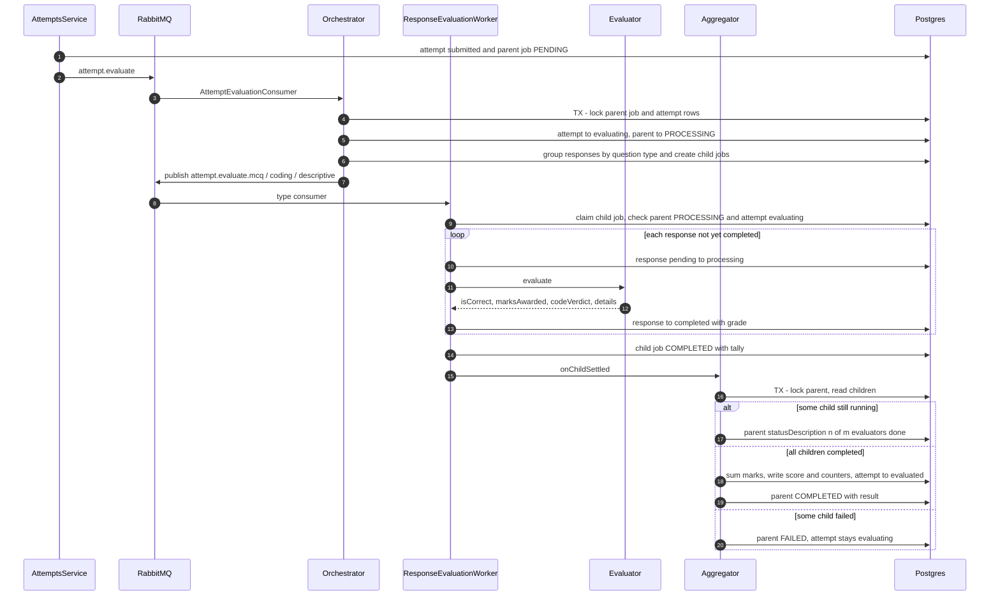
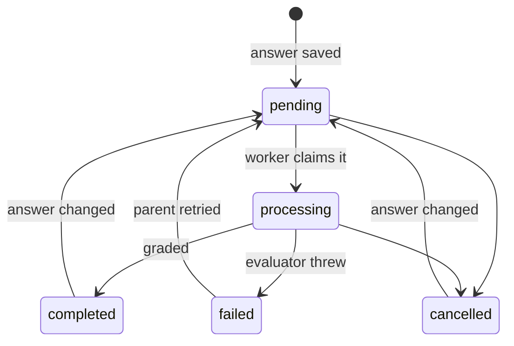
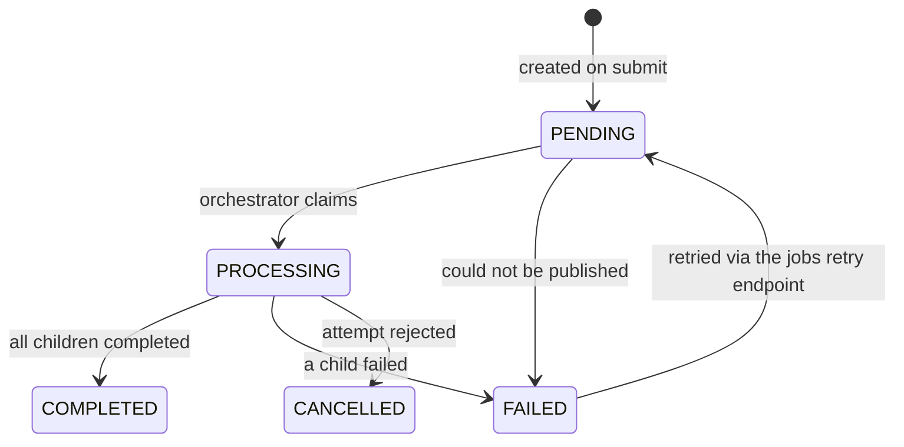

# Evaluation

## 1. Purpose

Evaluation turns a **submitted** attempt into an **evaluated** one. It grades every saved response, adds up the marks, and writes the score and counters onto the attempt.

Evaluation is **always asynchronous**. Nothing is graded during the test or inside the submit request. The submit call only queues a job, and RabbitMQ consumers do the work. This is because:

- coding answers must run against many test cases on an external code runner, which is slow
- descriptive answers are graded by an LLM, which is slow and can fail
- a failure should be retryable without making the user submit again

The code lives in `src/assessments/evaluation/`.

## 2. Key concepts

| Term | Meaning |
| --- | --- |
| Parent job | One `EVALUATE_ATTEMPT` row in `jobs` per submitted attempt. It tracks the whole evaluation. |
| Child job | One job per question type that has answers: `EVALUATE_MCQ_RESPONSES`, `EVALUATE_CODING_RESPONSES`, `EVALUATE_DESCRIPTIVE_RESPONSES`. Each has `parentJobId` set and a list of `responseIds`. |
| Orchestrator | `EvaluationOrchestratorService`. It runs the parent: claims the attempt, makes the children and publishes them. |
| Worker | `ResponseEvaluationWorker`. It runs one child: grades its responses one by one. |
| Evaluator | A class that implements `QuestionEvaluator` for one question type: `McqEvaluator`, `CodingEvaluator`, `DescriptiveEvaluator`. |
| Registry | `EvaluatorRegistry`. It maps a question type to its evaluator. Adding a type means adding an evaluator to the `EVALUATORS` provider list. |
| Aggregator | `EvaluationAggregatorService`. It is called whenever a child settles. When all children are done, it scores the attempt and settles the parent. |
| Snapshot | The `assessment_questions` row the response answers. It holds the answer key, test cases, checkpoints and marks for that assessment. |
| Settled job | A job in `COMPLETED`, `FAILED` or `CANCELLED`. |

## 3. Data used

See [ERD: Assessment Engine](../erd.md) and [ERD: Async Jobs](../erd.md).

- `assessment_attempts`: `status` moves `submitted -> evaluating -> evaluated`. `score`, `attempted_questions`, `correct_responses` and `incorrect_responses` are written at the end.
- `assessment_attempt_responses`: `evaluation_status`, `is_correct`, `marks_awarded`, `code_verdict`, `evaluation_result` (jsonb grading detail), `evaluated_at`.
- `assessment_questions` (+ type-specific content): `correctMarks`, `incorrectMarks`, MCQ `correctOptionId`, coding `testCases` / `timeLimitMs` / `memoryLimitMb`, descriptive `checkpoints`.
- `jobs`: the parent and child rows (`status`, `attempts`, `maxAttempts`, `statusDescription`, `result`, `error`, `parentJobId`).

## 4. Main flow: submit to result

Step by step:

1. **Submit** (see [attempts](attempts.md)) writes the attempt as `submitted`, creates the parent job (`maxAttempts = 3`), and publishes `{ jobId, attemptId, attemptUid, assessmentId, userId }` to exchange `attempt`, key `attempt.evaluate`.
2. **`AttemptEvaluationConsumer`** calls `EvaluationOrchestratorService.start`. In one transaction, with `SELECT ... FOR UPDATE` on the parent job and the attempt:
    - It drops the message if the job does not exist, has the wrong type, or is already settled (a redelivery).
    - If the attempt is gone, `rejected` or already `evaluated`, it cancels the parent and stops.
    - It moves the attempt `submitted -> evaluating` (`claimEvaluation`). An attempt already `evaluating` stays so, which is how a retry resumes.
    - It moves the parent to `PROCESSING` and increments `attempts`.
    - It groups the attempt's responses by question type. **No responses at all** means the attempt is scored right away (score 0) and the parent completes.
    - It creates one child job per type, or reuses an existing one: a `FAILED` child is reopened, a `PENDING` child is republished, and a `COMPLETED` or `PROCESSING` child is left alone.
3. After commit, each child is published to its own queue. A child that cannot be published is marked `FAILED` on the spot, and the aggregator is told so the parent does not wait forever.
4. **Per-type consumers** (`McqEvaluationConsumer`, `CodingEvaluationConsumer`, `DescriptiveEvaluationConsumer`) all call `ResponseEvaluationWorker.run`. The worker:
    - drops the message if the job does not exist, has the wrong type, is already settled, or its parent is no longer `PROCESSING`
    - **cancels** the child if the attempt is no longer `evaluating` (for example it was rejected), then tells the aggregator
    - grades each response that is not already `completed` or `cancelled`. Each grade is saved as soon as it is made, so a retry continues where it stopped
    - writes the child's `result` `{ graded, correct, incorrect, marksAwarded }` and completes it
5. **`EvaluationAggregatorService.onChildSettled`** locks the parent row, so only one caller finishes the evaluation:
    - any child still running: it only updates the progress text (`"1/3 evaluators done"`)
    - all children `COMPLETED`: `EvaluationService.evaluate` sums the grades, writes them onto the attempt, and moves it to `evaluated` (only if it is still `evaluating`)
    - any child not completed: the parent becomes `FAILED` with `error.failedChildren`, and the attempt stays `evaluating`
    - attempt rejected meanwhile: the parent is cancelled

Separate queues per type mean slow coding or LLM grading never holds up MCQ grading for other attempts.

## 5. Lifecycles

### 5.1 Response evaluation status

A response carries a grade (`isCorrect` and `marksAwarded`) **only** when it is `completed`. `assertGradeMatchesStatus` enforces this. A worker that finds a response already `processing` grades it again. This handles a redelivered message after a worker crashed mid-grade.

### 5.2 Parent job

## 6. Evaluators and marking rules

All marks are stored as `decimal(8,2)` and rounded to 2 decimal places. The marks come from the **question snapshot** (`question.correctMarks`, `question.incorrectMarks`).

| Type | Evaluator | How it decides | Marks | Negative marks |
| --- | --- | --- | --- | --- |
| MCQ | `McqEvaluator` | selected option equals `correctOptionId` | right: `correctMarks`. Wrong: `-abs(incorrectMarks)`. No option: 0 | Yes, only for a wrong pick |
| Coding | `CodingEvaluator` | runs code on **every** test case (hidden included), one after another | `correctMarks * passed / total` (partial credit) | Never |
| Descriptive | `DescriptiveEvaluator` | an LLM says which **checkpoints** the answer covers | sum of the weightage of completed checkpoints, as a percent of `correctMarks` (partial credit) | Never |

A question the user never answered (no response row) is not graded. It earns 0 and is not counted as attempted.

### 6.1 MCQ

- `gradeMcq` in `src/assessments/domain/response-invariants.ts`.
- `isCorrect` is true only for the right option.
- No details are stored (`evaluation_result` is null).

### 6.2 Coding

- Uses the shared `CODE_RUNNER` (see [code execution](code-execution.md)) with the question's `timeLimitMs` and `memoryLimitMb`.
- Empty or missing code: `wrong_answer`, 0 marks, no runs.
- Each case is judged by `judgeTestCase`: `passed`, `wrong_answer`, `time_limit_exceeded`, `memory_limit_exceeded`, or `runtime_error` (compile errors count as runtime errors). Output comparison is exact after normalising line endings, trailing spaces and trailing blank lines.
- `isCorrect` is true only when **all** cases pass. `codeVerdict` is `accepted`, or the verdict of the **first** failing case.
- `evaluation_result` stores, for each case: pass/fail, verdict, time, memory and, for failed cases, an error message, the input, the expected output and the program's output (clipped to 2,000 characters). The run time and memory stored on the response are the maximum across cases.
- What the **candidate** sees (`codingEvaluationOf`): pass/fail, verdict, time, memory and error per case. For a hidden case the error message never includes their output or stderr, because a program could echo the hidden input. **Reviewers** see everything.
- A `CodeRunnerError` (runner down, busy, not configured, unsupported language) is **not** a wrong answer. It fails the response and the child job so a retry can grade it later.

### 6.3 Descriptive (LLM-graded)

- Each descriptive question has **checkpoints** with integer weightages that sum to 100 (`assertCheckpointWeights`).
- A blank answer completes nothing and makes no LLM call.
- Otherwise `AiService.findCompletedCheckpoints` sends the question, the checkpoints and the answer (inside `<answer>` tags) to the model with structured output, temperature 0, and up to 2 tries. Any checkpoint id the model invents is rejected. See [AI](ai.md).
- The model is the **assessment creator's** plan model (`AiModelSelector.forUser(createdBy)`), and the call is audited against the creator, with the child job id.
- `scoreCheckpoints`: `scorePercent` is the sum of completed weightages. `marksAwarded = correctMarks * scorePercent / 100`. `isCorrect` is true when `scorePercent >= 60` (`DESCRIPTIVE_CORRECT_THRESHOLD_PERCENT`).
- `evaluation_result` stores each checkpoint (description, weightage, completed, marks) and `scorePercent`. The candidate sees this after evaluation.

### 6.4 Attempt totals

`EvaluationService.evaluate`, run inside the aggregator's transaction:

| Field | Value |
| --- | --- |
| `score` | sum of `marksAwarded` over `completed` responses (can be negative because of MCQ penalties) |
| `attempted_questions` | number of response rows (a blank descriptive answer still counts) |
| `correct_responses` | completed responses with `isCorrect = true` |
| `incorrect_responses` | completed responses with `isCorrect = false` |
| `status` | `evaluated`, only if the attempt is still `evaluating` (a conditional update) |

## 7. Failures, retries and re-evaluation

1. **Messages are always acked.** The consumers catch errors instead of rethrowing them, so a message is not requeued forever on a failure that may repeat (for example the runner being down). Retry is explicit.
2. **A child fails** when an evaluator throws. The response being graded becomes `failed`, and grades already saved in that child stay.
3. **The parent fails** once every child has settled and at least one did not complete. The attempt stays `evaluating`.
4. **The parent cannot start** (an error in the claim transaction): the parent is marked `FAILED`. Nothing else was written.
5. **The publish on submit fails:** the parent is `FAILED`, and the attempt stays `submitted`.
6. **Retry** is `POST /v1/jobs/:id/retry` on the **parent** job, by its owner. Retrying a child directly gives 409 "retry its parent job instead". The parent may run at most 3 times, and each child job also has `maxAttempts = 3`. On retry, the orchestrator keeps completed children, reopens failed ones (their `failed` responses go back to `pending`), and grades only what is left.
7. **Redelivery is safe.** Settled jobs are dropped, an `evaluating` attempt and `processing` responses are picked up again, and every status write is conditional on the status last read.
8. **Rejection during evaluation:** children cancel themselves, the parent is cancelled, and the attempt keeps `rejected`. If the rejection lands between the last grade and the final update, the conditional update leaves the attempt `rejected` and the parent completes with "Attempt was no longer evaluating".
9. **There is no re-evaluation of an `evaluated` attempt.** There is no endpoint or job type that re-grades a finished attempt (for example after a question fix). Only failed evaluations can be retried.

## 8. Async events, queues and notifications

All on exchange `attempt` (`src/config/rabbitmq/rabbitmq.constants.ts`). Routes for retries come from `src/jobs/job-routes.ts`.

| Routing key | Queue | Consumer | Job type |
| --- | --- | --- | --- |
| `attempt.evaluate` | `attempt-evaluation-queue` | `AttemptEvaluationConsumer` | `EVALUATE_ATTEMPT` (parent) |
| `attempt.evaluate.mcq` | `attempt-evaluation-mcq-queue` | `McqEvaluationConsumer` | `EVALUATE_MCQ_RESPONSES` |
| `attempt.evaluate.coding` | `attempt-evaluation-coding-queue` | `CodingEvaluationConsumer` | `EVALUATE_CODING_RESPONSES` |
| `attempt.evaluate.descriptive` | `attempt-evaluation-descriptive-queue` | `DescriptiveEvaluationConsumer` | `EVALUATE_DESCRIPTIVE_RESPONSES` |

Every message is `{ jobId, ...job.payload }`, so a retry can rebuild it from the job row. All consumers are marked `@Public()` so the global JWT guard skips them.

**Announcing results:** no WebSocket event and no email are sent when evaluation finishes or fails. Progress is visible only by polling:

- `GET /v1/attempts/:uid/result`: 400 until `evaluated`.
- `GET /v1/jobs/:id`: the parent job with its children (`statusDescription` such as `"2/3 evaluators done"`). The job id is not returned by submit, though.

See [realtime events](realtime-events.md) and [notifications](notifications.md).

## 9. Where the code lives

| Path | What |
| --- | --- |
| `src/assessments/evaluation/evaluation.module.ts` | Wires evaluators, registry, services and consumers |
| `src/assessments/evaluation/evaluation-orchestrator.service.ts` | Parent job: claim, fan-out, publish |
| `src/assessments/evaluation/response-evaluation.worker.ts` | Child job: claim, grade, complete |
| `src/assessments/evaluation/evaluation-aggregator.service.ts` | Settles the parent once all children settle |
| `src/assessments/evaluation/evaluation.service.ts` | Sums grades onto the attempt |
| `src/assessments/evaluation/evaluators/*.evaluator.ts` | MCQ, coding, descriptive grading |
| `src/assessments/evaluation/evaluator.registry.ts`, `evaluation.constants.ts` | Type-to-evaluator and type-to-job mapping, max attempts |
| `src/assessments/evaluation/consumers/` | RabbitMQ subscribers |
| `src/assessments/evaluation/interfaces/` | `QuestionEvaluator`, job payload and result shapes |
| `src/assessments/domain/response-*.ts`, `attempt-transitions.ts`, `descriptive-invariants.ts` | Status rules and scoring helpers |
| `src/jobs/` | Job rows, retry endpoint, `child-outcome.ts`, `job-routes.ts` |

## 10. Known gaps and TODOs found in code

1. **No completion notification.** Nothing pushes or emails the result. Clients must poll.
2. **The job id is hard to find.** `submitAttempt` returns `true`, not the job id, and there is no "list my jobs" endpoint. So a candidate cannot easily retry a failed evaluation through `POST /v1/jobs/:id/retry`.
3. **No automatic recovery.** No scheduler sweeps attempts stuck in `submitted` or `evaluating` after a failure. They stay there until someone retries the parent job by hand.
4. **Retry is billed like AI work.** `POST /v1/jobs/:id/retry` is rate-limited under the `AI_GENERATION` scope with cost 5 (`src/jobs/jobs.controller.ts:76`), even for an MCQ-only evaluation.
5. **No re-grading** of evaluated attempts (for example after an answer key fix).
6. **`checkerType` is ignored.** Coding questions store a `checkerType` (default `exact`), but grading always uses the exact comparison (`src/code-execution/judge-test-case.ts:19`).
7. **Descriptive grading is tied to the creator.** It runs on the assessment creator's plan model (`AI_MODEL` feature) and the LLM call is audited against the creator, not the candidate (`descriptive.evaluator.ts:43-57`). Keep this in mind when reading AI usage and audit data.
