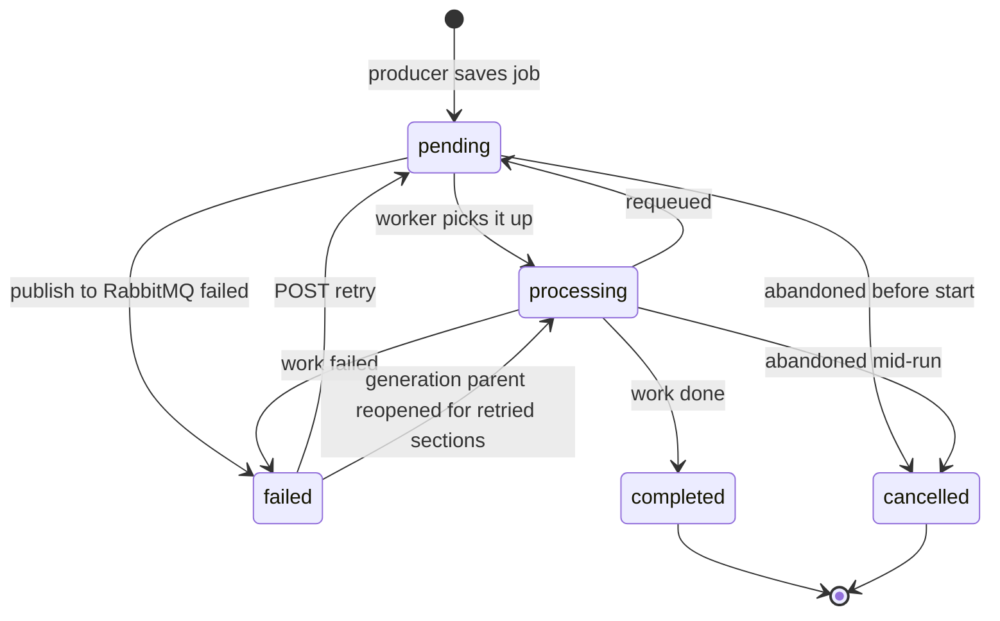
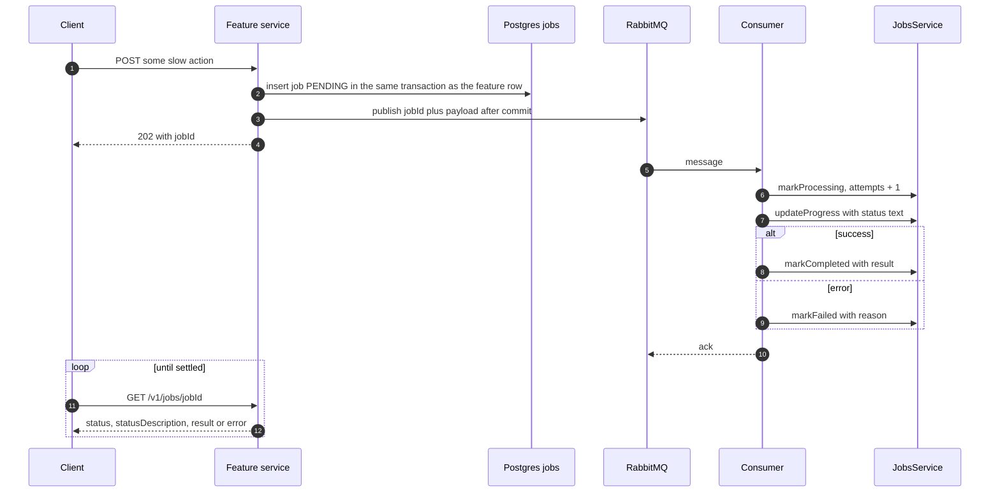
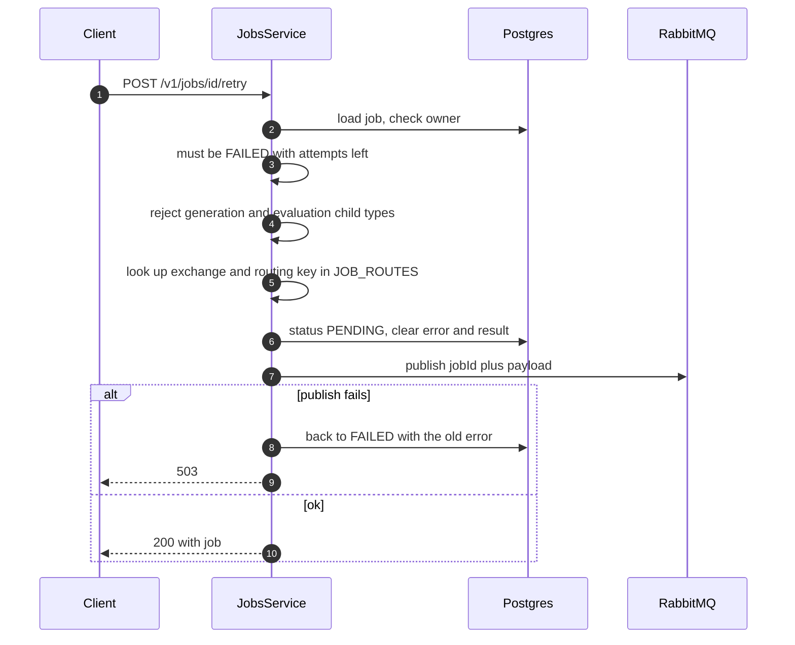

# Jobs and Schedulers

## 1. Purpose

Some work is too slow for an HTTP request: asking an LLM for questions, grading an attempt, building a roadmap, or importing a CSV of invitations. TestFlow does this work in the background:

1. The API saves a **job** row in Postgres.
2. It publishes a message to **RabbitMQ**.
3. A **consumer** (a worker) picks the message up, does the work, and updates the job row.
4. The client **polls** the job through `GET /v1/jobs/:id`.

The `jobs` module (`src/jobs/`) owns the job record, its state rules, and the polling and retry API. It does not own any worker. Workers live in the feature modules.

The `schedulers` module (`src/schedulers/`) owns every timed (cron) task. Today there is one.

## 2. Key concepts

| Term | Meaning |
|---|---|
| Job | One row in `jobs`. It tracks one unit of background work from start to finish. |
| Producer | Code that creates a job row and publishes its message (for example `LearningRoadmapsService.create`). |
| Consumer / worker | A class with a `@RabbitSubscribe` handler that does the work and settles the job. |
| Settled | A job that is `completed`, `failed` or `cancelled`. It will not change on its own. |
| Claimable | A job that is `pending` or `processing`. A worker may still pick it up. |
| Parent job | A job that only tracks child jobs (`GENERATE_ASSESSMENT`, `EVALUATE_ATTEMPT`). Children point to it with `parent_job_id`. |
| Attempts | How many times a worker has picked the job up. `max_attempts` is the budget for manual retries. |
| `CONSUMER` env var | When `false`, the instance only publishes messages and does not run consumers. Use this to split API and worker instances. |

## 3. Data

The table is `jobs`. See [ERD](../erd.md) for the full definition. The important columns are:

| Column | Meaning |
|---|---|
| `id` | `bigint`. Returned to clients as a string. |
| `type` | A `JobType` value (stored as `varchar`). |
| `queue` | A label for the job family, for example `roadmap`, `assessment-generation`, `attempt-evaluation`, `organization-invitations`. It is not the RabbitMQ queue name. |
| `status` | `JobStatus` enum. |
| `payload` | The message body, without `jobId`. Must include `userId` (see section 6). Never returned to clients. |
| `result` / `error` | JSON set when the job settles. |
| `status_description` | A short progress text for the UI, for example "Saving roadmap nodes and links". |
| `attempts` / `max_attempts` | Pick-up count and retry budget. |
| `parent_job_id` | Link to a parent job. Deleting the parent deletes the children (`CASCADE`). |
| `idempotency_key` | Optional. Unique per `created_by`. Used by assessment generation to make repeated create requests safe. Never returned to clients. |
| `created_by` | The user. `SET NULL` if the user is deleted, so the job stays as an audit record. |
| `started_at` / `completed_at` | Timestamps. |

### Job types

| `JobType` | Created by | Parent? | Retry through |
|---|---|---|---|
| `CREATE_ASSESSMENT` | Prompt-based generation, `AssessmentsService.generate` (also used for roadmap practice nodes). Consumed by `QuestionGenerationConsumer`. | No | `POST /v1/jobs/:id/retry` |
| `GENERATE_ASSESSMENT` | Assessment generation | Yes, of the three section types | `POST /v1/assessments/:id/generation/retry` |
| `GENERATE_MCQ_SECTION` / `GENERATE_CODING_SECTION` / `GENERATE_DESCRIPTIVE_SECTION` | Assessment generation, one per section | Child | Through the assessment |
| `EVALUATE_ATTEMPT` | Attempt submit | Yes, of the three evaluate types | `POST /v1/jobs/:id/retry` on the parent |
| `EVALUATE_MCQ_RESPONSES` / `EVALUATE_CODING_RESPONSES` / `EVALUATE_DESCRIPTIVE_RESPONSES` | Evaluation fan-out | Child | Through the parent |
| `ANALYZE_ROADMAP_INTENT` / `GENERATE_ROADMAP` / `MODIFY_ROADMAP_GRAPH` | Learning roadmaps | No | `POST /v1/jobs/:id/retry` |
| `IMPORT_ORG_INVITATIONS` | Organization CSV invitation import | No | `POST /v1/jobs/:id/retry` |

See [Assessment Generation](assessment-generation.md), [Evaluation](evaluation.md), [Learning Roadmaps](learning-roadmaps.md) and [Organizations](organizations.md) for each flow.

## 4. Lifecycle

These rules live in `src/jobs/domain/job-transitions.ts` (`JOB_TRANSITIONS`). Helper functions (`startJob`, `completeJob`, `failJob`, `cancelJob`, `requeueJob`, `reopenJob`) throw a conflict error if a move is not allowed.

Other domain helpers:

- `claimJob(status)`: `pending → processing`. If the job is already `processing`, it stays so. This is how a worker recovers a message that was redelivered after another worker crashed.
- `isClaimable(status)`: true for `pending` and `processing`. Workers use it to drop redelivered messages for jobs that are already settled.
- `assertRetryable(status, budget)`: only a `failed` job with `attempts < max_attempts` can be retried.
- `childOutcome(statuses)` in `src/jobs/domain/child-outcome.ts`: a parent is `running` while any child is unsettled, `completed` when all children completed, and `failed` otherwise. `childrenToRetry` returns the children that did not complete, so a retry only re-runs those.

## 5. Flows

### 5.1 Produce, consume, poll

The pattern every producer follows:

1. **Write first, publish second.** The job row is saved in the same transaction as the feature's own rows. The message is published only after the commit. If it were published first, a fast worker could read the job before it exists.
2. **The message is `{ jobId, ...payload }`.** Nothing else is stored. This is what makes generic retry possible (section 5.2).
3. **If publish fails**, the producer marks the job `failed`, walks the feature row back to a safe status, and returns `503`.

The pattern every worker follows:

1. Mark the job `processing` (`markProcessing` also adds 1 to `attempts`).
2. Write short progress text with `updateProgress`.
3. Settle with `markCompleted(result)` or `markFailed(reason)`.
4. **Catch errors instead of re-throwing them.** The message is acked either way. A failure that will happen again (a bad LLM output, a malformed file) would otherwise loop forever.

### 5.2 Manual retry

- The route for each type is in `src/jobs/job-routes.ts` (`JOB_ROUTES`). The map is typed so that adding a new job type without a route is a compile error.
- `attempts` is not increased by retry. It goes up only when a worker actually picks the message up.
- Generation jobs are refused here and must use `POST /v1/assessments/:id/generation/retry`. Evaluation child jobs are refused here, and the caller must retry the `EVALUATE_ATTEMPT` parent.
- Retry uses the same rate limit as creating AI work (CLASS_B, scope `AI_GENERATION`, cost 5). A retry should not be a cheaper way to run the LLM.

## 6. Rules and edge cases

| Situation | Behaviour |
|---|---|
| Job id is not numeric | `400` "Invalid job id" |
| Job not found | `404` |
| `payload.userId` is not the caller | `403` |
| `payload.userId` is missing | **No ownership check.** Any logged-in user can read the job. This is why every producer must put `userId` in the payload. |
| Retry a job that is not `failed` | `409` |
| Retry with no attempts left | `409` |
| Retry a job with an unknown type or no payload | `409` |

The response leaves out `payload` and `idempotency_key`. For `GENERATE_ASSESSMENT` and `EVALUATE_ATTEMPT` parents, it adds a `sections` array. Each item has the child `jobId`, `sectionId`, `questionType`, `status`, `statusDescription`, attempts and `error`. One poll shows the progress of every child.

## 7. RabbitMQ setup, retry and dead letters

Configured in `src/config/rabbitmq/rabbitmq.module.ts` with `@golevelup/nestjs-rabbitmq`.

| Exchange (topic) | Routing key → queue |
|---|---|
| `question.generation` | `question.generate` → `question-generation-queue`; `question.section.mcq` / `.coding` / `.descriptive` → `question-section-<type>-queue` |
| `attempt` | `attempt.evaluate` → `attempt-evaluation-queue`; `attempt.evaluate.mcq` / `.coding` / `.descriptive` → `attempt-evaluation-<type>-queue` |
| `roadmap` | `roadmap.analyze` / `.generate` / `.modify` → `roadmap-analysis-queue` / `roadmap-generation-queue` / `roadmap-modification-queue` |
| `organization` | `organization.invitations.import` → `organization-invitation-import-queue` |

Each question type has its own queue, so slow coding work never holds up MCQ work.

**Retry and dead-letter behaviour:**

- **No dead-letter exchange is configured.** No queue sets `x-dead-letter-exchange`, and there is no retry queue with a delay.
- **No automatic retry.** The library's default on a thrown error is to nack and **requeue** the message. Because workers catch their errors and mark the job `failed`, messages are acked and not requeued. Failed jobs stay `failed` until someone calls the retry endpoint.
- **Redelivery after a crash.** If a worker process dies before it acks, RabbitMQ redelivers the message. Workers that use `isClaimable` / `claimJob` (evaluation, invitation import) handle this safely. The roadmap consumers do not check this (see section 10).
- `connectionInitOptions: { wait: false }` means the app starts even when RabbitMQ is down. The health check reports `rabbitmq: down` until it connects.
- RabbitMQ handlers run through the same global guards as HTTP. Each consumer class is marked `@Public()` so `JwtAuthGuard` lets it through, and `RateLimitGuard` skips non-HTTP contexts.

## 8. Schedulers

All cron tasks are registered in `src/schedulers/`, and nowhere else. A feature module owns the work. The scheduler only calls an exported service at the right time. `ScheduleModule.forRoot()` from `@nestjs/schedule` is imported only in `SchedulersModule`.

| Name | Schedule | Class | What it does |
|---|---|---|---|
| `newsletter-dispatch` | Every minute (`CronExpression.EVERY_MINUTE`) | `NewsletterScheduler.dispatchDueNewsletters` | Calls `NewslettersDispatchService.dispatchDue()`, which claims newsletters whose `scheduled_at` has passed and emails all subscribers. See [Platform Services](platform-services.md#newsletters). |

Details:

- **Off switch:** set `NEWSLETTER_SCHEDULER_ENABLED=false` on machines that share a database but must not send mail (a dev laptop, a restored production snapshot).
- **Errors** are caught and logged, so a failed tick does not become an unhandled rejection. The next tick runs as normal.
- **Multiple instances.** Every instance runs the cron. This is safe because claiming uses `FOR UPDATE SKIP LOCKED`. Two instances never claim the same newsletter. Inside one instance, a `dispatchInFlight` flag stops overlapping ticks.
- Newsletters are not `jobs` rows. They keep their own status on the `newsletters` table.

## 9. Endpoints summary

Full details are in [API v1](../api-design/v1.md).

| Method and path | Purpose | Rate limit |
|---|---|---|
| `GET /v1/jobs/:id` | Job status, result or error, plus `sections` for parents | CLASS_C |
| `POST /v1/jobs/:id/retry` | Requeue a failed job | CLASS_B, scope `AI_GENERATION`, cost 5 |

Both need login. Ownership is checked through `payload.userId`.

## 10. Where the code lives

| Path | What it does |
|---|---|
| `src/jobs/jobs.controller.ts` | Poll and retry endpoints |
| `src/jobs/jobs.service.ts` | `markProcessing`, `updateProgress`, `markCompleted`, `markFailed`, `findOne`, `findSections`, `retry` |
| `src/jobs/job-routes.ts` | Job type → exchange and routing key |
| `src/jobs/domain/` | States, allowed transitions, invariants, parent/child outcome |
| `src/jobs/serializers/jobs.serializer.ts` | Response shape (hides payload) |
| `src/common/entities/job.entity.ts` | `Job` entity |
| `src/common/enums/jobs.enums.ts` | `JobType`, pipeline type groups |
| `src/config/rabbitmq/` | Exchanges, queues, routing keys |
| `src/schedulers/` | `SchedulersModule` and `NewsletterScheduler` |

## 11. Known gaps and TODOs

- **No dead-letter queue and no automatic retry with backoff.** Transient errors (an LLM timeout, a short network blip) fail the job at once. A person must retry it.
- **Ownership depends on the payload.** A job without `payload.userId` can be read by any logged-in user. A check on `created_by` would be safer.
- **`markProcessing` does not check transitions.** It writes `processing` without reading the row. The roadmap consumers call it without first checking `isClaimable`, so a redelivered message for a settled roadmap job would reopen it.
- **`cancelled` has no API.** Only internal evaluation code cancels jobs. There is no user-facing cancel endpoint.
- **No cleanup.** Old job rows are never deleted or archived.
- **No stuck-job sweeper.** A job left in `processing` (for example, after a worker crash with no redelivery) stays that way. No scheduler finds or fails it.
