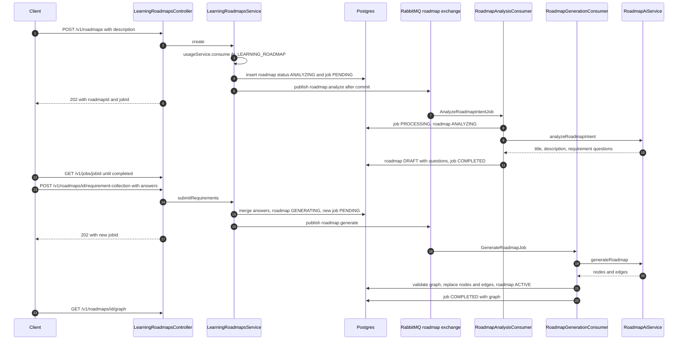
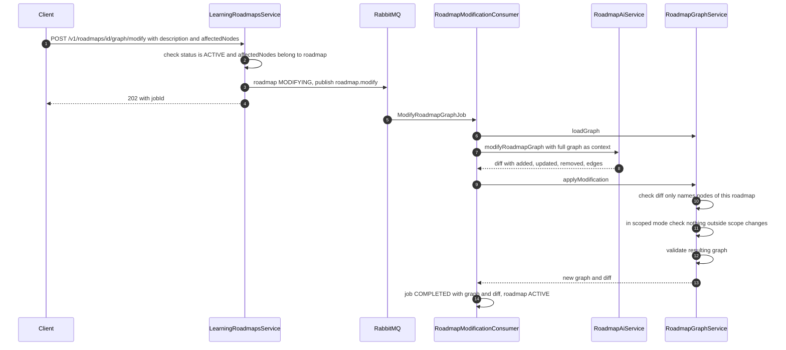
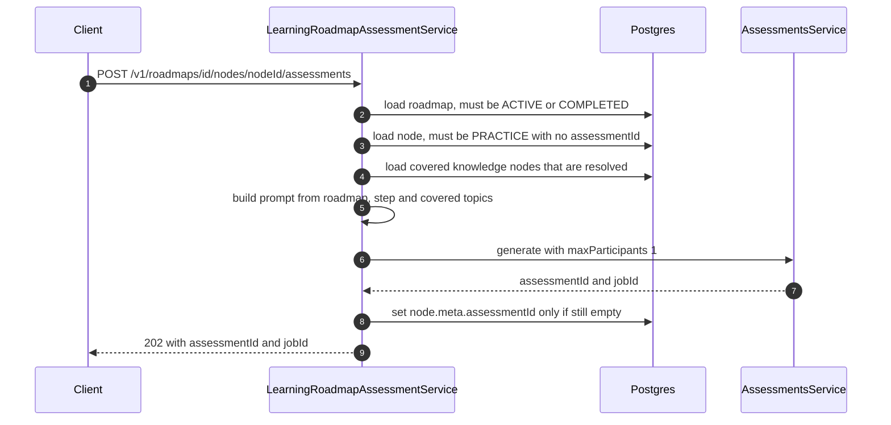
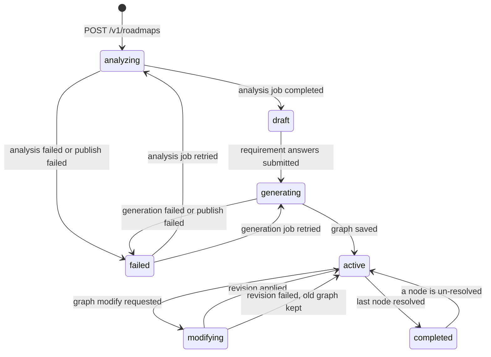

# Learning Roadmaps

## 1. Purpose

A **learning roadmap** is a personal study plan. The learner types a goal in plain words, for example "I want to become a backend engineer". The system then:

1. Asks the AI to understand the goal and come up with a few **requirement questions** (for example "How much time can you spend per week?").
2. Takes the learner's answers and asks the AI to build a **graph** of study steps.
3. Lets the learner mark steps as done, revise the graph in natural language, and generate a practice **assessment** for practice steps.

Each roadmap belongs to exactly one user. Roadmaps are not shared and are not tied to an organization.

All AI work runs in the background through RabbitMQ. HTTP calls return quickly with a **job id**, and the client polls `GET /v1/jobs/:id` (see [Jobs and Schedulers](jobs-and-schedulers.md)).

## 2. Key concepts

| Term | Meaning |
|---|---|
| Roadmap | One learner's plan. Has a `status`, a `title`, a `description`, a `meta` JSON blob, and a free-text `notepad`. |
| Node | One step in the plan. A node is either a **knowledge** node (something to learn) or a **practice** node (a check on what was learned). |
| Edge | A directed link `from → to` between two nodes. It means "do this before that". |
| Entry node | The single node with no incoming edge. This is where the learner starts. |
| Cursor | `current_node_id` on the roadmap. It points at the step the learner is working on. |
| Requirement questions | Questions the AI asks after reading the goal. Stored in `roadmap.meta.requirementQuestions`. |
| Resolved node | A node whose status is `completed` **or** `skipped`. Both count as "done" (`RESOLVED_NODE_STATUSES`). |
| Template | A ready-made goal text (name, description, goal) that a client can show as a starting point. |
| Scoped modification | A revision request that names `affectedNodes`. Only those nodes (and new nodes next to them) may change. |

### Graph rules

The roadmap is a **DAG** (directed acyclic graph). Before anything from the AI is saved, `RoadmapGraphService.assertValidGraph` checks that:

- There is at least one node.
- Every node has a known type (`knowledge` or `practice`) and a non-empty title.
- Every `positionIndex` is a whole number of 0 or more, and no two nodes share one.
- Every edge points at nodes that exist, with no self-loops and no duplicate edges.
- There are no cycles (checked with Kahn's algorithm).
- There is **exactly one** entry node, and every node can be reached from it.

If any rule fails, the job fails with a `422`-style message: "The generated roadmap was not usable: ...". Nothing is written.

### Node `meta`

| Node type | Useful `meta` fields |
|---|---|
| knowledge | `resources` (title, url, kind), `estimatedMinutes`, `concepts` |
| practice | `coversNodeIds` (the knowledge nodes this step checks), `questionCount`, `assessmentId` (set once an assessment is generated) |

Edges may carry `meta.label` and an optional `meta.condition` (for example "score >= 70"). The condition is stored but not enforced by the backend today.

## 3. Data

Tables: `learning_roadmaps`, `learning_roadmap_nodes`, `learning_node_edges`, `learning_roadmap_templates`. See [ERD](../erd.md) for columns and keys.

A few points worth knowing:

- `learning_roadmaps.meta` is always **merged**, never replaced. It keeps `rawDescription` (what the user typed), all job ids, the requirement answers, and an audit trail of each LLM run (`analysis`, `generation`, `modifications[]` with model, prompt version, and diff counts).
- `notepad` is `select: false`. Only the two notepad endpoints load it.
- `current_node_id` is `ON DELETE SET NULL`. The modification code re-anchors it so the learner does not lose their place (see section 6).
- `learning_roadmaps.job_id` holds the id of the most recent job for that roadmap.

## 4. Flows

### 4.1 Create, analyse, answer, generate

This is the main flow. It has two AI stages with a human step in between.

Step by step:

1. **Create.** `POST /v1/roadmaps` first spends one unit of the `AI_LEARNING_ROADMAP` plan quota (see [Commerce](commerce.md)). It then saves the roadmap in `analyzing` status and a `jobs` row of type `ANALYZE_ROADMAP_INTENT` in one transaction.
2. **Publish after commit.** The RabbitMQ message is sent only after the transaction commits. If the publish fails, the job is marked `failed`, the roadmap is set to `failed`, and the API returns `503`.
3. **Analyse.** The consumer calls the LLM. The model is chosen per user by `AiModelSelector.forUser`. On success the roadmap gets its title, description and questions, and moves to `draft`.
4. **Answer.** The client sends answers keyed by question `id`. Unknown ids are rejected with `400`. Answers are trimmed and merged into the stored questions. The client cannot change the original description.
5. **Generate.** The consumer asks the LLM for a graph, validates it, deletes any old nodes and edges, and inserts the new ones. The cursor is set to the entry node, and the roadmap becomes `active`.

For LLM graph and prompt details, see [AI](ai.md).

### 4.2 Revise the graph in natural language

Key points:

- The AI returns a **diff**, not a full new graph. Surviving nodes are updated in place, so they keep their ids and the learner's progress.
- Nodes are removed only when the diff lists them in `removed`.
- Edges are fully replaced by the diff's `edges` list.
- Even in scoped mode, the AI sees the whole graph. Otherwise a local edit could break the path around it.
- The job result contains both the new `graph` and a `diff` (added, updated, removed node summaries). The client should show the diff, so a revision never changes the plan silently.
- Each revision is logged in `roadmap.meta.modifications[]`.

### 4.3 Track progress

`PUT /v1/roadmaps/:id/nodes/:nodeId/progress` with `{ status }` is the only way a learner changes a node. In one transaction it:

1. Sets the node status. `completed_at` is stamped when entering `completed` and cleared when leaving it.
2. If the new status is `in_progress`, moves the roadmap cursor to this node.
3. Re-counts nodes. If every node is resolved, the roadmap becomes `completed`. If not, it goes back to (or stays) `active`.

Progress can only be written while the roadmap is `active` or `completed`. During `modifying` it returns `409`, because the revision may be rewriting the same rows.

### 4.4 Generate a practice assessment for a node

This is the link between roadmaps and [Assessments](assessments.md).

Rules:

- Only **practice** nodes can have an assessment (`400` otherwise).
- A node gets at most one assessment. A second call returns `409`. The final link uses a conditional `UPDATE ... WHERE meta->>'assessmentId' IS NULL`, so two parallel calls cannot both win.
- Covered topics are the knowledge nodes in `meta.coversNodeIds`. If that list is empty, it uses every knowledge node with a lower `positionIndex`. Only **resolved** nodes are used, so the test never covers material the learner has not reached.
- If no covered node is resolved yet, the call returns `409` ("Complete at least one knowledge node...").
- Skipped topics are marked "(self-declared)" in the prompt, so the AI checks them instead of assuming them.
- The prompt is capped at 5,000 characters. Topics that do not fit are dropped, and a warning is logged.
- The assessment is a normal solo assessment (`maxParticipants = 1`). Its question generation follows [Assessment Generation](assessment-generation.md).

### 4.5 Notepad

`GET` and `PUT /v1/roadmaps/:id/notepad` read and overwrite one free-text note per roadmap (up to 20,000 characters). The notepad can be written in **any** roadmap status.

### 4.6 Templates

A template is a reusable starting goal. It has `uid` (a public 8-character id), `slug`, `name`, `description`, `goal`, `visibility` (`public` or `private`), and `isActive`.

- `GET /v1/roadmap-templates` is **public** (no login). It lists only active public templates, with cursor paging and an optional `search` on name and description.
- Any logged-in user can create a template. It is private by default, and the caller owns it.
- Only the owner can update or delete it. Delete is a soft delete.
- The slug comes from the name unless one is given. It must be unique (`409` otherwise).
- A template does **not** create a roadmap by itself. The client takes the template's `goal` text and sends it to `POST /v1/roadmaps`.

**Seeding:** `npm run seed:roadmap-templates` runs `src/scripts/seed-learning-roadmap-templates.ts`. It reads the seed list from `src/config/database/dummy-data/learning-roadmap-templates`. It is idempotent by slug: existing templates are skipped and never changed. Flags: `--owner-email <email>` (defaults to the `system` user) and `--dry-run`.

## 5. Lifecycle

Notes:

- A failed **modification** returns the roadmap to `active`, never `failed`. The old graph is still there because the database transaction rolled back.
- A `completed` roadmap cannot be revised. A modify request returns `409`.
- `archived` exists in the enum and blocks modification, but **no code path sets it today**.
- A `failed` roadmap can recover only by retrying its failed job with `POST /v1/jobs/:id/retry`. The consumer sets the in-flight status again when it picks up the retried message.

Node status: `not_started` → `in_progress` → `completed` or `skipped`. The learner may set any of the four at any time.

## 6. Rules and edge cases

| Situation | Behaviour |
|---|---|
| Read a roadmap that belongs to someone else | `404`. The `userId` filter is part of the query, so the API does not reveal that it exists. |
| Write (answers, modify) to someone else's roadmap | `404` if missing, `403` if it belongs to another user. |
| Submit answers while still `analyzing` | `409` "Analysis still in progress". |
| Submit answers after generation started | `409` "Generation already started". |
| Modify when status is not `active` | `409` with a reason (no graph yet, already modifying, archived, completed). |
| `affectedNodes` includes a node from another roadmap | `400`. |
| AI title longer than 255 characters | Cut to 255 before saving. |
| Revision removes the learner's current node | The cursor moves to the nearest surviving ancestor in the old graph. If none exists, it moves to the new entry node. |
| Regeneration | `applyGeneration` deletes all old nodes and edges first, so graphs never stack. |
| `GET /:id/graph` before generation | `200` with empty `nodes` and `edges` and the current status, so the client can show a "pending" state. |
| Client lost the job id | `GET /v1/roadmaps/:id` returns the roadmap with its job ids in `meta`. |

Every roadmap job payload includes `userId`. This matters because `JobsService.findOne` uses `payload.userId` to decide who may poll a job.

## 7. Endpoints summary

Full details are in [API v1](../api-design/v1.md).

| Method and path | Purpose | Rate limit |
|---|---|---|
| `POST /v1/roadmaps` | Create and start analysis (202) | CLASS_B, scope `AI_GENERATION`, cost 3 |
| `POST /v1/roadmaps/:id/requirement-collection` | Submit answers, start generation (202) | CLASS_B, `AI_GENERATION`, cost 5 |
| `POST /v1/roadmaps/:id/graph/modify` | Natural-language revision (202) | CLASS_B, `AI_GENERATION`, cost 5 |
| `GET /v1/roadmaps` | List own roadmaps (cursor paging, `status` filter, progress counts) | CLASS_B |
| `GET /v1/roadmaps/:id` | Detail, questions, job ids | CLASS_B |
| `GET /v1/roadmaps/:id/graph` | Full graph | CLASS_B |
| `GET /v1/roadmaps/:id/nodes/:nodeId` | One node with incoming and outgoing node ids | CLASS_B |
| `PUT /v1/roadmaps/:id/nodes/:nodeId/progress` | Set node status | CLASS_B |
| `POST /v1/roadmaps/:id/nodes/:nodeId/assessments` | Generate practice assessment (202) | CLASS_B, `AI_GENERATION`, cost 5 |
| `GET` / `PUT /v1/roadmaps/:id/notepad` | Read or replace notepad | CLASS_B |
| `GET /v1/roadmap-templates` | Public list of templates | CLASS_B (by IP when not logged in) |
| `POST /v1/roadmap-templates` | Create template | CLASS_B |
| `PATCH` / `DELETE /v1/roadmap-templates/:uid` | Owner updates or deletes | CLASS_B |

The AI assistant can also read roadmaps through three tools (`LIST_ROADMAPS`, `GET_ROADMAP`, `GET_ROADMAP_NODE`) in `src/ai/tools/roadmap.tools.ts`. See [AI Assistant](ai-assistant.md).

## 8. Async events

All three stages share the `roadmap` topic exchange, but each has its own queue. They fail in different ways, so they do not share a consumer.

| Job type | Routing key | Queue | Consumer | On failure |
|---|---|---|---|---|
| `ANALYZE_ROADMAP_INTENT` | `roadmap.analyze` | `roadmap-analysis-queue` | `RoadmapAnalysisConsumer` | roadmap `failed` |
| `GENERATE_ROADMAP` | `roadmap.generate` | `roadmap-generation-queue` | `RoadmapGenerationConsumer` | roadmap `failed` |
| `MODIFY_ROADMAP_GRAPH` | `roadmap.modify` | `roadmap-modification-queue` | `RoadmapModificationConsumer` | roadmap back to `active` |

- `jobs.queue` is `roadmap` for all three. `maxAttempts` is 3.
- Each consumer catches every error, marks the job `failed`, and acks the message. RabbitMQ does not redeliver it. A retry is always manual through `POST /v1/jobs/:id/retry`.
- Progress text for the client is written to `jobs.status_description` (for example "Analyzing learning intent", then "Saving requirement questions").
- No Socket.IO events are sent for roadmaps. Clients poll the job.

## 9. Where the code lives

| Path | What it does |
|---|---|
| `src/learning-roadmaps/learning-roadmaps.controller.ts` | Roadmap HTTP endpoints |
| `src/learning-roadmaps/learning-roadmaps.service.ts` | Create, answers, modify (job producers), reads, progress, notepad, assistant reads |
| `src/learning-roadmaps/roadmap-graph.service.ts` | Graph validation, apply generation, apply diff, cursor re-anchoring, graph response building |
| `src/learning-roadmaps/learning-roadmap-assessment.service.ts` | Practice-node assessment generation |
| `src/learning-roadmaps/learning-roadmap-templates.controller.ts` and `.service.ts` | Templates |
| `src/learning-roadmaps/consumers/` | The three RabbitMQ consumers |
| `src/learning-roadmaps/interfaces/` | Job payloads, `RoadmapMeta`, planned-graph types |
| `src/learning-roadmaps/serializers/learning-roadmaps.serializer.ts` | Response shapes |
| `src/learning-roadmaps/tdd.md` | The original technical design (referenced as "TDD §x" in code comments) |
| `src/ai/roadmap-ai.service.ts` | LLM calls for analyse, generate, modify |
| `src/common/enums/learning-roadmaps.enums.ts` | `RoadmapStatus`, `NodeStatus`, `NodeType`, `RoadmapTemplateVisibility` |
| `src/scripts/seed-learning-roadmap-templates.ts` | Template seeder |

## 10. Known gaps and TODOs

- **No `archived` transition.** The status exists and is checked, but no endpoint archives a roadmap. There is also no delete endpoint for roadmaps.
- **Quota is not refunded on failure.** `create` spends `AI_LEARNING_ROADMAP` before the job runs. If publishing or analysis fails, the unit is not given back. (Assessment generation does refund through `usageService.release`.)
- **Consumers do not check if a job is still claimable.** Unlike the evaluation and invitation-import workers, the roadmap consumers call `markProcessing` without `isClaimable`. A redelivered message for a settled job would be processed again.
- **Edge conditions are not enforced.** `meta.condition` on edges (for example a minimum score) is stored, but nothing reads it.
- **`getResolvedNodes` is unused.** It exists in `LearningRoadmapsService` but no controller or tool calls it.
- **Feature flag is UI-only.** The `learning_roadmaps` flag hides the section in the client, but these endpoints do not check it (see [Platform Services](platform-services.md#feature-flags)).
- **Debug logging.** Both the analysis and generation consumers contain a leftover `console.log` of the full LLM output.
