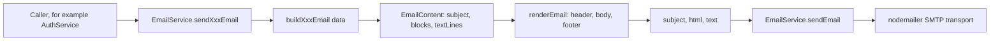
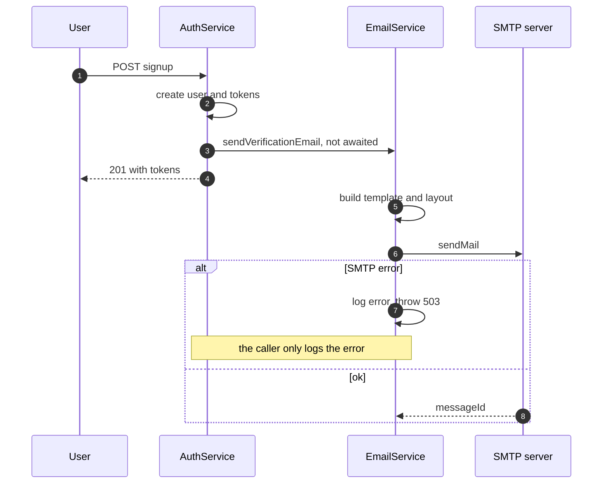

# Notifications (Email)

## 1. Purpose

The notifications module sends every email the platform sends. Today email is the only channel. There is no SMS, push or in-app inbox. (For live browser updates, see [Realtime Events](realtime-events.md).)

The module has three jobs:

1. **Send** email through SMTP (`EmailService`).
2. **Render** emails from typed, code-based templates that share one layout.
3. **Preview** those templates for admins, without sending anything (`EmailPreviewService` and the admin controller).

The emails carry the product brand **RealPrep** in subjects, header and footer.

## 2. Key concepts

| Term | Meaning |
|---|---|
| Transport | The SMTP connection made with `nodemailer`. One is created when the app starts. |
| Template | A TypeScript function such as `buildVerificationEmail(data)` that returns `{ subject, html, text }`. Templates are **code**, not database rows. |
| Content | What a template produces before the layout is added: subject, preheader, category, footnote, a list of blocks, and plain-text lines. |
| Block | A reusable body piece from `email-blocks.ts`: `intro`, `paragraph`, `primaryAction` (button), `divider`, `linkFallback`, `callout`, `steps`, `detailPanel`, `prose`. |
| Layout | `renderEmail()` wraps content in the shared page, header (wordmark plus category) and footer, for both HTML and plain text. |
| Theme | `email-theme.ts` copies the frontend design tokens as literal values, because CSS variables do not work in most mail clients. |
| Fire-and-forget | The caller starts the send but does not wait for it. A failure is logged and never fails the user's request. |

## 3. Data

The module has **no tables of its own**. Templates live in code under `src/notifications/email/templates/`. There are no database-stored email templates. The "email templates" admin API only lists and previews the code templates.

Related data owned by other modules:

- `users.is_newsletter_subscribe` decides who gets newsletters.
- `users.last_verification_email_sent_at` throttles verification resends.
- The `newsletters` table holds newsletter content and delivery counts (see [Platform Services](platform-services.md#newsletters)).

See [ERD](../erd.md).

## 4. Configuration

| Env var | Required | Default | Use |
|---|---|---|---|
| `SMTP_HOST` | Yes | – | SMTP server |
| `SMTP_PORT` | No | `587` | SMTP port |
| `SMTP_SECURE` | No | `false` | `true` for implicit TLS (port 465) |
| `SMTP_USER` / `SMTP_PASSWORD` | Yes | – | SMTP login |
| `EMAIL_FROM` | Yes | – | The `From` address on every email |
| `FRONTEND_URL` | No | `https://app.testflow.com` | Base for every link in emails |

The provider is whatever SMTP server these point to. No provider-specific SDK is used. If a required value is missing, the app fails at startup because `EmailService` uses `getOrThrow`.

## 5. The template system

How to read the files:

- `templates/<name>-email.template.ts`: one file per email. Each exports a `build<Name>EmailContent` (content only) and a `build<Name>Email` (content plus layout).
- `templates/email-blocks.ts`: body building blocks. Everything is table-based HTML with inline styles, because that is the only thing every mail client renders the same way. User-supplied text is passed through `escapeHtml`.
- `templates/layout/`: `email-layout.ts` (`renderEmail`), `email-header.ts`, `email-footer.ts`, `email-styles.ts` (one `<style>` block for dark mode and small screens) and `email-layout.constants.ts`.
- `templates/email-theme.ts`: colours, fonts and spacing.
- `email-template-previews.ts`: sample data for each template, used only by the preview API.

**To add a new email:**

1. Create `templates/<name>-email.template.ts` using blocks and `renderEmail`.
2. Add a `send<Name>Email` method to `EmailService` that builds the links and calls `sendEmail`.
3. Add an entry to `EMAIL_TEMPLATE_PREVIEWS` so admins can preview it.

## 6. Every email the system sends

Found by searching every caller of `EmailService` in `src/`.

| Email | Trigger | Template | Recipient | Sync or async | On failure |
|---|---|---|---|---|---|
| Email verification | Signup (`AuthService.signup`). Also on login with correct credentials while unverified, if the last link has expired (`resendVerificationEmailIfDue`). | `verification-email.template.ts`. Link: `FRONTEND_URL/verify-email?token=...` | The new user | Fire-and-forget | Logged. The send time is still recorded, so a broken mailer is not retried on every login. |
| Welcome | Email verified for the first time (`AuthService.verifyEmail`) | `welcome-email.template.ts`. Link: `FRONTEND_URL` | The user | Fire-and-forget | Logged |
| Welcome with credentials | First Google sign-in that creates a new account (`AuthService.googleLogin`). Includes the generated username and password. | `welcome-email.template.ts` (credentials variant) | The new user | Fire-and-forget | Logged |
| Password reset | `POST` forgot-password, only if the user exists and is active (`AuthService.requestPasswordReset`) | `password-reset-email.template.ts`. Link: `FRONTEND_URL/reset-password?token=...` and expiry in minutes | The user | Fire-and-forget | Logged by user id. The API always returns the same message, so it does not reveal whether the email exists. |
| Assessment invitation | Owner invites participants to a personal assessment (`AssessmentInvitationsService`, `src/assessments/assessment-invitations.service.ts`) | `assessment-invitation-email.template.ts`. New users go to `/signup?email=...`, others to `/assessments/:id`. | Each invitee | Fire-and-forget, one per invitee | Logged by assessment id. The invitation stays. |
| Organization invitation | Admin invites members by list (`OrganizationMembersService.inviteMany`) or by CSV import (background job) | `organization-invitation-email.template.ts`. New users go to `/signup?email=...`, others to `/invitations`. | Each invitee | **Awaited**, 10 at a time (`OrganizationInvitationMailer`) | Collected and returned as `emailsFailed` in the API or job result. The invitation stays. |
| Newsletter | Newsletter scheduler tick or "send now" (`NewslettersDispatchService`) | `newsletter-email.template.ts` with the admin's HTML body | All active, subscribed, not-deleted users, in pages of 100 by **BCC** | Background (cron) | A failed page counts all its recipients as failed. If every recipient fails, the newsletter is marked `FAILED`. |

Notes:

- Auth flows are covered in [Auth](auth.md). Invitations are covered in [Assessments](assessments.md) and [Organizations](organizations.md).
- Signup without a later verification gives a user only the verification email. The welcome email is sent after verification.

## 7. Flows

### 7.1 Fire-and-forget send (most emails)

### 7.2 Awaited batch send (organization invitations)

`OrganizationInvitationMailer.sendInvitations` sends invitations in batches of 10 with `Promise.allSettled`. It waits for each batch. Failed addresses are returned to the caller, and a failed email never undoes the invitation. For the CSV import, these counts go into the job result and the `org.invitations.import.settled` socket event.

### 7.3 Newsletter batches

`NewslettersDispatchService` loads subscribers 100 at a time (`NEWSLETTER_RECIPIENT_BATCH_SIZE`). For each page it sends **one** email with every address in `bcc`, so recipients never see each other. See [Platform Services](platform-services.md#newsletters) for the full lifecycle.

## 8. Sync vs queued sending

There is **no email queue**. Nothing goes through RabbitMQ just to send email, and there is no outbox table.

| Style | Used by | What it means |
|---|---|---|
| Fire-and-forget in the request | Verification, welcome, password reset, assessment invitation | The HTTP response does not wait. If the process dies, the email is lost. |
| Awaited in the request | Organization invitations from the HTTP endpoint | The response waits for all sends and reports failures. |
| Awaited in a background worker | Organization invitations from CSV import (RabbitMQ job), newsletters (cron) | Slow sends do not block any user request. |

## 9. Failure handling

- `EmailService.sendEmail` logs every attempt and its `messageId`. On any SMTP error, it logs the stack and throws `ServiceUnavailableException('Email delivery is temporarily unavailable')`.
- Callers decide what a failure means. Every caller treats email as best-effort. The main action (signup, invitation) is never rolled back because an email failed.
- There is **no automatic retry** of a failed email. Users can trigger some again themselves: log in again to get a new verification link after the old one expires, or request another password reset.
- Logging rules: newer code logs user ids or assessment ids, not addresses (logging conventions keep email addresses out of logs).

## 10. Endpoints summary

Admin-only. Full details are in [API v1](../api-design/v1.md).

| Method and path | Permission | Purpose |
|---|---|---|
| `GET /v1/admin/email-templates` | `newsletters:read` | List previewable templates: `key`, `name`, `description` |
| `GET /v1/admin/email-templates/:key/preview` | `newsletters:read` | Render one template with sample data. Returns `subject`, `html`, `text`. |
| `POST /v1/admin/newsletters/preview` | `newsletters:create` | Render a newsletter draft (see [Platform Services](platform-services.md#newsletters)) |
| `GET /v1/admin/newsletters/:id/preview` | `newsletters:read` | Render a saved newsletter |

Template keys: `welcome`, `welcome-google`, `verification`, `password-reset`, `assessment-invitation`, `assessment-invitation-signup`, `organization-invitation`, `organization-invitation-signup`, `newsletter`.

Previews need no SMTP settings. `EmailPreviewService` is separate from `EmailService` for this reason. All these routes use the CLASS_C rate limit.

## 11. Async events

The module publishes and consumes no RabbitMQ messages and emits no socket events. It is called directly by other services.

## 12. Where the code lives

| Path | What it does |
|---|---|
| `src/notifications/notifications.module.ts` | Exports `EmailService` and `EmailPreviewService` |
| `src/notifications/email/email.service.ts` | SMTP transport and one `send...Email` method per email |
| `src/notifications/email/email-preview.service.ts` | Renders previews |
| `src/notifications/email/email-template-previews.ts` | Sample data per template key |
| `src/notifications/email/templates/` | Templates, blocks, theme, layout |
| `src/notifications/email-templates-admin.controller.ts` | Admin preview endpoints |
| `src/organizations/services/organization-invitation-mailer.service.ts` | Batched organization invitation sends |
| `src/newsletters/newsletters-dispatch.service.ts` | Newsletter sending |

## 13. Known gaps and TODOs

- **No queue or outbox.** Fire-and-forget emails are lost if the process restarts mid-send, and nothing retries them.
- **No delivery tracking.** Bounces, complaints and opens are not recorded. A "sent" status only means the SMTP server accepted it.
- **Users cannot opt out of newsletters.** `users.is_newsletter_subscribe` defaults to `true`, and no endpoint or service ever changes it (`src/common/entities/user.entity.ts:76`). There is also no unsubscribe link in the newsletter email.
- **Email addresses in some logs.** `AuthService` still logs the address when welcome and verification emails fail (`src/identity/auth/auth.service.ts:276` and `:374`). This goes against the logging conventions that newer code follows.
- **Brand naming.** Templates say "RealPrep" while the code base and docs say "TestFlow". The default `FRONTEND_URL` is `app.testflow.com`.
- **Newsletter HTML is not sanitised.** The admin's `bodyHtml` is inserted as-is (`prose(bodyHtml)`). This is fine while only trusted admins can write newsletters.
