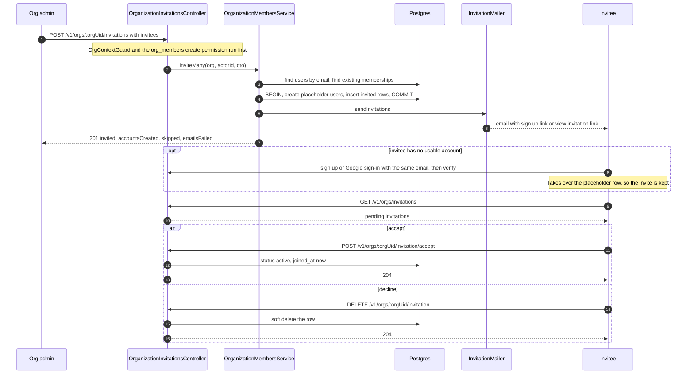
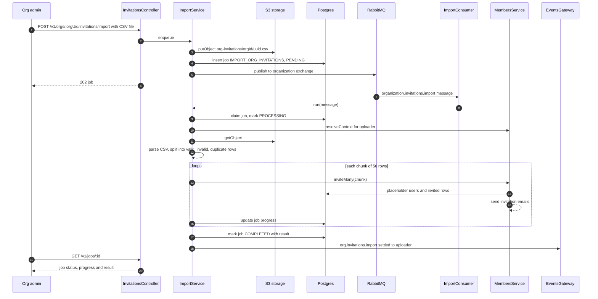
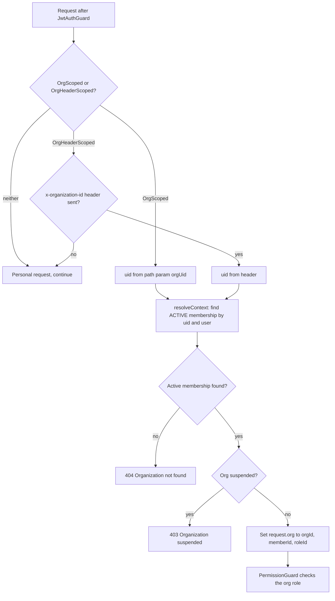
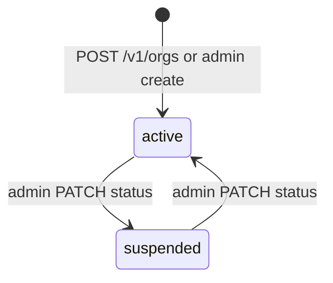
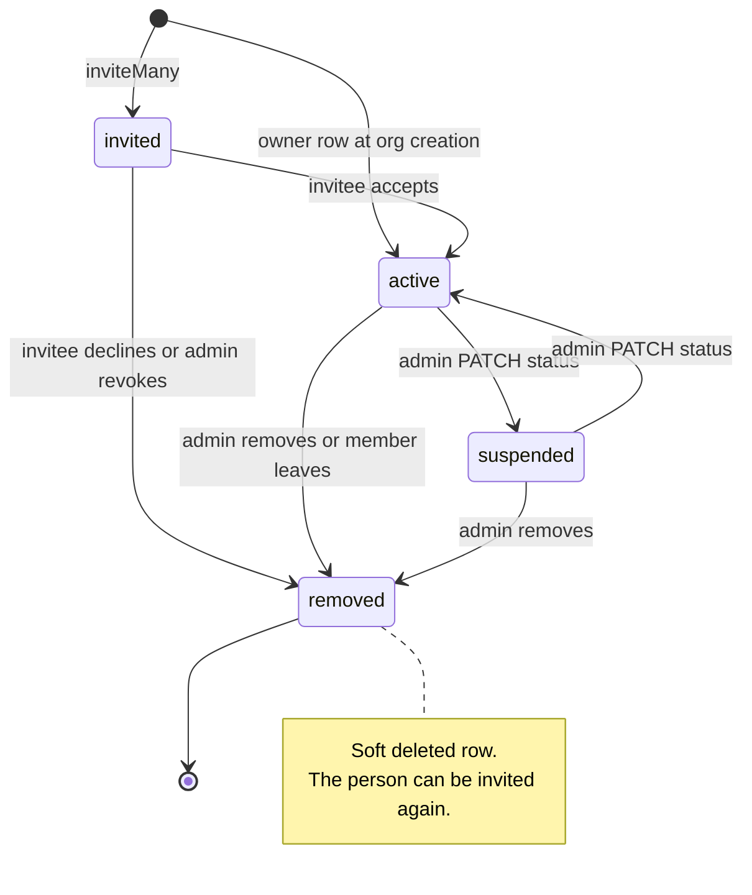

# Organizations

## 1. Purpose

An **organization** ("org") is a group of users who work together. Examples are a company, a college or a coaching class. Inside an org:

- Each member has an **org role** (`org_owner`, `org_admin` or `org_member`) that decides what they may do there.
- Members can create **org assessments**, which belong to the org and not to one person.
- The org has its **own subscription** (it starts on a 7-day trial). See [Commerce](commerce.md).

The same user can use TestFlow personally and also act in one or more orgs. Each request says which one it is acting in. That choice is called the **org context**.

## 2. Key terms

| Term | Meaning |
|---|---|
| **uid** | Public 8-character id of an org (for example `a7Kq2Xb9`). Clients always use the uid, never the numeric id. |
| **slug** | URL-safe name made from the org name, for example `acme-labs`. Unique among live orgs. |
| **Owner** | The user who created the org. Stored in `organizations.owner_user_id`, **and** as an `org_owner` membership row. |
| **Membership** | One row in `organization_members` for one user in one org, with a role and a status. |
| **Invitation** | A membership row with status `invited`. Accepting it changes the same row to `active`. There is no separate invitations table. |
| **Placeholder account** | An unverified user account created for an invitee who has no account yet. Its username starts with `invited_`. When the person later signs up (or uses Google) with that email, they take over this row. See [Auth](auth.md). |
| **Org context** | `request.org = { orgId, memberId, roleId }`. `OrgContextGuard` sets it when a request acts in an org. |
| **Org-scoped route** | A route under `/v1/orgs/:orgUid/...` marked `@OrgScoped()`. It always acts in that org. |
| **Header-scoped route** | A route marked `@OrgHeaderScoped()`. It acts in an org only if the `x-organization-id` header is sent. Otherwise it is personal. |

## 3. Data it uses

See the [ERD](../erd.md) for full definitions.

| Table | Notes |
|---|---|
| `organizations` | `uid`, `slug`, `name`, `owner_user_id`, `status` (`active` or `suspended`), soft delete. `uid` and `slug` are unique among live rows. |
| `organization_members` | `organization_id`, `user_id`, `role_id`, `status` (`invited`, `active`, `suspended`), `invited_by`, `joined_at`, soft delete. **One live row per user per org.** A soft-deleted row does not block a new invite. |
| `roles` | The built-in org roles. See [RBAC](rbac.md). |
| `jobs` | One row per bulk CSV import (`type = IMPORT_ORG_INVITATIONS`). See [Jobs and schedulers](jobs-and-schedulers.md). |
| `subscriptions` | The org's trial subscription is created with the org. See [Commerce](commerce.md). |
| `assessments.organization_id` | Set for org assessments. NULL for personal ones. See [Assessments](assessments.md). |

The uploaded CSV files are stored in S3 (or MinIO or LocalStack in development) under `org-invitations/<orgId>/<uuid>.csv`, by `StorageService` in `src/storage/storage.service.ts`.

## 4. Creating an organization

1. A signed-in user calls `POST /v1/orgs` with `{ name, slug? }`.
2. **Org limit**: a user can **own at most 1** org (`OrganizationLimit.ORG_LIMIT`). Otherwise the server returns `409`.
3. The slug is the one given, or it is made from the name (`slugify`). If the slug is already taken, the server returns `409`.
4. In **one transaction**, the server:
    - inserts the org with a new random uid and status `active`
    - inserts an **active `org_owner` membership** for the creator
    - creates the org's **7-day trial subscription** (`SubscriptionsService.createOrgTrialSubscription`)
5. If the random uid collides with an existing one, the whole transaction is retried, up to 5 times.

A platform admin can do the same thing for another user with `POST /v1/admin/organizations` and `{ name, slug?, ownerEmail }`. The owner must have an account and must be active. The result is the same as if that user had created the org.

**Updating** (`PATCH /v1/orgs/:orgUid`, needs `org_settings:update`): you can change `name` and `slug`. **If you change the name and do not send a slug, the slug is made again from the new name.**

## 5. Invitations

There is **one invite endpoint**. It takes a list of 1 to 50 people. Inviting one person means sending a list with one entry. (A separate single-invite route was removed on branch `feat/bulk-invite` in commit `c289b17`.) For larger lists there is a **CSV import** that runs as a background job.

Both paths end in the same method, `OrganizationMembersService.inviteMany`.

### 5.1 What `inviteMany` does

Input: `{ invitees: [{ name, email }, ...] }`. Names and emails are trimmed.

1. Every invitee gets the role **`org_member`**. You cannot pick another role at invite time.
2. Duplicate emails in the list are merged, ignoring case. The first spelling wins.
3. The server finds existing accounts by email, ignoring case.
4. For each person:
    - **Already an active or suspended member**: skipped with reason `already_member`.
    - **Already invited**: skipped with reason `already_invited`.
    - **Has an account** (verified or not): invited as they are.
    - **Has no account**: a **placeholder account** is created. It is unverified, the username is `invited_<random>`, the password is a random 24-character one that nobody sees, and the name comes from the invite.
5. In **one transaction**, the server creates the placeholder accounts and inserts the `invited` membership rows (`invited_by` = the caller).
6. If someone else invited or signed up one of these people at the same moment, a unique index fails and the server returns `409 ... please retry`. Nothing is saved.
7. After the commit, the server sends **one email per new invitation**, 10 at a time (`OrganizationInvitationMailer`). A failed email **does not undo** the invitation. It is listed in `emailsFailed`.

The response has `invited` (member rows), `accountsCreated` (emails), `skipped` (email and reason) and `emailsFailed`.

### 5.2 Invite and accept

The email link depends on whether an account was just created for the invitee:

- **Account created now**: "Sign up to accept" → `FRONTEND_URL/signup?email=...`
- **Account already existed**: "View invitation" → `FRONTEND_URL/invitations`

The invitee must be **verified** to call the accept or decline routes, because the auth guard rejects unverified accounts (see [Auth](auth.md)).

### 5.3 Bulk invite by CSV

1. `GET /v1/orgs/:orgUid/invitations/import/sample` downloads a sample file. Its contents are just the header `name,email`.
2. `POST /v1/orgs/:orgUid/invitations/import` with a multipart field `file`:
    - at most **1 MB**
    - type `text/csv`, `application/csv`, `text/plain` or `application/vnd.ms-excel` (CSV has no magic bytes, so only the MIME type is checked)
3. The server stores the file in S3, creates a `jobs` row (status `PENDING`, `maxAttempts` 3, `createdBy` = the caller) and publishes a message to RabbitMQ. It returns **`202 Accepted`** with the job.
4. If publishing fails, the job is marked failed and the server returns `503`.
5. `OrganizationInvitationImportConsumer` receives the message and calls `OrganizationInvitationImportService.run`:
    1. **Claim** the job. Drop the message if the job is missing, has the wrong type, or is already finished (a redelivery).
    2. **Re-check the uploader** with `resolveContext`. They must still be an active member, and the org must not be suspended.
    3. **Read and parse** the file (`parseInvitationCsv`):
        - The header row must have `name` and `email`, in any case. Other columns are ignored.
        - At most **5000 data rows**. An empty file or a file without the right header fails the whole job.
        - A bad row (it fails `InviteeDto` validation) goes to `failed` with its line number.
        - A repeated email goes to `skipped` as `duplicate_in_file`.
    4. **Invite in chunks of 50** through `inviteMany`. After each chunk, the job's progress text is updated ("Invited 50 of 320"). If a chunk hits a `409` conflict, it is tried once more. If it fails again, its rows go to `failed`.
    5. **Mark the job completed** with a result: `totalRows`, `invited`, `accountsCreated`, `skipped[]`, `failed[]`, `emailsFailed[]`.
    6. **Emit** the socket event `org.invitations.import.settled` to the uploader.
6. Any other error marks the job **failed** and emits the same event with `status: failed`. The message is still acknowledged, so it is not redelivered forever. To retry, call `POST /v1/jobs/:id/retry`. Re-running is safe, because people already invited are skipped and are not emailed again.
7. The client polls `GET /v1/jobs/:id`, or listens for the socket event.

RabbitMQ wiring (`src/config/rabbitmq/rabbitmq.constants.ts`):

| Item | Value |
|---|---|
| Exchange | `organization` (topic) |
| Routing key | `organization.invitations.import` |
| Queue | `organization-invitation-import-queue` |
| Job queue name stored on the job row | `organization-invitations` |
| Job type | `IMPORT_ORG_INVITATIONS` |

## 6. Members

| Action | Route | Permission | Rules |
|---|---|---|---|
| List | `GET /v1/orgs/:orgUid/members` | `org_members:read` | Cursor-paged, newest first. Optional `status` filter. Includes pending invitations. `meta` has `nextCursor` and `total`. |
| Change role or status | `PATCH /v1/orgs/:orgUid/members/:userId` | `org_members:update` | `roleKey` can be any built-in org role **except `org_owner`**. `status` can be `active` or `suspended`. An invitation cannot be activated this way, only by the invitee accepting it. |
| Remove member or revoke invite | `DELETE /v1/orgs/:orgUid/members/:userId` | `org_members:delete` | Soft-deletes the row. |
| Leave | `DELETE /v1/orgs/:orgUid/membership` | none (active member) | The owner cannot leave. |

For both PATCH and DELETE, **you cannot target yourself**, and **you cannot target the owner** (`403`).

A **suspended** member stays in the list, but cannot act in the org at all, because `OrgContextGuard` requires status `active`.

## 7. Org context: how a request picks its organization

`OrgContextGuard` (`src/organizations/guards/org-context.guard.ts`) runs after `JwtAuthGuard`, `RateLimitGuard` and `RolesGuard`, and **before** `PermissionGuard`. So the permission check can already see `request.org`.

There are two ways a route can ask for an org:

| Decorator | Where the org uid comes from | If it is missing |
|---|---|---|
| `@OrgScoped()` | Route param `:orgUid` | Not possible, because it is part of the path |
| `@OrgHeaderScoped()` | Header `x-organization-id` | The request stays **personal**. `request.org` is not set. |

Steps:

1. If the route has neither decorator, do nothing.
2. Read the uid from the param or the header. A header-scoped route with no header (or an empty one) continues as personal.
3. Call `OrganizationMembersService.resolveContext(uid, userId)`. It looks for an **active** membership of this user in the org with this uid.
    - No such membership (not a member, only invited, suspended member, or no such org): **`404 Organization not found`**. It is 404 and not 403 so that outsiders cannot find out which orgs exist.
    - The org is suspended: **`403 This organization has been suspended`**.
4. Set `request.org = { orgId, memberId, roleId }`.

Handlers read it with:

- `@CurrentOrg()`: returns the context. It throws a 500 if used on a route that is not org-scoped (a programming error).
- `@OptionalOrg()`: returns the context or `null`. Used on header-scoped routes.

### 7.1 Org-scoped permissions

When `request.org` is set, `PermissionGuard` checks permissions against the **member's org role only**. Platform roles, including `super_admin`, give nothing inside an org. `@OrgPermissions(...)` adds keys that are checked only in org mode. The full logic and the default grants for each org role are in [RBAC](rbac.md#43-default-grants-for-org-roles).

Routes that use the header today:

- **Assessments**: create, generate, list, invite, participants, register, and more. They use `@OrgPermissions('org_assessments:read' or 'create')`. See [Assessments](assessments.md).
- **Attempt review and leaderboard**. See [Attempts](attempts.md).
- **Billing**: `GET /v1/subscriptions` and `GET /v1/usage/subscriptions/:subscriptionId`, with `@OrgPermissions('org_billing:read')`. See [Commerce](commerce.md).

## 8. Org assessments and participants

The assessment side is covered in [Assessments](assessments.md). These are the points that matter for orgs:

1. An assessment created with the `x-organization-id` header gets `organization_id` set, and belongs to the org.
2. **Schedule**: an org assessment has **two windows**, added on branch `feat/bulk-invite` (commit `514f2bd`, migration `add-registration-window-to-assessments`):
    - **Registration window** (`registrationStartTime` to `registrationEndTime`): when people can register or be invited. If not given, it opens now and closes when the attempt window closes.
    - **Attempt window** (`attemptStartTime` to `attemptEndTime`): **required** for org assessments.
    - Rules: each window must end after it starts, and registration cannot close after the attempt window ends.
    - A personal assessment ignores these inputs. Both of its windows are "now plus 30 days".
3. **Only active org members can be invited** to an org assessment. Others come back as skipped.
4. **Participant details** (`GET /v1/assessments/:id/participants`, added in commits `d442e37` and `cc7ffd0`) list everyone invited, active or revoked. Each row has the account details, `isCreator`, `invitedBy`, `invitedAt`, `inviteAcceptedAt` and `revokedAt`. There are `status` and `search` filters, and `meta.counts` gives the number in each status. Only the creator, or a member whose org role has `org_assessments:update`, may see it.
5. `DELETE /v1/assessments/:id/participants/:userId` removes a participant or revokes an invite. The creator cannot be removed.

## 9. Lifecycles

### 9.1 Organization

When an org is **suspended**:

- Every org-scoped or header-scoped request for it returns `403`.
- Its pending invitations are hidden from `GET /v1/orgs/invitations` and cannot be accepted.
- It still shows in `GET /v1/orgs`, with an empty permissions list.

There is **no delete** endpoint for organizations.

### 9.2 Membership

## 10. Business rules and edge cases

1. A user can **own** at most one org. They can be a **member** of any number.
2. Each org has exactly one owner. `org_owner` can never be granted through the API, and the owner's membership can never be changed or removed. **There is no ownership transfer endpoint.**
3. Invites always use the role `org_member`. Promote people afterwards with `PATCH .../members/:userId`.
4. An `org_admin` can change or remove **another** `org_admin`. There is no rank check between admins.
5. Emails are matched **ignoring case** when inviting, but login and sign-up match them exactly (see [Auth](auth.md)).
6. A person with an account who has never verified it (for example, a placeholder from another org's invite) gets the "View invitation" email, not the "Sign up" one.
7. Re-inviting after a decline, revoke, removal or leave works, because the unique index ignores soft-deleted rows.
8. The import job re-checks only that the uploader is still an **active member**. It does not re-check that they still have `org_members:create`.
9. Each invite request is limited to 50 people. Each CSV is limited to 5000 rows and 1 MB.
10. A failed invitation email never fails the invite.
11. There is **no limit on how many members** an org can have.

## 11. Endpoints summary

The [API reference](../api-design/v1.md) has the full details.

### User and member routes (`src/organizations/controllers/`, rate limit CLASS_B)

| Method and path | Scope | Permission | Purpose |
|---|---|---|---|
| `POST /v1/orgs` | personal | none | Create an org |
| `GET /v1/orgs` | personal | none | My orgs (active and suspended memberships), each with my role and permission keys |
| `GET /v1/orgs/invitations` | personal | none | My pending invitations |
| `POST /v1/orgs/:orgUid/invitation/accept` | personal | none | Accept (204) |
| `DELETE /v1/orgs/:orgUid/invitation` | personal | none | Decline (204) |
| `GET /v1/orgs/:orgUid` | org | `org_settings:read` | Org details |
| `PATCH /v1/orgs/:orgUid` | org | `org_settings:update` | Rename or change the slug |
| `DELETE /v1/orgs/:orgUid/membership` | org | none | Leave |
| `GET /v1/orgs/:orgUid/members` | org | `org_members:read` | List members and invites |
| `PATCH /v1/orgs/:orgUid/members/:userId` | org | `org_members:update` | Change role or status |
| `DELETE /v1/orgs/:orgUid/members/:userId` | org | `org_members:delete` | Remove or revoke |
| `POST /v1/orgs/:orgUid/invitations` | org | `org_members:create` | Invite 1 to 50 people (201) |
| `POST /v1/orgs/:orgUid/invitations/import` | org | `org_members:create` | Upload a CSV, queue a job (202) |
| `GET /v1/orgs/:orgUid/invitations/import/sample` | org | `org_members:create` | Download the sample CSV |

### Admin routes (`src/organizations/admin.controller.ts`, rate limit CLASS_C)

| Method and path | Permission | Purpose |
|---|---|---|
| `POST /v1/admin/organizations` | `organizations:create` | Create an org for the user with `ownerEmail` |
| `GET /v1/admin/organizations` | `organizations:read` | Cursor-paged list. Filters: `search` (name, slug), `status`. |
| `GET /v1/admin/organizations/:orgUid` | `organizations:read` | One org |
| `PATCH /v1/admin/organizations/:orgUid/status` | `organizations:update` | Suspend or reactivate |

Admin routes are personal requests. They use platform permissions, and the admin does not need to be a member of the org.

## 12. Async work, emails and events

| Kind | Name | When |
|---|---|---|
| RabbitMQ consumer | `OrganizationInvitationImportConsumer` (`src/organizations/consumers/organization-invitation-import.consumer.ts`) | A CSV import is queued |
| Job | `IMPORT_ORG_INVITATIONS` | One per CSV upload. Poll `GET /v1/jobs/:id`, retry with `POST /v1/jobs/:id/retry`. |
| Email | Organization invitation (`src/notifications/email/templates/organization-invitation-email.template.ts`) | Every new invitation, from the API route and from the import |
| Socket event | `org.invitations.import.settled` | Sent to the uploader's user room when an import completes or fails. Payload: `jobId`, `status`, and either counts or a `reason`. See [Realtime events](realtime-events.md). |

## 13. Where the code lives

| Path | What |
|---|---|
| `src/organizations/controllers/organizations.controller.ts` | Create, list, accept, decline, read, update, leave |
| `src/organizations/controllers/organization-members.controller.ts` | Member list, update, remove |
| `src/organizations/controllers/organization-invitations.controller.ts` | Invite, CSV import, sample CSV |
| `src/organizations/admin.controller.ts`, `admin.service.ts` | Admin org routes |
| `src/organizations/services/organizations.service.ts` | Create and update orgs |
| `src/organizations/services/organization-members.service.ts` | `resolveContext`, `inviteMany`, member changes, accept, decline |
| `src/organizations/services/organization-invitation-import.service.ts` | CSV import job |
| `src/organizations/services/organization-invitation-mailer.service.ts` | Invitation emails |
| `src/organizations/helpers/parse-invitation-csv.ts` | CSV parsing and row validation |
| `src/organizations/guards/org-context.guard.ts` | `OrgContextGuard` |
| `src/organizations/decorators/` | `@OrgScoped`, `@OrgHeaderScoped`, `@CurrentOrg`, `@OptionalOrg` |
| `src/organizations/organizations.constants.ts` | Import limits, storage prefix, socket event name |
| `tests/unit/organizations/` | Unit tests, including the guard, import, mailer and CSV parser |

## 14. Known gaps and TODOs

1. **No ownership transfer** and **no org delete**. The owner can never leave.
2. **Uploaded CSV files are never deleted** from S3 after the import finishes.
3. **The `maxAttempts: 3` on import jobs is not used for automatic retries.** A failure is final until someone calls the retry endpoint.
4. **No member limit** and no seat billing for orgs.
5. **The wrong email for existing unverified accounts** (rule 6). Those people get "View invitation" but cannot log in until they sign up.
6. **The import does not re-check permission** (rule 8).
7. **No rank check between admins** (rule 4).
8. **A suspended member cannot leave** the org, because `leave` is org-scoped and needs an active membership.
9. **Changing the name changes the slug** unless a slug is also sent. This may break saved links that use the slug.
10. Admin org creation does not check that the owner is verified.
