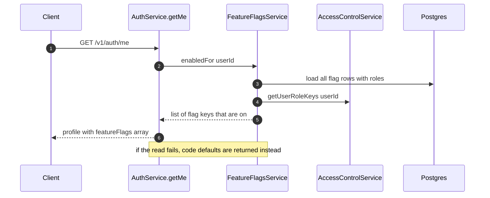
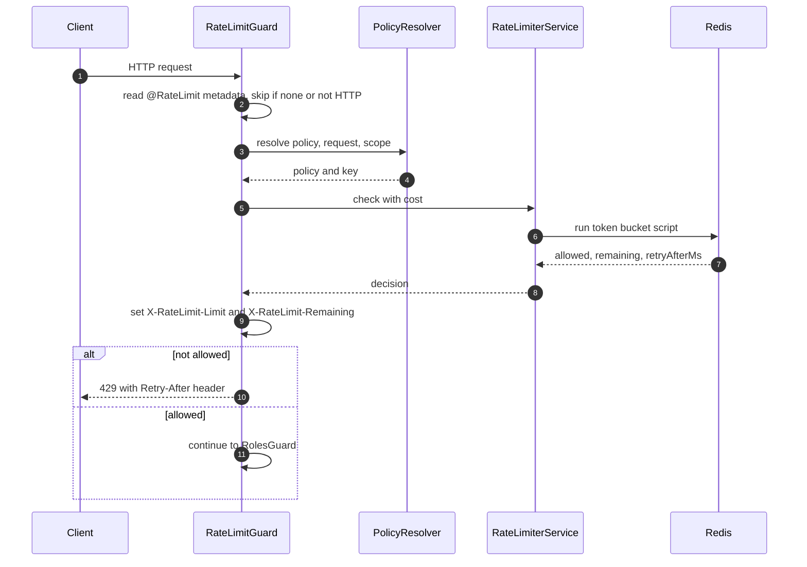
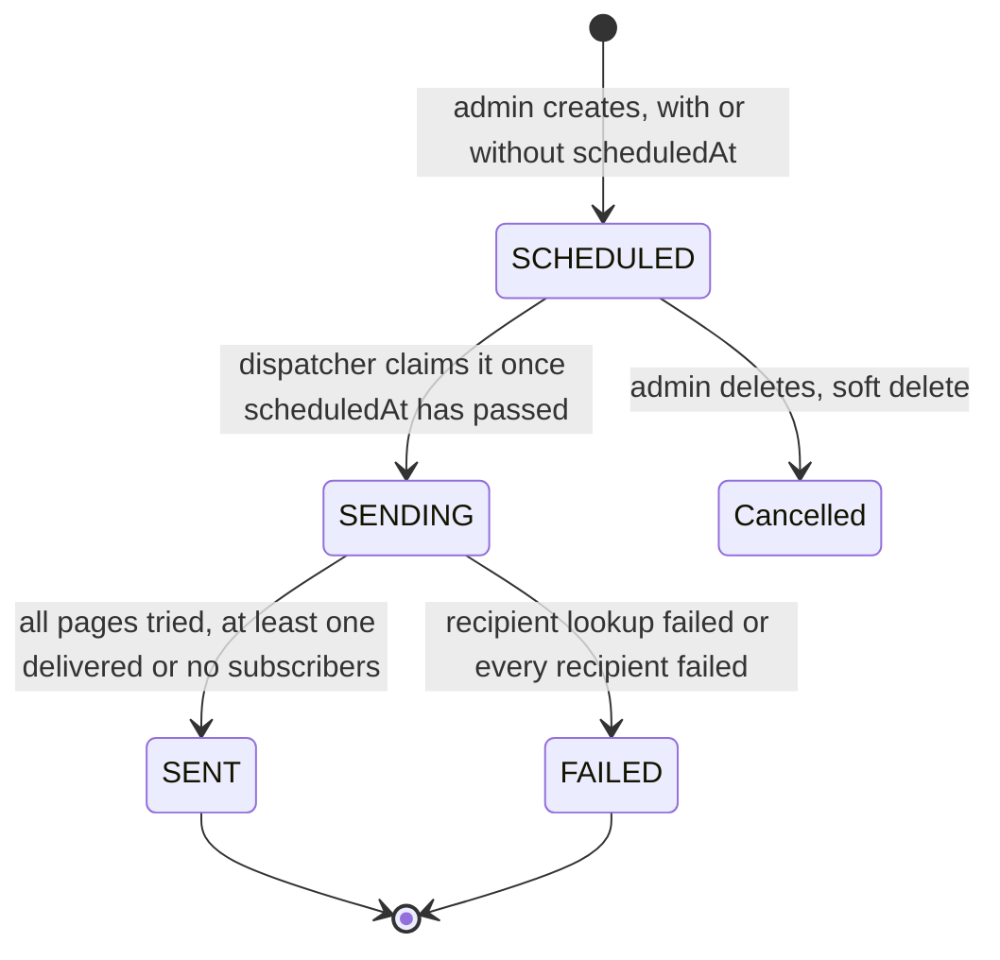
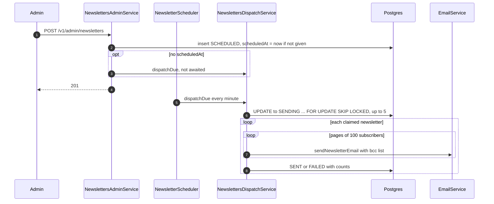
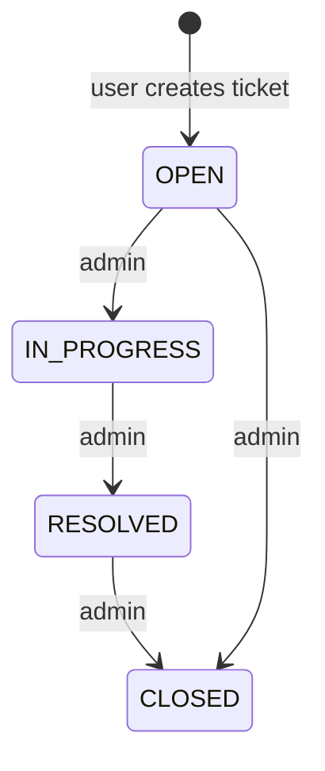

# Platform Services

This page covers the small modules that support the rest of the platform. Each section follows the same shape: what it is for, how it works, its endpoints, and its known gaps.

| Module | Folder | One-line summary |
|---|---|---|
| [Feature flags](#feature-flags) | `src/feature-flags/` | Admin-controlled on/off switches, optionally limited to platform roles |
| [Rate limiter](#rate-limiter) | `src/rate-limiter/` | Redis token bucket, applied per route with `@RateLimit()` |
| [Stats](#stats) | `src/stats/` | One admin endpoint with platform-wide numbers |
| [Newsletters](#newsletters) | `src/newsletters/` | Admins write and schedule an email to all subscribers |
| [Support tickets](#support-tickets) | `src/support-tickets/` | Users open tickets, admins change their status |
| [Health](#health) | `src/health/` | Checks Postgres, Redis and RabbitMQ |
| [Storage](#storage) | `src/storage/` | Thin S3 wrapper |
| [App controller](#app-controller) | `src/app.controller.ts` | `GET /ping` |

All admin routes live under `/v1/admin/...` and are protected by `@Permissions('<resource>:<action>')`. The global `PermissionGuard` checks these. See [RBAC](rbac.md).

---

## Feature flags

### Purpose

A **feature flag** is a switch that turns a product feature on or off without a deploy. Admins can turn a flag off for everyone (a kill switch) or limit it to some platform roles (for example, only `super_admin` while testing).

### Model

- **Flags are defined in code.** `FeatureFlagKey` and `FEATURE_FLAG_DEFINITIONS` in `src/feature-flags/feature-flag.constants.ts` list every flag with its description, `defaultEnabled` and `defaultRoles`.
- **State is stored in the database.** `feature_flags` has one row per flag (`key`, `description`, `enabled`, `updated_by`). `feature_flag_roles` links a flag to the platform roles it is limited to. See [ERD](../erd.md).
- **No row means the code default applies.** The seeder (`src/seeders/feature-flag.seeder.ts`) adds missing rows in their default state and never changes rows that already exist.

| Key | Controls | Default |
|---|---|---|
| `coding_questions` | Coding question types in the composer and templates. A kill switch for coding generation. | On for everyone |
| `learning_roadmaps` | The learning roadmaps section: pages and navigation | On for everyone |

### Evaluation rules

`isFlagOn(state, userRoleKeys)`:

1. If `enabled` is false → **off** for everyone.
2. If the flag has no roles → **on** for everyone.
3. Otherwise → on only if the user holds **any** of the flag's roles.

Only **platform** roles can be used. Organization roles are rejected with `400`. A soft-deleted role is ignored.

### How code checks a flag



The only consumer is `GET /me`, which returns `featureFlags: FeatureFlagKey[]`. The **client** hides or shows features from that list. No server endpoint checks a flag today. There is no guard or decorator for flags.

### Admin API

| Method and path | Permission | Purpose |
|---|---|---|
| `GET /v1/admin/feature-flags` | `feature_flags:read` | Every flag in code with its current state |
| `GET /v1/admin/feature-flags/:key` | `feature_flags:read` | One flag (`404` for unknown keys) |
| `PATCH /v1/admin/feature-flags/:key` | `feature_flags:update` | Body `{ enabled?, roleKeys? }`. Creates the row if missing. `roleKeys` replaces the whole role list. `[]` means everyone. |

### Gaps

- **Flags are not enforced on the server.** Turning off `learning_roadmaps` or `coding_questions` hides the UI, but the API endpoints still work for a client that calls them directly.
- No caching. Every `GET /me` reads the flag tables.
- No per-user or percentage rollout. Targeting is by platform role only.

---

## Rate limiter

### Purpose

The rate limiter stops abuse and runaway clients. It protects login from password guessing and stops one user from spending too much on AI calls.

### Algorithm

It uses a **token bucket**:

- Each bucket holds up to `limit` tokens and starts full.
- Tokens refill smoothly at `limit / windowSeconds` per second.
- Each request takes `cost` tokens (default 1). If not enough are left, the request is rejected.

The whole read-refill-decide-write step runs as **one Lua script inside Redis** (`TOKEN_BUCKET_LUA` in `src/rate-limiter/algorithms.ts`). Because it is atomic, two parallel requests can never both spend the same token, even across app instances. The script is registered once with `defineCommand` and called with `EVALSHA`.

The caller passes the current time, so app servers need synced clocks (NTP).

### Policies (default limits)

From `src/rate-limiter/policies.ts`:

| Policy | Limit | Keyed by | Meant for |
|---|---|---|---|
| `CLASS_A` | 10 per 5 minutes (1 token every 30s) | IP | Auth: login, signup, refresh, password reset |
| `CLASS_B` | 30 per minute | User | Writes: create, update, submit, AI generation |
| `CLASS_C` | 120 per minute | User | Reads, lists, polling |

### Redis keys

```
rl:v1:<identifier>:<identity>:<scope>
```

- `identifier` is `user` or `ip`.
- `identity` is the user id or IP address.
- `scope` is the policy name by default, so all routes with that policy share one bucket. A route can pass its own scope (for example `AI_GENERATION`) to get a separate bucket.
- Each key is a hash with `tokens` and `updatedAt`. It expires once it would have refilled to full, so idle keys clean themselves up.
- Bump `v1` in `RATE_LIMIT_KEY_PREFIX` if the stored shape changes.

The limiter uses its own Redis client (`src/rate-limiter/redis.provider.ts`). It fails fast: no offline queue, 1 retry, and a 200 ms command timeout (`REDIS_COMMAND_TIMEOUT_MS`).

### The decorator

```ts
@RateLimit(POLICIES.CLASS_B, { scope: 'AI_GENERATION', cost: 5 })
```

- A route with no `@RateLimit` is **not limited**. The global guard skips it.
- The decorator can go on a controller (all routes) or on a method. The method wins.
- AI endpoints share the `AI_GENERATION` scope with different costs. For example, creating a roadmap costs 3, while submitting roadmap answers, revising a roadmap or retrying a job costs 5. They all draw from the same 30-token bucket per minute.

### Request flow



The guard runs **after** `JwtAuthGuard`, so it can key by user. If a USER policy runs on a request with no user (a `@Public` route), it falls back to the IP and logs a warning.

### Response on limit

- Status `429 Too Many Requests`.
- Body (through the global exception filter): `{ success: false, message: 'Rate limit exceeded. Please retry later.' }`.
- Headers on every limited response: `X-RateLimit-Limit`, `X-RateLimit-Remaining`. On a 429 also: `Retry-After` (seconds).

### Gaps

- **Fails open.** If Redis is down, every request is allowed and an error is logged. This is a deliberate choice: a Redis outage should not take down the API.
- **IP behind a proxy.** `request.ip` is only correct if Express `trust proxy` matches the deployment. Otherwise every user behind the load balancer shares one IP bucket. `main.ts` does not set `trust proxy` today.
- **Not used for WebSockets.** Socket messages do not go through this guard. Code runs have their own in-memory cooldown (see [Realtime Events](realtime-events.md)).

---

## Stats

### Purpose

One endpoint that feeds the admin overview page with platform-wide numbers.

### What it shows

`GET /v1/admin/stats?days=30` (`days` from 7 to 90, default 30). Needs `stats:read`.

| Section | Figures |
|---|---|
| `range` | `days`, `from`, `to` (UTC dates, today included) |
| `users` | total, verified, new in period |
| `organizations` | total, active, suspended, new in period |
| `assessments` | total, personal, organization, new in period, count by status |
| `attempts` | total, submitted in period, average score percent (evaluated attempts in period), count by status |
| `subscriptions` | active, personal, organization, paid (plan price > 0) |
| `revenue` | successful payment totals **per currency** for the period, failed payment count |
| `ai` | LLM calls, failed calls, total cost in USD (from `llm_audit`) |
| `supportTickets` | open, in progress |
| `daily` | One row per day with signups, assessments created, attempts submitted, and revenue per currency. Days with no activity are filled with zeros. |

### How it is computed

- `StatsAdminService.getStats` (`src/stats/admin.service.ts`) runs about 13 raw SQL queries **in parallel** with `Promise.all`.
- Counts use `COUNT(*) FILTER (WHERE ...)`, so one scan gives several numbers.
- The window is `[today − (days − 1), tomorrow)` in UTC.
- The daily series uses `generate_series` so no day is skipped.
- Revenue is never summed across currencies.
- Soft-deleted users, organizations, assessments, subscriptions and tickets are excluded.
- The average score is `score / (total_questions × correct_marks)`, where `correct_marks` comes from the assessment's **first** section.

### Gaps

- No caching. Every page load runs all queries live, and the daily series uses one sub-query per day for each metric.
- The average score assumes every section uses the same marks as the first one.

---

## Newsletters

### Purpose

Admins write an HTML email and send it now or at a set time to every subscribed user.

### Lifecycle



`Cancelled` is not a status value. It is a soft delete (`deleted_at`). A newsletter in `SENDING` cannot be deleted (`422`).

### Flow



Rules:

- **Who gets it:** users with `is_newsletter_subscribe = true`, `is_active = true` and not soft-deleted. They are read in pages ordered by id.
- **One email per page**, with all addresses in `bcc`. A failed page counts all its recipients as failed.
- **Claiming is safe across instances** thanks to `FOR UPDATE SKIP LOCKED`. A per-instance `dispatchInFlight` flag stops overlapping passes.
- **Config:** `NEWSLETTER_DISPATCH_BATCH_SIZE` (newsletters per pass, default 5), `NEWSLETTER_RECIPIENT_BATCH_SIZE` (default 100), `NEWSLETTER_SCHEDULER_ENABLED`.

See [Jobs and Schedulers](jobs-and-schedulers.md#8-schedulers) for the cron, and [Notifications](notifications.md) for the template.

### Endpoints

| Method and path | Permission | Purpose |
|---|---|---|
| `POST /v1/admin/newsletters` | `newsletters:create` | Create. `subject` 3–200 characters, `bodyHtml` at least 10, optional `bodyText`, optional `scheduledAt` (ISO date). CLASS_B rate limit. |
| `POST /v1/admin/newsletters/preview` | `newsletters:create` | Render a draft without saving |
| `GET /v1/admin/newsletters` | `newsletters:read` | List (page and limit, optional `status`), newest `scheduledAt` first |
| `GET /v1/admin/newsletters/:id` | `newsletters:read` | One newsletter with delivery counts |
| `GET /v1/admin/newsletters/:id/preview` | `newsletters:read` | Render a saved newsletter |
| `DELETE /v1/admin/newsletters/:id` | `newsletters:delete` | Cancel (soft delete). `422` while sending. |

### Gaps

- **A crash mid-send leaves the row in `SENDING` forever.** Nothing resets it, and it cannot be deleted.
- **No unsubscribe.** No API changes `is_newsletter_subscribe` (it defaults to `true`), and the email has no unsubscribe link.
- No per-recipient record. A page that fails is not retried.
- `scheduledAt` in the past is accepted and sent on the next tick.

---

## Support tickets

### Purpose

A simple help desk. Users send a question. Admins see all tickets and update their status.

### Model

`support_tickets`: `user_id`, `topic`, `query` (10–2,000 characters), `status`, timestamps and soft delete. See [ERD](../erd.md).

- Topics: `BILLING`, `TECHNICAL`, `ACCOUNT`, `ASSESSMENT`, `FEEDBACK`, `OTHER`.
- Statuses: `OPEN`, `IN_PROGRESS`, `RESOLVED`, `CLOSED`.

### Lifecycle



This is the **intended** path. The code does not enforce it. An admin can set any status from any status.

### Endpoints

| Method and path | Who | Purpose |
|---|---|---|
| `POST /v1/support` | Any logged-in user (CLASS_B) | Create a ticket with `topic` and `query` |
| `GET /v1/admin/support-tickets` | `support_tickets:read` | List all tickets, newest first, page and limit (max 100) |
| `PATCH /v1/admin/support-tickets/:id` | `support_tickets:update` | Set `status` |

### Gaps

- Users cannot list or read their own tickets. There is only a create endpoint.
- No replies, comments or assignee. Admins answer outside the system.
- No email to the user or to support when a ticket is created or changes status.
- The admin list has no filter by status or topic.
- No transition rules (see lifecycle above).

---

## Health

### Purpose

A probe for load balancers, CI and deploy pipelines.

### Checks performed

`GET /health` (public, not versioned, no rate limit). `HealthService.check` runs three probes **in parallel**, each with a 2-second timeout:

| Check | How |
|---|---|
| `database` | `SELECT 1` through TypeORM |
| `redis` | `PING` on the **rate limiter's** Redis client, so it matches what the limiter sees |
| `rabbitmq` | `amqpConnection.connected` (false until the link is up, because the module starts with `wait: false`) |

### Responses

- All up → `200` with the usual envelope. `data` is `{ status: 'ok', uptime, checks: { database: 'up', redis: 'up', rabbitmq: 'up' } }` and `message` is `'Service is healthy.'`.
- Any down → `503` with `{ success: false, message: 'One or more dependencies are unavailable.', checks, uptime }`. The `checks` object names the dependency at fault.

A probe never throws. One dead dependency still produces a full report.

### Gaps

- The cache Redis client (`src/config/redis/`) is a separate connection and is not checked.
- External services (SMTP, S3, LLM providers, code runners) are not checked.

---

## Storage

### Purpose

A thin wrapper around Amazon S3 (or any S3-compatible store) for files the backend needs to keep for a short time.

### How it works

`StorageService` (`src/storage/storage.service.ts`) uses `@aws-sdk/client-s3` and has two methods:

- `putObject(key, buffer, contentType)`
- `getObject(key)` → `Buffer`

| Env var | Use |
|---|---|
| `AWS_REGION`, `AWS_ACCESS_KEY_ID`, `AWS_SECRET_ACCESS_KEY` | Required |
| `AWS_S3_BUCKET` | Required. The one bucket used. |
| `AWS_S3_ENDPOINT` | Optional. Points to MinIO or LocalStack for local development. Turns on path-style URLs. |

### Current use

Only the organization CSV invitation import uses it. The uploaded CSV is stored at `org-invitations/<orgId>/<uuid>.csv`. The background job then reads it back. See [Organizations](organizations.md).

### Gaps

- Uploaded CSVs are never deleted. Add a bucket lifecycle rule or a delete call after import.
- No delete, list or signed-URL methods.

---

## App controller

`src/app.controller.ts` has one route:

| Method and path | Auth | Response |
|---|---|---|
| `GET /ping` | Public | `{ success: true, message: 'Success.', data: 'OK' }` |

It only shows that the process is up and serving HTTP. It does not check any dependency. Use `/health` for that.

---

## Where the code lives

| Path | What it does |
|---|---|
| `src/feature-flags/feature-flag.constants.ts` | Flag keys, defaults, `isFlagOn`, `flagState` |
| `src/feature-flags/feature-flags.service.ts` | `enabledFor`, `list`, `get`, `update` |
| `src/feature-flags/admin.controller.ts` | Feature flag admin API |
| `src/rate-limiter/policies.ts` | The three policies |
| `src/rate-limiter/algorithms.ts` | Lua token bucket |
| `src/rate-limiter/rate-limit.guard.ts` | Global guard |
| `src/rate-limiter/rate-limit.decorator.ts` | `@RateLimit()` |
| `src/rate-limiter/policy-resolver.ts` | Policy and key selection |
| `src/rate-limiter/stores.ts` | Redis store (fails open) |
| `src/stats/admin.service.ts` | All stats SQL |
| `src/newsletters/admin.service.ts` and `newsletters-dispatch.service.ts` | Newsletter CRUD and delivery |
| `src/schedulers/newsletter.scheduler.ts` | The minute cron |
| `src/support-tickets/` | User and admin ticket endpoints |
| `src/health/` | Health check |
| `src/storage/storage.service.ts` | S3 wrapper |
| `src/app.controller.ts` | `/ping` |
