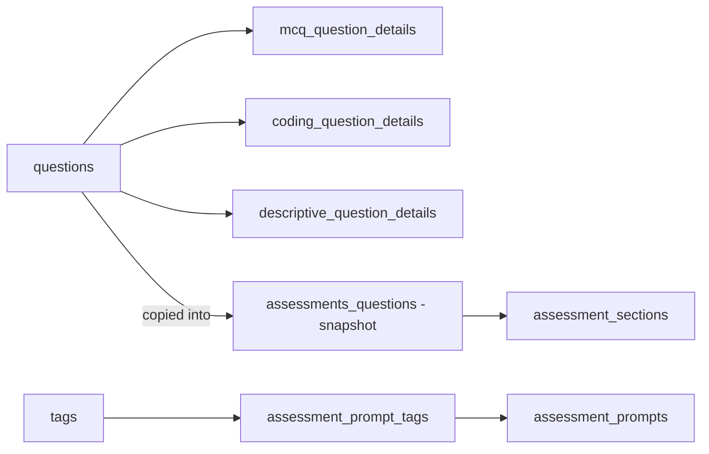
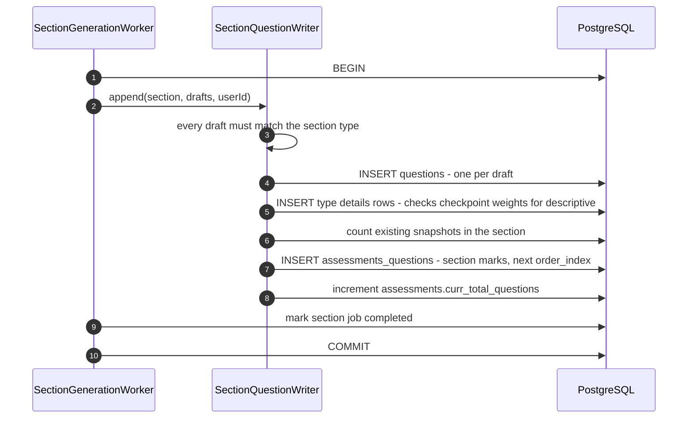

# Questions & Tags

## 1. Purpose

- **Questions** (`src/assessments/questions/`) hold the content people answer: the question bank, the three question types, and the code that saves AI-generated questions into an assessment.
- **Tags** (`src/assessments/tags/`) are simple labels. Today they are only used to label **assessment prompts** in the prompt library.

How an assessment is built from questions is on [Assessments](assessments.md). How questions are generated by AI is on [AI Assessment Generation](assessment-generation.md). How answers are graded is on [Evaluation](evaluation.md).

## 2. Key concepts

| Term | Meaning |
| --- | --- |
| **Question bank** | The `questions` table plus one details table per type. Every question ever created or generated lives here. |
| **Snapshot** | A copy of a question placed in one assessment: a row in `assessments_questions`. It copies the text and the type-specific content as JSON (`content`). |
| **Question type** | `mcq`, `coding` or `descriptive` (`QuestionType` in `src/common/enums/assessments.enums.ts`). Stored as `varchar`, so a new type needs no Postgres enum migration. |
| **Topics** | Weighted labels on a question (`questions.meta.topics`), e.g. `[{ name: "mvcc", weight: 0.6 }, ...]`. Weights sum to 1. Copied onto the snapshot. Used by analytics. |
| **Checkpoint** | One idea a good descriptive answer must contain, with a weight. The answer key for descriptive questions. |
| **Test case** | An input and expected output for a coding question. Hidden cases are used for grading but never shown. |
| **Tag** | A label with a unique `name` and `slug`, and an `isActive` flag. |

## 3. Data it uses

See the [ERD](../erd.md) for full columns. In short:

- `questions`: `type`, `question_text`, `meta` (JSON, topics), `created_by`, soft delete.
- `mcq_question_details`, `coding_question_details`, `descriptive_question_details`: one row per question, sharing the question's primary key (`question_id`). Only the table matching `questions.type` has a row.
- `assessments_questions`: the snapshot. `type`, `question_text`, `content` (JSON), `topics`, `correct_marks`, `incorrect_marks`, `order_index`, `section_id`. Unique on (`assessment_id`, `question_id`).
- `tags`, and `assessment_prompt_tags` (the join to `assessment_prompts`).

## 4. Question types

The interfaces live in `src/assessments/questions/interfaces/question-content.interface.ts`. The snapshot's `content` column holds exactly one of these shapes, picked by `type`.

### 4.1 MCQ (`McqQuestionContent`)

| Field | Notes |
| --- | --- |
| `options` | 2–6 options, each `{ id, text }`. `id` is an integer ≥ 1, unique within the question. Option text up to 500 chars. |
| `correctOptionId` | Must match one option's `id`. Exactly one correct answer. There is no multi-select type. |
| `explanation` | Optional, up to 5000 chars. AI-generated MCQs have none. |

Question text: 10–1000 chars.

### 4.2 Coding (`CodingQuestionContent`)

| Field | Notes |
| --- | --- |
| `inputFormat`, `outputFormat`, `constraints` | Optional text, up to 5000 chars each. |
| `starterCode` | Object keyed by language, e.g. `{ python: "...", java: "...", cpp: "..." }`. Each up to 20,000 chars. |
| `supportedLanguages` | Always the keys of `starterCode`. Allowed languages: `python`, `java`, `cpp` (`CODING_LANGUAGES` in `src/ai/interfaces/generated-coding-question.interface.ts`). |
| `timeLimitMs` | 100–10,000 on edit. Generated problems get 2000. |
| `memoryLimitMb` | 16–1024 on edit. Generated problems get 256. |
| `checkerType` | Only `exact` exists today (output compared line by line, ignoring trailing whitespace). |
| `testCases` | 1–50 cases of `{ input, expectedOutput, isHidden }`. |

The problem title is put at the top of `questionText` (`"<title>\n\n<statement>"`), because the content has no title field. The AI's reference solution is **dropped** before saving, so it can never reach a candidate. Defaults live in `src/assessments/questions/coding-question.defaults.ts`.

### 4.3 Descriptive (`DescriptiveQuestionContent`)

| Field | Notes |
| --- | --- |
| `checkpoints` | List of `{ id, description, weightage }`. IDs unique. Weightages are positive integers that **sum to exactly 100**. |
| `maxWords` | Suggested answer length shown to the candidate. Not enforced when grading. |

Rules in `src/assessments/domain/descriptive-invariants.ts`:

- `assertCheckpointWeights` enforces the rules above. It runs when generated descriptive questions are saved.
- `normaliseWeightages` rescales whatever weights the AI wrote to integers that sum to 100. Leftover points go to the largest remainders, and every checkpoint keeps at least 1.
- `scoreCheckpoints` grades an answer: each completed checkpoint earns its share of the question's marks. An answer counts as **correct** at 60% or more (`DESCRIPTIVE_CORRECT_THRESHOLD_PERCENT`).

## 5. Question bank vs snapshots

**Why snapshots?** An assessment must not change under its participants. So when a question is placed into an assessment, its text and content are **copied** into `assessments_questions`. Later edits to the bank question do not affect assessments that already hold it.

| | Bank (`questions` + details) | Snapshot (`assessments_questions`) |
| --- | --- | --- |
| Created by | Admin create, admin generate, or AI section generation | Manual add (`POST /v1/assessments/:id/questions`) or AI section generation |
| Edited by | Admins (`/v1/admin/questions/:id`) | The assessment's manager (`PUT /v1/assessments/:id/questions/:assessmentQuestionId`), MCQ only, before publish |
| Carries marks | No | Yes (`correct_marks`, `incorrect_marks`) |
| Used for attempts and grading | No | Yes |

Every AI-generated question is saved **twice**: once in the bank (owned by the user who asked) and once as the snapshot. Both are written in the same transaction by `SectionQuestionWriter` (`src/assessments/questions/section-question-writer.ts`):

If anything fails, nothing from that section is saved.

## 6. Marking per question

- Each **section** has `correct_marks` and `incorrect_marks` (0–999.99). `incorrect_marks` is a positive number that is **deducted** for a wrong answer.
- Each **snapshot** copies those marks when it is created. Scoring reads the snapshot's marks.
- Manual add (`POST /:id/questions`) takes marks **per item** from the request instead.
- Editing an assessment's marks (`PATCH /v1/assessments/:id`) rewrites the first section's marks and the marks on **every** snapshot of that assessment.
- AI auto-mode defaults (`AUTO_MODE_DEFAULT_MARKS` in `generation/generation.constants.ts`): MCQ +1/0, coding +10/0, descriptive +5/0.
- Descriptive answers can earn partial marks by checkpoint. MCQ is all or nothing. Coding grading is covered in [Evaluation](evaluation.md) and [Code Execution](code-execution.md).

## 7. Tags

### 7.1 What tags are for

Tags label **assessment prompts** so the public prompt library can be filtered (`GET /v1/assessment-prompts/public?tags=...`). They are linked through `assessment_prompt_tags`. Tags are **not** attached to questions or assessments today.

### 7.2 How tags are assigned

1. A platform admin creates tags (`POST /v1/admin/tags`). `slug` is derived from `name` unless given (lowercase, non-alphanumerics become `-`).
2. A user creating or replacing an assessment prompt sends `tagSlugs` (up to 50, unique).
3. `AssessmentPromptsService.resolveTags` looks the slugs up. Any unknown slug gives a 404.
4. On `PUT`, removed links are soft-deleted and new links are inserted. A partial unique index keeps one live link per (prompt, tag).

### 7.3 Tag rules

1. `name` and `slug` must be unique. The service checks first and returns 409.
2. Changing `name` regenerates the slug, unless a slug is sent.
3. Delete is by **slug** and is a soft delete.
4. `isActive` is a flag only. Inactive tags still show in lists unless the caller filters with `is_active`, and can still be assigned to prompts.

## 8. Business rules and validation

1. **Admin create makes MCQs only.** `POST /v1/admin/questions` always creates `type = mcq`. Coding and descriptive bank questions come only from AI generation.
2. **Option checks.** `HasUniqueOptionIds` and `IsCorrectOptionPresent` (custom validators in `dto/create-question.dto.ts`) check that option IDs are unique and that `correctOptionId` is one of them. On partial update the pair is re-checked against the final state in the service.
3. **Edit refuses the wrong type's fields.** Sending `coding` for an MCQ, or `options` for a coding question, is a 400 instead of being silently ignored.
4. **MCQ text limit is 1000, coding text limit is 10,000** (`QUESTION_TEXT_MAX_LENGTH`).
5. **Coding test cases** need at least one visible case, and no two cases may share the same input.
6. **Starter code** may only use known languages, each non-empty and up to 20,000 chars. The given languages become `supportedLanguages`, in canonical order.
7. **Descriptive questions cannot be edited** through the admin API yet (400).
8. **Bank edits never touch snapshots.** Fixing a bank question does not fix assessments that already hold it.
9. **Delete is soft.** Snapshots keep pointing at the soft-deleted question.
10. **Testing environment.** When `NODE_ENV=testing` no LLM runs: MCQ sections copy random bank MCQs, coding sections use a fixed "Sum of Two Integers" problem, descriptive sections use a fixed indexing question (`coding-question.defaults.ts`, `descriptive-question.defaults.ts`).

## 9. Endpoints summary

Full reference: [API v1](../api-design/v1.md).

| Method | Path | Permission | Purpose |
| --- | --- | --- | --- |
| POST | `/v1/admin/questions` | `questions:create` | Create an MCQ in the bank |
| POST | `/v1/admin/questions/generate` | `questions:create` | Generate MCQs from a prompt (count 1–50) into the bank, inline |
| GET | `/v1/admin/questions` | `questions:read` | List with `search`, `created_by`, paging |
| GET | `/v1/admin/questions/:id` | `questions:read` | One question with its details |
| PATCH | `/v1/admin/questions/:id` | `questions:update` | Partial update (MCQ or coding) |
| PUT | `/v1/admin/questions/:id/starter-code` | `questions:update` | Replace coding starter code |
| DELETE | `/v1/admin/questions/:id` | `questions:delete` | Soft delete |
| GET | `/v1/tags`, `/v1/tags/:id` | logged in | List and read tags |
| POST | `/v1/admin/tags` | `tags:create` | Create tag |
| GET | `/v1/admin/tags`, `/v1/admin/tags/:id` | `tags:read` | Admin list and read |
| PATCH | `/v1/admin/tags/:id` | `tags:update` | Update tag |
| DELETE | `/v1/admin/tags/:slug` | `tags:delete` | Soft delete by slug |

These are platform permissions, checked by `@Permissions(...)` (see [RBAC](rbac.md)).

The admin generate endpoint runs the LLM **inside the HTTP request** (no job). It is audited in `llm_audit` with job type `GENERATE_QUESTIONS`. It uses the model the admin's plan assigns. See [AI Layer](ai.md).

## 10. Async events

None. Question and tag routes are synchronous. Questions created by the generation pipeline are written by the RabbitMQ section workers; see [AI Assessment Generation](assessment-generation.md).

## 11. Where the code lives

| Path | What |
| --- | --- |
| `src/assessments/questions/admin.controller.ts`, `admin.service.ts` | Admin bank CRUD and inline generation |
| `src/assessments/questions/questions.service.ts` | Generators per section type, bank helpers (`createBulk`, `findRandom`) |
| `src/assessments/questions/section-question-writer.ts` | Saves generated drafts to bank + snapshot |
| `src/assessments/questions/interfaces/` | Content, draft and meta interfaces |
| `src/assessments/questions/dto/` | Request/response DTOs and option validators |
| `src/assessments/questions/coding-question.defaults.ts`, `descriptive-question.defaults.ts` | Defaults and testing stand-ins |
| `src/assessments/domain/descriptive-invariants.ts` | Checkpoint rules and scoring |
| `src/common/entities/question.entity.ts` and `*-question-details.entity.ts` | Bank entities |
| `src/common/entities/assessment-question.entity.ts` | Snapshot entity |
| `src/assessments/tags/` | Tags module, public and admin controllers |

## 12. Known gaps and TODOs

1. **Tag uniqueness and soft delete clash.** `UQ_tags_name` and `UQ_tags_slug` are plain unique indexes (`src/common/entities/tag.entity.ts`, migration `20260723000000-create-tags-table.ts`). The service's duplicate check ignores soft-deleted rows. Re-creating a tag with the name of a deleted one passes the check and then hits the DB unique index.
2. **Inactive tags are not enforced.** They can still be assigned to prompts and show in default lists.
3. **No user-facing bank.** Only platform admins can list bank questions, yet manual assessment building needs bank question IDs.
4. **No admin create for coding or descriptive questions,** and no edit for descriptive questions.
5. **Old flow saves bank rows outside the snapshot transaction.** `QuestionsService.generateFromPrompt` saves bank questions first, and the older `completeGeneration` writes snapshots in a second transaction, so a failure in between leaves orphan bank rows.
6. **A stray `console.log`** in `QuestionsService.generateFromPrompt` (`questions.service.ts:59`) bypasses the logger.
