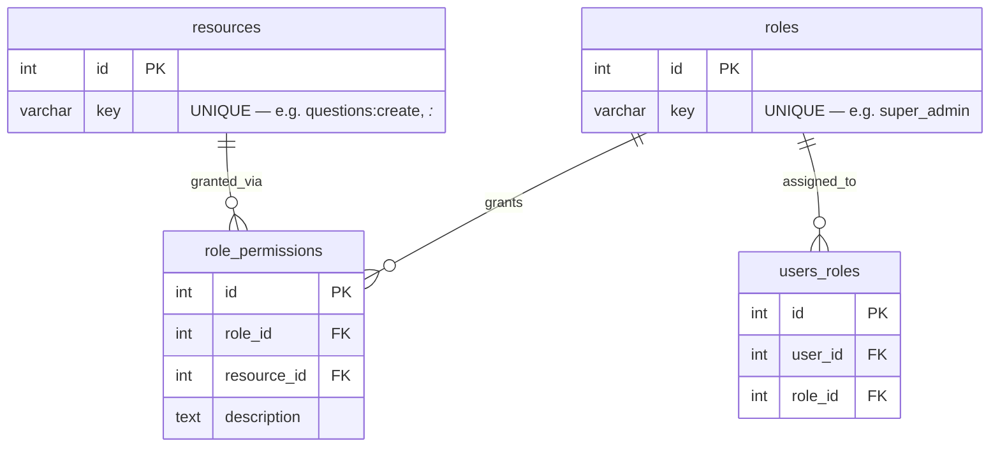
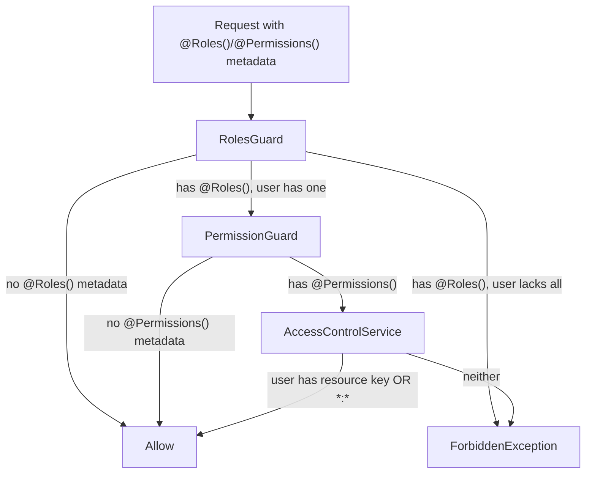

# HLD — RBAC Module

## 1. Purpose

`RbacModule` provides role/resource/permission management and the two guards (`RolesGuard`, `PermissionGuard`) that enforce authorization globally across the app, layered on top of `AuthModule`'s authentication (`JwtAuthGuard`).

## 2. Model

RBAC here is **role → resource**, not the classic `role → permission → resource` triple. A "resource" is a composite string key like `questions:create` — there is no separate `permissions` table; `resources.key` doubles as the permission identifier.



A resource key of `*:*` is the wildcard — any role holding it passes every permission check, regardless of the specific resource requested.

## 3. Guards



Both guards are registered globally via `APP_GUARD` and run on **every** request, but both are no-ops unless the route carries the relevant decorator metadata:

- **`RolesGuard`** reads `@Roles(...keys)` — currently **no controller in the codebase uses `@Roles()`**, so this guard passes through unconditionally everywhere today. It exists and is wired, but is inert.
- **`PermissionGuard`** reads `@Permissions(...keys)` (format `resource:action`, built from `RbacResource`/`RbacAction` enums) — actively used by the `questions`, `rbac`, and user-role-assignment controllers. `assessments`/`attempts`/`commerce`/`payments` controllers do not use it; they rely on bearer auth + service-level ownership checks instead (or, for `plans`, `@Permissions('plans:...')` even though `plans` isn't part of the seeded resource matrix — see §5).

`AccessControlService.userHasPermission(userId, permission)` — the check both guards ultimately rely on for permissions — runs:

```sql
SELECT 1 FROM users_roles ur
JOIN roles r ON r.id = ur.role_id
JOIN role_permissions rp ON rp.role_id = r.id
JOIN resources res ON res.id = rp.resource_id
WHERE ur.user_id = $1 AND (res.key = $2 OR res.key = '*:*')
LIMIT 1;
```

`PermissionGuard` requires **all** listed permissions (AND semantics) — it throws on the first one that fails.

## 4. Endpoints

See [API Design — RBAC Module](../api-design/v1.md#rbac-module) for the full endpoint table (roles, resources, role-permissions, access-check CRUD). All of them require the caller to already hold the relevant `roles:*`/`resources:*`/`permissions:*` permission — i.e. RBAC management is itself gated by RBAC, so a fresh deployment must bootstrap a `super_admin` user (via `npm run bootstrap-admin`) before anyone can manage roles through the API.

## 5. Seed Data

Out of the box, exactly one role and 21 resources are seeded (`DatabaseSeeder`, run via `npm run seed`):

- **Role**: `super_admin`
- **Resources**: `*:*` plus the 4-action CRUD matrix (`read`/`create`/`update`/`delete`) for `users`, `roles`, `permissions`, `resources`, `questions` — 20 keys.
- **Grant**: `super_admin` → `*:*` (blanket access).

Notable gap: `RbacResource.PLANS` is defined in the enum (`src/common/enums/rbac-resource.enum.ts`) but is **not** included in the seeded resource matrix — if `plans:create`/`plans:update` are to be enforced via `@Permissions()` on the commerce Plans controller, those resource rows must be created manually via `POST /v1/resources` before any non-wildcard role can be granted them. `super_admin` is unaffected since it holds the `*:*` wildcard.

Any role beyond `super_admin` (e.g. an "instructor" or "participant" role with a narrower resource set) must be created through the `/v1/roles` and `/v1/roles/:roleKey/permissions` endpoints post-deployment — there is no second default role seeded.

## 6. Bootstrap Ordering

`RolesSeeder` → `ResourcesSeeder` → `RolePermissionsSeeder` must run in that order (each depends on the previous existing). `npm run bootstrap-admin -- --email <e> --password <p>` then creates exactly one `super_admin` user — the script explicitly enforces "only one super admin is allowed" and fails if a different user already holds that role. Question seeding (`QuestionsSeeder`) also depends on a `username: 'system'` user existing, so in practice: seed → bootstrap-admin → (re-run seed if question seeding was skipped the first time).

## 7. Open Gaps

1. `RolesGuard`/`@Roles()` is fully wired but unused — either adopt it for coarser role-based gating or remove it to reduce surface area.
2. `RbacResource.PLANS` is defined but not seeded — decide whether Commerce's Plans endpoints should be brought into the standard resource-seeding matrix.
3. No endpoint lists which users hold a given role, or which roles a set of users hold in bulk — only per-user (`GET /v1/users/:username/roles`) and per-role (`GET /v1/roles/:roleKey/permissions`) views exist today.

## 8. Related Pages

- [Architecture](../architecture.md)
- [ERD — Identity & RBAC](../erd.md#1-identity--rbac)
- [API Design v1 — RBAC Module](../api-design/v1.md#rbac-module)
- [HLD — Authentication](auth.md)
