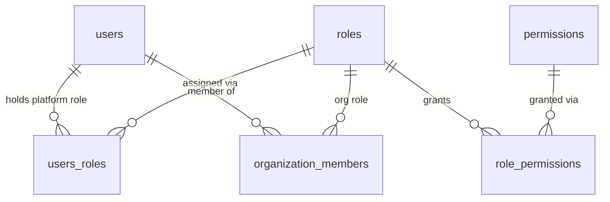
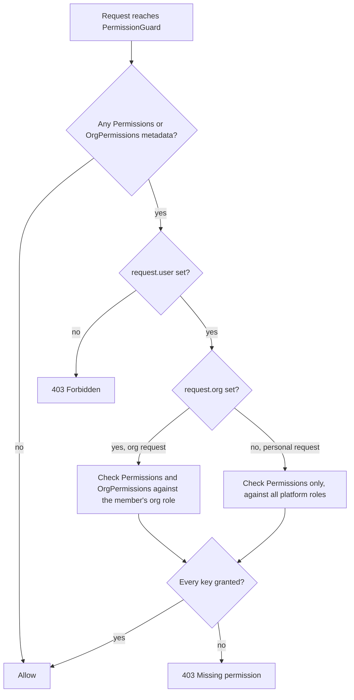

# RBAC (Roles and Permissions)

## 1. Purpose

RBAC means **role-based access control**. Users are not given rights one by one. A user holds a **role**, and the role grants a list of **permissions**.

[Authentication](auth.md) answers "who is calling?". RBAC answers "**may this caller do this action?**".

TestFlow has two kinds of roles that share one permission list:

- **Platform roles**, such as `super_admin`. They apply to the whole product and mostly guard the `/v1/admin/...` routes.
- **Organization roles**, such as `org_admin`. A user holds one of these per organization, through their membership. They apply only when a request acts inside that organization. See [Organizations](organizations.md).

## 2. Key terms

| Term | Meaning |
|---|---|
| **Resource** | A kind of thing, such as `questions`, `users` or `org_members`. The list is the `RbacResource` enum in `src/common/enums/identity.enums.ts`. |
| **Action** | What you do to a resource: `read`, `create`, `update` or `delete`. (`upload` and `export` are in the enum but no resource uses them.) |
| **Permission key** | `resource:action`, for example `questions:update`. One row in `permissions`. |
| **Role** | A named set of permissions, for example `super_admin` or `org_member`. One row in `roles`. |
| **Scope** | `platform` or `organization` (`RbacScope`). It says where a role is held. |
| **Platform role** | Held through `users_roles`. Checked on normal (personal) requests. |
| **Org role** | Held through `organization_members.role_id`. Checked when the request acts in an organization. |
| **Built-in role** | A role seeded by the app, with `organization_id = NULL`. All organizations share the built-in org roles. |

## 3. Data it uses

See the [ERD](../erd.md) for the full columns. Short version:

| Table | Notes |
|---|---|
| `roles` | `key`, `scope`, `organization_id`. Built-in keys are unique among live rows with `organization_id IS NULL`. A custom org role would be unique per `(organization_id, key)`, but no API creates custom org roles yet. |
| `permissions` | `key` is unique, plus an optional `description`. |
| `role_permissions` | Links a role to a permission. It has a `meta` jsonb column with `implicitPermissions`, but **no code reads it**. |
| `users_roles` | Links a user to a **platform** role. Soft-deletable. |
| `organization_members` | `role_id` holds the member's org role. See [Organizations](organizations.md). |

## 4. Roles and permissions

### 4.1 Built-in roles

These are seeded by `src/seeders/role.seeder.ts`.

| Role key | Scope | What it is for |
|---|---|---|
| `super_admin` | platform | Full platform admin. It is granted **every** permission key in the catalog. |
| `beta_tester` | platform | Grants no permissions. Its only use is to switch on feature flags that target it (see [Platform services](platform-services.md)). |
| `org_owner` | organization | Owner of an organization. Exactly one per organization, set when the organization is created. |
| `org_admin` | organization | Manages the organization, its members and its assessments. |
| `org_member` | organization | Normal member. The role every invite gives. |

`super_admin` and the three org roles are **protected**. The admin API will not rename or delete them. `beta_tester` is not protected.

### 4.2 The permission catalog

The source of truth is `RBAC_RESOURCE_ACTIONS` in `src/identity/rbac/constants/resource-actions.constant.ts`. The seeder creates one `permissions` row for each pair. CRUD means read, create, update and delete.

| Resource | Actions | Used for |
|---|---|---|
| `users` | CRUD | Admin user list and platform role changes |
| `roles` | CRUD | Admin role routes |
| `permissions` | CRUD | Admin role-permission routes and access check |
| `questions` | CRUD | Admin question bank |
| `plans` | CRUD | Admin plans |
| `features` | read | Plan features |
| `support_tickets` | read, update | Admin support tickets |
| `tags` | CRUD | Admin tags |
| `assessment_prompts` | CRUD | Admin prompts |
| `newsletters` | read, create, delete | Admin newsletters |
| `ai_models` | CRUD | Admin AI models |
| `llm_audits` | read | Admin LLM audit logs |
| `organizations` | read, create, update | Admin organization routes |
| `org_settings` | read, update | Organization details, inside an org |
| `org_members` | CRUD | Members and invitations, inside an org |
| `org_assessments` | CRUD | Organization assessments, inside an org |
| `org_billing` | read, update | Organization subscription and usage, inside an org |
| `payments`, `subscriptions`, `usage` | read | Admin views of commerce records |
| `assessment_attempts` | read, update | Review attempts (list, reject). Shared by platform and org roles. |
| `assessment_attempt_responses` | read | Read the answers of an attempt. Shared by platform and org roles. |
| `assessments` | read | Admin list of all assessments |
| `stats` | read | Admin overview numbers |
| `feature_flags` | read, update | Admin feature flags |

An old `*:*` "wildcard" permission may still be in older databases. The guards **do not** treat it as a wildcard. `SuperAdminPermissionsSeeder` replaces it with explicit grants and removes it.

### 4.3 Default grants for org roles

These come from `ORG_ROLE_DEFAULT_PERMISSIONS` in the same constants file.

| Permission | `org_owner` | `org_admin` | `org_member` |
|---|:-:|:-:|:-:|
| `org_settings:read` | yes | yes | yes |
| `org_settings:update` | yes | yes | |
| `org_members:read` | yes | yes | yes |
| `org_members:create` / `update` / `delete` | yes | yes | |
| `org_assessments:read` | yes | yes | yes |
| `org_assessments:create` | yes | yes | yes |
| `org_assessments:update` / `delete` | yes | yes | |
| `org_billing:read` | yes | yes | |
| `org_billing:update` | yes | | |
| `assessment_attempts:read` / `update` | yes | yes | |
| `assessment_attempt_responses:read` | yes | yes | |

The org seeder only **adds** missing grants. It never removes any. So if a platform admin changes an org role's permissions through the API, a later `npm run seed` keeps the change. Built-in org roles are shared, so **a change applies to every organization at once**.

### 4.4 Seeding order

`npm run seed` runs `src/seeders/index.ts` in this order:

1. `RolesSeeder`: create the built-in roles if they are missing.
2. `PermissionsSeeder`: create a permission row for every catalog pair.
3. `SuperAdminPermissionsSeeder`: grant `super_admin` every catalog key and remove the legacy `*:*`. Runs in one transaction.
4. `OrgRolePermissionsSeeder`: add the default org grants. Runs in one transaction.
5. Then the features, plans, AI models and feature flags seeders.

After seeding, create the first admin with `npm run bootstrap-admin` (see [Auth](auth.md#9-bootstrapping-the-first-admin)).

## 5. Decorators

| Decorator | File | Meaning |
|---|---|---|
| `@Roles(...keys)` | `src/identity/rbac/decorators/roles.decorator.ts` | The caller must hold **at least one** of these **platform** roles. |
| `@Permissions(...keys)` | `src/identity/rbac/decorators/permissions.decorator.ts` | The caller must have **all** these permissions. Checked against platform roles on a personal request, or against the org role on an org request. |
| `@OrgPermissions(...keys)` | `src/identity/rbac/decorators/org-permissions.decorator.ts` | Extra permissions checked **only** when the request acts in an organization. A personal request skips them. |
| `@Public()` | `src/common/decorators/public.decorator.ts` | Skip authentication. See [Auth](auth.md). |
| `@OrgScoped()`, `@OrgHeaderScoped()` | `src/organizations/decorators/` | Make the request act in an organization. See [Organizations](organizations.md#7-org-context-how-a-request-picks-its-organization). |

When the handler and the controller both have the same decorator, the handler's value wins (`getAllAndOverride`). The two lists are not merged.

Today `@Roles` is used in only one place: `@Roles('super_admin')` on `POST /v1/admin/questions/generate` in `src/assessments/questions/admin.controller.ts`. Everything else uses permissions.

## 6. How the guards decide

All guards are global (`APP_GUARD` in `src/app.module.ts`) and run in this order:

`JwtAuthGuard` → `RateLimitGuard` → `RolesGuard` → `OrgContextGuard` → `PermissionGuard`

### 6.1 RolesGuard

File: `src/identity/rbac/guards/roles.guard.ts`.

1. Read `@Roles` from the handler, or from the class if the handler has none. If it is empty, allow.
2. If there is no `request.user`, deny (403).
3. Load the user's **platform** role keys (`AccessControlService.getUserRoleKeys`).
4. If the user holds any required role, allow. Otherwise: `403 Insufficient role`.

`RolesGuard` runs **before** `OrgContextGuard`. It never looks at org roles.

### 6.2 PermissionGuard

File: `src/identity/rbac/guards/permission.guard.ts`.

1. Read `@Permissions` (required) and `@OrgPermissions` (org-only). If both are empty, allow.
2. If there is no `request.user`, deny (403).
3. Look at `request.org`. `OrgContextGuard` sets it when the request acts in an organization.
4. Build the list to check:
    - **Org request** (`request.org` is set): `@Permissions` plus `@OrgPermissions`.
    - **Personal request**: `@Permissions` only.
5. Check each key, one at a time:
    - **Org request**: `roleHasPermission(org.roleId, key)`. This is the member's org role only.
    - **Personal request**: `userHasPermission(userId, key)`. This means any of the user's platform roles.
6. The first missing key fails with `403 Missing permission: <key>`.

### 6.3 The two SQL checks

Both are in `src/identity/rbac/services/access-control.service.ts`, and both are a single `COUNT` query:

- `userHasPermission`: `users_roles` → `roles` → `role_permissions` → `permissions`, filtered by user id and key.
- `roleHasPermission`: `role_permissions` → `permissions`, filtered by role id and key.

**There is no cache.** Each key on a route costs one query, on every request. A role or permission change takes effect on the very next request.

## 7. Platform roles and org roles together

This is the part people most often get wrong:

1. **Inside an organization, platform roles do not count.** If a route acts in an org, `@Permissions` is checked against the member's org role. Even a `super_admin` gets `403` (or `404` from `OrgContextGuard` if they are not a member).
2. **Outside an organization, org roles do not count.** A personal request only looks at platform roles.
3. **Some keys are shared.** `assessment_attempts:*` and `assessment_attempt_responses:read` are granted to `super_admin` (platform) and to `org_owner` / `org_admin` (org). The same route checks whichever role applies to the request.
4. **`@OrgPermissions` adds a check only in org mode.** For example, `POST /v1/assessments` has `@OrgHeaderScoped()` and `@OrgPermissions('org_assessments:create')`. A personal request needs nothing extra. A request with the `x-organization-id` header needs that org permission.
5. **Some checks live in services, not guards.** For example, editing an org assessment needs `org_assessments:update` **unless** you created it. The route checks `org_assessments:read`, and `AssessmentsService` checks the rest (`ORG_ASSESSMENT_MANAGE_PERMISSIONS` in `src/assessments/assessments.constants.ts`). See [Assessments](assessments.md).
6. `GET /v1/orgs` returns each org with the caller's role and the permission keys it grants, so the frontend can show or hide buttons. The list is empty while the membership or the org is suspended.

## 8. Admin endpoints

All of these are in `src/identity/rbac/admin.controller.ts` under `/v1/admin`, with the CLASS_C rate limit. They only work on **built-in** roles (`organization_id IS NULL`), of both scopes. The [API reference](../api-design/v1.md) has the full details.

| Method and path | Permission | Purpose |
|---|---|---|
| `GET /roles` | `roles:read` | List built-in roles |
| `GET /roles/:roleKey` | `roles:read` | One role |
| `POST /roles` | `roles:create` | Create a role. Body: `{ key, scope? }`. `scope` defaults to `platform`. |
| `PATCH /roles/:roleKey` | `roles:update` | Rename a role (`{ key }`) |
| `DELETE /roles/:roleKey` | `roles:delete` | Soft-delete a role |
| `GET /roles/:roleKey/permissions` | `permissions:read` | The keys a role grants |
| `PUT /roles/:roleKey/permissions` | `permissions:update` | Replace all of a role's keys. Body: `{ permissions: [...] }`. |
| `POST /roles/:roleKey/permissions/:permissionKey` | `permissions:create` | Grant one key |
| `DELETE /roles/:roleKey/permissions/:permissionKey` | `permissions:delete` | Revoke one key |
| `GET /permissions` | `permissions:read` | The full catalog, sorted by key |
| `POST /access-check` | `permissions:read` | `{ roleKey, permissionKey }` returns `{ allowed }` |

Platform role assignment to users is on the user admin routes. See [Auth](auth.md#7-endpoints-summary).

## 9. Business rules and edge cases

1. Protected roles (`super_admin`, `org_owner`, `org_admin`, `org_member`) cannot be renamed or deleted (`403`).
2. You cannot delete a role that you hold (`403`).
3. You cannot change the permissions of a role that you hold, **unless you are `super_admin`** (`403`). So a `super_admin` can edit `super_admin`'s own permissions, and could remove their own access.
4. You cannot add or remove **your own** platform roles (see [Auth](auth.md)).
5. Role keys must be unique among live built-in roles (`409`). Up to 100 characters.
6. `PUT .../permissions` with an unknown key fails with `404` and lists the missing keys. Nothing changes.
7. `PUT .../permissions` with an empty list removes every grant from the role.
8. Changing a built-in org role changes it for **every** organization.
9. `POST /roles` can create a built-in role with scope `organization`. Org admins can then give it to members with `PATCH /v1/orgs/:orgUid/members/:userId`, because that route accepts any built-in org role except `org_owner`. A new role starts with no permissions, so a platform admin must grant some first.

## 10. Async events

None. RBAC is fully synchronous and uses the database only.

## 11. Where the code lives

| Path | What |
|---|---|
| `src/identity/rbac/guards/roles.guard.ts` | `RolesGuard` |
| `src/identity/rbac/guards/permission.guard.ts` | `PermissionGuard` |
| `src/identity/rbac/decorators/` | `@Roles`, `@Permissions`, `@OrgPermissions` |
| `src/identity/rbac/services/access-control.service.ts` | The permission queries |
| `src/identity/rbac/services/user-roles.service.ts` | `holdsRole`, `isSuperAdmin` |
| `src/identity/rbac/constants/resource-actions.constant.ts` | Permission catalog and default org grants |
| `src/identity/rbac/admin.controller.ts`, `admin.service.ts` | Admin role routes |
| `src/common/enums/identity.enums.ts` | `RbacResource`, `RbacAction`, `SystemRole`, `OrgRole`, `RbacScope` |
| `src/seeders/role.seeder.ts`, `permission.seeder.ts`, `super-admin-permissions.seeder.ts`, `org-role-permissions.seeder.ts` | Seed data |
| `tests/unit/identity/rbac/` | Unit tests |

## 12. Known gaps and TODOs

1. **`PUT /roles/:roleKey/permissions` is not wrapped in a transaction** (`src/identity/rbac/admin.service.ts`, `replaceRolePermissions`). It deletes all grants and then inserts the new ones. If the insert fails, the role is left with no permissions.
2. **Mixed delete styles.** `PUT` hard-deletes `role_permissions` rows, but `DELETE .../permissions/:key` soft-deletes them.
3. **Deleting a role leaves its links behind.** `DELETE /roles/:roleKey` soft-deletes the role but not its `users_roles` or `role_permissions` rows. `AccessControlService.getUserRoleKeys` then reads `ur.role.key`. If TypeORM leaves the soft-deleted role out of the join, `role` is undefined and the code crashes. This affects `RolesGuard` (the `@Roles` route) for users who held the deleted role. Needs a test.
4. **No caching.** Every permission check is a database query.
5. **`role_permissions.meta.implicitPermissions` is never read.** For example, `update` does not imply `read`.
6. **No API for custom org roles.** The schema supports roles with an `organization_id`, but nothing creates them.
7. **`RbacAction.UPLOAD` and `EXPORT`** are defined but unused.
8. **`@Roles('super_admin')`** uses a string literal instead of `SystemRole.SUPER_ADMIN`.
