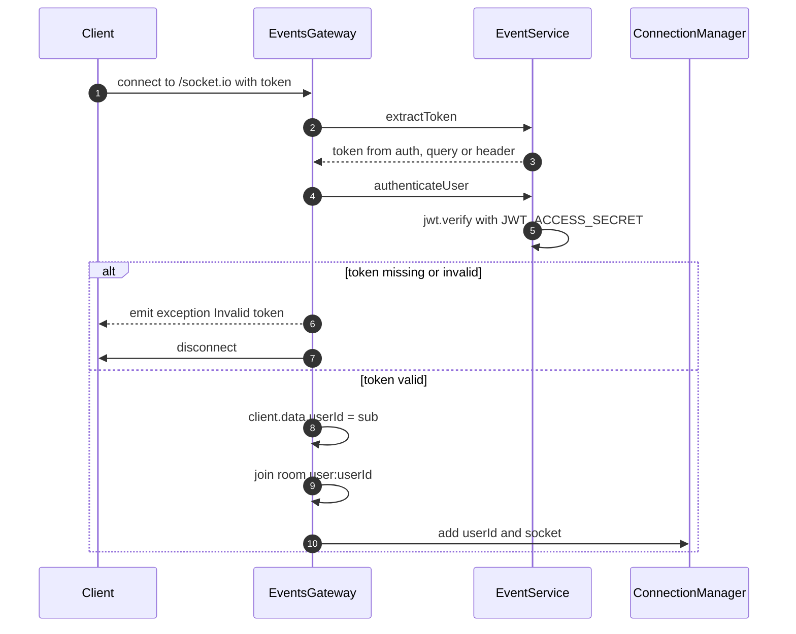
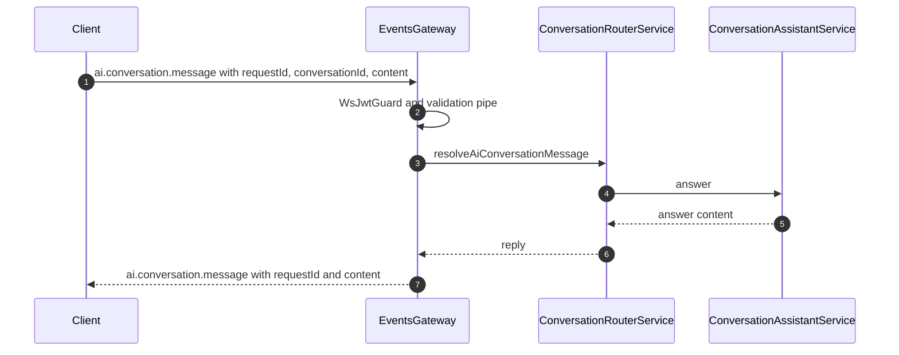
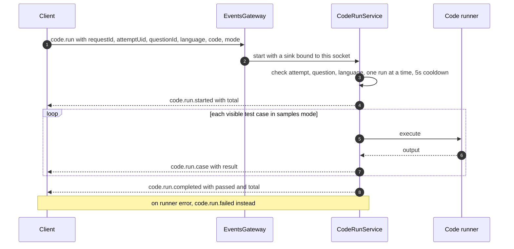
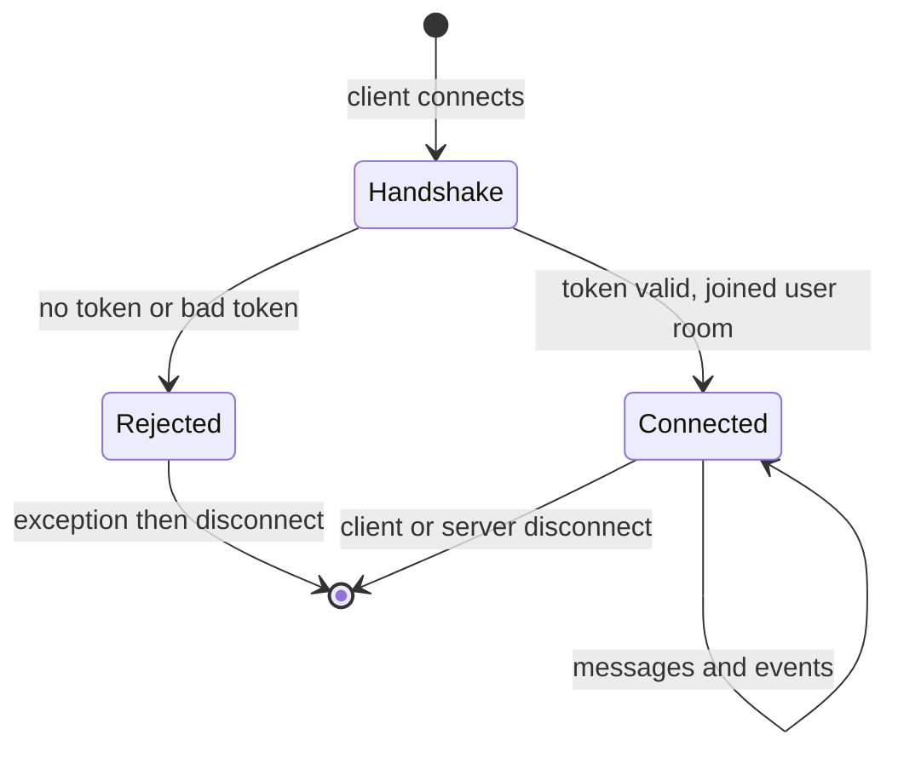

# Realtime Events (Socket.IO)

## 1. Purpose

Most of TestFlow works over plain HTTP. Background work (AI generation, evaluation) is followed by polling `GET /v1/jobs/:id`. The WebSocket layer is used only where polling would be slow or clumsy:

- **AI assistant chat.** The client sends a message and gets the assistant's answer back on the same socket.
- **Running code during an attempt.** Test-case results stream back one by one as they finish.
- **Push notices for background work.** Today there is one: the result of a bulk organization invitation import.

The layer uses [Socket.IO](https://socket.io/) through NestJS's `@nestjs/websockets` package. All of it lives in `src/events/`.

## 2. Key concepts

| Term | Meaning |
|---|---|
| Gateway | `EventsGateway`, the one NestJS WebSocket gateway. It accepts connections and handles incoming messages. |
| Handshake | The first request a Socket.IO client makes. The JWT is checked here, and only here. |
| Room | A named group of sockets. The server can send to a room instead of to a single socket. |
| User room | `user:<userId>`. Every socket a user opens joins it, so one emit reaches all of that user's tabs. |
| `requestId` | A client-made id (letters, digits, `-`, `_`, max 64 characters) sent with a message and echoed back in replies and errors. It lets the client match replies to requests. |
| `exception` | The standard Socket.IO event name NestJS uses for error frames. |

## 3. Data

The gateway stores nothing in the database. State is kept in memory:

- `client.data.userId`: the authenticated user for a socket.
- `ConnectionManager`: a `Map<userId, Set<socket>>` of open sockets. It has `isOnline(userId)` and `get(userId)` helpers, but no other code uses them today.

AI conversations and attempts are stored by their own modules. See [AI Assistant](ai-assistant.md) and [Attempts](attempts.md).

## 4. Flows

### 4.1 Connection and authentication



The client can send the access token in one of three ways. They are checked in this order:

| Order | Client code | Where the server reads it |
|---|---|---|
| 1 | `io(url, { auth: { token } })` | `handshake.auth.token` (recommended) |
| 2 | `io(url, { query: { token } })` | `handshake.query.token` |
| 3 | `io(url, { extraHeaders: { Authorization: 'Bearer ...' } })` | `handshake.headers.authorization` |

Important details:

- The token is the normal **access token** from login. It is checked once, at connect time. A socket stays open even after the token expires. The client should reconnect with a fresh token after refresh.
- The handshake only checks the JWT signature and expiry. It does **not** check that the account is still active. The HTTP `JwtAuthGuard` does check this.
- `WsJwtGuard` (`src/events/guards/WsJwtGuard.guard.ts`) runs on each message handler. It does not re-verify the JWT. It only checks that the handshake set `client.data.userId`. If not, it throws `WsException('Unauthorized')`.
- On disconnect, the socket is removed from `ConnectionManager`.

### 4.2 AI conversation message



The reply goes back to the **sending socket only**, under the same event name. An LLM answer takes several seconds, so a client may have more than one message in flight. It uses `requestId` to match each reply.

### 4.3 Code run



If the run is refused before it starts (bad attempt, wrong language, a run already in progress, or cooldown), the client gets an `exception` frame, not `code.run.failed`. See [Code Execution](code-execution.md) for how runners work.

### 4.4 Push to a user

Any module can import `EventsModule` and call:

```ts
eventsGateway.emitToUser(userId, eventName, data)
```

This emits to the room `user:<userId>`, so every open tab of that user receives it. Today only the organizations module uses it.

## 5. Lifecycle



## 6. Message reference

### 6.1 Client → server messages

| Event | Payload | Validation | Reply |
|---|---|---|---|
| `ai.conversation.message` | `{ requestId, conversationId, content }` | `requestId` and `conversationId`: `[A-Za-z0-9_-]`, max 64. `content`: string, max 4,000. | `ai.conversation.message` to the sender |
| `code.run` | `{ requestId, attemptUid, questionId, language, code, mode, stdin? }` | `attemptUid`: UUID v4. `questionId`: int ≥ 1. `language`: one of the coding languages. `mode`: `samples` or `custom`. `code` and `stdin`: max 50,000 characters. | `code.run.*` events to the sender |

DTOs: `src/events/dto/conversation-message.dto.ts` and `src/assessments/attempts/code-run/run-code.dto.ts`.

### 6.2 Server → client events

This is the full list, found by searching every `emit` and `emitToUser` call in `src/`.

| Event | Payload | Triggered by | Sent to |
|---|---|---|---|
| `exception` | `{ status: 'error', message, errors?, requestId?, retryAfterMs? }` | Bad handshake token, failed guard, failed validation, or any error thrown in a handler | The one socket |
| `ai.conversation.message` | `{ requestId, conversationId, userId, content, sentAt }` | Reply to the client's `ai.conversation.message` (`EventsGateway.handleAiConversationMessage`) | The sending socket |
| `code.run.started` | `{ requestId, mode, total }` | `CodeRunService` accepted the run | The sending socket |
| `code.run.case` | `{ requestId, index, input, expectedOutput, passed, status, stdout, stderr, exitCode, timeMs, memoryKb, outputTruncated }` | One visible test case finished (samples mode only) | The sending socket |
| `code.run.completed` | `{ requestId, mode, passed?, total?, output? }` (samples: `passed`, `total`. custom: `output`) | The run finished | The sending socket |
| `code.run.failed` | `{ requestId, reason, message }` | The runner failed mid-run (for example unavailable or busy). Results already sent still count. | The sending socket |
| `org.invitations.import.settled` | Completed: `{ jobId, status: 'completed', invited, skipped, failed }` (counts). Failed: `{ jobId, status: 'failed', reason }` | `OrganizationInvitationImportService.run` after a CSV import job finishes (`src/organizations/services/organization-invitation-import.service.ts`) | Room `user:<uploaderId>` |

Code-run payload types are in `src/assessments/attempts/code-run/code-run-events.interface.ts`. The import event name is `INVITATION_IMPORT_SETTLED_EVENT` in `src/organizations/organizations.constants.ts`. See [Organizations](organizations.md) for the import flow.

### 6.3 Error frames

All errors go out as the `exception` event. Two pieces shape them:

- **`wsValidationPipe`** (`src/events/pipes/ws-validation.pipe.ts`): a `ValidationPipe` with `whitelist`, `forbidNonWhitelisted` and `transform`. Unknown fields are rejected. A failure becomes `{ status: 'error', message: 'Validation failed', errors: [...] }`.
- **`WsExceptionFilter`** (`src/events/filters/ws-exception.filter.ts`): catches everything. It:
    - maps domain errors to HTTP exceptions with the shared `asHttpException` mapper, then turns them into `{ status: 'error', message }`;
    - turns class-validator message arrays into `message: 'Validation failed'` plus `errors`;
    - copies `retryAfterMs` when present (for example the code-run cooldown);
    - adds `requestId` from the raw incoming frame, but only if it passes the same pattern and length rules as the DTO. This is because the frame may have failed validation.

The socket stays open after an error frame. Only a bad handshake disconnects.

## 7. Endpoints summary

There are no REST endpoints. The Socket.IO server is mounted on the same HTTP server at path `/socket.io`. CORS is open to every origin (`origin: '*'`). Security relies on the JWT, not on origin checks.

## 8. Async events

The gateway does not consume RabbitMQ. A RabbitMQ consumer can push to a user through `emitToUser`. The invitation import consumer does this.

Background jobs for AI generation, evaluation and roadmaps do **not** emit socket events. Clients poll `GET /v1/jobs/:id` (see [Jobs and Schedulers](jobs-and-schedulers.md)).

## 9. Scaling notes

- **No Redis adapter.** `main.ts` uses the default in-memory Socket.IO adapter. A room exists only inside one Node process.
- **What this means for `emitToUser`.** With more than one app instance, the push only reaches sockets connected to the instance that emits. For the invitation import, the emitting instance is the one running the RabbitMQ consumer (`CONSUMER=true`), which may not be the instance holding the user's socket. Clients should treat the push as a hint and still poll the job.
- **Request and reply handlers are fine.** `ai.conversation.message` and `code.run` reply on the same socket, so they work on any number of instances. A load balancer still needs sticky sessions if clients can fall back to HTTP long-polling.
- **Code-run limits are per instance.** The "one run at a time" and 5-second cooldown rules are kept in memory in `CodeRunService`. A user connected to two instances could get around them.
- To scale out properly, add `@socket.io/redis-adapter` (a new package, which needs team approval) and a custom `IoAdapter` in `main.ts`.

## 10. Where the code lives

| Path | What it does |
|---|---|
| `src/events/events.gateway.ts` | Gateway: connect, disconnect, `ai.conversation.message`, `code.run`, `emitToUser` |
| `src/events/events.service.ts` | Token extraction and JWT verification for the handshake |
| `src/events/connection-manager.service.ts` | In-memory map of user → sockets |
| `src/events/conversation-router.service.ts` | Routes chat messages to the AI assistant |
| `src/events/guards/WsJwtGuard.guard.ts` | Per-message "is this socket authenticated" check |
| `src/events/pipes/ws-validation.pipe.ts` | Validation pipe for message bodies |
| `src/events/filters/ws-exception.filter.ts` | Turns any error into an `exception` frame |
| `src/events/interfaces/authenticated-socket.interface.ts` | `AuthenticatedSocket` type and `userRoom()` helper |
| `src/assessments/attempts/code-run/` | Code-run service, DTO and event types |

## 11. Known gaps and TODOs

- **No account-status check at handshake.** A deactivated user with a still-valid access token can open a socket. `EventService` injects `UsersService` but never uses it.
- **Token is never re-checked.** A socket opened with a token stays authenticated until it disconnects.
- **Single-instance only.** There is no Redis adapter, so `emitToUser` does not work across instances (see section 9).
- **Only one push event.** Generation, evaluation and roadmap jobs could push completion events instead of being polled, but they do not.
- **`ConnectionManager` is mostly unused.** It tracks sockets, but nothing reads `isOnline` or `get`.
