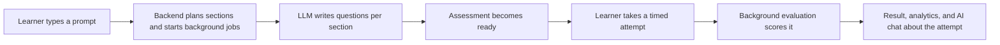

# TestFlow — Business Overview

**TestFlow** is a SaaS online assessment platform. It helps organizations create, deliver, and score tests at scale. It also lets any individual practice for an exam, a certification, or an interview on demand, by typing a single prompt.

---

## The problem it solves

Hiring teams, schools, and training providers spend a lot of time writing tests, sending them out, and marking them by hand. At the same time, people preparing for competitive exams or interviews struggle to find realistic practice that fits their exact topic. TestFlow solves both problems on one platform.

## Who it is for

| Audience                         | What they use TestFlow for                                                                              |
| -------------------------------- | ------------------------------------------------------------------------------------------------------- |
| Recruiters and HR teams          | Screening candidates with skill tests (MCQ, coding, written answers).                                   |
| Educators and training providers | Testing learners across a course or program.                                                            |
| Enterprises                      | Internal certifications, compliance tests, and performance reviews, run inside an organization account. |
| Individual learners              | Practicing any topic on demand and following an AI learning roadmap.                                    |

---

## Core value

1. **AI-powered test creation.** The creator describes what to test. An LLM writes the questions, answer options, correct answers, and coding test cases.
2. **Flexible configuration.** Creators choose question types (MCQ, coding, descriptive), sections, question counts, difficulty, positive and negative marks, duration, time windows, and participant limits.
3. **Automatic scoring.** MCQs are scored by rule, coding answers are run against test cases in a sandbox, and descriptive answers are graded by an LLM. All of it happens in the background after submission.
4. **Participant management.** Invite people by email, let them register, track each attempt, review responses, reject a suspicious attempt, and show a leaderboard.
5. **Teams and roles.** Organizations with owners, admins, and members. A permission system controls who can do what, both platform-wide and inside each organization.
6. **Subscription model.** Plans and quotas decide how many AI assessments and roadmaps a user can generate, which question types they can use, and which AI model they get.

---

## Key use case: prompt to practice

> _"I want to practice for UPSC Prelims. Give me a mock test right now."_

Any individual can type a prompt and sit a full, timed exam a few moments later. No admin setup or question bank is needed.

**Why it matters for the business**

- It opens a large **B2C channel**. Any student or job seeker can become a user without an organization.
- It drives **repeat usage**. Learners come back for new topics, which supports retention and plan upgrades.
- It makes TestFlow a **universal practice platform**, not only an enterprise testing tool.
- It builds a **data asset**. Performance data across topics can power adaptive learning later.

## Business model

TestFlow is a **B2B and B2C SaaS**. Revenue comes from tiered plans. A plan version lists features with limits, such as `AI_ASSESSMENT` (AI assessments per period), `AI_LEARNING_ROADMAP`, `AI_MODEL` (which LLM you get), and `ALLOWED_QUESTION_TYPES`. Payments go through **Razorpay**. See [Commerce](hld-design/commerce.md).

---

## What is built today

This table reflects the backend code as of the date at the top of this page.

| Area                                   | Status                | Notes                                                                                                                                                                                                           |
| -------------------------------------- | --------------------- | --------------------------------------------------------------------------------------------------------------------------------------------------------------------------------------------------------------- |
| Email + password auth                  | Built                 | Signup, email verification, login, refresh tokens, logout, forgot and reset password. See [Auth](hld-design/auth.md).                                                                                           |
| Google sign-in                         | Built                 | `POST /v1/auth/google` verifies a Google ID token. GitHub exists only as an enum value; there is no GitHub login flow.                                                                                          |
| RBAC                                   | Built                 | Platform roles (`super_admin`, `beta_tester`) and org roles (`org_owner`, `org_admin`, `org_member`) share one permission catalog. See [RBAC](hld-design/rbac.md).                                              |
| Organizations                          | Built                 | Create an org, invite members one by one or by CSV upload (processed in the background), manage roles, suspend orgs (admin). See [Organizations](hld-design/organizations.md).                                  |
| Manual assessments                     | Built                 | Create, edit, add questions, publish, invite, register, and manage participants. See [Assessments](hld-design/assessments.md).                                                                                  |
| AI assessment generation               | **Built**             | LLM-backed, through RabbitMQ. Auto or manual section layout, one job per section, retries, idempotency keys, and quota refunds on failure. See [AI Assessment Generation](hld-design/assessment-generation.md). |
| Question types                         | Built                 | MCQ, coding (with test cases), and descriptive. See [Questions & Tags](hld-design/questions-and-tags.md).                                                                                                       |
| Assessment templates and saved prompts | Built                 | Reusable section layouts and public or private prompts with tags.                                                                                                                                               |
| Attempts                               | Built                 | Start, answer, change answers, submit, results, analytics, leaderboard, and creator review or reject. See [Attempts](hld-design/attempts.md).                                                                   |
| Evaluation                             | Built                 | Background scoring split into MCQ, coding, and descriptive child jobs. See [Evaluation](hld-design/evaluation.md).                                                                                              |
| Code execution                         | Built                 | Live "run code" over WebSocket and judging at evaluation time, on Piston (self-hosted) or OnlineCompiler.io. See [Code Execution](hld-design/code-execution.md).                                                |
| Multiple LLM providers                 | Built                 | OpenAI, Anthropic, and Google through LangChain. Models live in the `ai_models` table and are picked per plan. See [AI Layer](hld-design/ai.md).                                                                |
| AI assistant                           | Built                 | Chat over WebSocket with read-only tools for assessments, attempts, roadmaps, and the user's profile. See [AI Assistant](hld-design/ai-assistant.md).                                                           |
| Learning roadmaps                      | Built                 | Intent analysis, requirement questions, graph generation, graph edits by prompt, node progress, notes, and node practice tests. See [Learning Roadmaps](hld-design/learning-roadmaps.md).                       |
| Plans, subscriptions, usage            | Built                 | Plan versions with features and limits, checkout, and usage counters.                                                                                                                                           |
| Payments                               | Built (Razorpay only) | Razorpay orders and signed webhooks. `STRIPE` and `AI_CREDITS` exist in enums but have no flow yet.                                                                                                             |
| Email                                  | Built                 | SMTP via Nodemailer, with admin template previews. See [Notifications](hld-design/notifications.md).                                                                                                            |
| Platform services                      | Built                 | Rate limiting, feature flags, health checks, admin stats, newsletters (cron), support tickets, and S3 storage. See [Platform Services](hld-design/platform-services.md).                                        |

### Not built yet

- GitHub login.
- Stripe payments and buying AI credits as a one-time order.
- Adaptive learning on top of performance data (a product idea, not code).
