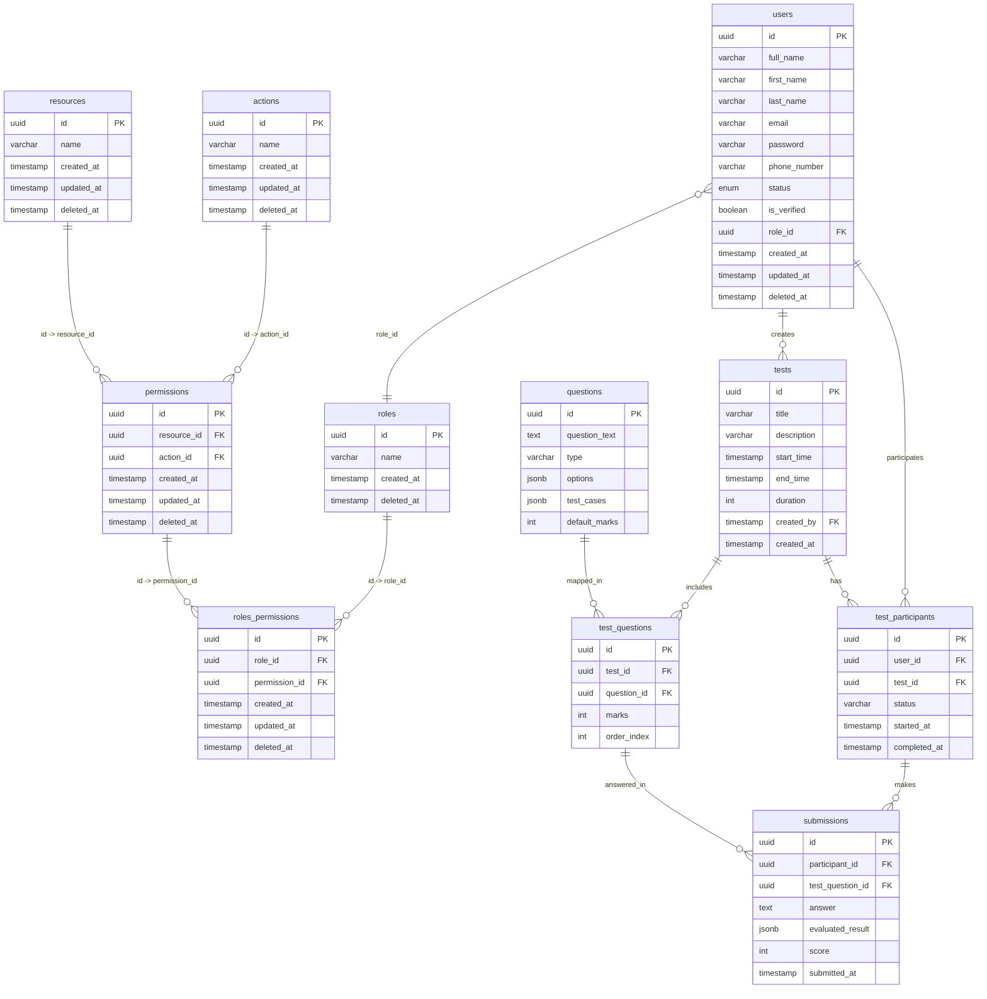
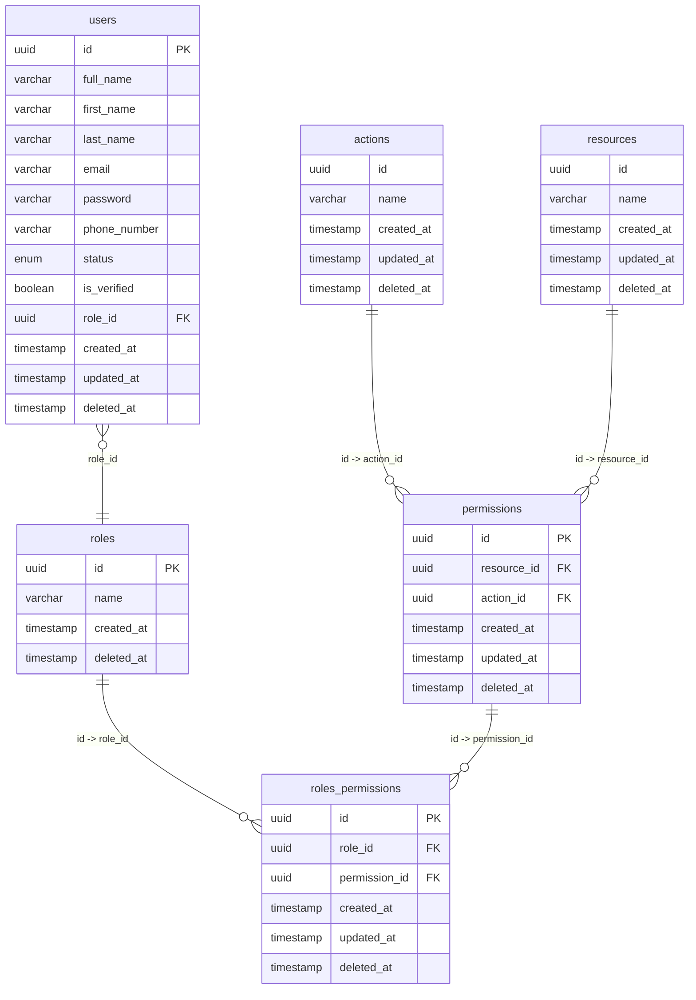
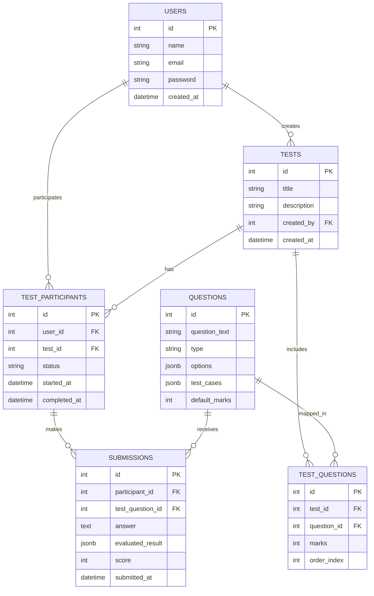

# Entity Relationship Diagram (ERD)

In this section, we will create an Entity Relationship Diagram (ERD) to visually represent the relationships between the entities in our database. An ERD is a graphical representation of the entities and their relationships in a database.

## v1

## Authentication and Authorization

## Test Management

